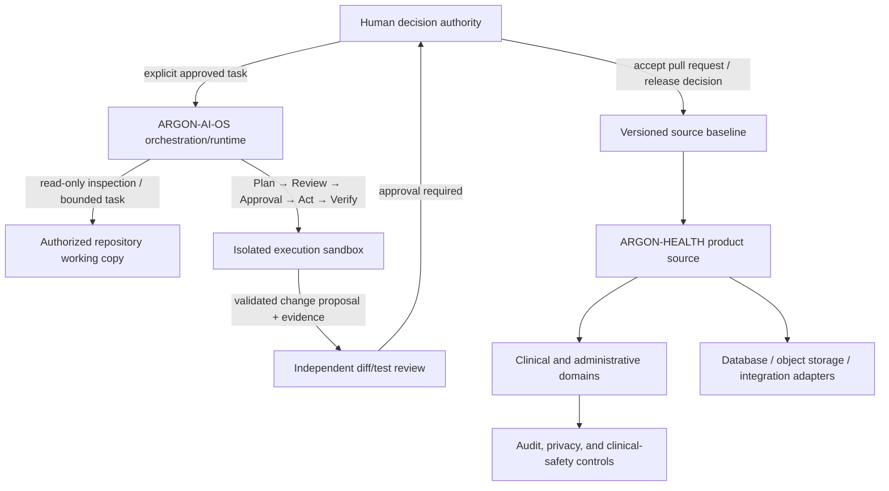
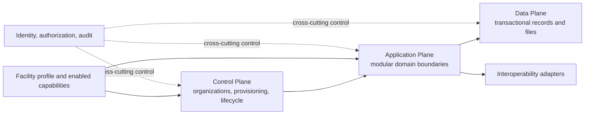

# ARGON Platform Foundry — Phase Zero Forensic Baseline

**Audit date:** 2026-10-17  
**Mode:** Read-only remote repository inspection  
**Scope:** `kkbb22/ARGON-AI-OS` and `kkbb22/ARGON-HEALTH`, kept strictly separate  
**Execution performed:** repository API/tree/file inspection and documented-state reconciliation only. No repository files, branches, settings, dependencies, workflow configurations, or Git history were changed. No application tests were executed during this audit.

---

## 1. Executive decision

### Overall result

**ARGON is currently at a design/governance stage, not an implemented healthcare platform or an operational engineering runtime.** The evidence supports a meaningful architecture and assurance-documentation foundation. It does not support claims that the target clinical application, multi-tenant authorization, clinical workflows, CI/CD, deployment, monitoring, or autonomous Plan/Act execution runtime exist.

The next safe action is not a rewrite or broad code generation. It is to finish the existing C1 synthesis task, reconcile and preserve the C2–C6 candidate evidence, obtain the C7 synthesis audit, and then obtain explicit human approval for any scoped runtime work. In parallel, keep the uploaded ARGON-HEALTH UI/UX reference as a separate intake artifact; it is not application code and is not present under its exact filename in either checked repository tree.

### Current remote baselines inspected

| Repository | Checked ref | `main` commit | Commit date | Result |
|---|---|---|---|---|
| [ARGON-AI-OS](https://github.com/kkbb22/ARGON-AI-OS/commit/71a3fa6d1fb1eed0e694886263710d4020e10341) | `main` | `71a3fa6d1fb1eed0e694886263710d4020e10341` | 2026-10-12 | Research/governance documents only; no runtime implementation |
| [ARGON-HEALTH](https://github.com/kkbb22/ARGON-HEALTH/commit/fb6e3e38a09769e434dd9a40fb6590c8903ed744) | `main` | `fb6e3e38a09769e434dd9a40fb6590c8903ed744` | 2026-10-10 | Target architecture and assurance tooling; no clinical application implementation |

**Inspection boundary:** these are remote GitHub `main` snapshots. The current state of any local Windows working tree, untracked files, local branches, editor buffers, and cloud work sessions cannot be observed from this remote read-only inspection. Therefore, “not present on `main`” must not be read as “does not exist in a local candidate.”

### Primary evidence links

- AI-OS status: [STATUS.md at audited commit](https://github.com/kkbb22/ARGON-AI-OS/blob/71a3fa6d1fb1eed0e694886263710d4020e10341/STATUS.md)
- AI-OS next actions: [planning/NEXT-ACTIONS.md](https://github.com/kkbb22/ARGON-AI-OS/blob/71a3fa6d1fb1eed0e694886263710d4020e10341/planning/NEXT-ACTIONS.md)
- AI-OS dependency register: [planning/DEPENDENCY-REGISTER.md](https://github.com/kkbb22/ARGON-AI-OS/blob/71a3fa6d1fb1eed0e694886263710d4020e10341/planning/DEPENDENCY-REGISTER.md)
- AI-OS existing forensic review: [C7-FFA-003.md](https://github.com/kkbb22/ARGON-AI-OS/blob/71a3fa6d1fb1eed0e694886263710d4020e10341/assurance/audits/C7-FFA-003.md)
- HEALTH repository boundary/status: [README.md](https://github.com/kkbb22/ARGON-HEALTH/blob/fb6e3e38a09769e434dd9a40fb6590c8903ed744/README.md)
- HEALTH governance board: [ARCHITECTURE-STATUS.md](https://github.com/kkbb22/ARGON-HEALTH/blob/fb6e3e38a09769e434dd9a40fb6590c8903ed744/docs/governance/ARCHITECTURE-STATUS.md)
- HEALTH implementation readiness: [FINAL-IMPLEMENTATION-READINESS.md](https://github.com/kkbb22/ARGON-HEALTH/blob/fb6e3e38a09769e434dd9a40fb6590c8903ed744/docs/audit/FINAL-IMPLEMENTATION-READINESS.md)
- HEALTH assurance baseline: [INITIAL-BASELINE-REPORT.md](https://github.com/kkbb22/ARGON-HEALTH/blob/fb6e3e38a09769e434dd9a40fb6590c8903ed744/docs/assurance/INITIAL-BASELINE-REPORT.md)
- HEALTH assurance matrix: [VERIFICATION-MATRIX.csv](https://github.com/kkbb22/ARGON-HEALTH/blob/fb6e3e38a09769e434dd9a40fb6590c8903ed744/docs/assurance/VERIFICATION-MATRIX.csv)
- HEALTH staged evolution: [ADR-019 reconciliation with ADR-000](https://github.com/kkbb22/ARGON-HEALTH/blob/fb6e3e38a09769e434dd9a40fb6590c8903ed744/docs/adr/ADR-019-RECONCILIATION-WITH-ADR-000.md)
- HEALTH “do not build yet” register: [DO-NOT-BUILD-YET.md](https://github.com/kkbb22/ARGON-HEALTH/blob/fb6e3e38a09769e434dd9a40fb6590c8903ed744/docs/audit/DO-NOT-BUILD-YET.md)

---

## 2. Repository inventory and actual implementation state

### 2.1 ARGON-AI-OS

The recursive tree at the audited `main` commit contains **104 entries: 79 files and 25 directories**. File-type inventory: 39 Markdown, 21 YAML, 3 HTML, 4 ZIP, 3 XLSX, 2 PNG, 2 PDF, 2 JSON, 1 CSV, 1 TXT, and 1 DOCX.

| Area | Evidence observed | Classification |
|---|---|---|
| C1–C6 research | Canonical research documents and manifests under `clouds/C1` through `clouds/C6` | `DESIGNED` / research baseline |
| C7 audit | `assurance/audits/C7-FFA-003.md` exists | Prior document-level forensic audit; it explicitly leaves experiments open |
| Planning | `planning/NEXT-ACTIONS.md`, `DEPENDENCY-REGISTER.md`, `OPEN-QUESTIONS.md` exist | Sequence and blockers documented |
| Future capability packs | Packs exist for some clouds; C6’s expected current pack is absent from the remote main tree | Mixed: `DESIGNED` / `PENDING` |
| Runtime/application code | No Java, JavaScript/TypeScript, Python, Go, Rust, SQL, or other product runtime source found in the tree | `NOT IMPLEMENTED` on this remote ref |
| Build/dependency files | No `pom.xml`, Gradle build files, `package.json`, lockfile, Dockerfile, Makefile, or IaC files found | `NOT IMPLEMENTED` |
| Test suite | No `tests/`, test files, or test harness found | `NOT IMPLEMENTED`; no runtime tests executed |
| CI/CD | No `.github/workflows/` or equivalent committed workflow files found; GitHub returned zero check runs/status contexts for this commit | No repository CI evidence at audited ref |
| Application deployment | No runtime manifest, infrastructure definition, environment configuration, or deployment implementation found | `NOT IMPLEMENTED` |
| C1 synthesis | `architecture/synthesis/ARGON-AI-OS-CROSS-CLOUD-SYNTHESIS.v2.md` is absent from main | `BLOCKED / PENDING C1` |
| Post-synthesis audit | `assurance/audits/C7-FFA-004.md` is absent from main | `NOT YET PERFORMED` for the synthesis artifact |

The repo’s own status file correctly says `DESIGNED_AND_AUDITED | NOT_IMPLEMENTED`, and the existing C7 report gives `CLEAN WITH OPEN EXPERIMENTS`. That is a document-level assurance result, not proof that an executable runtime is secure. See `STATUS.md`, `C7-FFA-003.md`, and `planning/NEXT-ACTIONS.md` at the audited commit.

**Dependencies still open in the repository’s registers:**

- C1 cross-cloud synthesis v2 remains pending.
- C6 future evaluation capability pack is listed as missing/pending.
- C7 final audit of the synthesis remains downstream work.
- RP-13 cryptographic approval/action binding has unresolved questions: key custody, identity binding, expiry, replay protection, revocation, and exact payload binding.
- The five-vector Plan/Act mutation test is specified but has never been executed against a runtime.
- Delegation depth and stale-state resumption/checkpoint rules still need runtime enforcement and/or experiments.
- The mutation-vector-5 taxonomy requires reconciliation in C1 synthesis.

### 2.2 ARGON-HEALTH

The recursive tree at the audited `main` commit contains **90 entries: 78 files and 12 directories**. File-type inventory: 68 Markdown, 6 CSV, 1 PNG, 1 XLSX, and 2 Python files.

The only executable source files in the tree are:

- `scripts/argon_assurance_lint.py` — a Python standard-library checker for assurance-register consistency and fail-closed readiness-gate bookkeeping.
- `tests/test_argon_assurance_lint.py` — unit tests for that checker.

The checker’s own module docstring explicitly says it does **not** test the ARGON application, conduct legal review, perform a penetration test, or certify clinical safety/compliance.

| Area | Evidence observed | Classification |
|---|---|---|
| Master architecture | `docs/master/01` through `20`, master blueprint, operational flows | Extensive target documentation; `PROPOSED` |
| Domain/workflow model | `03-MASTER-DOMAIN-MAP.md`, `05-MASTER-WORKFLOW-MAP.md` | Documented; not implemented |
| Architecture decisions | ADR index and standalone ADR documents | Mostly `PROPOSED`; approval not implied by presence |
| Assurance checker | `scripts/argon_assurance_lint.py` | Present in source; this is tooling, not the Health product |
| Checker tests | 35 `test_*` methods found in the current `tests/test_argon_assurance_lint.py` file | Test code exists; this audit did not run it |
| Clinical/application backend | No Java/Spring or other application runtime, no application API entry point | `NOT IMPLEMENTED` |
| Frontend/UI implementation | No HTML/JS/TS frontend application source or frontend package/build manifest | `NOT IMPLEMENTED` |
| Database | No SQL schema, versioned migration files, migration runner, or app DB config found | `NOT IMPLEMENTED` |
| Integrations | No executable FHIR/HL7/DICOM, payer, pharmacy, lab, imaging, or government adapters found | `NOT IMPLEMENTED` |
| Deployment/IaC | No Docker/build manifest, IaC, deployment config, or application release artifact found | `NOT IMPLEMENTED` |
| CI/CD | No committed `.github/workflows/` or equivalent CI workflow found; GitHub returned zero check runs/status contexts for the checked commit | No repository CI evidence at audited ref |
| Production operation | No deployed runtime evidence, production telemetry, restoration drill, or release sign-off in the audited tree | `UNVERIFIED / NOT IMPLEMENTED` |

The target repository README states directly that the target architecture is not an implemented system. The absence of application code is therefore not a surprise finding; it is a confirmed current-state boundary. Do not treat the assurance linter’s existence as evidence of application security.

### 2.3 Uploaded UI/UX reference

The uploaded file `ARGON_HEALTH_MASTER_UI_UX_EPIC_REFERENCE_2026.html` is present in this conversation environment, not under that exact name in either audited repository tree. Local file facts verified for this audit:

- Size: 648,290 bytes.
- SHA-256: `9d55b166c0285146168e5e821c1d2b0f1084f7586ca4081250e9fa3db68b35eb`.
- The HTML’s own landing section describes six embedded reference documents and explains that some imagery/content may load externally.

Classification: **design/reference intake**, not a production frontend, not a tested design system, and not proof that any Epic-like screen is implemented. It should be retained separately for later review and, if accepted, added to `ARGON-HEALTH` in a dedicated reviewed change. It should not be added to `ARGON-AI-OS` or treated as a product specification until requirements are mapped and accepted.

---

## 3. Architecture and trust-boundary maps

### 3.1 System responsibility boundaries

This is a **proposed logical separation**, not a diagram of a deployed architecture. In the inspected repositories, AI-OS runtime, sandbox, approval enforcement, Health application, and product data plane are not implemented.

### 3.2 ARGON-HEALTH target architecture

The repository’s target design separates Control Plane, Application Plane, and Data Plane, with modular-monolith-first guidance and facility capability configuration. That is an appropriate **candidate target** for a staged product, but all master-design decisions remain proposed in the status board and there is no app code to verify module boundaries or authorization.

Before implementation, map actual API/data ownership, trust boundaries, transaction guarantees, privileged paths, tenant context derivation, background jobs, exports, file access, and external adapter failure behavior to an accepted architecture and tests. A diagram or ADR is not runtime enforcement.

### 3.3 Security boundary for AI-OS

Plan/Act boundaries currently exist in research and specifications, not in a runtime. Until implemented and tested, no Cloud/persona should be given direct write-capable access to protected repositories based on prompt instructions alone. The actual runtime must control tool permissions, filesystem/process/network access, nested tool calls, approval identity, exact action binding, expiry, revocation, replay resistance, checkpoints, and post-action verification.

---

## 4. Findings and severity

Severity describes practical priority for the intended product and current evidence state; it does not mean every missing design item is a confirmed exploitable vulnerability.

### P0 — Stop conditions before implementation/release

**F-01 — Neither target system is implemented as an application/runtime.**  
**Status:** `VERIFIED` from repository inventory.  
**Evidence:** AI-OS tree has no product code/build/test/CI; HEALTH tree has only the assurance checker/test pair as executable code. HEALTH’s own `README.md`, `KIT-README.md`, and `FINAL-IMPLEMENTATION-READINESS.md` state the distinction.  
**Impact:** No clinical service or autonomous engineering execution can be declared functional, tested, secure, or production-ready on these repository snapshots.  
**Required response:** Treat architecture and assurance as design/tooling only. Scope and approve the first implementation increment separately after the stated gates.

**F-02 — C1/C7 closure is not present on AI-OS remote `main`.**  
**Status:** `VERIFIED` on checked ref; local candidate status not observed.  
**Evidence:** `planning/NEXT-ACTIONS.md` still lists C1 synthesis v2 as pending, C6 future capability pack as a required action, C7-FFA-004 as the post-synthesis audit, and runtime scaffold only after a clean C7 result. The target synthesis path and C7-FFA-004 path are absent from the tree.  
**Impact:** The runtime gate in the documented sequence has not been satisfied on main.  
**Required response:** Finish the existing C1 work; reconcile C2–C6 candidate inputs/manifests; obtain C7-FFA-004 against pinned, exact artifacts; do not begin the Wave 4 runtime scaffold until C7 certifies the synthesis clean and a human approves scope.

**F-03 — Health assurance gates are not product verification and deliberately have no evidence yet.**  
**Status:** `VERIFIED`.  
**Evidence at HEALTH main `fb6e3e3`:** 67/67 verification controls are `NOT_RUN`; 20/20 acceptance scenarios are `NOT_RUN`; 7/7 risk hypotheses are `OPEN` (3 Critical, 4 High); evidence, release sign-off, and operational revalidation registers each have zero data records. `docs/assurance/INITIAL-BASELINE-REPORT.md` states zero product assurance and expects the production gate to fail.  
**Impact:** No authorization to pilot or deploy; absence of evidence is not evidence of success. This is currently a documented starter state, not proof that controls were executed and failed.  
**Required response:** Keep fail-closed gates closed until real build-, environment-, release-, and scope-bound evidence is reviewed.

### P1 — Resolve before approving the relevant system baseline or exposing it to broader use

**F-04 — Potential operational secret/validation datum in a public archived screenshot requires owner verification.**  
**Status:** `PARTIALLY VERIFIED / LIVE STATUS UNKNOWN`.  
**Evidence:** `archive/external-health/Screenshot 2026-10-09 151504.png` is present in the public AI-OS tree. Prior inspection flagged that it shows administrative email/domain-management material and a DNS validation value. This audit has not proven that the value remains live or that it is an authentication credential.  
**Impact:** If it remains active, exposure may permit domain/DNS validation abuse or reveal operational identifiers.  
**Required response:** Through the relevant domain/account owner, determine whether the value is still valid; if active or uncertain, invalidate/regenerate the validation token and inspect account/DNS audit logs. Preserve evidence. Do not repeat the value, change repository visibility, delete files, or rewrite public Git history as part of this read-only audit; history/privacy remediation requires an explicit owner-approved action.

**F-05 — HEALTH governance counts/status records are inconsistent.**  
**Status:** `VERIFIED`.  
**Evidence:** `docs/master/03-MASTER-DOMAIN-MAP.md` contains 40 domain headings; `docs/governance/ARCHITECTURE-STATUS.md` reports 39 domains. `docs/audit/FINAL-IMPLEMENTATION-READINESS.md` reports 40. The master ADR index contains ADR-001 through ADR-024 (24 entries), while the architecture status board lists ADR-001 through ADR-023 (23 rows), omitting ADR-024. `docs/governance/ARCHITECTURE-FREEZE.md` still describes 23 master ADRs plus two standalone ADRs, while the current tree contains three files under `docs/adr/` (ADR-019, ADR-025, and ADR-MESSAGING-PLATFORM). ADR-025 explicitly says it is a proposed candidate pending decision-authority review and should not be added to frozen index/board until reviewed, so its pending/indexed status should remain explicit rather than assumed.  
**Impact:** Traceability and status dashboards can misstate the controlled decision/domain inventory. This is not a reason to rewrite frozen documents casually.  
**Required response:** Record a small evidence-backed reconciliation issue; follow `ARCHITECTURE-FREEZE.md`’s formal change process, have the human decision authority decide which frozen records are updated, and run the documented consistency scan after approved changes.

**F-06 — The governing ADR-000 trigger table is referenced but its source is external to HEALTH repository.**  
**Status:** `PARTIALLY VERIFIED / SOURCE NOT IN REPOSITORY TREE`.  
**Evidence:** `docs/adr/ADR-019-RECONCILIATION-WITH-ADR-000.md` names ADR-000 as the governing execution/staged-evolution authority; the repository tree does not contain the source ADR-000 file. `docs/audit/DO-NOT-BUILD-YET.md` records no fired triggers for the target build stages.  
**Impact:** This audit cannot independently reconstruct or validate every trigger row from the HEALTH repository alone. The target blueprint must not be treated as permission for a big-bang rewrite.  
**Required response:** Bring the exact canonical ADR-000 reference/version into the review evidence packet or provide its authoritative location; verify each trigger with actual evidence and owner approval before opening a build phase. Do not replace ADR-000 or infer that a trigger has fired.

**F-07 — Jurisdiction-specific compliance remains unverified.**  
**Status:** `VERIFIED` as a documentation gap; legal conformity itself is `UNKNOWN`.  
**Evidence:** `docs/compliance/COMPLIANCE-TRACEABILITY-MATRIX.md` marks jurisdiction rows including Jordan as requiring legal review, with implementation/tests/evidence not started or absent; `DO-NOT-BUILD-YET.md` likewise holds jurisdiction-specific retention and compliance matters open.  
**Impact:** No legal/regulatory compliance or health-sector licensing claim is supportable. The mention of a law/standard is not proof of compliance.  
**Required response:** Obtain current jurisdiction-specific legal/privacy and clinical-specialist determinations before any related production gate or public compliance claim. Keep global core separate from country-specific adapters.

**F-08 — Frontend design source exists outside the product repository; no implementation is present.**  
**Status:** `VERIFIED`.  
**Evidence:** The uploaded `ARGON_HEALTH_MASTER_UI_UX_EPIC_REFERENCE_2026.html` hashes to `9d55b166c0285146168e5e821c1d2b0f1084f7586ca4081250e9fa3db68b35eb` (648,290 bytes) in the conversation environment, but that exact path is absent from both inspected remote trees. HEALTH has no frontend source or front-end build manifest. The HTML describes itself as a combined reference and notes that some resources load externally.  
**Impact:** A reference HTML is not a maintained component library, working clinical UI, accessibility evidence, or accepted functional requirement set.  
**Required response:** Keep as a separately hashed reference artifact. Before an approved intake, review external assets, links, embedded content, provenance/licensing, privacy, and any script/frame behavior; then map screen requirements to prioritized workflows and design-system acceptance tests. Do not copy this file to AI-OS.

### P2 — Resolve as part of assurance/tooling hardening

**F-09 — Current assurance unit-test execution is not evidenced for the audited commit.**  
**Status:** `PARTIALLY VERIFIED`.  
**Evidence:** The current `tests/test_argon_assurance_lint.py` contains 35 methods named `test_*`; `INITIAL-BASELINE-REPORT.md`, dated 2026-10-10, records “5 passed” for its local validation run. GitHub returned zero check runs/status contexts on the inspected main commit and there are no committed CI workflow files. This audit did not execute tests. The older recorded count may describe an earlier/scoped run; it must not be silently generalized to the current 35-method suite.  
**Impact:** The checker is helpful assurance tooling, but its current head-by-head results and automated enforcement are unverified.  
**Required response:** In an approved, isolated validation job, run the existing standard-library test suite against the exact commit, record command/environment/exit code/output, and add CI only after human approval and permissions review. Do not make `G4`/`G5` pass by relaxing tests or populating fictitious evidence.

**F-10 — Potentially confusing retained research/duplicate archives in AI-OS.**  
**Status:** `VERIFIED`; impact depends on retrieval/use.  
**Evidence:** AI-OS contains 16 files under `archive/external-health/`, plus duplicate/superseded research artifacts. README says health/legacy assets were isolated under this archive and must not be merged into AI-OS requirements. This is structural separation but does not remove the material from the public repository.  
**Impact:** Future AI retrieval/context loaders may accidentally treat archived Health content as current AI-OS requirements; public archival material also expands the privacy/licensing review surface.  
**Required response:** Preserve archives as evidence for now. For future runtime retrieval, exclude the external-health archive by default and make source/project boundary metadata mandatory. Any history/content removal requires a separate owner-approved decision.

**F-11 — Performance, restoration, operational and clinical safety claims have no implementation evidence.**  
**Status:** `VERIFIED` for missing evidence, runtime behavior `NOT IMPLEMENTED / UNKNOWN`.  
**Evidence:** Health’s master design defers unmeasured NFR/RPO/RTO values and uses designed hazard/control models; assurance evidence and release records are empty.  
**Impact:** No realistic performance, clinical-safety, backup/restore, disaster-recovery, SLA/SLO, or production-readiness claim can be asserted yet.  
**Required response:** Establish workload profiles and business-approved objectives; validate them with representative synthetic data, fault tests, restore drills, clinical review, and a release-bound evidence record when implementation is authorized.

---

## 5. Implemented vs. planned capability matrix

| Capability | AI-OS | HEALTH |
|---|---|---|
| Architecture/specifications | Present; document-level C1–C6 research and C7-FFA-003 | Extensive target architecture and governance docs |
| Core application/runtime | `NOT IMPLEMENTED` | `NOT IMPLEMENTED` |
| Main business workflows running | None evidenced | None evidenced |
| Auth/authorization enforcement in product | Design/research only | Design only; no application endpoints to test |
| Tenant isolation / database RLS | No runtime/database | Design/test plan only; no database schemas/app DB roles |
| UI/frontend | Not applicable as the intended AI-OS core; no runtime UI evidenced | Design reference exists externally; no app frontend |
| Build/package/deploy pipeline | No build manifests or CI workflows | No app build/deploy manifests or CI workflows |
| Tests in repository | None found | Linter unit tests only; 35 current test methods, not executed in this audit |
| Automated security mutation tests | Specified on paper; no runtime and no test suite | Security/tenant tests catalogued, all NOT_RUN |
| Evidence records / release signoff | Existing design audit and hash manifests; no runtime test evidence | Evidence/signoff/revalidation registers empty |
| Production operations | None evidenced | None evidenced |

---

## 6. Proposed target architecture (design proposal, not implementation approval)

### 6.1 AI-OS engineering runtime

Use a minimal, auditable control loop rather than a self-authorizing autonomous agent:

1. Task intake records repository, base commit, permitted path/domain, task scope, and prohibited operations.
2. Context loader enforces repository boundaries and excludes unrelated/archived sources unless specifically authorized.
3. Read-only PLAN tools are capability-restricted at the runtime/tool layer.
4. REVIEW emits an exact proposed action/diff, tests, blast radius, and rollback/checkpoint reference.
5. Human APPROVAL binds to a narrowly defined action/change set, repository/ref, target paths, payload/diff or immutable digest, expiry, approver identity, and revocation state.
6. ACT runs inside an isolated workspace with least-privilege process, filesystem, network and credential access.
7. VERIFY runs policy, tests, secret scanning, diff checks, and mutation tests independently of the agent’s own claims.
8. Evidence is sealed to the actual commit/artifact/environment and emitted as a machine-readable report.
9. Merge/release remains a human-controlled operation until a separately approved and empirically validated governance policy says otherwise.

**Before sensitive action is enabled:** decide and implement signing/key custody, identity binding, nonce/replay protection, expiry/revocation, exact payload binding, delegation-depth enforcement, and checkpoint verification. Use established cryptographic libraries/protocols; do not invent a new cryptographic protocol ad hoc.

### 6.2 HEALTH product architecture

Retain the repository’s proposed staged, modular-monolith-first direction subject to human approval and ADR-000 triggers. The target model should keep:

- Control Plane: organization lifecycle, provisioning, tenant/facility capability configuration, privileged administrative operations.
- Application Plane: bounded clinical/administrative domains; module activation controls availability but is never a substitute for server authorization.
- Data Plane: transactional patient/clinical/financial records, appropriately separate object storage for large documents/images, migrations and audit history.
- Interoperability boundary: explicit, versioned adapters with contract tests, timeouts, retries, idempotency and safe failure handling.
- Cross-cutting controls: identity, server-side object/function authorization, tenant isolation, audit, consent, clinical safety, privacy, observability, recovery and release gates.

Start with a clinic-focused vertical slice only after the governing trigger and scope are evidenced and approved. Do not create every domain as a separate microservice; keep domain boundaries testable and deploy modularly until measured needs justify separation.

### 6.3 Product design system

Turn design research into an approved, versioned design system—not a pile of screens. Define semantic tokens, typography for Arabic/English, real RTL/LTR behavior, navigation, forms, tables, alerts, chart semantics, loading/empty/error/restricted states, accessibility, and component acceptance tests. Prioritize a complete clinic workflow before hospital-only breadth. Validate with representative clinician/reception users and synthetic data. Keep external assets and clinical claims traceable and licensed.

---

## 7. Phased implementation plan and acceptance gates

The stages below are proposed. They do not authorize implementation by themselves. No stage starts until its entry gate is met and the human decision authority approves the scope.

### Stage 0 — Forensic baseline and governance closure

**Work:** preserve exact repository SHAs, reconcile status counts and decision inventory, identify missing external governing documents, verify potential exposed operational value, inventory UI source material, and agree who can approve decisions/release evidence.

**Acceptance:**
- Exact repo/ref/commit is recorded for every artifact.
- Local worktree/branch and untracked candidate inventory is supplied by the owner before any local merge decision.
- ADR-000’s canonical source and trigger table are accessible and version-pinned.
- 40-domain vs 39-domain count is reconciled in an approved traceable update.
- ADR-024 is represented correctly in the governance status board via the formal freeze/change process.
- Potential DNS validation material is owner-verified; any live value is revoked/regenerated and audit logs reviewed.
- No application code or deployment performed in this stage.

### Stage 1 — Finish AI-OS design synthesis (current critical path)

**Work:** complete C1 Cross-Cloud Synthesis v2 from the canonical C1–C6 inputs; reconcile vector-5 taxonomy; include source-to-claim links; preserve unresolved RP-13/delegation and experiment status; complete missing C6 capability-pack work; preserve all candidate/history artifacts without overwriting prior evidence.

**Acceptance:**
- Every canonical input is bound to exact path/ref/hash and version.
- No unapproved change to canonical research documents.
- Every synthesis claim points to evidence or is explicitly labeled inference/open.
- Contradictions/open questions are listed; no guessed architecture resolution is represented as approved.
- C1 synthesis manifest/hash validates against the final artifact bytes.

### Stage 2 — Independent AI-OS audit

**Work:** C7 performs C7-FFA-004 against the exact candidate commit and synthesis, not against a vague branch/workspace.

**Acceptance:**
- C7 reproduces hashes and samples all material source-to-claim mappings.
- Vector-5, SWE-bench sourcing tension, RP-13, delegation depth and checkpoint gaps are correctly represented.
- Every blocker has owner, evidence required, and exit criteria.
- Verdict is clean for synthesis integrity; any conditions are documented, and the report hash/commit are recorded.
- No runtime scaffold starts unless this gate is clean and the human owner approves the runtime task.

### Stage 3 — AI-OS minimum runtime prototype (future, approval required)

**Work:** isolated, non-production scaffold; no access to real PHI/secrets and no unapproved production repository writes.

**Acceptance:**
- PLAN has no mutation capability by server/tool enforcement.
- Five mutation vectors are tested: all unapproved mutations blocked; approved exact-scope changes work only in ACT.
- Direct writes, shell redirection, interpreter writes, wrapper/composite commands and nested/delegated calls are covered.
- Expired, invalid, revoked and replayed approvals fail closed.
- Delegation depth is enforced at tool authorization, not merely by prompt.
- A failed task returns to a verified checkpoint; checkpoint and final diff are independently hashed.
- Logs and artifacts contain no secret/PHI canaries.
- Evidence references exact code commit and test environment; independent reviewer approves findings.

### Stage 4 — HEALTH readiness and assurance-kit validation

**Work:** resolve governance discrepancies, obtain a decision on ADR-025/linter adoption, run the current 35-method linter suite against exact code, define initial facility/scope/jurisdiction, and translate design assertions to implementation-bound test cases.

**Acceptance:**
- Every ADR’s status matches the decision authority’s written record.
- Starter assurance counts/registers and documented ownership reconciled.
- Current test suite run is recorded against the exact commit; test report does not reuse the earlier “5 passed” count as though it covers all 35 current methods.
- G4/G5 remain blocked in the starter state, as intended.
- Real PHI is not used in cloud/agent prompts or test fixtures.

### Stage 5 — HEALTH first authorized vertical slice

**Entry condition:** the applicable ADR-000 trigger is evidenced and human approval specifies facility profile, intended use, geography, rollout users, data classes, success criteria, and non-goals. Without this, remain in design/low-risk preparation.

**Candidate scope:** organization/facility configuration, identity/session, patient registration/search, appointment flow, encounter shell/recording, audit trail, and required workflow-specific safety checks—only the subset authorized for the trigger.

**Acceptance:**
- Data/domain ownership and migrations documented and reviewed.
- Server-side authorization enforced on every protected operation, with negative tenant/role/object tests.
- Patient/encounter identity and signed-history invariants tested.
- Unit, integration, API-contract, end-to-end and security tests pass for scoped behavior.
- RTL/LTR and accessibility tests cover the implemented workflows.
- No critical/high unmitigated security or clinical-safety findings.
- Data migration/recovery and backup restore are demonstrated if in scope.
- Current evidence, review, and sign-off records are bound to one exact release candidate.

### Stage 6 — Controlled specialty expansion

Add one domain/workflow at a time (e.g. dental, pharmacy, lab, radiology, emergency, inpatient) only where requirement/trigger exists. Each module requires ownership, APIs/events, data model, security policy, failure/recovery design, acceptance tests, and specialist review. Facility capability flags must be validated, and module visibility must never imply authorization.

### Stage 7 — Production gate and continuous operation

Only after implementation-specific tests, relevant legal/clinical review, release-bound signoff, telemetry, incident routing, recovery drills, rollback and operational owners exist. Treat G0–G5 from the assurance kit as proposed gates until formally adopted; their documented intent is conservative/fail closed.

---

## 8. Objective evidence and release gates

| Gate | Required evidence | Fail/blocked condition |
|---|---|---|
| G0 — Baseline integrity | Exact Git commit, source/manifest hashes, scoped inventory, clean provenance record | Unknown baseline, missing required artifact, hash mismatch, unaccounted candidate files |
| G1 — Architecture approval | Approved scope/ADRs, resolved ownership and trust boundaries, traceability from requirement to test | ADR still proposed where approval is required, missing ADR-000 trigger evidence, unresolved critical architectural conflict |
| G2 — Implementation verification | Reproducible build, unit/integration/contract/security/regression tests, migration validation | Build/test not run, material negative test fails, unsupported “pass” without evidence |
| G3 — Staging/pilot safety | Scope-bound synthetic-data end-to-end tests, clinical-safety review, representative user validation, failure paths | Critical clinical/security defect, unsupported clinical workflow, real data leakage, missing specialist review |
| G4 — Production authorization | Exact release artifact/digest, accepted control evidence, valid rollback plan and demonstrated rollback/restore as applicable, independent sign-offs, legal/privacy/clinical/operations review | Any required control NOT_RUN/FAIL/BLOCKED/unbound/expired, critical risk open, missing sign-off, recovery unproven |
| G5 — Operational revalidation | Release-bound operational evidence, current risk review, monitoring/incident review, restore/recovery and expiry checks | No valid G4 predecessor, expired evidence, unresolved material incident/control drift |

A structural checker passing does not imply any product gate has passed. Every result must be `PASS`, `FAIL`, `BLOCKED`, `NOT_RUN`, or justified `NOT_APPLICABLE` with owner-reviewed evidence.

---

## 9. Resource implications

No defensible calendar estimate or numeric budget can be inferred from these repositories: there is no measured team velocity, working build, benchmark workload, or deployed environment. Relative needs are:

| Workstream | Required capacity before credible release |
|---|---|
| AI-OS synthesis/forensics | C1 author, C2–C6 source owners as needed, independent C7 reviewer; artifact provenance and manifest tooling |
| AI-OS runtime | Senior platform/backend engineer, application-security reviewer, test-automation engineer, isolated execution environment, controlled credential/identity design |
| HEALTH product foundation | Product owner, healthcare informatics/clinical workflow reviewer, backend engineer, frontend engineer, database/migration owner, QA automation, security/SRE capacity |
| Arabic-first UX | Arabic clinical terminology review, RTL-capable frontend implementation, accessibility/usability review with representative users |
| Compliance/clinical safety | Qualified Jordan-specific privacy/legal review as relevant, clinical safety reviewer, interoperability specialist; other jurisdictions only when in scope |
| Production readiness | CI/build/release engineering, observability/incident ownership, tested backup/restore and rollback, controlled test environment and synthetic datasets |

A single repository owner may make product decisions according to existing project records, but that does not create independent security/clinical/legal review capacity. The assurance proposal itself flags role-combination and external reviewer questions. These must be resolved explicitly; names, budgets and timelines must not be invented.

---

## 10. Human decisions required (no agent may self-approve)

1. Confirm that the inspected remote `main` SHAs are the intended Phase Zero reference points; separately provide the current local branch/worktree status before merging any local C1/C2–C6 candidate.
2. Complete and accept the C1 synthesis plan and its scope; the current repository main does not yet contain synthesis v2.
3. Identify the authoritative ADR-000 location/version and prove which trigger (if any) has fired for HEALTH implementation.
4. Decide whether/when to adopt ADR-025 assurance tooling and the proposed G0–G5 governance layer.
5. Resolve the governance inventory discrepancies through the project’s formal change process; do not silently edit frozen docs.
6. Verify the potential DNS validation exposure with its account owner and authorize any account/token remediation separately.
7. Decide the first healthcare deployment profile, jurisdiction, intended use and non-goals before any app implementation.
8. Decide the independent clinical/security/legal reviewers and acceptable compensating controls if full separation of duties is not available.

---

## 11. Recommended immediate next actions

1. **Continue the existing C1 work on its current isolated working branch.** Do not discard, rewrite, or overwrite the untracked candidate or prior evidence.
2. Complete C1 and reconcile C2–C6 candidate versions, source manifests, hashes, and unresolved provenance. Keep the candidate bundle out of `main` until reviewed.
3. Run C7-FFA-004 against the exact synthesis candidate; require a clean evidence-backed result before Wave 4 runtime work.
4. Separately review the potential DNS validation value in the public archived screenshot; if active or uncertain, use the account owner’s official controls to revoke/regenerate it. No repo/history change was performed here.
5. For HEALTH, retain architecture freeze; write up the count/status mismatches as a small reconciliation issue and resolve only through an approved change process.
6. Keep the UI/UX HTML as a separately hashed design reference until it undergoes intake/provenance/security review and is mapped to an approved, scoped design-system plan.
7. Do not start large-scale implementation, migration, release, or deployment from this audit alone.

## 12. Audit conclusion

The repositories contain meaningful architecture research, governance, and assurance definitions, but **not a running healthcare application or running autonomous engineering system**. The most urgent blockers are explicit: finish C1/C2–C6 reconciliation and C7-FFA-004 before AI-OS runtime work; maintain fail-closed Health assurance; verify the public screenshot exposure; resolve authority, ADR-000 trigger, and governance-count discrepancies before opening a Health implementation phase.

This audit stops here. It changed no repository state, ran no tests, approved no ADR, accepted no release, and authorized no implementation. Await explicit human approval before moving beyond Phase Zero.
