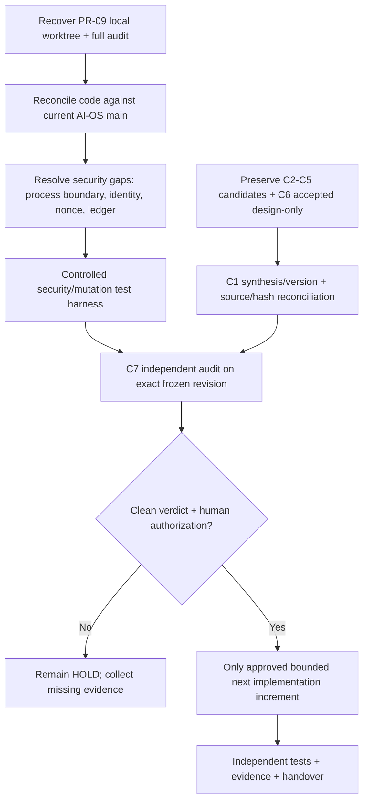

# ARGON Remaining Work and Dependencies

**Cut-off:** 2026-11-04  
**Purpose:** Evidence-backed prioritized backlog. No new Cloud roles are assigned here; original ownership is preserved.

## 1. Priority model

- **P0 — stop / protect:** work required to establish truth or prevent unsafe execution. No code deployment or writes implied.
- **P1 — governance and audit closure:** required to establish a defensible frozen baseline.
- **P2 — repository integrity and readiness:** correct status/provenance drift and define reproducible test evidence.
- **P3 — product architecture readiness:** resolve Health-specific design and legal/operational gaps before product implementation.

Owners below are existing ownership labels where established (`C1`–`C7`, Integration Owner, human decision authority). “Integraphy” is marked pending attribution because its activity records are missing.

## 2. Prioritized backlog

| Priority | ID | Remaining item | Current evidence/status | Dependency / owner | Closure evidence required |
|---|---|---|---|---|---|
| **P0** | R-001 | Recover exact PR-09 local worktree/branch and compare with current AI-OS main | Branch/worktree/commit given by user; not found on accessible GitHub remote; local Windows state unknown | Human supplies read-only export; Integraphy if it owns the worktree | Exact repo path, branch, HEAD, base SHA, `git status`, commit log, full diff/patch, untracked files and hashes. No merge/rebase. |
| **P0** | R-002 | Obtain the full 2026-11-02 PR-09 independent forensic audit and logs | Summary available only in user handover | User / original auditor | Original report, report hash, tested commit, environment, Docker status, commands, test logs, image reference/digest, findings and sign-off. |
| **P0** | R-003 | Keep machine writes / autonomous execution / Wave 4 on HOLD | C7-FFA-004 Rev5 no clean verdict; current source findings; user-supplied Nov2 hold | Human decision authority + C7 | No closure by document edits or test claims alone. Explicit clean, revision-pinned independent audit and separate human authorization. |
| **P0** | R-004 | Reconcile host subprocess paths and execution boundary in PR #8 main | `tools.py` and `verifier.py` source both contain `subprocess.run`; no Docker boundary visible in inspected path | C2 (security) + C4 (execution) + independent C7 | Exact code diff and tests proving OS/container isolation, allowlist enforcement, denial of outside-workspace effects, no nested bypass, and fail-closed verification. |
| **P0** | R-005 | Close SEC-03 authenticated approver identity | Current policy accepts caller-provided string with local defaults | C2 + human identity/security decision | Authenticated principal proof, identity-source contract, tamper-resistant identity claim, negative tests for forged identity. |
| **P0** | R-006 | Close SEC-04 audit evidence integrity | Current `AuditLedger` uses a local SHA-256 chain and documents privileged rewrite weakness | C2 + C6 + C7 | Approved integrity architecture outside the writer's privilege boundary; independent verification and rewrite/tamper tests. |
| **P0** | R-007 | Fix/verify replay nonce fail-closed and atomicity semantics | Source path can reset nonce set on malformed/read failure; unprotected read-check-write path | C2 + C4 + C6 | Corrupt-store, concurrent consume, crash/restart, replay, expiry, revocation and duplicate-request tests with exact logs. |
| **P1** | R-008 | Complete C7-FFA-004 final audit against one frozen candidate bundle | Rev5 no clean verdict for v2.1.1; latest user summary says OPEN; no current final C7 file found in main | C7 after C1–C6 intake; independent reviewer | Exact input hashes, source-to-claim matrix, cross-Cloud map, open-decision list, no repairable critical gaps; documented verdict. |
| **P1** | R-009 | Reconcile C1 v2 in main vs v2.1.1 candidate/audit trail | PR #7 integrated v2 draft; v2.1.1 exists in Library; C7 Rev5 no clean verdict | C1 + C7 + integration owner | Version/lineage table, correction matrix, manifests, precise canonical path, C7 verdict. Do not silently substitute versions. |
| **P1** | R-010 | Preserve C2 RP-13 candidate and close decision/test prerequisites | Candidate v3 reported; 55 tests/12 scenarios specified; zero executed; six questions open | C2, C1, human decision authority, C7 | Exact candidate/manifest/provenance; explicit decision whether crypto binding is needed; test harness and key/identity/replay/expiry/revocation/payload evidence. |
| **P1** | R-011 | Complete C3 review packaging and interface prerequisites | C3 r3 held as staging; missing input-hash log/checker output/fixtures/oracles; zero tests | C3 + C6 + C7 | Complete fixture payloads/hashes, ground-truth/oracle table, reproducible checker/output, resolved interface ownership or explicitly open records. |
| **P1** | R-012 | Complete C4 Plan/Act matrix package and keep vector taxonomy open | C4 candidate package incomplete; zero tests; H-09/OQ-03 unresolved | C4 + C1 + C2 + C6 + human authority | All missing manifests/diffs/logs, many-to-many map of original vectors and PAM test IDs, explicit human decision or continued `OPEN`. |
| **P1** | R-013 | Recover (or explicitly leave unrecovered) C4 Wave 3.5 source | AI-OS historical manifest exists, declares HEALTH target and expected SHA; original Markdown not verified | C4 + integration owner; HEALTH remains read-only | Search exact `ARGON-HEALTH` historical tree/refs for both v2/v1 exact bytes and hash; report searched refs and result. If absent, keep `NOT RECOVERED`, never fabricate historical original. |
| **P1** | R-014 | Resolve C5 v1 provenance and AT-17 routing dependency | v1 not recovered; r3 specifies 18 tests; AT-17 routing blocked by IC-9; zero executions | C5 + C2/C4 + C7 | Exact v1 recovery/hash or `NOT RECOVERED`; test-ID lineage; IC-9 interface; operator/authority tests and thresholds. |
| **P1** | R-015 | Preserve C6 design-only acceptance and close interface ownership | C6 accepted in PR #5; packs remain `DESIGNED / NOT_IMPLEMENTED`; zero tests | C6 plus owning Clouds and C7 | Interface contracts or explicit open owner/status; do not rerun C6 research; tests only after runtime/test environment exists. |
| **P2** | R-016 | Reconcile `STATUS.md` / NEXT-ACTIONS / current PR8 implementation | `STATUS.md` predates PR7 and PR8 | Single integration owner; human approval | Exact change list tied to accepted baseline and C7; statuses distinguish source-present, executed, accepted and production-ready. |
| **P2** | R-017 | Review PR8 repository hygiene and demo artifacts | PR8 tracks `__pycache__`, sandbox outputs, task/approval/ledger samples | Integration owner + C7 privacy reviewer | File provenance/classification, ignore policy, redaction scan, keep/remove decision via approved PR; do not delete in this investigation. |
| **P2** | R-018 | Establish exact current-head automated test evidence | PR8 tests exist; current-head successful run not evidenced; GitHub query returned no workflow run records | C4/C6 + integration owner | Exact HEAD, Python/dependency versions, command, exit code, full logs, test inventory and independent oracle; include mutation/security suites. |
| **P2** | R-019 | Complete public archive/privacy triage | Oct17 Phase Zero flagged a possible DNS validation datum with unknown live status; C7 prompt required detailed scan | C7 privacy triage + account/domain owner | Offline inventory of archives/binaries/history and redacted findings; owner verifies whether any value remains active. No public secret values in reports. |
| **P2** | R-020 | Verify ownership of every Cloud output and transfer receipt | No authenticated Integraphy log or full Cloud transcripts | User, Cloud export, Integraphy | Original output filenames, hashes, receipt/review/acceptance disposition, integration commit/PR reference. |
| **P3** | R-021 | Maintain ARGON-HEALTH as architecture-only until first implementation gate is legitimately opened | No application backend/frontend/schema/integrations/deployment evidenced | HEALTH architecture owner + clinical/security/legal reviewers | Approved ADR/stage trigger, bounded clinic-first vertical slice, accepted domain contracts, tests and reviewers. |
| **P3** | R-022 | Reconcile ADR-000 authority and staged implementation trigger | Earlier Phase Zero report notes canonical ADR-000 source not present in Health tree | Human architecture authority | Exact authoritative ADR-000 version/location and evidence that a specific stage trigger fired; no inference from roadmap. |
| **P3** | R-023 | Reconcile Firebase conflict in current target governance text | User states target “no Firebase”; Health README references a staged incremental Firebase step | Human architecture authority | Explicit decision recorded in target governance; do not modify Legacy or initiate Firebase implementation absent approval. |
| **P3** | R-024 | Complete Health assurance and jurisdiction readiness | Historical 67/67 controls and 20/20 scenarios NOT_RUN; 7 risk hypotheses open; Jordan legal review unresolved in older report | HEALTH owner, qualified clinical/security/legal reviewers | Current revalidation register and test execution bound to build/release/environment; Jordan-specific legal/privacy review; backup/restore and tenant-isolation evidence. |

## 3. Dependency map

The order is intentionally conservative. If a predecessor cannot be closed, the downstream item remains blocked. A report, manifest, code file, or passing unrelated test cannot substitute for the missing gate.

## 4. Minimum next evidence packet

To unblock the most urgent unknowns, the next transfer should contain:

1. Exact local PR-09 branch/worktree metadata and patch, without changing it.
2. Full November 2 forensic report and machine-readable logs.
3. Docker daemon availability record, image name/digest, runtime invocation and complete containment test results.
4. Exact current PR8 test execution report if available, tied to SHA `1458a7f...`.
5. C1 v2.1.1 candidate, updated correction matrix, manifest and every C7 revision after Rev5.
6. C2–C5 final candidate/manifest/review bundles and C7 privacy-triage report (or explicit “not completed”).
7. Integraphy output/receipt log mapping each artifact to accepted/integrated/rejected state.

## 5. Explicit non-actions

No item in this backlog authorizes: direct `main` edits, PR creation, cherry-pick/merge, deleting generated files, rotating credentials, changing visibility, rewriting history, executing commands on the Windows host, deploying, using real patient data, enabling AI-OS writes to HEALTH, or marking any gate closed.
