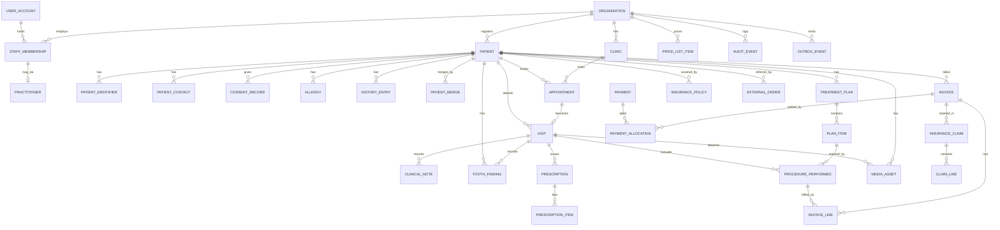

# ARGON Dental — Database and System Architecture (Cloud 2)

**Research and design report · Jordan pilot, Saudi Arabia second · Prepared 6 November 2026 · Status: DRAFT for specialist review**

This report is research, analysis and design only. No repository, local file, production system or real patient data was touched. All examples are synthetic. ARGON is **not** claimed to be production-ready.

**Evidence legend used throughout:** **\[V\]** verified evidence (a retrieved source, with access date in section 24) · **\[D\]** documented design or statement supplied by the project owner, not independently inspected here · **\[R\]** recommendation of this report · **\[A\]** unverified assumption that must be confirmed.

---

## 1. Executive summary

ARGON Dental needs a data architecture that is safe for one dental clinic in Jordan on a $0/month budget, yet does not trap the product when it grows to branches, Saudi Arabia, insurance and external labs.

**Core recommendations \[R\]:**

1. **Modular monolith, not microservices.** One deployable backend/application, internally split into bounded modules (identity, scheduling, clinical, dental chart, billing, media, audit). Extract a service only when a measured need appears.
2. **Model the data relationally, whatever the engine.** The logical model in this report (entities, keys, constraints) is store-neutral. It uses stable UUIDs, integer money, append-only clinical history and explicit tenant keys, so it can live in PostgreSQL or be mapped onto the existing Firebase Realtime Database (RTDB) \[D\].
3. **Do not rewrite the existing repositories without evidence.** For the pilot, the recommended path is *Path A+*: keep the current store, adopt the logical model and conventions here, and add an export/migration-ready layer. Defined triggers (section 4.3) force a decision to move billing/claims and clinical history to a relational engine (*Path B*).
4. **Clinical truth is append-only.** Tooth findings, notes, prescriptions and plan decisions are never overwritten; corrections create new versions that reference the old one. The dental chart on screen is a *projection* of an event history.
5. **Tenant isolation is enforced in three places**: the data key (every row carries `organization_id`, and `clinic_id` where relevant), the access layer (server-side authorization, never client trust), and the storage rules/policies.
6. **Money is integer minor units with currency and exponent** (JOD has three decimals: 1 JOD = 1000 fils \[D, A\]; SAR has two). Invoices are immutable once issued; changes are credit/debit notes.
7. **Health data residency is an open legal question** for both countries, not a settled engineering choice (sections 3 and 22). Design so the hosting region can be chosen per organization.
8. **Free-tier backup is the biggest practical gap.** A $0 budget does not remove the need for tested, off-platform, encrypted backups with a rehearsed restore (section 14).

**Biggest unresolved items:** legal basis and hosting location for health data; whether the current store can meet integrity needs for billing/claims; the real state of the existing code (this report did not audit it); who is the legal data controller (clinic vs. ARGON).

---

## 2. Scope and evidence status

**In scope:** logical architecture, ERD, data dictionary, identity/duplicate strategy, dental chart model, tenancy, record history, file/image storage, transaction integrity, backup/recovery, scalability, API boundaries, interoperability.

**Out of scope:** UI design, code, deployment, a security audit of the current repositories, legal advice, and clinical content decisions (those need a dentist).

**What this report did and did not verify:**

| Topic | Status |
| --- | --- |
| Legal and regulatory statements | Web research on 6 Nov 2026; mostly secondary (law-firm and vendor summaries). Primary legal texts were **not** read. Marked \[V-secondary\] |
| Existing ARGON stack (vanilla JS + Firebase RTDB, append-only rules, multi-tenant paths, fils-based currency, dental chart with FDI) | Stated by the project owner \[D\]. **Not inspected.** Do not read this as proof of implementation |
| Production usage, clinic count, test coverage | Unknown / unverified \[A\] |
| Free-tier limits of any hosting product | Not verified; they change often and must be re-checked before commitment |

A documented design is not implemented software. Every acceptance criterion in section 20 therefore starts from "demonstrate it", not "it exists".

---

## 3. Regulatory findings that shape the architecture

These findings constrain design. They are **not legal advice**. A Jordanian and a Saudi healthcare/data-protection lawyer must confirm them before launch.

### 3.1 Jordan

- **\[V\]** Personal Data Protection Law No. 24 of 2023 was published in the Official Gazette on 17 September 2023 and took effect on 17 March 2024; the Ministry of Digital Economy and Entrepreneurship (MODEE) states it applies even to data collected before enforcement.
- **\[V-secondary\]** Consent is the primary legal basis and must be explicit for sensitive data; health data is treated as sensitive. Children's data needs parental consent. Rights include access, rectification, erasure, restriction and objection.
- **\[V-secondary\]** Transfer of data outside Jordan is restricted unless the destination offers adequate protection or an exception applies. One law-firm summary lists exchange of medical data *necessary for the data subject's treatment* as an exception, and notes the law does not anticipate standard contractual clauses. Whether hosting a clinic's records in a foreign cloud region qualifies is **not established**.
- **\[V-secondary, CONFLICTING\]** Sources disagree on breach-notification timing (one says 72 hours to the regulator, another says 24 hours to data subjects) and on penalty levels (JOD 1,000–10,000 per violation in one source; up to JOD 1 million in another). **Do not hard-code either number.** Treat as unresolved until the Arabic primary text/implementing regulations are read.
- **\[V-secondary\]** Regulator status is unclear: sources say a Personal Data Protection Council/Directorate exists in law, but enforcement structures and adequacy designations appeared incomplete in 2025 material.
- **\[A\]** Jordan-specific health rules (Ministry of Health, Jordan Dental Association, medical-liability and record-retention rules, e-health connection requirements) were **not** found in this research and must be sourced by the compliance/legal team.

### 3.2 Saudi Arabia

- **\[V-secondary\]** The Saudi PDPL came into force 14 September 2023, with a one-year grace period; full enforcement began 14 September 2024. SDAIA is the competent authority. Implementing Regulations and the Personal Data Transfer Regulation were issued 7 September 2023; the transfer regulation was amended in 2024.
- **\[V-secondary\]** Health data is sensitive data. A Data Protection Officer is required where core activities involve sensitive data, with health institutions given as an example. Privacy notices serving Saudi users should be in Arabic.
- **\[V-secondary\]** Transfers outside the Kingdom need a lawful pathway (adequacy once SDAIA publishes its list, SDAIA-approved standard clauses, binding common rules, or limited exceptions); a risk assessment is required for certain cases. One source (June 2026) says the adequacy list was still pending. Lower-reliability source; re-check.
- **\[V-secondary, LOW CONFIDENCE\]** One vendor blog claims the Ministry of Health imposes health-data localisation. This was not confirmed by an authoritative source. **Design for in-Kingdom hosting as an option** and resolve with counsel.
- **\[V-secondary, LOW CONFIDENCE\]** Vendor pages describe NPHIES (national health information exchange) as the mandatory channel for eligibility, pre-authorisation and claims between providers and insurers, using FHIR R4, with CCHI as the insurance regulator. Official NPHIES/CCHI documents were **not** retrieved. Treat Saudi insurance integration as an unconfirmed requirement.

### 3.3 Design consequences \[R\]

| Finding | Architectural consequence |
| --- | --- |
| Health data is sensitive in both countries | Field-level classification, minimum-necessary access, audit of reads, consent records |
| Cross-border transfer is restricted in both | Per-organization hosting region; no silent use of foreign analytics/AI/email services on patient data |
| Breach duty exists but timing is uncertain | Build breach-detection evidence (audit, access logs) now; set the notification clock after legal confirmation |
| Two different regimes | `jurisdiction` is a first-class property of an organization; rules (retention, consent text, coding) are configuration, not code branches |
| Arabic privacy notice needed for Saudi | Consent/notice documents are versioned, multilingual records |

---

## 4. Architecture style and data store decision

### 4.1 Options considered

| Option | Strengths | Weaknesses | Verdict |
| --- | --- | --- | --- |
| Microservices per domain | Independent scaling, team autonomy | Operational cost, distributed transactions across billing/clinical, far beyond a one-clinic pilot and a tiny team | **Reject** for now |
| Modular monolith + one store | Simple to run, transactional, easy to test and back up | Needs discipline to keep modules separate | **Recommend** |
| Serverless functions around a managed DB | $0 start, no servers | Cold starts, vendor lock-in, harder local testing, hidden limits | Acceptable as a *hosting* choice for the monolith |

### 4.2 Store options

| Path | Description | Fit |
| --- | --- | --- |
| **A+ (recommended for pilot)** | Keep the existing Firebase RTDB \[D\]. Adopt the logical model, UUID keys, integer money, versioned records, and a migration-ready export. Atomic multi-path updates and security-rule validation provide integrity for single-clinic scale | Lowest rewrite risk, $0, familiar code |
| B (target) | PostgreSQL-class relational engine for clinical history, billing, claims, audit; row-level security for tenancy; point-in-time recovery where available | Best integrity, reporting, FHIR mapping, multi-branch growth; needs migration effort and a free-tier suitability check |
| C | Document DB (Firestore-like) | Better querying than RTDB, still weak for ledgers and ad-hoc reporting; **not recommended** as a stop-over |

**Why RTDB is a risk beyond the pilot \[R\]:** it has no joins and limited query capability, so reporting, duplicate detection and insurance workflows need denormalised copies that can drift; transactions are path-scoped (multi-path atomic updates help but do not give relational constraints). These are properties of the engine, not code defects.

### 4.3 Decision gate DG-1: triggers to move to Path B \[R\]

Move billing/claims and clinical history to a relational engine when **any** occurs: (a) a second clinic or branch goes live; (b) electronic insurance claims go live (Jordan or Saudi); (c) Saudi launch; (d) a reconciliation discrepancy between invoices and payments occurs in production; (e) a legal answer requires data in a region the current host does not offer; (f) duplicate-detection or reporting queries cannot be served without unsafe full-collection reads.

Migration is incremental (strangler pattern): new modules write to the relational store; old modules are wrapped by an adapter; no big-bang rewrite.

---

## 5. Logical architecture

```text
+--------------------------- Clients (Arabic/English, RTL/LTR) ---------------------------+
|  Reception / Dentist / Assistant / Billing / Clinic admin / Org admin / (later) Patient |
+------------------------------------------+--------------------------------------------+
                                           | HTTPS only, short-lived tokens
+------------------------------------------v--------------------------------------------+
|                        API layer (authN, authZ, validation, rate limits)                |
+--+---------+----------+----------+-----------+----------+-----------+--------+---------+
   |         |          |          |           |          |           |        |
+--v--+  +---v---+  +---v----+  +--v-----+  +--v-----+  +--v----+  +----v--+  +--v-----+
|Ident|  |Patient|  |Schedul-|  |Clinical|  |Dental  |  |Billing|  |Media/ |  |Audit & |
|&    |  |registry|  |ing     |  |(visits,|  |chart & |  |& ins. |  |docs   |  |consent |
|Tenant|  |& dedup |  |        |  |notes,  |  |treat-  |  |       |  |       |  |        |
|     |  |       |  |        |  |Rx,alg.)|  |ment    |  |       |  |       |  |        |
+--+--+  +---+---+  +---+----+  +---+----+  +---+----+  +---+---+  +---+---+  +---+----+
   +---------+----------+-----------+-----------+-----------+----------+----------+
                                    |
                  +-----------------+------------------+
                  | System of record (RTDB now / SQL)  |   Object storage (images, PDFs)
                  | + outbox table/path for events     |   private, encrypted, signed access
                  +-----------------+------------------+
                                    |
                       Outbox worker (later) -> lab / radiology / pharmacy / insurer adapters
```

**Module rules \[R\]:** a module owns its tables/paths; other modules call its interface, never read its storage directly. Cross-module consistency uses a transaction (same store) or an outbox event. Every module takes `organization_id` from the authenticated context, never from the request body.

**Stack-neutral cross-cutting services:** time (store UTC, display clinic time zone), identifiers (UUIDv4/v7, never sequential for patients), localisation (Arabic/English labels as data), feature flags per organization, structured logging without patient identifiers.

---

## 6. Entity relationship diagram

The diagram is Mermaid `erDiagram` syntax (render in any Mermaid viewer); the full field list is in section 7.



**Reading notes:** `TOOTH_FINDING` is an append-only event table, not a chart row. `PLAN_ITEM` links to a tooth/surface and, when done, to a `PROCEDURE_PERFORMED`. An `INVOICE` references performed procedures, never plan items, so unperformed work is never billed.

---

## 7. Data dictionary

Types are logical (`uuid`, `text`, `int`, `bool`, `date`, `timestamptz`, `jsonb`-like structured value, `enum`). Under RTDB they map to strings/numbers/objects; `enum` values are validated in security rules and the API layer. **\[R\]**

### 7.1 Conventions applied to every table

| Column | Type | Rule |
| --- | --- | --- |
| `id` | uuid | Primary key, generated server-side, never reused, never sequential for patients |
| `organization_id` | uuid | Mandatory tenant key on every row; copied from the authenticated context, never from client input |
| `clinic_id` | uuid | Present where the record belongs to one branch (appointment, visit, invoice, payment) |
| `created_at`, `created_by` | timestamptz, uuid | Set by server; immutable |
| `row_version` | int | Optimistic concurrency on mutable tables; incremented on update |
| `supersedes_id` | uuid null | On append-only tables: points to the record this one corrects |
| `status` | enum | Lifecycle state; deletion is a status (`voided`, `entered_in_error`), not a physical delete, for clinical and financial data |
| `source_system`, `external_ref` | text | For imported or integrated records (traceability) |

### 7.2 Tenancy and identity

| Entity | Key fields | Notes |
| --- | --- | --- |
| `organization` | `legal_name`, `trade_name_ar`, `trade_name_en`, `jurisdiction` (`JO`/`SA`), `default_language`, `time_zone`, `data_region`, `currency_code`, `currency_exponent`, `controller_role` (`controller`/`processor`) | Top tenant. `data_region` decides hosting placement. `controller_role` records the legal answer to decision D-02 |
| `clinic` | `organization_id`, `name_ar`, `name_en`, `address`, `license_number`, `license_authority`, `is_active` | A branch. License fields are free text until the regulator format is confirmed \[A\] |
| `user_account` | `auth_subject`, `display_name`, `status`, `last_login_at` | A person who can sign in. Not tied to one organization |
| `staff_membership` | `user_id`, `organization_id`, `clinic_ids[]`, `role`, `valid_from`, `valid_to` | Authorization lives here. Roles: `org_admin`, `clinic_admin`, `dentist`, `assistant`, `receptionist`, `billing`, `read_only_auditor` |
| `practitioner` | `membership_id`, `professional_license_no`, `license_authority`, `specialty`, `signature_asset_id` | A dentist profile. Prescriptions and notes reference this, not just the user |

### 7.3 Patient registry

| Entity | Key fields | Notes |
| --- | --- | --- |
| `patient` | `mrn` (per organization, human-readable), `given_name_ar`, `family_name_ar`, `given_name_en`, `family_name_en`, `birth_date`, `sex_at_birth`, `preferred_language`, `status` (`active`, `inactive`, `merged`, `deceased`), `merged_into_id` | `mrn` is for staff; `id` is the technical key. Both Arabic and English names stored; neither is derived from the other |
| `patient_identifier` | `patient_id`, `type` (`national_id_jo`, `iqama_sa`, `national_id_sa`, `passport`, `other`), `value_hash`, `value_encrypted`, `value_last4`, `issuing_country`, `verified_at` | Hash for matching, encrypted value for display on authorised screens. **Not** stored in plain text. Number formats are not asserted here \[A\] |
| `patient_contact` | `patient_id`, `kind` (`mobile`, `email`, `address`, `guardian`, `emergency`), `value`, `is_primary`, `relationship`, `consent_to_contact` | Guardian contact required when the patient is a minor |
| `consent_record` | `patient_id`, `purpose` (`treatment`, `data_processing`, `image_capture`, `marketing`, `data_sharing_external`, `cross_border_transfer`), `notice_version_id`, `language`, `granted`, `granted_at`, `withdrawn_at`, `given_by` (`self`/`guardian`), `evidence_asset_id` | One row per purpose per decision; never edited, withdrawal is a new row. Notice text is versioned and multilingual |
| `patient_merge` | `survivor_id`, `merged_id`, `merged_by`, `reason`, `snapshot_asset_id`, `undone_at` | See section 8 |

### 7.4 Medical context

| Entity | Key fields | Notes |
| --- | --- | --- |
| `allergy` | `patient_id`, `substance_text`, `substance_code` (optional), `category` (`drug`, `latex`, `anaesthetic`, `food`, `other`), `reaction`, `severity`, `status` (`active`, `resolved`, `entered_in_error`), `recorded_by`, `verified_by` | Append-only with status; a UI banner reads the latest non-error rows |
| `history_entry` | `patient_id`, `kind` (`medical_condition`, `medication_current`, `surgery`, `habit`, `pregnancy`), `text`, `code` (optional), `onset_date`, `status`, `visit_id` | Dentally relevant conditions (e.g. anticoagulants, diabetes) are *captured as free text/codes provided by the clinician*; this report does not define clinical rules |

### 7.5 Scheduling and visits

| Entity | Key fields | Notes |
| --- | --- | --- |
| `appointment` | `clinic_id`, `patient_id`, `practitioner_id`, `chair_id` (optional), `start_at`, `end_at`, `reason`, `status` (`booked`, `arrived`, `cancelled`, `no_show`, `completed`), `cancel_reason`, `created_via` | Overlap prevention: unique constraint on (`practitioner_id`, time slot) or a slot-lock record (section 13) |
| `visit` | `clinic_id`, `patient_id`, `appointment_id` (nullable for walk-ins), `practitioner_id`, `opened_at`, `closed_at`, `status` (`open`, `closed`, `entered_in_error`) | Closing a visit freezes its clinical entries; later changes are addenda |
| `clinical_note` | `visit_id`, `patient_id`, `author_id`, `kind` (`complaint`, `exam`, `diagnosis`, `plan_note`, `addendum`, `progress`), `text`, `language`, `supersedes_id` | Append-only. Diagnosis stored as text plus optional ICD-10 code \[A\] |

### 7.6 Dental chart, treatment and prescriptions

| Entity | Key fields | Notes |
| --- | --- | --- |
| `tooth_finding` | see section 9.3 | The core append-only chart event |
| `treatment_plan` | `patient_id`, `version`, `status` (`proposed`, `presented`, `accepted`, `declined`, `in_progress`, `completed`, `superseded`), `presented_at`, `accepted_at`, `accepted_by`, `estimated_total_minor`, `currency_code`, `supersedes_id` | A new plan version supersedes the old; accepted versions are never edited |
| `plan_item` | `plan_id`, `procedure_code`, `tooth_fdi` (nullable), `surfaces` (set), `quadrant_or_arch` (nullable), `sequence_no`, `phase`, `estimated_price_minor`, `status` (`planned`, `scheduled`, `done`, `cancelled`, `declined`), `reason` | Prices are snapshots from the price list at plan time |
| `procedure_performed` | `visit_id`, `plan_item_id` (nullable), `procedure_code`, `tooth_fdi`, `surfaces`, `performed_by`, `performed_at`, `anaesthesia_note`, `materials_note`, `status`, `supersedes_id` | What was actually done. Source for invoice lines |
| `prescription` | `visit_id`, `patient_id`, `prescriber_id`, `issued_at`, `status` (`issued`, `cancelled`, `entered_in_error`), `allergy_check_done`, `allergy_check_override_reason` | Immutable after issue |
| `prescription_item` | `prescription_id`, `medicine_text`, `medicine_code` (optional), `strength`, `route`, `dose_text`, `frequency_text`, `duration_text`, `quantity`, `instructions_ar`, `instructions_en` | Dose text is clinician-entered; the system does not calculate doses \[R\] |

### 7.7 Media and documents

| Entity | Key fields | Notes |
| --- | --- | --- |
| `media_asset` | `patient_id`, `visit_id` (optional), `kind` (`xray_periapical`, `xray_bitewing`, `xray_panoramic`, `xray_cbct_report`, `photo_intraoral`, `photo_extraoral`, `scan_document`, `consent_form`, `lab_result`, `other`), `tooth_fdi` (optional), `storage_key`, `mime_type`, `size_bytes`, `sha256`, `captured_at`, `captured_by`, `status` (`active`, `entered_in_error`), `dicom_study_uid` (optional) | The row is metadata; bytes live in object storage (section 12) |

### 7.8 Billing and insurance

| Entity | Key fields | Notes |
| --- | --- | --- |
| `price_list_item` | `organization_id`, `procedure_code`, `name_ar`, `name_en`, `price_minor`, `currency_code`, `valid_from`, `valid_to`, `price_list_kind` (`cash`, `insurer_<id>`) | Effective-dated; old invoices keep their own snapshot |
| `invoice` | `clinic_id`, `patient_id`, `visit_id`, `invoice_no` (per clinic, gap-free allocation), `issued_at`, `status` (`draft`, `issued`, `partially_paid`, `paid`, `void`, `credited`), `subtotal_minor`, `discount_minor`, `tax_minor`, `total_minor`, `currency_code`, `payer_kind` (`self`, `insurer`, `mixed`) | Immutable once `issued`. Tax/e-invoicing treatment is **not** defined here (decision D-09) |
| `invoice_line` | `invoice_id`, `procedure_performed_id`, `description`, `qty`, `unit_price_minor`, `line_total_minor`, `tooth_fdi` | Totals are stored and re-verifiable from lines |
| `payment` | `clinic_id`, `patient_id`, `method` (`cash`, `card`, `transfer`, `insurer_remittance`), `amount_minor`, `currency_code`, `received_at`, `received_by`, `reference`, `status` (`posted`, `reversed`), `reverses_payment_id` | Never edited. A refund or error is a reversing payment |
| `payment_allocation` | `payment_id`, `invoice_id`, `amount_minor` | Many-to-many split; sum of allocations of a payment cannot exceed its amount |
| `insurance_policy` | `patient_id`, `insurer_name`, `insurer_code` (optional), `member_no_encrypted`, `policy_no_encrypted`, `class_or_plan`, `valid_from`, `valid_to`, `copay_rule` (structured), `annual_limit_minor` | Coverage facts are copied, not interpreted \[A\] |
| `insurance_claim` | `invoice_id`, `policy_id`, `status` (`draft`, `submitted`, `accepted`, `rejected`, `paid`, `appealed`), `submitted_at`, `external_ref`, `payload_asset_id` | Placeholder structure; real fields depend on the insurer channel (section 17) |
| `claim_line` | `claim_id`, `invoice_line_id`, `claimed_minor`, `approved_minor`, `rejection_code`, `rejection_text` |  |

### 7.9 Integration and audit

| Entity | Key fields | Notes |
| --- | --- | --- |
| `external_order` | `patient_id`, `visit_id`, `kind` (`lab`, `radiology`, `pharmacy`, `referral`), `partner_id`, `status`, `request_payload_asset_id`, `result_asset_id`, `sent_at`, `received_at` | Future. Defined now so identifiers do not change later |
| `outbox_event` | `event_type`, `aggregate_type`, `aggregate_id`, `payload`, `created_at`, `delivered_at`, `attempts` | Written in the same transaction as the change; a worker delivers later |
| `audit_event` | `actor_user_id`, `actor_role`, `clinic_id`, `action` (`read`, `create`, `update`, `void`, `export`, `login`, `permission_change`, `merge`, `break_glass`), `object_type`, `object_id`, `patient_id`, `occurred_at`, `ip_hash`, `request_id`, `reason`, `outcome` | Append-only. Contains **no clinical content**, only references. Reads of patient records are audited |

---

## 8. Patient identity and duplicate detection

### 8.1 Identity model \[R\]

- **Two keys per patient:** an immutable technical `id` (uuid) and a human `mrn`. All foreign keys use `id`.
- **Identifiers are evidence, not keys.** A national ID or passport number helps match but is never used as the primary key (it can be missing, wrong, shared by a family typing error, or change).
- **Organization-scoped registry.** The same real person at two unrelated organizations has two `patient` records. Linking across organizations is out of scope until a legal basis and a consent model exist (section 25).
- **Within an organization with several clinics:** one patient record, plus `patient_clinic_link` (`patient_id`, `clinic_id`, `first_seen_at`) to support branch reports. Clinical records are shared across branches *only if* the organization's policy and consent allow it (decision D-05).
- **Arabic names:** normalise for matching (remove diacritics, unify alef/hamza forms, `ة`/`ه`, `ى`/`ي`, strip honorifics and extra spaces) and keep the original as typed. Transliteration to Latin is **not** assumed reliable; store both and match on each.

### 8.2 Duplicate detection at registration \[R\]

Run on create and on edit of name, birth date, identifier or phone.

| Rule | Result |
| --- | --- |
| Exact `value_hash` match on a verified national ID/iqama/passport in the same organization | **Hard stop**: open the existing record |
| Same normalised full name (Arabic or English) + same birth date | **Strong candidate**: require staff to choose "same person" or "different person" with a reason |
| Same mobile number + similar name (edit distance ≤ 2 per token) | **Candidate** (family members share phones; never auto-merge) |
| Same birth date + same guardian contact + similar given name | **Candidate** (siblings, twins: warn clearly) |
| Phonetic/fuzzy name match only | **Weak**, shown as a hint |

The matching key set is stored as derived, rebuildable data (`patient_match_key`: normalised name tokens, birth year, phone hash) so the check can run with indexed lookups even on a store without joins.

**Twins and family risk \[R\]:** the UI must display age, sex and last visit beside every candidate; a "same person" decision always records who chose it.

### 8.3 Merge and unmerge \[R\]

1. Merge is a privileged action (`clinic_admin` or higher, plus a second confirmation).
2. Before merging, store a **snapshot** of both records (asset reference).
3. The merged record becomes `status = merged` with `merged_into_id`; its clinical rows are *re-pointed* by writing new link rows or by reference redirect, **not** deleted. Original `patient_id` values stay visible in history.
4. `patient_merge.undone_at` supports unmerge within a defined window; after other edits on the survivor, unmerge is a manual, audited procedure.
5. Allergies and active alerts from both records are unioned, never dropped.
6. Any merge writes an `audit_event` (`merge`).

**Wrong-patient safeguards:** show two identifiers on every chart header; require confirmation of name + birth date before charting or prescribing; log a `wrong_patient_entry` correction flow (`entered_in_error` on the entry, with re-entry on the right patient).

---

## 9. Dental chart data model

### 9.1 Principles \[R\]

- The chart is a **projection**: current state = fold of append-only `tooth_finding` events up to a date. This also gives "chart as of date X".
- The same model covers permanent, primary and mixed dentition.
- Findings are *structured codes + optional text*. Coded values come from a controlled, versioned list kept in the organization's configuration, with Arabic and English labels.
- A dentist, not engineering, owns the clinical value list (decision D-07).

### 9.2 Tooth identification

- Primary notation: **FDI two-digit** (ISO 3950): permanent 11–18, 21–28, 31–38, 41–48; primary 51–55, 61–65, 71–75, 81–85. \[A: standard knowledge, not re-verified in this research\]
- Store `tooth_fdi` as text (`"16"`), never as a number, and validate against the allowed set for the patient's recorded dentition.
- Optional `display_notation` per user (FDI, Universal/US, Palmer) is a **presentation setting**, not stored data, avoiding conversion errors in history.
- Whole-mouth and region targets use `scope`: `tooth`, `quadrant` (Q1–Q4 / Q5–Q8 primary), `arch` (upper/lower), `full_mouth`.
- Dentition status per tooth is itself a finding (`present_permanent`, `present_primary`, `missing_congenital`, `missing_extracted`, `unerupted`, `impacted`, `supernumerary`, `implant`, `retained_primary`) so mixed dentition and supernumerary teeth are representable. Supernumerary teeth need a non-FDI slot key such as `18S1`; **the format is a design decision** (D-08) because FDI has no standard code for them \[A\].

### 9.3 `tooth_finding` (append-only event)

| Field | Type | Notes |
| --- | --- | --- |
| `id`, `organization_id`, `patient_id`, `visit_id` | uuid |  |
| `scope` | enum | `tooth`, `quadrant`, `arch`, `full_mouth` |
| `tooth_fdi` | text null | Required when `scope = tooth` |
| `surfaces` | set of enum | `M` mesial, `D` distal, `O` occlusal (posterior), `I` incisal (anterior), `B` buccal, `F` facial (anterior labial), `L` lingual, `P` palatal. Use one display set per language; the stored codes are fixed. Stored as a sorted set, never a free string |
| `root_site` | enum null | Optional: per-root findings for multirooted teeth (e.g. `MB`, `DB`, `P`) \[A\] |
| `category` | enum | `condition`, `restoration`, `treatment_done`, `dentition_status`, `periodontal`, `mobility`, `note` |
| `code` | text | From the controlled list, e.g. `caries`, `fracture`, `restoration_composite`, `crown`, `rct_done`, `extraction`, `missing`, `implant` |
| `severity_or_stage` | text null | Optional, clinician-defined |
| `state` | enum | `observed`, `planned`, `done`, `resolved`, `entered_in_error` |
| `effective_date` | date | Clinical date (may differ from entry time) |
| `recorded_at`, `recorded_by` | timestamptz, uuid | System time |
| `supersedes_id` | uuid null | Correction chain |
| `linked_plan_item_id`, `linked_procedure_id`, `linked_media_id` | uuid null | Ties findings to plan, work and images |
| `free_text` | text null | Short note, not a substitute for codes |

**Projection rule:** for each (`tooth_fdi`, `surfaces`, `category`), the latest non-superseded, non-`entered_in_error` finding by `effective_date` then `recorded_at` defines current state. A `resolved` state ends an `observed` condition without deleting it. A cached `tooth_state_snapshot` (patient, tooth, JSON, `as_of_event_id`) may speed display and is always rebuildable.

**Periodontal charting** (pocket depths, bleeding, recession) is high-volume and numeric. Model it as `perio_exam` (`visit_id`, `exam_date`) with child `perio_measure` (`tooth_fdi`, `site`, `probing_depth_mm`, `recession_mm`, `bleeding`, `mobility`), versioned per exam, rather than as individual chart events. Whether the pilot includes it is decision D-07.

### 9.4 Worked synthetic example

Patient P-1 (synthetic), 9 years old, mixed dentition.

1. Visit V1: finding `{tooth 16, surfaces [O], category condition, code caries, state observed}`; `{tooth 55, dentition_status, retained_primary}`.
2. Plan item: composite restoration tooth 16 surface O.
3. Visit V2: `procedure_performed` (restoration, 16, \[O\]) → finding `{category restoration, code restoration_composite, state done}` and the earlier caries finding gets a `resolved` finding that references it.
4. Visit V3: dentist notices the surface was recorded wrongly (should be `[M,O]`). A new finding supersedes the V2 finding; the old one stays for history.

The chart for 16 on any date between V2 and V3 shows `[O]`, after V3 it shows `[M,O]`; the audit trail shows who changed it.

---

## 10. Multi-tenant isolation strategy

### 10.1 Model \[R\]

Shared database, shared schema, **tenant key on every record** (`organization_id`), with optional `clinic_id` for branch scope. Separate databases per tenant are rejected for the pilot (operational cost, no benefit at one clinic) but the design must allow moving a large tenant to its own database later (tenant-export tool, section 17).

### 10.2 Enforcement layers

| Layer | Control |
| --- | --- |
| Identity | Authentication token carries `user_id` only; the server resolves memberships and roles. Tenant claims in the token are advisory and re-checked |
| API | Every handler takes a tenant context from the verified session; queries without a tenant context are rejected by a shared data-access function. No client-supplied `organization_id` is trusted |
| Data store (SQL path) | Row-level security policies on `organization_id` (and clinic scope where applicable); application database role cannot bypass them |
| Data store (RTDB path) | Data nested under `/orgs/{organization_id}/...`; security rules check membership and role at each path; **no queries or listeners at the root**; shared top-level indexes are forbidden (an index that mixes tenants leaks structure) |
| Storage | Object keys prefixed `org/{organization_id}/`; access only through short-lived signed URLs minted by the API after an authorization check |
| Logs/analytics | Never include patient identifiers or clinical text; include `organization_id` hash only |
| Backups/exports | Per-tenant export and restore; a backup is encrypted and its access is audited |

### 10.3 Branch (clinic) scope

Staff hold a list of permitted `clinic_ids`. Default policy \[R, D-05\]: **patient demographics are organization-wide; clinical records are visible to clinics where the patient has a `patient_clinic_link`**; cross-branch clinical sharing becomes an organization setting with consent text. The default is the more restrictive option.

### 10.4 Break-glass

An authorised clinician may open a record outside their normal scope only with a typed reason; it raises an alert to the clinic admin and is always audited.

### 10.5 Tests that prove isolation

Section 21 includes tenant-leak scenarios; they must run in CI against both a read path and a write path for every module.

---

## 11. Data versioning and medical record history

### 11.1 Rules \[R\]

1. **Clinical and financial records are append-only.** No physical delete or in-place edit after the record is *finalised* (visit closed, invoice issued, prescription issued, plan accepted).
2. **Corrections** create a new row with `supersedes_id` and a reason; the old row's effective status becomes `superseded` or `entered_in_error` by a *new* status row, not by mutating clinical content.
3. **Two time axes:** *valid time* (`effective_date`, when it was true clinically) and *transaction time* (`recorded_at`, when ARGON learned it). Reports and legal exports use both.
4. **Draft state is mutable.** Before finalisation, `row_version` optimistic locking prevents lost updates between two staff members.
5. **Addenda after closure:** a closed visit accepts `clinical_note(kind = addendum)` only.
6. **Demographic and contact data** are mutable but audited; previous values go to `patient_history` (`patient_id`, `field`, `old_value_encrypted`, `changed_at`, `changed_by`).
7. **Legal hold and retention:** retention periods are configuration per jurisdiction, **not** hard-coded, because they were not established in this research (decision D-04). Deletion after retention is a deliberate, audited batch process; erasure requests are evaluated against clinical retention duties before action.
8. **Medical-legal export:** a patient record can be exported with the full history including superseded entries.

### 11.2 History and audit are different

| Concern | Store | Contains |
| --- | --- | --- |
| What the record said at a time | The record tables themselves (versions/supersession) | Clinical and financial content |
| Who accessed or changed what | `audit_event` | References and actions, no clinical content |
| What the system sent elsewhere | `outbox_event` + delivery log | Payload references |

---

## 12. File and image storage architecture

### 12.1 What is stored \[R\]

Dental X-rays (periapical, bitewing, panoramic), intraoral and extraoral photos, scanned consent forms, referral letters, lab results and generated PDFs (invoices, prescriptions). CBCT volumes and full DICOM studies are **out of pilot scope**: they are large and need a viewer; store only the radiologist's report and a reference until decision D-10 is taken.

### 12.2 Pattern

```text
Client --(1) request upload slot--> API --authZ + consent check--> creates media_asset(status=pending)
Client <-(2) short-lived signed upload URL-- API
Client --(3) uploads bytes directly--> Object storage (private bucket)
Client --(4) confirm--> API: verifies size, MIME sniff, sha256, malware scan (if available) -> status=active
Viewer --(5) request view--> API --authZ + audit(read)--> short-lived signed download URL (minutes)
```

| Rule | Detail |
| --- | --- |
| Private by default | No public bucket, no permanent URL, no URL containing patient name or national ID |
| Opaque keys | `org/{organization_id}/patient/{patient_id}/{asset_id}` — no personal data in names |
| Integrity | `sha256` and `size_bytes` stored in the metadata row; checked on upload and in periodic verification |
| Allowed types | Allow-list (JPEG, PNG, PDF; DICOM later). Reject by content sniffing, not by extension alone. Strip location EXIF from photos |
| Immutability | An asset is never overwritten. A corrected image is a new asset; the old one is marked `entered_in_error` |
| Thumbnails | Generated derivatives stored under the same tenant prefix; deleted with the original |
| Quota and size caps | Per-organization quota and per-file cap enforced by the API (values are decision D-10; free storage is limited and must be checked) |
| Encryption | Provider-side encryption at rest is a minimum; client-side or application-level encryption is considered only if the legal assessment requires it (adds key-management complexity) |
| Deletion | Metadata row `status` change first; physical deletion only after retention and legal-hold checks, and recorded in audit |
| Offline clinics | If capture happens offline, bytes queue on the device encrypted and sync later; the device must auto-expire the local queue and require a screen lock (section 18) |

### 12.3 Free-tier reality check \[A\]

Free storage allowances, egress limits and inactivity rules vary by provider and change; none were verified here. For a dental clinic, radiographs are the volume driver (a typical image can be hundreds of KB to several MB). **Compute expected monthly image volume before choosing the host**; if the free tier is exceeded, options in order are (1) compression policy agreed with the dentist, (2) tiering old images to a cheaper/offline archive, (3) a paid tier with a written justification (the project rule requires that explanation).

### 12.4 Images and diagnostic integrity

Lossy re-compression of diagnostic radiographs may be clinically unacceptable. Keep the original upload and, if a viewer copy is needed, create a separate derivative. Compression settings need dentist sign-off (D-10).

---

## 13. Transaction integrity strategy

### 13.1 Where integrity matters most

| Workflow | Invariant |
| --- | --- |
| Issue invoice | Invoice number is unique and gap-free per clinic; lines sum to total; lines reference performed procedures; status moves `draft` → `issued` once |
| Record payment | Payment amount > 0; sum of allocations ≤ payment amount; invoice balance = total − allocated, never negative without an explicit credit |
| Reverse payment | Creates a reversing payment and reverses allocations; original untouched |
| Book appointment | No double-booking of a practitioner/chair; reschedule is cancel + book in one atomic step |
| Close visit | All procedures have a performer; unfinished plan items remain open; closing freezes entries |
| Issue prescription | Allergy check recorded (or override reason); immutable afterwards |
| Merge patients | All re-pointing succeeds or none |

### 13.2 Techniques \[R\]

**Money:** integer minor units (`amount_minor`), `currency_code` and `currency_exponent` on every monetary row. No floating point anywhere. Rounding rules for percentage discounts/taxes are written once (a pure function with tests) and the rounded result is stored.

**SQL path (Path B):** one database transaction per workflow; `CHECK` constraints for sign and status transitions; a unique index on (`clinic_id`, `invoice_no`); invoice-number allocation via a counter row locked in the same transaction; an exclusion constraint or unique slot key for appointment overlap; `SERIALIZABLE` or explicit row locks for balance updates.

**RTDB path (Path A+):** use **multi-path atomic `update()`** so invoice, lines, payment, allocation and balance change together or not at all; use `transaction()` on counter nodes (invoice numbers) and on slot-lock nodes (`/slots/{practitioner}/{slot}` set only if empty); validate shape, sign and sum relationships in security rules where the rules language allows; **recompute** balances from allocations in a nightly reconciliation job and raise an alert on mismatch. Accept that cross-path constraints (e.g. "allocations sum ≤ payment") are enforced by the API layer and verified by reconciliation, not by the engine.

**Idempotency:** every mutating API call carries a client-generated `idempotency_key` stored with the result for 24 hours, so a retry on a flaky clinic connection cannot double-post a payment.

**Concurrency:** `row_version` optimistic locking for editable drafts; last-writer-wins is *not* acceptable for clinical or financial data.

**Outbox:** domain events (e.g. `invoice.issued`) are written in the same atomic operation as the change; a worker publishes them later. This is how lab, insurer and notification integrations are added without changing core transactions.

**Reconciliation as a feature:** a daily job proves (a) invoice totals equal line sums, (b) allocations ≤ payments, (c) cash-drawer totals equal posted cash payments for the day, (d) no invoice number gaps, (e) every procedure billed at most once. Output is a report plus an audit event; any failure blocks day close.

### 13.3 Failure handling

Partial failure must leave the system in a *recoverable named state* (for example `invoice.status = draft` with a visible error), never a silent half-write. Each workflow lists its compensating action in the implementation task.

---

## 14. Backup and recovery architecture

### 14.1 Targets (proposed, need clinic approval — D-11) \[R\]

| Objective | Pilot proposal | Rationale |
| --- | --- | --- |
| RPO (max data loss) | ≤ 24 h from the independent backup; ≤ 1 h if the platform offers point-in-time recovery | A dental clinic can re-enter a day's schedule; it cannot recreate lost clinical history |
| RTO (max downtime) | ≤ 8 h to a working read-only copy; ≤ 24 h full service | Clinics can fall back to a paper day sheet |
| Retention of backups | Daily 14 days, weekly 8 weeks, monthly 12 months (adjust to legal retention once known) | Balances ransomware/corruption detection time against storage |

### 14.2 Design

1. **Platform-native protection** where available (point-in-time recovery, managed daily backups). Verify what the chosen free tier actually includes; do not assume.
2. **Independent off-platform logical backup** (the one that matters at $0): scheduled export of every tenant's data to an encrypted archive stored in a *different account and provider* from production. Export credentials are read-only on production and write-only to the archive.
3. **Encryption and keys:** archive encrypted with a key held by a named person plus a sealed recovery copy; losing the key is losing the backup.
4. **Object storage:** versioning or periodic copy to a second location; checksums compared with `sha256` in metadata.
5. **Immutability:** at least one backup copy cannot be deleted by the production credentials (ransomware and operator-error protection).
6. **Restore tests:** monthly automated restore into an isolated environment using synthetic data, with a verification script (row counts, referential checks, reconciliation from 13.2, sample chart rebuild). An untested backup is treated as not existing.
7. **Tenant-level restore:** restoring one clinic must not overwrite another. This requires the export format to be tenant-partitioned.
8. **Disaster runbook:** written steps for (a) accidental deletion, (b) corrupted data, (c) provider outage, (d) credential compromise, (e) ransomware on a clinic PC. Includes who decides, who calls the clinic, and the paper-fallback procedure.
9. **Security of backups:** access logged; backups hold patient data, so they fall under the same residency and breach rules as production.

### 14.3 Recovery flow

```text
Incident detected -> freeze writes for affected tenant -> choose recovery point
 -> restore to isolated environment -> run verification script
 -> compare with audit log since recovery point (what must be re-entered)
 -> promote or copy back -> notify clinic -> post-incident review (+ breach assessment if personal data exposed)
```

---

## 15. Scalability strategy

### 15.1 Expected load (assumption \[A\], to be measured in the pilot)

One clinic: tens of staff-users, tens to low hundreds of appointments per day, thousands of patients, tens of thousands of chart events per year, images dominating storage. This is small; the main risks are correctness and operations, not throughput.

### 15.2 Growth path \[R\]

| Stage | Trigger | Change |
| --- | --- | --- |
| 0. Pilot | One clinic | Single deployment, single store, nightly reconciliation, indexes on tenant + patient + date |
| 1. A few clinics | 2–10 clinics or Saudi pilot | Relational store (DG-1), per-tenant export tool, read replicas or cached reports if needed, queue for outbox delivery |
| 2. Chains/complexes | Many branches, shared patients | Branch-aware reporting store, background job runners, monitoring/alerting, regional deployments per jurisdiction |
| 3. Hospital-grade | Pharmacies, labs, radiology on the platform | Integration engine, event streaming, extraction of the busiest module (likely media or billing) into its own service, tenant sharding |

### 15.3 Performance design rules

- Every list screen paginates with a cursor; no unbounded reads.
- Index (or RTDB index/denormalised path) for: patient by name/phone/ID hash; appointments by clinic and date; findings by patient and tooth; invoices by clinic and date; audit by patient and time.
- The dental chart loads from `tooth_state_snapshot` plus events after the snapshot.
- Heavy reports run off the main path (scheduled or on a replica/export), never against live clinical collections.
- Offline-first clients (if used) sync by event ID ranges, with server-side conflict rules from section 11.

### 15.4 What not to build yet

No message bus, no service mesh, no per-tenant database, no custom search cluster. Add each only when a measured limit is hit, documented in an architecture decision record.

---

## 16. API boundaries

### 16.1 Principles \[R\]

- Resource-oriented HTTPS JSON API, versioned (`/v1`), one public API surface for web/mobile and one separate, narrower **integration API** for partners later.
- The API enforces authorization and invariants; clients are not trusted to compute totals, permissions or tenant IDs.
- Standard error model with stable codes; no stack traces or personal data in errors.
- Pagination, filtering and sorting parameters defined once; `Idempotency-Key` header on creates.
- Optimistic concurrency via `ETag`/`row_version` on updates.
- Every request has a `request_id` that appears in logs and `audit_event`.

### 16.2 Module boundaries

| Module | Owns | Exposes | Never does |
| --- | --- | --- | --- |
| Identity & tenancy | organizations, clinics, users, memberships, roles | Session context, permission checks | Store clinical data |
| Patient registry | patients, identifiers, contacts, consents, merges | Search, create, merge, consent query | Read invoices |
| Scheduling | appointments, slots, chairs | Availability, book/cancel | Write clinical notes |
| Clinical | visits, notes, allergies, history, prescriptions | Visit lifecycle, note/Rx CRUD with rules | Create invoices |
| Dental chart & treatment | findings, plans, plan items, procedures | Chart projection, plan versions, performed-procedure events | Compute prices |
| Billing & insurance | price lists, invoices, payments, claims | Quote, invoice, pay, reconcile | Edit clinical records |
| Media | media metadata, signed URLs | Upload/confirm/view | Interpret images |
| Audit & consent | audit events, consent notice versions | Write audit, query audit (admin only) | Be bypassed by other modules |
| Integration (later) | outbox delivery, partner adapters | Webhooks/partner API | Hold clinical truth |

### 16.3 Example endpoints (illustrative)

| Endpoint | Purpose | Notes |
| --- | --- | --- |
| `POST /v1/patients` | Register | Returns duplicate candidates before commit (`409` with candidates unless `confirm_not_duplicate`) |
| `GET /v1/patients/{id}/chart?asOf=` | Chart projection | Audited read |
| `POST /v1/visits/{id}/findings` | Append finding | Validates FDI, surfaces, codes, visit status |
| `POST /v1/treatment-plans/{id}/accept` | Accept plan version | Records who accepted |
| `POST /v1/invoices/{id}/issue` | Issue invoice | Atomic, gap-free number |
| `POST /v1/payments` | Post payment | Idempotent; allocations in body |
| `POST /v1/media/upload-slots` | Request upload slot | Checks consent for image capture |
| `POST /v1/patients/{id}/merge` | Merge | Privileged, two-step |

### 16.4 Authorisation matrix (starting point, needs clinical sign-off)

| Capability | Receptionist | Assistant | Dentist | Billing | Clinic admin | Auditor |
| --- | --- | --- | --- | --- | --- | --- |
| Demographics | R/W | R | R/W | R | R/W | R |
| Clinical notes, chart | — (or limited) | R, limited W | R/W | — | R | R |
| Prescriptions | — | — | R/W | — | R | R |
| Invoices/payments | R (own day) | — | R | R/W | R/W | R |
| Media | — | R/W | R/W | — | R | R |
| Audit log | — | — | — | — | R (own clinic) | R |
| Merge/void | — | — | — | — | Yes | — |

---

## 17. Migration and interoperability considerations

### 17.1 Migrating from the existing store \[R\]

The existing repositories hold a documented design \[D\] whose actual data shapes were not inspected. Before any migration:

1. Export a **synthetic** dataset with the same shapes and build the migration against it.
2. Write a field mapping (old path → new entity.field) and record every transformation; unmapped fields are listed, not dropped.
3. Preserve original IDs as `external_ref` and keep an ID crosswalk.
4. Migrate in this order: organizations/clinics/users → patients → history/allergies → visits/notes → findings/plans/procedures → prescriptions → media metadata then bytes → invoices/payments.
5. Run in **parallel read-only verification**: counts, checksums, random chart comparisons, and financial totals per day must match before cutover.
6. Cutover per module (strangler), with rollback plan and a frozen-write window.
7. Keep the old store read-only and backed up until the retention review allows removal.

### 17.2 Standards alignment (design for, do not implement yet) \[R\]

| ARGON entity | HL7 FHIR R4 resource (target mapping) |
| --- | --- |
| `patient` | Patient |
| `practitioner` | Practitioner / PractitionerRole |
| `organization`, `clinic` | Organization, Location |
| `appointment` | Appointment |
| `visit` | Encounter |
| `tooth_finding` | Observation or Condition (with body-site = tooth/surface) |
| `procedure_performed` | Procedure |
| `treatment_plan` | CarePlan |
| `allergy` | AllergyIntolerance |
| `prescription` | MedicationRequest |
| `media_asset` | DocumentReference / ImagingStudy / Media |
| `insurance_policy` | Coverage |
| `invoice` | Invoice (and Account/ChargeItem) |
| `insurance_claim` | Claim / ClaimResponse |
| `consent_record` | Consent |
| `audit_event` | AuditEvent |

A mapping layer (not the storage schema) produces FHIR so internal modelling stays dental-specific.

### 17.3 Terminology and codes

- **Tooth/surface:** FDI + the surface codes in section 9; map to other notations at the edge.
- **Procedures:** the organization maintains a `procedure_code` list with Arabic/English names. Which national or insurer code set applies (Jordan and Saudi) **was not established**; keep a `code_system` and `code` pair so multiple systems can coexist. One vendor source mentions ICD-10-AM and ACHI for Saudi claims, unverified \[V-secondary, LOW CONFIDENCE\].
- **Diagnoses:** text plus optional ICD-10 code.
- **Medicines:** free text with optional code; drug-interaction checking requires a licensed or free reference dataset and is **not** in pilot scope.

### 17.4 Jurisdiction-specific integration (unconfirmed)

| Market | Likely external connection | Status |
| --- | --- | --- |
| Saudi Arabia | NPHIES for eligibility, pre-authorisation, claims (FHIR-based messages); CCHI rules | Reported by vendor sources only; official documents not retrieved. Treat as a gating requirement for the Saudi launch until disproved |
| Jordan | Ministry of Health e-health connection, insurer-specific portals/files, any national health information system | **Not researched/found.** Needs a Jordan-specific investigation |

Design consequence: the `insurance_claim`/`external_order` layer is an adapter boundary with its own payload store, so each country's format is isolated from the core model.

### 17.5 Data portability and exit

Provide per-patient export (structured data + files) and per-organization export (all data, documented schema). This supports patient access rights, clinic switching and DG-1 migrations. Export formats: JSON/CSV with a schema document; FHIR bundle as a later option.

---

## 18. Security and safety considerations

This section covers data-architecture-level controls; the security team's own report will go deeper.

### 18.1 Security controls \[R\]

| Area | Requirement |
| --- | --- |
| Authentication | Delegate to a vetted identity provider; no home-made password storage. Multi-factor for `org_admin`, `clinic_admin`, billing and any role that can export or merge. Session lifetime limited; idle timeout on shared clinic PCs |
| Authorisation | Server-side role and clinic checks on every request; deny by default; permission changes audited |
| Data in transit | TLS everywhere; no patient data over plain HTTP, email body or chat apps |
| Data at rest | Provider encryption at rest as a baseline; application-level encryption for identifiers and insurance numbers (`value_encrypted`) with keys held outside the database |
| Secrets | No secrets in repositories or client code; rotate on staff change; separate keys per environment |
| Input safety | Schema validation on every endpoint; output encoding to prevent script injection; CSRF protection if cookies are used; strict upload validation (section 12) |
| Rate limiting | On login, search and export endpoints, to limit scraping and brute force |
| Logging | Structured logs without patient identifiers or clinical text; audit separate from debug logs; logs protected and retained per D-04 |
| Environments | Development and test use **synthetic data only**; no production data copied down |
| Dependencies | Free dependency-vulnerability scanning and update alerts in the code host, reviewed on a schedule |
| Endpoints | Clinic PCs: OS updates, disk encryption, screen lock, no shared accounts |
| Incident response | Written plan, contact list, evidence preservation, clock for regulator and patient notification **once the legal duty is confirmed** (see 3.1/3.2) |

### 18.2 Privacy controls \[R\]

- Purpose-specific consent records (section 7.3), Arabic and English notices, versioned.
- Minors: guardian consent captured and linked; guardian access rules defined; age of majority is a configuration value to confirm \[A\].
- Minimum-necessary views: receptionists see no clinical text by default.
- Patient rights workflow (access, correction, restriction, erasure where applicable) tracked as tickets with deadlines; clinical retention duties override erasure where the law says so (to be confirmed).
- No patient data to third-party analytics, advertising, AI or messaging providers without a transfer assessment and consent (D-01, D-06).

### 18.3 Clinical safety considerations \[R\]

These are data-design contributions to patient safety; clinical validation belongs to a dentist.

| Hazard | Data-model mitigation |
| --- | --- |
| Wrong patient | Two identifiers on every chart header; confirm name + birth date before charting/prescribing; duplicate detection; merge with snapshot |
| Wrong tooth / surface / side | FDI only in storage; display notation switch is presentation only; confirmation step showing tooth map position before saving destructive procedures (extraction) |
| Missed allergy | Allergy banner on every screen that can prescribe or anaesthetise; prescription requires allergy-check flag or override reason |
| Lost clinical history | Append-only history, supersession, backups, restore tests |
| Billing for work not done (and vice versa) | Invoices only from `procedure_performed`; reconciliation job |
| Outdated chart shown as current | Chart header shows `as_of` and last-updated time; offline sync conflicts surfaced, not silently merged |
| Unauthorised access | Role scopes, audit of reads, break-glass alerts |

A **hazard log** (hazard, cause, control, residual risk, owner) should be kept from day one; this table is its seed.

---

## 19. Risks and gaps

| ID | Risk or gap | Impact | Likelihood | Mitigation |
| --- | --- | --- | --- | --- |
| R1 | Health-data hosting location not legally cleared (Jordan and Saudi) | Unlawful transfer; forced re-hosting | Medium | Decision D-01 before real patient data; per-organization region; counsel review |
| R2 | Primary legal texts and implementing regulations not read; secondary sources conflict | Wrong obligations built | High | Legal review of the Arabic texts; treat numbers in 3.1 as unconfirmed |
| R3 | Existing code and data not audited; documented design may differ from reality | Plan built on false assumptions | High | Repository audit by other teams; run section 20 acceptance tests as discovery, not confirmation |
| R4 | Current store lacks relational integrity for billing/claims | Reconciliation errors | Medium | Atomic multi-path updates, reconciliation job, DG-1 triggers |
| R5 | Free-tier limits (storage, backups, inactivity pausing, quotas) unverified | Data loss or outage | Medium | Verify before commitment; independent backup; monitor usage |
| R6 | No tested restore | Unrecoverable loss | Medium | Monthly restore test (section 14) as a release gate |
| R7 | Single developer/operator (bus factor) | Operational paralysis | Medium | Runbooks, documented keys escrow, simple architecture |
| R8 | Duplicate or wrongly merged patients | Clinical harm | Medium | Section 8 controls; merge undo; audit |
| R9 | Dental chart model not accepted by dentists | Low adoption, unsafe shortcuts | Medium | Dentist review of value list and UI (D-07) before build |
| R10 | Insurance formats and codes unknown (Jordan insurers, NPHIES) | Late rework | High for Saudi | Keep claim layer as adapter; research task before Saudi work |
| R11 | Over-engineering for a one-clinic pilot | Delay, cost | Medium | Modular monolith; no extra infrastructure until measured need |
| R12 | Image volume exceeds free storage | Cost or data loss | Medium | Volume estimate, quotas, archive tiering (12.3) |
| R13 | Controller/processor role undefined (clinic vs ARGON) | Contracts and liability unclear | High | D-02, data processing agreement template |
| R14 | Breach-notification timing uncertain | Late notification | Medium | Confirm law; build detection and evidence now |
| R15 | Time zone and calendar issues (Hijri/Gregorian, daylight changes) | Wrong appointments | Low–Medium | Store UTC, display local; birth dates stored as ISO date; calendar choice is display only |
| R16 | Arabic search/normalisation errors | Missed duplicates | Medium | Normalisation rules + test set of synthetic Arabic names |

**Missing information list:** real data volumes; list of current features that actually run in production; hosting provider and region in use; clinic staff roles and devices; insurers used by the pilot clinic; the dentist's chart conventions and procedure list; Jordan MoH/e-health obligations; Jordan and Saudi retention periods.

---

## 20. Acceptance criteria

Criteria apply to the *data architecture deliverable* and, later, to each implementation milestone. Each must be demonstrated with synthetic data.

| ID | Criterion |
| --- | --- |
| AC-01 | Every persisted entity in section 7 has `organization_id`; a schema/rules check fails the build if a new entity lacks it |
| AC-02 | A user of organization A cannot read, list, write or infer the existence of any record of organization B through API, storage, or backup restore |
| AC-03 | The chart projection reproduces the expected state for the worked example in 9.4 at three dates, including after a correction |
| AC-04 | FDI validation rejects invalid tooth numbers and primary/permanent mismatches; surfaces are stored as a controlled set |
| AC-05 | Clinical and financial finalised records cannot be edited or deleted through any path; corrections create superseding rows |
| AC-06 | Duplicate detection returns the expected result class for each rule in 8.2 on the synthetic test set, including Arabic variants and twin cases |
| AC-07 | Merge and unmerge restore the exact prior state of both patients (verified by snapshot comparison) |
| AC-08 | Invoice number allocation is gap-free and unique under concurrent requests; no invoice total differs from its lines |
| AC-09 | Posting the same payment request twice yields one payment (idempotency) |
| AC-10 | Daily reconciliation detects an injected inconsistency and blocks day close |
| AC-11 | Media upload/download works only via short-lived signed URLs after authorisation; a copied URL expires; bytes in storage match `sha256` |
| AC-12 | Audit log records reads, writes, exports, merges and break-glass access and contains no clinical text |
| AC-13 | A full restore from the independent backup into an isolated environment passes the verification script within the agreed RTO |
| AC-14 | A single-tenant restore does not alter any other tenant |
| AC-15 | Per-patient and per-organization exports contain complete history including superseded records |
| AC-16 | Consent withdrawal is recorded as a new row and enforced for the relevant purpose (e.g. image capture, external sharing) |
| AC-17 | Region configuration prevents provisioning an organization's data outside its allowed region (once D-01 is decided) |
| AC-18 | No production data exists in development/test environments; verified by a scan for non-synthetic identifiers |

---

## 21. Test scenarios (synthetic data only)

All names and numbers below are fictional.

### 21.1 Tenancy

- **T-01:** Two organizations, "Clinic A (JO)" and "Clinic B (SA)". Authenticate as a dentist of A; request B's patient by guessed UUID → expect `404` (not `403`, to avoid confirming existence); attempt the same via a storage URL, a search endpoint and a listener at the root → all denied.
- **T-02:** Dentist with clinics {1} requests a patient seen only at clinic 2 → denied unless break-glass; break-glass with reason succeeds, raises an alert, writes an audit row.
- **T-03:** Tampered request body with another `organization_id` → ignored; server context used.

### 21.2 Patient identity

- **T-10:** Register "محمد أحمد الخطيب" born 2001-03-04, then "محمد احمد الخطيب" (without hamza) same birth date → strong candidate.
- **T-11:** Twin siblings, same birth date, same guardian phone, different given names → candidate warning, no auto-merge, staff must confirm.
- **T-12:** Same national ID entered twice (hash match) → hard stop.
- **T-13:** Merge then unmerge; compare snapshots; allergies of both retained.

### 21.3 Dental chart

- **T-20:** Child (synthetic) with mixed dentition: tooth 55 retained primary and 16 erupted; assign finding to tooth 54 when `present_primary` is false → validation warning.
- **T-21:** Tooth 18 impacted then extracted; chart shows missing; history shows both events.
- **T-22:** Surface correction `[O]` → `[M,O]` as in 9.4; `asOf` queries return correct states.
- **T-23:** Supernumerary tooth representation per decision D-08; chart rendering and export round-trip.
- **T-24:** Entering a finding on a closed visit is rejected; an addendum is accepted.

### 21.4 Treatment and billing

- **T-30:** Plan v1 accepted; plan v2 created for changed scope; v1 remains `superseded`, not edited.
- **T-31:** Perform procedure → invoice → issue → two concurrent payments (cash 20.000 JOD = 20000 fils; card 15.500 JOD) → allocations balance; reconciliation passes.
- **T-32:** Reverse the card payment → reversing row exists; invoice reopens; original untouched.
- **T-33:** Attempt to edit an issued invoice → rejected; credit note path works.
- **T-34:** Repeat the same payment request with the same idempotency key → one payment.
- **T-35:** Saudi organization in SAR with exponent 2: rounding of a 15% discount on an odd amount follows the single rounding function.

### 21.5 Media

- **T-40:** Upload a 3 MB synthetic JPEG: slot, upload, confirm, view; link expires; tampered bytes fail hash check.
- **T-41:** Upload an executable renamed `.jpg` → rejected by content sniffing.
- **T-42:** Patient without `image_capture` consent → upload slot refused (or warning policy per D-05/D-06).

### 21.6 Backup and recovery

- **T-50:** Delete one synthetic patient chain by mistake; restore into isolated environment; compare counts and checksums; re-apply allowed.
- **T-51:** Simulate loss of the primary hosting account; recover to a new environment from the off-platform archive within RTO.
- **T-52:** Corrupt a backup file; verification script detects it.

### 21.7 Audit and privacy

- **T-60:** Read 10 charts as a dentist; 10 audit read rows exist with no clinical text.
- **T-61:** Consent withdrawn for external sharing; an outbox event for the lab is blocked.
- **T-62:** Per-patient export includes superseded findings and consent history.

---

## 22. Design decisions to resolve before implementation

| ID | Decision | Options | Owner (proposed) | Needed by |
| --- | --- | --- | --- | --- |
| D-01 | Hosting region / data residency for each country | Foreign cloud region with legal basis; in-country; hybrid | Legal + architect | Before any real patient data |
| D-02 | Legal role: ARGON as controller or processor; clinic as controller | Processor under a DPA; joint | Legal + business owner | Before pilot contract |
| D-03 | Identifier policy: which identifiers are mandatory, validation rules, storage form | National ID/iqama/passport; optional vs required | Product + legal | Before registration build |
| D-04 | Retention periods and erasure policy per jurisdiction | Per law; clinic policy; default conservative | Legal + dentist | Before go-live |
| D-05 | Cross-branch clinical sharing default | Restrictive (link-based) vs organization-wide with consent | Clinic owner + legal | Before second clinic |
| D-06 | Patient messaging (SMS/WhatsApp/email) providers and consent | In-country gateway; foreign provider with consent; none in pilot | Product + legal | Before reminders feature |
| D-07 | Clinical value lists and chart scope (conditions, restorations, perio charting in pilot or later) | Minimal list; full; phased | Lead dentist | Before chart build |
| D-08 | Representation of supernumerary teeth and special cases | Slot key format; separate entity | Dentist + architect | Before chart build |
| D-09 | Tax and e-invoicing treatment for invoices | Internal receipt only; regulator-integrated invoicing | Accountant + legal | Before billing build |
| D-10 | Imaging scope: formats, compression, quotas, DICOM/CBCT | Photos/PDF only; DICOM later | Dentist + architect | Before media build |
| D-11 | RPO/RTO targets and backup retention | Section 14 proposal or stricter | Clinic owner | Before go-live |
| D-12 | Path A+ vs B for the pilot, and the DG-1 triggers | Section 4 | Architect + owner | Before data-model coding |
| D-13 | Insurance integration scope for pilot | None (cash only); manual claim sheets; electronic channel | Product + clinic | Before billing build |

---

## 23. Recommended implementation sequence

The sequence is ordered by dependency and risk. It is a recommendation for the engineering lead, not an instruction to implement.

**Phase 0 — Evidence and decisions (before coding)**

1. Audit the existing repositories and data shapes against sections 7–11 (gap report).
2. Resolve D-01, D-02, D-04, D-12 with counsel and the clinic owner.
3. Dentist workshop for D-07, D-08, D-10; collect real conventions on paper, not data.
4. Verify hosting free-tier limits and backup options in writing.

**Phase 1 — Foundations** 5. Tenant keys, role model, audit events, error model, idempotency, request IDs. 6. Automated tenant-isolation tests (AC-01/02) wired into CI. 7. Independent backup and one successful restore test (AC-13/14) *before* any pilot data.

**Phase 2 — Patient registry** 8. Patient, identifiers, contacts, consents; normalisation and duplicate detection; merge with snapshot.

**Phase 3 — Clinical core** 9. Visits, notes, allergies, history; append-only rules and supersession. 10. Dental chart events, projection and snapshot; treatment plans and performed procedures. 11. Prescriptions with allergy check flag.

**Phase 4 — Money** 12. Price lists, invoices, payments, allocations, reconciliation job, day close.

**Phase 5 — Media** 13. Signed-URL upload/view, integrity checks, quotas.

**Phase 6 — Pilot readiness** 14. Export tools (patient and organization), restore drill, incident drill, paper-fallback drill. 15. Pilot run with synthetic data, then a supervised real-data start only after legal sign-off.

**Phase 7 — Growth gates** 16. Review DG-1 triggers; plan Path B migration; scope Saudi legal/integration research (NPHIES, in-Kingdom hosting) as a separate workstream.

---

## 24. Evidence and references

All web sources were accessed on **6 November 2026**. Reliability notes explain how much weight each deserves. Primary legal texts were not retrieved.

### 24.1 Jordan

| Source | URL | Used for | Reliability |
| --- | --- | --- | --- |
| MODEE FAQs (Ministry of Digital Economy and Entrepreneurship) | https://modee.gov.jo/EN/Pages/FAQs | Effective date 17 March 2024; applies to earlier-collected data | Official, short excerpt |
| Clyde & Co, "Jordan issues first personal data protection law" | https://www.clydeco.com/en/insights/2023/10/jordan-issues-first-personal-data-protection-law | Gazette date; transfer exceptions incl. medical data for treatment; no SCCs | Law-firm summary |
| Al Tamimi, "Jordan's new data protection law" | https://www.tamimi.com/news/jordans-new-data-protection-law-safeguarding-personal-data | Consent, transfer, oversight bodies | Law-firm summary |
| DataGuidance, Jordan | https://www.dataguidance.com/jurisdiction/jordan | Law reference and regulator | Commercial summary |
| DLA Piper, Data Protection Laws of the World, Jordan | https://www.dlapiperdataprotection.com/guide.pdf?c=JO | Law reference (last modified 8 Feb 2026) | Law-firm summary |
| Flexyconsent guide | https://flexyconsent.com/blog/jordan-pdpl-law-24-cookie-consent-compliance-guide/ | Claims 72-hour breach notice, large fines | Vendor blog; **conflicts** with other sources |
| ConsentStack, Jordan PDPL | https://consentstack.io/regulations/jo-pdpl | Claims 24-hour notice, JOD 1,000–10,000 fines, authority not fully established | Vendor page; **conflicts** |
| Securiti, Jordan PDPL | https://securiti.ai/jordan-personal-data-protection-law-of-2023/ | Publication date | Vendor summary |

### 24.2 Saudi Arabia

| Source | URL | Used for | Reliability |
| --- | --- | --- | --- |
| PwC Middle East, KSA PDPL series part 1 | https://pwc.com/m1/en/blogs/pdf/ksa-personal-data-protection-law-series-part-1.pdf | In-force dates, scope, SDAIA role, health data processing | Professional-services summary |
| Clyde & Co, "Saudi PDPL becomes enforceable" (10 Sep 2024) | https://www.clydeco.com/en/insights/2024/09/saudi-arabia-s-personal-data-protection-law-become | Enforcement date, amended transfer regulation, SCCs/BCRs | Law-firm summary |
| Morgan Lewis (12 Sep 2024) | https://www.morganlewis.com/ru/pubs/2024/09/saudi-arabia-personal-data-protection-law-transition-period-ends-september-14 | Sensitive data includes health; DPO for health institutions; adequacy list pending | Law-firm summary |
| DLA Piper, Saudi Arabia | https://www.dlapiperdataprotection.com/index.html?c=SA&t=law | Regulations and breach notification overview | Law-firm summary |
| TCSA PDPL guide | https://www.tcsa.in/frameworks/pdpl/what-is-pdpl | Adequacy list pending as of June 2026 | Commercial blog, lower reliability |
| Ecosire PDPL article | https://ecosire.com/blog/saudi-arabia-pdpl-compliance | Claim that MoH imposes health-data localisation | Vendor blog, **unconfirmed** |
| MocDoc NPHIES page | https://mocdoc.com/nphies-integration | NPHIES capabilities as described by a vendor | Vendor marketing, **unconfirmed** |
| Insta HMS NPHIES guide | https://www.instahms.com/blog/preparing-your-clinic-for-nphies-integration | FHIR support expectations | Vendor marketing, **unconfirmed** |
| Noqta NPHIES tutorial (7 Aug 2026) | https://noqta.tn/en/tutorials/nphies-fhir-api-integration-typescript-2026 | NPHIES is message-based (not simple REST) | Tutorial, secondary |

### 24.3 Authoritative sources still to be consulted (not retrieved, no URLs asserted)

The Arabic Official Gazette text of Jordan Law No. 24 of 2023 and any implementing regulations; Jordan Ministry of Health and Jordan Dental Association requirements for clinics and records; SDAIA's official PDPL, Implementing Regulations and Transfer Regulation pages; Saudi Ministry of Health, SFDA and Council of Health Insurance (CCHI) requirements; NPHIES official technical documentation.

### 24.4 Statements based on general engineering or dental knowledge (not researched here)

FDI tooth numbering and surface conventions; FHIR R4 resource names; RTDB atomic multi-path update behaviour; JOD sub-unit (fils); typical radiograph sizes. These should be re-verified against current official references by the implementing team.

---

## 25. Questions requiring human or specialist approval

**For the project owner / clinic owner**

1. Is any clinic already using the current system with real patient data? If yes, legal and migration obligations already apply, and the pilot plan changes.
2. Who is the contractual data controller at the pilot clinic, and will you sign a data processing agreement?
3. Which hosting provider and region is in use today, and is the clinic comfortable with data leaving Jordan (pending legal advice)?
4. Are the proposed RPO/RTO and the paper-fallback day sheet acceptable (D-11)?
5. Which insurers does the pilot clinic bill, and in what form (portal, spreadsheet, paper) (D-13)?

**For the lead dentist** 6. Review and approve the condition/restoration/treatment value lists, surfaces, and perio scope (D-07). 7. How should supernumerary teeth and special cases be recorded (D-08)? 8. Which image types and sizes will be stored, and is compression acceptable (D-10)? 9. Should receptionists ever see clinical text (16.4)?

**For Jordanian counsel** 10. Is hosting clinical data in a foreign cloud region lawful under Law 24/2023 and Ministry of Health rules? What are the retention periods and the breach-notification timing? 11. What are the consent and guardian rules for minors, and the age of majority for medical consent?

**For Saudi counsel and compliance** 12. Is in-Kingdom hosting required for health data? Which transfer pathway applies? When is a DPO mandatory? 13. Is NPHIES integration mandatory for a dental provider using ARGON, and what certification is required?

**For the accountant** 14. What tax and receipt requirements apply to dental invoices in each country (D-09)?

---

*End of report. Nothing was implemented, deployed or modified.*
