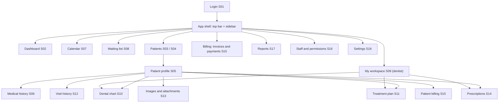
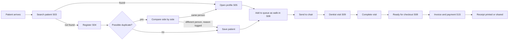
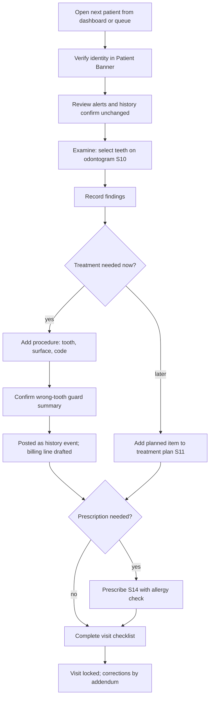
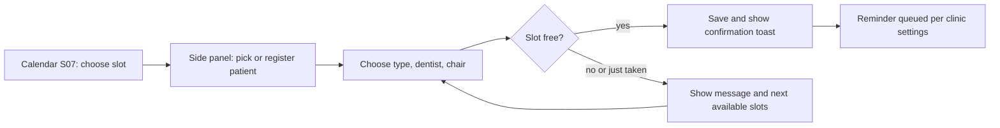
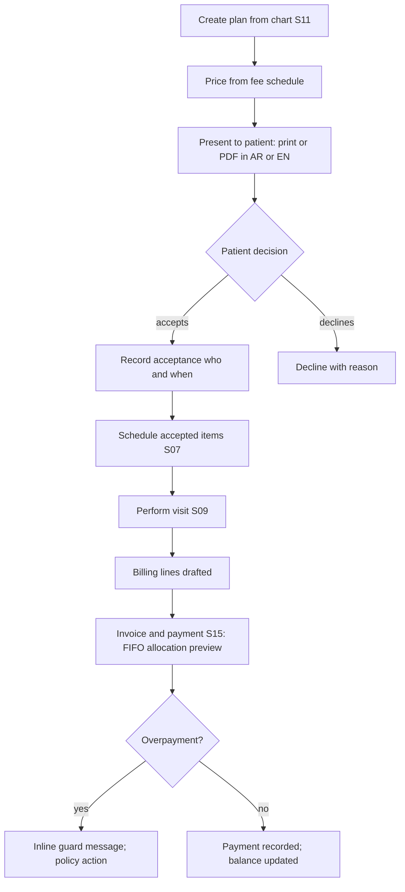

# ARGON Dental — Cloud 4: Premium UX/UI Design System

| Field | Value |
|---|---|
| Product | ARGON Dental — Jordan Pilot |
| Team | Cloud 4 — Principal UX/UI (enterprise healthcare) |
| Deliverable type | Research, analysis, design specification (documentation only) |
| Report date / source access date | 2026-11-06 |
| Status | **DESIGN PROPOSAL — NOT IMPLEMENTED — NOT USER-TESTED — NOT PRODUCTION-READY** |
| Data policy | All patient names, numbers and amounts in this document are **synthetic** |

## Contents

1. [Executive summary](#1-executive-summary) · 2. [Scope](#2-scope) · 3. [Research method and findings](#3-research-method-and-findings) · 4. [Design principles](#4-design-principles) · 5. [Visual identity and design tokens](#5-visual-identity-and-design-tokens) · 6. [Typography](#6-typography) · 7. [Layout, grid, bidi, responsive, states](#7-layout-grid-bidi-responsive-and-cross-cutting-states) · 8. [Screen specifications S01–S18](#8-screen-specifications) · 9. [Navigation model](#9-navigation-model-and-information-architecture) · 10. [Component library](#10-component-library-structure) · 11. [User journeys](#11-user-journeys) · 12. [Requirements, security and safety](#12-design-requirements-security-and-safety) · 13. [Risks, sequence, acceptance, tests](#13-risks-implementation-sequence-acceptance-criteria-test-scenarios) · 14. [Evidence and references](#14-evidence-and-references) · 15. [Questions for approval](#15-questions-requiring-human-or-specialist-approval) · Appendices A–F (tokens JSON, CSS, contrast, odontogram matrix, glossary, fixtures)

---

## 0. How to read this document

### 0.1 Evidence labels

Every non-trivial statement is tagged so an engineering team knows what it can rely on.

| Tag | Meaning |
|---|---|
| **[V]** | **Verified evidence** — retrieved from a cited source this session, or computed this session (e.g., WCAG contrast ratios). |
| **[D]** | **Documented design** — described in existing ARGON skill/spec files or project notes available to this team. *Not verified as implemented software.* |
| **[R]** | **Recommendation** — Cloud 4's proposal. A design decision, not a fact. |
| **[A]** | **Unverified assumption** — plausible, needs confirmation by a human or specialist before it is relied on. |

### 0.2 What this team did and did not do

- **Did:** read the existing ARGON design-system specification **[D]**; retrieved public standards and reference material (Section 14); computed contrast ratios for every existing and proposed color pair **[V]**; produced specifications.
- **Did not:** open, clone or modify any ARGON repository; connect to any production system; use any real patient data; build clickable prototypes or editable design files (see 0.3); verify any product's visual UI by screenshot (see 3.2).
- **Therefore:** this document says what ARGON's *documented* design system contains, not what the deployed UI looks like. Where the report says "existing token", it means "documented token".

### 0.3 Visual deliverables — important limitation

No editable design file (Figma/Penpot) could be produced in this research session. Instead this report provides:

1. **Machine-readable tokens** in the W3C Design Tokens Community Group (DTCG) JSON format (Appendix A) and a CSS custom-property block (Appendix B) — importable into design tools **[A: import behaviour per tool must be tested]**.
2. **Schematic wireframes** (ASCII, clearly labeled *SCHEMATIC — layout intent only, not final visual design*).
3. **Mermaid diagrams** for navigation and user journeys.
4. A **reference-study protocol** (Section 3.3) for collecting labeled visual references from official product demos.

---

## 1. Executive summary

### 1.1 Direction in one paragraph

ARGON Dental should look and behave like a **calm, institutional clinical instrument**: quiet surfaces, one confident deep-teal brand anchor, strong typographic hierarchy, and zero decorative effects on clinical or financial data. It is **Arabic-first by construction** (layouts authored in logical, direction-neutral terms; English LTR is a first-class sibling, not a mirrored afterthought) and **desktop-first** with a purpose-built **chairside tablet mode** for dentists. The system **evolves the existing ARGON design tokens** **[D]** rather than replacing them, in line with the project rule that existing repositories are improved, not rewritten.

### 1.2 Ten decisions that shape everything else

| # | Decision | Basis |
|---|---|---|
| 1 | **Keep the existing ARGON token lineage** (teal primary, slate neutrals, six semantic status colors, 4px grid, "Clinical Flat+" rules) as the base; add *text-safe* and *surface* variants and a dental layer on top. | [D] existing spec; project rule "improve, not replace" |
| 2 | **Fix the documented-token accessibility defects** before any new screen ships: white text on `primary-600` (3.74:1), `warning` as text/fill-with-white (2.15:1), `slate-400` placeholder (2.56:1), `slate-200` input borders (1.23:1 for a control boundary), and the `primary-500` focus border (2.49:1). | [V] computed (Appendix C); WCAG 2.2 SC 1.4.3 / 1.4.11 |
| 3 | **Brand anchor shifts one step darker for interactive use:** buttons/links use `primary-700` (#0F766E, 5.47:1 with white), keeping `primary-600` for large decorative or non-text use only. | [V] contrast; [R] |
| 4 | **Status is never color-only:** every status = color + icon + text label (already an ARGON hard rule **[D]**); the odontogram additionally uses fill *patterns* and letter codes. | [D]; [R] extension |
| 5 | **The odontogram keeps a fixed, direction-independent layout** (FDI/ISO 3950 "dentist's view": patient's right on the viewer's left) in **both** Arabic and English UI. It is *not* mirrored with the page. | [V] FDI chart convention (Section 14); [A] confirm with Jordanian dentists |
| 6 | **Numerals are Western digits (0–9) in all data fields**, embedded as LTR runs inside RTL text; **JOD = 3 decimals**, SAR = 2 decimals (currency-aware formatting). | [D] existing rule; [A] ISO 4217 decimals need confirmation in implementation; [A] user preference for Eastern digits unconfirmed |
| 7 | **Type:** run a short typeface bake-off — IBM Plex Sans Arabic (+ IBM Plex Sans Latin), Noto Sans Arabic, and the current Tajawal — against objective criteria (Section 6.2). Tajawal remains the fallback. **Self-host** the winner (offline-capable, no third-party CDN dependency, $0). | [D] current Tajawal/Cairo; [V] all three are open-licensed; [R] |
| 8 | **Patient identity is always on screen** in any clinical or financial context (persistent *Patient Banner* with name, age, file number, and a **medical-alert indicator**) to reduce wrong-patient errors. | [R] safety-by-design; [D] documented dedup engine/NID gate informs registration |
| 9 | **Every drag interaction has a non-drag alternative** (calendar rescheduling, odontogram multi-select). | [V] WCAG 2.2 SC 2.5.7 |
| 10 | **Tokens are authored in DTCG JSON, designed in Penpot (free, self-hostable), consumed as CSS variables** — keeping the $0/month budget. | [V] DTCG 2025.10 stable; [V] Penpot free/self-host claims (secondary sources); [R] |

### 1.3 What is *not* decided (needs human/specialist approval)

The most consequential open items (full list in Section 15):

1. Final typeface (bake-off result).
2. Tooth-numbering notation used by Jordanian pilot dentists (FDI vs. other) and whether the UI must offer an alternate display.
3. Clinical content: medical-history questionnaire items, alert rules, procedure/Arabic terminology — **must be authored/approved by a licensed dentist**, not by design.
4. Legal items (consent capture, e-signature, e-invoicing, retention, data residency, Saudi PDPL / Jordan PDPL obligations) — **not researched by this team and not asserted here**.
5. Whether the pilot clinic needs a gloved-touch chairside tablet at all, or desktop only.

### 1.4 Honest status of the evidence

- Standards material (WCAG 2.2, ARIA APG, DTCG, FDI notation) is well sourced.
- **Reference-product UI evidence is thin**: only aggregator feature lists were retrievable; no screenshots were verified (Section 3.2). Product names in this report indicate *categories of study*, not claims about their interfaces.
- **Official Jordanian digital-design guidance was not found** in this session; Saudi DGA "Platform Code" was confirmed to exist via press and a case-study PDF, but the official DGA portal itself was not reached.
- No usability testing has occurred. Every layout here is a hypothesis.

---

## 2. Scope

### 2.1 In scope

Visual identity, interaction patterns and specifications for the **18 screens** listed in the brief; design tokens; typography; spacing/grid; component library structure; navigation model; user-journey diagrams; accessibility, RTL/LTR and responsive rules; UX-level security/safety considerations; acceptance criteria and test scenarios.

### 2.2 Out of scope (and why)

| Item | Reason |
|---|---|
| Writing code / modifying repos / deployment | Project rule |
| Clinical content authoring (questionnaires, alerts, drug data) | Requires a licensed clinician |
| Legal/regulatory determination (Jordan, KSA) | Not researched; must not be invented |
| Backend/security rules design | Other Clouds; this report only lists **UX dependencies** on them |
| Brand naming, logo, marketing site | Not requested; logo treatment appears only where login needs a placeholder |
| Native mobile apps | Pilot is web/PWA-first **[D: existing stack is web/PWA]** |

### 2.3 Documented context this design must respect

These come from existing ARGON notes **[D]** and are *not verified as implemented*:

| Documented fact | UX consequence |
|---|---|
| Live multi-tenant Firebase EMR already serves clinics in Jordan; changes must be **surgical and additive** | Design system ships as an **additive layer** (new tokens/components alongside old), never a big-bang restyle. |
| Existing design spec: teal/slate palette, Tajawal/Cairo, "Clinical Flat+", shared spinner/toast/modal, Western digits, JOD 3 decimals | Base of this system (Section 5). |
| Dental chart v2.0 with interactive odontogram already exists; dental terminology v2.1 adds a **128-code Jordanian fee-schedule catalog** plus a **doctor-scoped label customization layer**; a new **append-only `dental_history`** records tooth-level events while the **older chart save is destructive** | Odontogram and treatment-plan specs (Sections 8.10–8.11) must expose *canonical code + custom label* and distinguish "chart snapshot" from "history event". |
| Auth claims carry only `{role, clinicId}` — **no per-staff claim**, so doctor-vs-doctor isolation of per-doctor data is **UI convention, not enforced** | The UI must **not imply privacy it cannot guarantee** (Section 8.16). |
| A cross-tenant Home Screen/PWA bug was fixed by removing a hardcoded default clinic and adding a "Safe Failure" screen | Login/shell must always show *which clinic* is active and fail safe, never default to a clinic (Section 8.1). |
| Smart Patient Deduplication with Arabic normalization and a National-ID gate | Patient search/registration must surface duplicates *before* creation (Sections 8.3–8.4). |
| Billing engine: FIFO payment allocation, append-only records, overpayment guard | Invoice UI shows **reversal/credit**, not edit; shows allocation transparently (Section 8.15). |
| Offline-first and autosave-draft principles exist for clinical notes | Standard "Saved / Saving / Offline" state indicator (Section 7.6). |
| Production security audit identified cross-tenant storage and RBAC-at-rules gaps, with fixes *produced* (deployment status not verified here) | Images/attachments screen carries an explicit dependency (Section 8.13). |
| Existing repository visibility was flagged as public | Out of Cloud 4 scope; recorded as a risk because design assets/tokens must not embed secrets or real data. |

---

## 3. Research method and findings

### 3.1 Standards and primary guidance retrieved

| Topic | Finding | Tag | Source (see §14) |
|---|---|---|---|
| WCAG version | WCAG 2.2 is a W3C Recommendation (published 5 Oct 2023) and adds 9 success criteria to 2.1. | [V] | R1 |
| Target size | SC 2.5.8 (AA): pointer targets at least **24×24 CSS px**, with exceptions. | [V] | R1, R2 |
| Dragging | SC 2.5.7 (AA): dragging must have a single-pointer alternative. | [V] | R1 |
| Focus | SC 2.4.11 (AA) Focus Not Obscured (Minimum); 2.4.13 (AAA) Focus Appearance ≥2 px thick, ≥3:1 contrast. | [V] | R1, R3 |
| Authentication | SC 3.3.8 (AA) Accessible Authentication (Minimum) — affects Login (no cognitive-function test; paste/password managers allowed). | [V] list; [A] exact wording to be read from the Recommendation | R1 |
| Consistent Help | SC 3.2.6 (A) — help mechanism in a consistent location. | [V] | R1 |
| Redundant Entry | SC 3.3.7 (A) — avoid re-asking info already entered in the same process (registration, history). | [V] | R1 |
| Widget patterns | ARIA APG documents Dialog (Modal), Combobox, Grid, Tabs, Disclosure, Alert, etc., each with keyboard model. | [V] | R4 |
| Tooth numbering | FDI two-digit notation = ISO 3950; permanent teeth 11–48, primary 51–85; quadrant digit first; chart conventionally shown from the *dentist's view* (patient's right on chart left). | [V] secondary (Wikipedia + dental FAQ); ISO page not opened | R5, R6 |
| Design tokens | DTCG Format Module **2025.10** is the first stable version; it is a Community Group report, **not a W3C Standard/Standards Track**. | [V] | R7, R8 |
| Design tool | Penpot is open source, free, self-hostable, with native design tokens; free hosted plan limits (e.g., team size) vary by source. | [V] secondary; [A] confirm current limits | R9, R10 |
| Saudi government design system | DGA launched the **Platform Code**, an open-source national design system for government interfaces (Nov 2024); a CX case study cites 75+ reusable components. | [V] secondary; official portal not reached | R11, R12 |
| Arabic fonts | IBM Plex Sans Arabic, Noto Sans Arabic, Tajawal, Cairo are available under open licenses (SIL OFL) via Google Fonts; Noto Sans Arabic exposes a tabular-figures feature (`tnum`) per Fontsource; IBM Plex Sans Arabic is **not variable** (static 100–700). | [V] secondary; [A] verify `tnum` on each candidate in a test page | R13–R15 |

### 3.2 Reference products — what was and was not verified

Targets named in the brief's "real reference products" instruction and found in dental charting/PMS categories: **Dentrix, Open Dental, CareStack, Curve Dental** (Capterra / Software Advice / GetApp listings). **[V]** The retrievable evidence only confirms **feature categories** (scheduling, charting, periodontal charting, imaging, e-prescribing, treatment planning, billing, reminders, multi-location). **[V]**

**No screenshot or official demo was reviewed.** Therefore:

- This report makes **no claim** about how any named product looks or behaves.
- Section 3.3 gives the *study protocol* the team should run (≈1 day, free: public demo videos/documentation) to attach labeled visual references to each screen spec.
- UI patterns in Section 8 are derived from **domain constraints and standards**, and are tagged **[R]**.

### 3.3 Reference-study protocol (to complete the "visual references" requirement)

For each of the 18 screens, a team member records, for 2–3 official product demos/docs:

| Field | Capture |
|---|---|
| Product + official URL + access date | Cite; never copy proprietary assets |
| Screen / moment | e.g., "chair-side odontogram selection" |
| Pattern observed | one sentence, own words |
| What to adopt / reject / avoid copying | decision + reason |
| Image | **link only**; do not embed or redistribute screenshots |

Rule: *study patterns, not pixels.* ARGON's visual identity, iconography, odontogram artwork and component styling must be original.

### 3.4 Domain findings that drive the design **[R unless tagged]**

1. **Two very different users share one system.** Reception: high-volume, interruption-driven, speed + accuracy on identity/money. Dentist: low-volume, high-stakes, hands often occupied/gloved, glancing at the screen between actions.
2. **Wrong-patient and wrong-tooth errors are the signature risks** of this domain. UI should make patient and tooth identity unmistakable at every write action.
3. **Arabic UIs fail most often at the seams:** mixed Arabic/Latin names, numbers, phone numbers, dates, currency, mirrored icons, PDFs, and tables. The system therefore specifies bidi rules explicitly (Section 7.2).
4. **Odontogram is a diagram, not a form.** It has a physical orientation independent of text direction and must be keyboard- and screen-reader-operable through the APG *grid* pattern **[V pattern exists]**.
5. **Dim treatment rooms and varied monitors** argue for strong contrast margins (we target ≥ 4.5:1 for all text with headroom where cheap, and ≥ 3:1 for all control boundaries).
6. **$0 budget** argues for: system-font fallback stacks, self-hosted subsetted fonts, SVG (not raster) odontogram, no UI frameworks that require paid licenses, Penpot rather than paid design seats.

---

## 4. Design principles

| # | Principle | Practical meaning |
|---|---|---|
| P1 | **Identity before action** | The patient (and for charting, the tooth) is named on screen before any write. |
| P2 | **Quiet by default, loud by exception** | Neutral surfaces; color is reserved for status, selection and the single primary action. Alerts that matter (allergy, overdue, destructive) are the only loud elements on a screen. |
| P3 | **Data surfaces are flat** | No gradients, glass or heavy shadow on patient records, odontogram, tables or invoices **[D existing rule]**. |
| P4 | **Never color alone** | Color + icon + text (+ pattern in the odontogram). |
| P5 | **Direction-neutral authoring** | Layouts are written with logical properties; the Arabic UI is designed natively, then the English UI is verified, rather than flipping a finished LTR design. |
| P6 | **Right density for the right role** | Reception: comfortable. Dentist desk: compact. Dentist chairside: large-target mode. |
| P7 | **Reversible or confirmed** | Anything destructive needs confirmation naming the object ("Delete treatment item: Tooth 36 — Composite filling"). Financial and clinical records are append-only: correct by *addendum/reversal*, not edit **[D]**. |
| P8 | **Fail safe, say so plainly** | Errors state what happened and the next step. When tenancy/identity is uncertain, show a safe-failure screen instead of guessing **[D PWA bug precedent]**. |
| P9 | **Original, institutional identity** | Study patterns from existing products; copy none of their pixels, icons or odontogram artwork. |
| P10 | **Everything works from the keyboard** | Desktop reception staff are power users; shortcuts are a feature, not an extra. |

**Tone of voice (Arabic and English):** plain, respectful, clinical-neutral. No exclamation marks in errors; no humor in clinical contexts; Modern Standard Arabic for system text, with Jordanian/Gulf colloquial avoided in UI strings **[R; A: confirm with pilot staff]**.

---

## 5. Visual identity and design tokens

### 5.1 Brand expression: "Clinical Flat+ — Institutional"

The existing ARGON direction ("inert, stable, precise, clean — a noble gas, not a flashy startup") **[D]** already suits a premium medical brand. The evolution proposed here is *refinement*, not reinvention:

| Lever | Existing **[D]** | Proposed **[R]** | Why |
|---|---|---|---|
| Brand anchor | Teal `primary-600` for buttons/links | **Deep teal `primary-700` for interactive text/fills; `primary-900` for brand surfaces** (login panel, sidebar header) | `primary-600` with white text is 3.74:1 **[V]** — fails AA for normal text. Deeper teal also reads as more mature. |
| Neutrals | Cool slate | Keep. Add **`slate-500`** for control borders and placeholders. | Existing `slate-400`/`slate-200` borders and placeholders fail non-text/ text contrast **[V]**. |
| Accent | Gold, sparingly | Keep, **decorative only** (plan badge, login ornament). Never as text on white (2.31:1 **[V]**). | Premium cue without legibility cost. |
| Surfaces | Flat, 1px borders, 8/12px radius | Keep. Add 4px radius for dense chips/odontogram controls. | Consistency with live product. |
| Signature | — | **Hairline-and-ink** header: 1px `slate-200` rule under a white top bar; page titles in the display face; generous whitespace; one deep-teal sidebar. | Distinctive without ornament. |
| Illustration | — | Line-weight-consistent, monochrome teal/slate SVG for empty states and login; custom tooth glyphs. | Avoids stock-AI look; stays $0 (own SVG). |

**What "not generic AI-generated UI" means here (design test):** (a) no purple-blue gradients, glass cards or floating blobs; (b) no emoji as icons; (c) hierarchy created by type, spacing and alignment—not by boxes and shadows; (d) language-specific typographic care (Arabic leading, numerals, bidi); (e) domain-specific components (patient banner, odontogram, queue board) rather than generic dashboards of cards.

### 5.2 Token architecture (three layers)

```
Layer 1  PRIMITIVE   raw values            --argon-primary-700: #0F766E
Layer 2  SEMANTIC    role in the UI        --color-action-bg: var(--argon-primary-700)
Layer 3  COMPONENT   per component         --btn-primary-bg: var(--color-action-bg)
```

Rules: components reference **semantic** tokens only; no hex in component CSS; a new hex requires adding a primitive and updating Appendix A/C (mirrors the existing "no new hex without updating the token file" rule **[D]**). Existing token names are **preserved** (backwards compatible); new names are additive.

### 5.3 Color — primitives

**Existing primitives retained [D]**

| Token | Hex | Notes |
|---|---|---|
| `--argon-primary-50/100/300/500` | #ECFEFF / #CCFBF1 / #5EEAD4 / #14B8A6 | Tints, selection, dark-theme accents |
| `--argon-primary-600` | #0D9488 | **Non-text / large graphics only** (3.74:1 on white **[V]**) |
| `--argon-primary-700` | #0F766E | **Default interactive color** (5.47:1 on white **[V]**) |
| `--argon-primary-900` | #134E4A | Brand surfaces, hover (9.48:1 with white **[V]**) |
| `--argon-slate-50/100/200/400/600/900` | #F8FAFC / #F1F5F9 / #E2E8F0 / #94A3B8 / #475569 / #0F172A | Page / panel / divider / disabled / secondary text / primary text |
| Status fills: success / info / warning / danger / archived / draft | #059669 / #0284C7 / #F59E0B / #DC2626 / #374151 / #6B7280 | **Load-bearing in existing badges — do not change [D]** |
| `--argon-accent-gold` | #D4A24E | Decorative only |

**New primitives proposed [R]** (all contrast values computed this session **[V]**)

| Token | Hex | Used for | Contrast |
|---|---|---|---|
| `--argon-slate-500` | #64748B | Control borders, placeholder, tertiary text | 4.76:1 on white; 4.55:1 on slate-50 |
| `--argon-success-text` | #047857 | Success text/icons on white | 5.48:1 |
| `--argon-info-text` | #0369A1 | Info text/icons on white | 5.93:1 |
| `--argon-warning-text` | #B45309 | Warning text/icons on white | 5.02:1 |
| `--argon-danger-text` | #B91C1C | Danger text on white | 6.47:1 |
| `--argon-success-soft` / `-on-soft` | #D1FAE5 / #065F46 | Badge/banner surface + text | 6.78:1 |
| `--argon-info-soft` / `-on-soft` | #E0F2FE / #075985 | | 6.59:1 |
| `--argon-warning-soft` / `-on-soft` | #FEF3C7 / #92400E | | 6.37:1 |
| `--argon-danger-soft` / `-on-soft` | #FEE2E2 / #991B1B | | 6.80:1 |

### 5.4 Color — semantic tokens (light theme)

| Semantic token | Resolves to | Contrast / note |
|---|---|---|
| `--color-bg-page` | slate-50 | App canvas |
| `--color-bg-surface` | #FFFFFF | Cards, tables, inputs, modals |
| `--color-bg-subtle` | slate-100 | Panels, table header, zebra (use sparingly) |
| `--color-border-separator` | slate-200 | Decorative dividers only (1.23:1 — **not** acceptable as a control boundary) |
| `--color-border-control` | slate-500 | Input/checkbox/radio/select boundaries (4.76:1; meets ≥3:1 for SC 1.4.11) |
| `--color-text-primary` | slate-900 | 17.06:1 on slate-50 |
| `--color-text-secondary` | slate-600 | 7.58:1 on white; 7.24:1 on slate-50 |
| `--color-text-tertiary` / placeholder | slate-500 | 4.76:1 on white |
| `--color-text-disabled` | slate-400 | Disabled text is exempt from contrast rules but must carry a non-color disabled cue (cursor, no hover, `aria-disabled`) |
| `--color-action-bg` / `-hover` / `-text` | primary-700 / primary-900 / #FFFFFF | 5.47:1 / 9.48:1 |
| `--color-action-link` | primary-700 | 5.47:1 on white; 5.23:1 on slate-50 |
| `--color-selection-bg` | primary-50 | Selected row/tab/tooth halo; text on it ≥5.26:1 with primary-700, 9.11:1 with primary-900 |
| `--color-focus-ring` | primary-700 | 3 px outline, 2 px offset; **5.47:1** vs white (SC 2.4.13 AAA target: ≥2 px and ≥3:1) |
| `--color-danger-action-bg` | #DC2626 | White text 4.83:1 |
| `--color-warning-action-bg` | #F59E0B | **Dark text only** (slate-900, 8.31:1). White on it is 2.15:1 — forbidden |

> **Defects found in the documented tokens [V]** (full list with the focus-style defect in Appendix C): (1) white text on `primary-600` = 3.74:1; (2) `warning` #F59E0B with white = 2.15:1 (the documented trial/grace banner token); (3) `slate-400` placeholders = 2.56:1; (4) `slate-200` input border = 1.23:1; (5) `success` #059669 and `info` #0284C7 as *text on white* = 3.77:1 and 4.10:1 (below 4.5:1 for normal text). Fix: use the `-text` and `-soft` variants for text; keep original fills for dots, bars, icons ≥3:1 and badge borders.

### 5.5 Dim theme (optional, post-pilot) **[R]**

Dental operatories are often dimmed for imaging and procedures; a dim theme reduces glare. It is **P2** (not required for pilot).

| Token | Value | Contrast **[V]** |
|---|---|---|
| bg-page | #0F172A | — |
| bg-surface | #111B2E | text #E2E8F0 = 13.96:1 |
| text-primary | #E2E8F0 | 14.48:1 on #0F172A |
| text-secondary | #94A3B8 | 6.96:1 on #0F172A |
| action / link / focus | #2DD4BF | 9.59:1 on #0F172A |
| primary button | bg #0F766E, text #FFFFFF | 5.47:1 |

The **radiograph/image viewer is always dark** regardless of theme **[R]**.

### 5.6 Dental clinical palette (odontogram) **[R; A: confirm conventions with dentists]**

Color conventions in dental charting vary; do not assume a universal "red = pathology, blue = existing treatment". Proposed mapping, each with **pattern + glyph + label** so color is never the only carrier:

| Condition class | Fill token | Hex | Contrast vs white **[V]** | Pattern | Glyph |
|---|---|---|---|---|---|
| Pathology (e.g., caries) | `--dental-pathology` | #DC2626 | 4.83:1 | solid | ● |
| Existing restoration | `--dental-restored` | #0369A1 | 5.93:1 | solid + 1px inner outline | ■ |
| Planned / treatment needed | `--dental-planned` | #B45309 | 5.02:1 | diagonal hatch | ▨ |
| Missing / extracted | `--dental-missing` | #374151 | 10.31:1 | tooth outline dashed, no fill | ✕ |
| Healthy / no finding | tooth fill #FFFFFF, outline slate-500 | #64748B | 4.76:1 | none | — |
| Selected | halo `primary-50` + 3px `primary-700` outline | #0F766E | 5.00:1 vs slate-100 tooth fill | — | — |

Full state matrix in Appendix D.

### 5.7 Elevation, radius, borders, spacing, motion

| Token group | Values |
|---|---|
| Radius | `xs 4px` (new, dense chips, odontogram controls) · `sm 8px` · `md 12px` · `full 999px` **[D + new xs]** |
| Border | 1px `separator` for cards/tables; 1px `control` for inputs; 2px for selected/active **[R]** |
| Elevation | `0` resting cards (use border) · `0 4px 12px rgba(15,23,42,.08)` hover/raised · `0 10px 30px rgba(15,23,42,.12)` modal/dropdown **[D]** |
| Spacing | 4/8/12/16/24/32/48 **[D]** + `space-7: 40px`, `space-9: 64px` **[R]** (2px hairline for icon/text gaps) |
| Motion | 120 ms (micro) / 200 ms (panel, toast — existing toast 200 ms **[D]**) / 0 under `prefers-reduced-motion`; easing standard ease-out; no animation of clinical values except a 1-second highlight of changed cells **[R]** |
| Z-index | content 0 · sticky header 10 · patient banner 20 · dropdown 30 · modal 40 · toast 50 **[R]** |

### 5.8 Iconography **[R]**

- One outline icon set, 1.5px stroke, 24px grid (16/20/24 sizes). Candidate: an open-source set such as Lucide **[A: license and Arabic-RTL mirroring behaviour to be verified; not researched this session]**.
- **Custom SVG tooth set** (32 adult + 20 primary silhouettes, 5-surface geometry) — original artwork, authored once, reused by odontogram, treatment plan and mini-charts.
- **Mirror in RTL:** chevrons, back/forward arrows, "next/previous", list/tree indents, progress bars, send/reply, sidebar toggle. **Do not mirror:** checkmarks, clocks, media controls, brand/logo, tooth glyphs, charts' value axes, phone, search (magnifier handle is conventionally kept), "undo/redo" arrows **[A: confirm undo/redo with Arabic reviewers]**.

---

## 6. Typography

### 6.1 Roles and scale

Existing scale retained **[D]**, with usage clarified and two additions **[R]**:

| Token | Size / line-height | Weight | Role |
|---|---|---|---|
| `display` | 2.25rem / 1.2 (EN) · 1.3 (AR) | 700 | **Login and empty-state heroes only** (existing H1) |
| `h2` (page title) | 1.5rem / 1.3 | 600 | Page/screen titles (existing H2) |
| `h3` | 1.125rem / 1.4 | 600 | Card/section/modal titles |
| `lg` *(new)* | 1.25rem / 1.35 | 600 | Sub-headers in workspace panels |
| `body` | 1rem / 1.6 (EN) · 1.7 (AR) | 400 | Forms, notes |
| `sm` | 0.875rem / 1.5 (EN) · 1.6 (AR) | 400 | Table cells, helper text |
| `xs` | 0.8125rem / 1.4 (EN) · 1.5 (AR) | 400/500 | Timestamps, badges, captions — **minimum 13px** (raised from the documented 12px for Arabic legibility **[R]**) |
| `kpi` *(new)* | 1.75rem / 1.2 | 600 | Dashboard numbers, tabular figures |
| `mono-code` *(new)* | 0.875rem | 500 | Procedure codes, file numbers (tabular figures; LTR) |

Arabic needs **more line-height than Latin** at the same size because of ascenders, dots and diacritics; the AR/EN line-height tokens differ (e.g., `--lh-body: 1.6` vs `1.7`) and are switched by `:lang(ar)` **[R; A: validate with specimen testing]**.

### 6.2 Typeface decision — bake-off (do this before locking tokens)

Candidates (all retrieved as open-licensed **[V]**; usage via Google Fonts catalog):

| Candidate | Facts **[V]** | Considerations **[R/A]** |
|---|---|---|
| **IBM Plex Sans Arabic** | OFL; weights 100–700 (static); pairs by design with IBM Plex Sans (Latin) | Institutional tone; one family covers AR + EN; verify tabular figures and weight rendering at 13–14px. |
| **Noto Sans Arabic** | OFL; 9 weights; variable axes; exposes `tnum` and `rtlm` features (Fontsource) | Neutral, very broad coverage; Latin glyphs need a pairing (e.g., Noto Sans or Plex Sans). |
| **Tajawal** (current) | OFL; in the Google Fonts Arabic subset; **already in ARGON** **[D]** | Zero-migration cost; verify numerals/Latin pairing; weights 300–800 **[D]**. |
| Cairo (display only) | OFL **[D: currently display]** | Geometric; keep for display/brand moments only. |

**Bake-off protocol (≈½ day, free):** render the same 12 specimens in each candidate at 13/14/16 px in light theme on a typical clinic monitor and a tablet: a patient table (mixed Arabic names + Latin names + phone + JOD amounts), the odontogram labels, an invoice, a prescription, an English-only screen, and a 12-row medical-history checklist. Score 1–5 on: small-size legibility, numeral clarity (0 vs ٠ confusion avoided by Western digits), tabular alignment, Latin–Arabic harmony, weight steps visible, file size after subsetting, rendering in PDF export. Highest total wins; ties go to the existing Tajawal (lowest migration risk).

**Delivery:** self-host WOFF2 subsets (Arabic + Latin + digits), `font-display: swap`, load ≤2 weights initially (400, 600) plus 700 for headings **[R]**. Fallback stack: `<winner>, 'Tajawal', 'Segoe UI', Tahoma, system-ui, sans-serif`.

### 6.3 Typographic rules

1. **No letter-spacing on Arabic** (breaks joining); only EN uppercase labels may use it.
2. **No italics for Arabic emphasis**; use weight.
3. **No all-caps** in Arabic; avoid in English except tiny labels.
4. **Numerals:** Western digits in all data, tabular figures (`font-variant-numeric: tabular-nums`) wherever numbers align **[A: confirm font support]**; numbers are `dir="ltr"` inline-block runs **[D]**.
5. **Truncation:** truncate with ellipsis only in tables/lists, never on patient names in the banner (wrap to two lines); tooltip shows full text; do not truncate allergies.
6. **Names:** display order per user's script; never reorder name parts; use `dir="auto"` / `<bdi>` for user-entered text.
7. **Line length:** 60–80 characters for notes; clinical notes editor max-width ~720px.

---

## 7. Layout, grid, bidi, responsive and cross-cutting states

### 7.1 Grid and layout primitives **[R unless tagged]**

| Breakpoint | Name | Range (CSS px) | Columns | Gutter / margin | Typical device |
|---|---|---|---|---|---|
| xs | Mobile | < 480 | 4 | 12 / 16 | Staff phone |
| sm | Mobile-L | 480–767 | 4 | 16 / 16 | |
| md | Tablet | 768–1023 | 8 | 16 / 24 | Chairside tablet (portrait/landscape) |
| lg | Small desktop | 1024–1279 | 12 | 24 / 24 | Reception laptop |
| xl | Desktop (reference) | 1280–1599 | 12 | 24 / 32 | Dentist desk monitor; container max 1280 **[D]** |
| 2xl | Wide | ≥ 1600 | 12 | 24 / 32 | Max content width 1440; extra width goes to side panels |

Shell: **sidebar 260 px [D]** (collapsed 72 px) at `inline-start`; **top bar 56 px**; **patient banner 64 px** (condensed 48 px on scroll). Reference design width: **1440 × 900**; minimum supported desktop: **1024 × 700**.

### 7.2 Bidirectional (RTL/LTR) rules

1. `<html lang dir>` set from the user's language preference; each user-entered string rendered with `dir="auto"` or inside `<bdi>`.
2. **Logical CSS only** in components (`margin-inline-start`, `padding-inline`, `inset-inline-end`, `text-align: start/end`, `border-start-start-radius`); a lint rule bans `left/right` in component styles **[R]**.
3. **Numbers, phone numbers, IDs, codes, dates, currency amounts** are LTR isolates (`direction: ltr; unicode-bidi: isolate; display: inline-block`) **[D, extended]**.
4. **Currency:** amount then label — `123.450 د.أ` (JOD, 3 decimals, per billing engine **[D]**); `123.45 ر.س` (SAR, 2 decimals) **[A: confirm decimals per ISO 4217 when the second market is enabled]**. Always show ISO code `JOD`/`SAR` in the English UI and in exports.
5. **Dates:** store ISO 8601; display `DD/MM/YYYY` (Gregorian) with the month spelled in long forms where space allows. **Arabic month names differ by region** (Levantine vs. Gulf naming) → locale pair `ar-JO` / `ar-SA` as a setting **[A: confirm which names Jordanian staff expect]**. Optional secondary Hijri display for KSA is **P2** **[A]**.
6. **Week:** start day and weekend days are **clinic settings** (Section 8.18) **[A: Jordan/KSA weekend conventions to be confirmed with the pilot clinic; do not hardcode]**.
7. **Keyboard:** horizontal arrow keys follow the *visual* direction (RTL: ← moves to the next item); **exception:** the odontogram, whose visual orientation is fixed (Section 8.10).
8. **Directional icons** mirror per Section 5.8; **tooth diagrams, charts' value axes and logos do not**.
9. **Tables:** first column at `inline-start`; actions column at `inline-end`; numeric columns align to `end` with tabular figures **[A: validate decimal alignment in RTL usability test]**.
10. **Time axes** (calendar, timelines) run **in the reading direction** (RTL: earlier = right) **[A: validate; if users disagree, add a setting]**.
11. **Search/normalization:** Arabic search ignores diacritics and common letter variants; reuse the documented normalization used by the dedup engine **[D]**.
12. **Language switcher:** per-user setting persisted to the profile; switching does not lose unsaved input; no full reload required if the stack allows **[R]**.

### 7.3 Responsive behavior (global rules)

| Pattern | ≥1280 | 1024–1279 | 768–1023 | < 768 |
|---|---|---|---|---|
| Sidebar | Expanded 260 px | Collapsed 72 px (icons + tooltip) | Off-canvas drawer | Bottom tab bar (4 items) + drawer |
| Patient banner | Full | Full | Condensed | Condensed, expandable sheet |
| Tables | Full columns | Hide low-priority columns | Column chooser; key columns | **Card list** (key fields + chevron) |
| Two-pane workspaces | Side-by-side | Side-by-side, narrower | Stacked with tabs; odontogram first | Single column, segmented control |
| Modals | Centered 480/720 px **[D]** | Same | Same / full-height sheet for forms | Full-screen sheet |
| Calendar | Week + resources | Day + resources | Day (3 resources) | Day, 1 resource, swipe between resources |
| Touch target | ≥ 32 px | ≥ 32 px | ≥ 44 px | ≥ 44 px |
| Hover-only info | Allowed with focus equivalent | Same | **Never** | **Never** |

**Chairside mode** (tablet, dentist workspace): all targets ≥ 48 px, row height 56 px, type +1 step, no hover affordances, no drag-only actions, primary actions at the bottom `inline-end` for thumb reach **[R; A: validate glove/touch assumption with dentists]**.

### 7.4 Density modes **[R]**

| Mode | Row height | Body size | Default for |
|---|---|---|---|
| Comfortable | 48 px | 1rem | Reception, mobile, tablets |
| Compact | 36 px | 0.875rem (≥14 px) | Dentist desk, reports |
| Chairside | 56 px | 1.0625rem | Tablet in dentist workspace |

Minimum target in any mode: **24×24 px (WCAG 2.5.8 AA) [V]**; recommended ≥ 32 px desktop, ≥ 44 px touch **[R]**.

### 7.5 Forms (global)

- Labels above inputs (never placeholder-as-label); required marked with text "(required)" / "(مطلوب)" not just an asterisk.
- Inline validation on blur; summary at top on submit with links to fields; focus moves to the first error (SC 3.3.1/3.3.3 intent).
- Preserve input on error; never clear a form; **avoid asking twice** for data already provided (SC 3.3.7 **[V]**).
- Input types: `inputmode` and `autocomplete` set; phone and ID fields LTR; paste always allowed (SC 3.3.8 **[V]**).
- Destructive confirm modal names the object, disables overlay-click dismissal **[D]**.

### 7.6 Save, sync and connection indicator (global) **[R; D offline/autosave principle]**

A single component, `SaveStatus`, near the page title:

| State | Icon + text (EN / AR) | Behavior |
|---|---|---|
| Editing (unsaved draft) | ● Draft / مسودة | Autosave debounced; draft stored on device |
| Saving | spinner Saving… / جارٍ الحفظ | Non-blocking |
| Saved | ✓ Saved 10:42 / تم الحفظ 10:42 | Time shown in LTR run |
| Offline, held locally | ⚠ Offline — saved on this device / بلا اتصال — محفوظ على الجهاز | Persistent banner; queued-actions list reachable |
| Failed | ✕ Not saved — Retry / لم يُحفظ — إعادة المحاولة | Persists until resolved; blocks "Complete visit" |
| Conflict | ⚠ Changed by another user — Review / تم التعديل من مستخدم آخر | Opens diff dialog |

### 7.7 Universal screen states (apply to all 18 screens)

| State | Pattern |
|---|---|
| **Initial load** | Skeletons that match final layout (no layout shift); spinner only inside buttons **[D]** |
| **Empty** | One sentence explaining what belongs here + one primary action; never a blank panel |
| **No results** | Echo query, offer broaden/clear, and a context action (e.g., "Register new patient") |
| **Error (recoverable)** | Inline banner: what failed, effect on data ("Nothing was saved"), Retry; support reference id small and LTR |
| **Error (fatal / tenancy / auth)** | Safe-failure full-page: no data shown, clear next step (sign in again / contact admin); **never default to another clinic** **[D precedent]** |
| **Permission denied** | Explain which role is needed and who can grant it; do not render the data |
| **Offline** | Global banner; read from local cache where allowed; writes queued with visible count |
| **Stale** | "Updated 10:42 · Refresh" on live boards (waiting list, calendar) |
| **Session expiring / locked** | Warn before timeout; on idle, **blur patient data** and require unlock **[R; A: timeout length is a clinic policy decision]** |
| **Partial failure** | List what succeeded and what failed (e.g., 2 of 3 attachments uploaded) |

---

## 8. Screen specifications

**Conventions for this section.** Wireframes are *SCHEMATIC — layout intent only, not final visual design*, drawn in LTR; in Arabic the layout mirrors (sidebar and primary actions move to the right) **except** where stated (odontogram, numerals, media). All names, numbers and amounts are **synthetic**. Each screen ends with its **dependencies/risks**. Role names are proposals (**[R]**) because only `role` and `clinicId` claims are documented **[D]**.

Screen IDs: S01 Login · S02 Dashboard · S03 Patient search · S04 Patient registration · S05 Patient profile · S06 Medical history · S07 Appointment calendar · S08 Reception waiting list · S09 Dentist workspace · S10 Odontogram · S11 Treatment plan · S12 Visit history · S13 Images & attachments · S14 Prescription · S15 Invoice & payment · S16 Staff & permissions · S17 Reports · S18 Clinic settings.

### 8.1 S01 — Login

**Purpose.** Authenticate staff, establish and *confirm* clinic context, fail safely.
**Users.** All staff. (A separate platform-admin entry exists in the live system **[D]**; keep it off the clinic login page.)

**Layout (desktop ≥1024).**
```
┌──────────────────────────────┬───────────────────────────────┐
│  BRAND PANEL (primary-900)   │   [AR | EN]            (Help) │
│  flat, no gradient           │                               │
│  logo                        │      ┌───────────────────┐    │
│  line-art tooth/arch (SVG)   │      │ Sign in           │    │
│  one-line promise            │      │ Email / username  │    │
│                              │      │ Password   [show] │    │
│                              │      │ [ Sign in ]       │    │
│  © / version                 │      │ Forgot password?  │    │
└──────────────────────────────┴───────────────────────────────┘
```
(RTL: brand panel on the right, form on the left.)

**Components.** Language toggle · text input (email, `dir="ltr"`) · password input with show/hide · primary button with in-button spinner **[D]** · inline alert · "Help" link in the same place on every public/auth page (SC 3.2.6 **[V]**) · caps-lock indicator.
**Actions.** Sign in; reset password; switch language; open help.
**Post-sign-in confirmation.** Interstitial strip for 2 seconds or until key press: "Signed in to **{Clinic name}** as **{Role}**" with "Not your clinic? Sign out" **[R]**; the clinic name + role then stay in the top bar permanently.

**States & errors.**
| State | Behavior |
|---|---|
| Idle / typing | Primary disabled only if fields empty (never disable for "invalid" before submit) |
| Submitting | Spinner in button; fields locked |
| Wrong credentials | Generic: "Email or password is incorrect." (no account enumeration) |
| Locked / throttled | "Too many attempts. Try again later or reset your password." |
| Offline | "No connection. Sign-in needs internet." |
| Session expired | Banner "Your session ended. Sign in to continue." and return to the previous safe location |
| Tenancy/identity uncertain | **Safe-failure page**: no data, "We couldn't confirm which clinic this account belongs to. Contact your administrator." Never fall back to a default clinic **[D precedent]** |
| Maintenance | Static notice with expected time |

**AR/EN.** Email and password inputs stay LTR inside the RTL form; labels and helper text follow language; toggle button sits at `inline-end` of the password field; tagline written natively in Arabic (not translated) **[R]**. Allow paste and password managers (SC 3.3.8 **[V]**). 
**Responsive.** < 1024: brand panel collapses to a 96 px header band; card fills width with 16 px margins. 
**Dependencies/risks.** MFA availability is unknown **[A]**; clinic discovery depends on how auth maps users→clinics **[D claims]**; PWA launch URL must never carry/guess another clinic **[D]**.

---

### 8.2 S02 — Main dashboard

**Purpose.** A role-aware "what needs me now" start page.
**Users and default content [R]:**
| Role | Widgets |
|---|---|
| Dentist | Next patient · My schedule today · Unfinished visits/notes · Patients with medical alerts today · Quick patient search |
| Receptionist | Arrivals & waiting · Today's schedule load · Unconfirmed appointments · Outstanding balances at checkout · Quick actions (New patient, New appointment, Check-in) |
| Owner/Admin | Revenue today / month (JOD) · Collections vs outstanding · No-show rate · Chair utilization · New patients · Setup checklist (first-run) |

**Layout (desktop).**
```
┌ Top bar: clinic ▾ · search (Ctrl/⌘K) · SaveStatus · lang · user ┐
├ Sidebar ┬───────────────────────────────────────────────────────┤
│ nav     │ h2 "Today — Sun 08/11/2026"          [ + New appt ]   │
│         │ ┌ KPI ┐ ┌ KPI ┐ ┌ KPI ┐ ┌ KPI ┐   (kpi tokens)       │
│         │ ┌ Schedule today (list) ──────┐ ┌ Needs attention ──┐ │
│         │ │ 09:00 Patient A · Filling   │ │ ⚠ 2 overdue bills │ │
│         │ │ 09:30 Patient B · Check-up  │ │ ⚠ 1 unsigned note │ │
│         │ └─────────────────────────────┘ └───────────────────┘ │
└─────────┴───────────────────────────────────────────────────────┘
```
**Components.** KPI tile (number, label, delta with icon+text, optional sparkline) · agenda list · attention list · quick-action buttons · lifecycle banner (trial/grace/locked using warning/danger *soft* tokens with icon **[D saas lifecycle]**).
**Actions.** Open an item (deep link), quick actions, change date (reception/admin).
**States.** First-run (empty): setup checklist (add staff → set hours → add dentists/chairs → import/register patients) · loading skeleton per widget · **per-widget error isolation** (one failing widget never blanks the page; "Couldn't load — Retry") · offline (stale stamp) · no appointments ("No appointments today" + "New appointment").
**AR/EN.** KPI numbers LTR with tabular figures; deltas "▲ 4.2%" use icon + text (not color alone); currency format per §7.2.
**Responsive.** 4 KPI → 2×2 → stacked; agenda full-width; on mobile only top 3 widgets + "More".
**Dependencies/risks.** KPI definitions (e.g., utilization, no-show) must be agreed with the pilot clinic **[A]**; financial KPIs hidden from roles without permission.

---

### 8.3 S03 — Patient search

**Purpose.** Find the *right* patient fast; prevent wrong-patient selection.
**Entry points.** Global search in the top bar (`Ctrl/⌘+K` or `/`), and a full page "Patients" with filters.

**Components.** Combobox (APG combobox + listbox **[V pattern]**) · result row · filter chips · recent patients · "New patient" row.
**Result row fields.** Initials avatar · full name (never truncated) · age/sex · file no. (`mono-code`) · mobile **partly masked** (e.g., last 3 digits) · last visit date · flags: ⚠ medical alert, balance-due glyph (both from the icon set) · status (active/archived).
**Search inputs.** Name (Arabic/English, normalization per **[D]**), mobile, file no., National ID (exact match only; **never displayed in results**), date of birth. Minimum 2 characters; debounce ~250 ms **[R; A tune]**.
**Disambiguation.** When ≥2 results share a name, differing fields (DOB, mobile suffix, last visit) are emphasized.
**Actions.** ↑/↓ move, Enter open, Esc close, Ctrl/⌘+Enter open in "Start visit/Book"; result action menu: Open profile · Book appointment · Start visit · Check-in.

**States & errors.** Searching (inline progress) · **No results** (echo query; "Register new patient" prefilled with the query) · **Too many** ("Showing first 20 — refine by date of birth or mobile") · Offline (search limited to locally cached recent patients, labeled) · Permission-limited roles see fewer fields · Error ("Search is unavailable — try again").
**AR/EN.** Query field `dir="auto"`; phone/ID entry LTR; Arabic orthographic variants matched; Latin and Arabic names of one patient both searchable if stored **[A: field exists]**.
**Privacy.** Do **not** put the query (name/phone/ID) in the URL or analytics **[R]**.
**Responsive.** Mobile: full-screen search sheet; results as cards.
**Dependencies/risks.** Search performance on a small Firebase tier at pilot scale **[A]**; list virtualization for large result sets **[D skill exists]**.

---

### 8.4 S04 — Patient registration

**Purpose.** Create a patient record quickly and **without duplicates**.
**Layout.** Single page, three collapsible sections (no wizard — reception speed): **1 Identity** · **2 Contact** · **3 Guardian/Other** — with a sticky action bar (`Save`, `Save & book`, `Cancel`) and a right-hand "Possible matches" panel that appears when needed.

| Field | Rule |
|---|---|
| Full name (Arabic) | Required; four-part guidance in helper text; `dir="auto"` |
| Name (English/transliteration) | Optional; needed for English documents/insurance **[A]** |
| Date of birth or approximate age | Required one of; age shown live; typed `DD/MM/YYYY` + date picker (no drag) |
| Sex | Required; options per clinic policy **[A]** |
| Mobile | Required; country selector (+962 / +966), LTR; validate with a maintained open-source phone library **[A]** |
| National ID / other ID | Optional; masked after entry; triggers ID gate **[D]** |
| Email, address, emergency contact | Optional |
| Guardian | **Required if patient is a minor** (threshold = legal age of majority, to be confirmed **[A]**): name, relationship, phone |
| Referral source | Optional, picklist |
| Consents / privacy notice | Text supplied by legal; checkbox + timestamp **[A: legal]** |
| Photo | Optional |

**Duplicate gate (P1 priority).** On blur of (name + DOB), mobile or ID, run the documented matching **[D]**; if matches: show *side-by-side comparison* (name, DOB, mobile suffix, last visit) with actions **Open existing** · **This is a different person** (reason required, logged). An ID collision is a **hard stop** ("A patient with this ID already exists") **[D NID gate]**.
**States & errors.** Field-level validation (inline + summary) · duplicate found · ID conflict · offline (**creation blocked offline**; allow saving a local draft because offline creation can create duplicates **[R; A confirm]**) · save success (toast + "Patient created — Book appointment / Open profile") · partial failure.
**AR/EN.** Both name inputs always visible; do not auto-transliterate; phone and ID LTR with labels RTL; Western digits; validation messages localized with the *field label*, not generic "invalid".
**Responsive.** One column; sticky action bar at bottom; matches panel becomes a modal sheet.
**Dependencies/risks.** Minimum dataset for compliance unknown **[A]**; consent wording legal **[A]**.

---

### 8.5 S05 — Patient profile

**Purpose.** The patient hub: identity, alerts, status, and entry to everything.
**Layout.**
```
┌ Patient banner (sticky): [AB] Name · 34 y · F · File 000123 ·  ⚠ 2 alerts · Balance 25.000 JOD ┐
├ Tabs: Overview | Medical history | Dental chart | Treatment plan | Visits | Images | Prescriptions | Billing ┤
│ Overview:  Demographics card │ Alerts │ Upcoming appts │ Active plan summary │ Recent visits │ Outstanding │
│ Quick actions: [Book] [Start visit] [New invoice] [Add note]                                            │
└──────────────────────────────────────────────────────────────────────────────────────────────────────────┘
```
**Patient banner (global component, used on S05–S15).** Initials/photo · full name (wraps, never truncated) · age · sex · file no. · alert indicator with count (opens popover listing alerts; never hidden at any breakpoint) · balance indicator · "Switch patient" action. Name+age+file no. appear again in the **page title of every print/PDF**.
**Components.** Tabs (APG tabs, manual activation for heavy tabs **[V pattern]**) · cards · alert chips (icon + text) · timeline preview.
**Actions.** Edit demographics (audited) · Book · Start visit · Archive patient (soft; never delete) · Merge duplicate (admin only, irreversible-with-audit) **[R]**.
**States.** Loading skeleton · not found/no access ("This patient isn't available to you") · **archived** banner · **merged** (redirect with notice) · incomplete profile prompt · offline (read cache).
**AR/EN.** Banner fields reflow in RTL; file number and phone LTR; alert text localized (alert *codes* are language-neutral).
**Responsive.** Tabs → scrollable segmented control; banner condenses with a tap-to-expand sheet.
**Dependencies/risks.** Archiving/merging rules need data owner approval **[A]**.

---

### 8.6 S06 — Medical history

**Purpose.** Capture and keep current the patient's medically relevant history; surface *critical* items everywhere.
**Content ownership.** The questionnaire items, wording, critical flags and Arabic phrasing **must be authored/approved by a licensed dentist [A — no clinical content is asserted here].** This spec defines *structure and behavior* only.

**Structure.** Grouped cards (Allergies · Medications · Conditions · Bleeding/Anticoagulants · Pregnancy/Lactation (when applicable) · Previous complications · Habits · Notes).
**Item control.** Tri-state **Yes / No / Not sure**, default **unanswered** (never default "No"); "Yes" reveals detail field (type, severity, date). Items designated *critical* promote a chip to the Patient Banner.
**Versioning.** Each save creates a dated revision ("Updated 06/11/2026 by Dr. Sara"); *Confirm unchanged* action at each visit start (no re-entry; SC 3.3.7 **[V]**).
**Variants.** Adult · Pediatric (completed by guardian; guardian identity captured).
**Layout.** Two-column groups; sticky summary rail ("Critical flags: 2 · Unanswered: 5").
**Actions.** Edit · Confirm unchanged · Print/export · (P2) patient self-completion via a link **[A: not decided]**.
**States & errors.** Unanswered critical items → non-blocking warning at *Start treatment* with **override + reason** (decision to block belongs to clinical lead **[A]**) · save failure keeps edits · concurrent edit conflict dialog · locked/read-only for roles without edit rights · accountant/reception see limited fields **[R]**.
**AR/EN.** Free text `dir="auto"`; medication names are often Latin → `<bdi>`; both language versions of each item maintained as a controlled glossary (Appendix E).
**Responsive.** Single column; summary rail becomes a top banner.
**Dependencies/risks.** Highest-sensitivity data → access logging and role gating are required; legal status of electronic signatures **[A]**.

---

### 8.7 S07 — Appointment calendar

**Purpose.** Book, move and manage appointments by dentist/chair without double-booking.
**Views.** **Day** (default, columns = dentists or chairs) · **Week** (single resource) · **Agenda** (list; default on mobile). Month is not required for pilot **[R]**.

**Layout (Day).**
```
┌ Toolbar: [Today] [‹][›] 06 Nov 2026   [Day|Week|Agenda]  Resource filter ▾   [+ New] ┐
├ time │ Dr. Sara          │ Dr. Omar          │ Chair 3 (hygiene) │
│ 09:00│ ┌───────────────┐ │                   │ ┌───────────────┐ │
│ 09:15│ │Patient A ⚠    │ │ ░░░ (closed) ░░░  │ │Patient C      │ │
│ 09:30│ │Filling · ✓conf│ │                   │ └───────────────┘ │
└──────┴───────────────────────────────────────────────────────────┘
```
**Appointment block.** Patient name · procedure type · duration · status (color + icon + text label on focus/hover and in the list) · alert glyph. Minimum block height supports 2 text lines at 15-minute slots **[R]**.
**Creating.** Click empty slot or `Enter` on a focused slot → **side panel** (not modal): patient combobox (S03) · appointment type (sets default duration) · dentist · chair · start/end · notes · reminder toggle. Walk-in shortcut. "Register new patient" inline.
**Rescheduling.** Drag & drop **and** a "Move…" action with date/time pickers (**non-drag alternative required, SC 2.5.7 [V]**).
**Status flow.** Scheduled → Confirmed → Arrived → In chair → Completed; plus Cancelled and No-show (reason required). Colors map to existing semantic tokens **[D]**; every status has an icon and text.
**Conflict handling.** Prevent overlap per resource; show inline: "Dr. Sara is booked 09:00–09:30" with next available slots. Concurrent booking uses the existing slot-lock mechanism **[D slotLocks]**; user-facing message: "This slot was just taken — pick another."
**Keyboard (grid pattern [V]).** Arrows move between slots; `Enter` create/open; `Esc` close panel; `T` today; `[`/`]` previous/next period (visually mirrored in RTL).
**Non-working time.** Hatched; shows reason (holiday, break); bookings outside hours need override + reason.
**States.** Loading skeleton grid · empty day · realtime update ("Updated 10:42") · offline: **read-only** with banner (booking offline risks double-booking **[R; A]**) · permission-limited (dentist sees own column by default).
**AR/EN.** Time column at `inline-start`; days/resources flow in reading direction; times are LTR runs; navigation chevrons mirror; printable day sheet (A4) with Arabic shaping verified **[A test]**.
**Responsive.** Tablet: Day with ≤3 resource columns; mobile: Agenda or single-resource Day with swipe between resources; touch targets ≥44 px.
**Dependencies/risks.** Slot length, working hours, holiday calendar come from S18; reminder delivery channels (SMS/WhatsApp) have cost implications vs. $0 budget **[A not researched]**.

---

### 8.8 S08 — Reception waiting list ("Queue board")

**Purpose.** Run the front desk in real time: who has arrived, who is waiting, who is in chair, who needs checkout.
**Layout.** Four lanes (Expected · Waiting · In chair · Ready for checkout) on desktop; single list with lane filter on small screens.
```
┌ Expected (6) ┬ Waiting (3) ──────────┬ In chair (2) ──┬ Checkout (1) ─┐
│ 10:30 Pt D   │ Pt E  ⏱ 12 min  ⚠     │ Pt A · Dr Sara │ Pt F  25.000  │
│  [Check in]  │  [Send to chair]      │  since 09:05   │  [Open invoice]│
└──────────────┴───────────────────────┴────────────────┴───────────────┘
```
**Card.** Name · appointment time · dentist · wait timer (minutes, LTR) · alert glyph · balance glyph · primary action.
**Actions.** Check in (one click/`Enter`) · Add walk-in (opens quick-registration S04 minimal) · Send to chair · Mark no-show · Open invoice. Reordering priority (urgent/emergency) via explicit "Mark urgent" (no drag-only).
**Wait indicators.** Thresholds configurable in S18; default progression info → warning → danger with icon + minutes **[R; A thresholds]**.
**States.** Live sync with stale stamp · empty lanes ("No patients waiting") · offline banner (actions queue; check-in is idempotent) **[R]** · conflict (two receptionists act on one card → last action wins with a toast naming who acted).
**Privacy.** A patient-facing waiting-room display, if ever added, shows **ticket number or first name only [R; A policy]** — not in pilot scope.
**AR/EN.** Lane order follows reading direction; timers LTR; no truncation of names.
**Responsive.** Lanes → tabs; large cards on tablet.
**Dependencies/risks.** Requires reliable realtime listeners; listener cost at scale **[D perf skill]**.

---

### 8.9 S09 — Dentist workspace

**Purpose.** The dentist's single working surface for a visit: see the patient, chart, record, plan, prescribe, finish.
**Layout (desktop ≥1280).**
```
┌ Patient banner (sticky) ─────────────────────────────────────────────────┐
├ Odontogram + Tooth panel (≈40%) ─┬ Tabs (≈60%):  Visit note | Plan | History | Images | Rx ┤
│  [fixed FDI layout]              │  Visit note: Complaint · Findings · Diagnosis ·          │
│                                  │  Procedures performed (table) · Notes                    │
├──────────────────────────────────┴──────────────────────────────────────────┤
│ SaveStatus · [Add procedure] [Prescribe] [Request image]      [Complete visit] │
└──────────────────────────────────────────────────────────────────────────────┘
```
(RTL: odontogram column at the right; **its internal orientation does not change**.)

**Visit lifecycle.** Not started → In progress → Ready to complete → **Completed (locked; addendum only)**. *Complete visit* shows a checklist: procedures posted · note present · (if applicable) plan updated · billing lines generated. Completed visits are corrected by **addendum**, not edit **[R; D append-only principle]**.
**Add procedure (command search).** `Ctrl/⌘+K` or button → search by Arabic/English name or **canonical code** across the 128-code catalog **[D]**; results show *canonical name + code* with the doctor's **custom label** beside it when one exists **[D]**; tooth/surface prefilled from the odontogram selection; fee shown from the clinic fee schedule (JOD, 3 decimals). **Wrong-tooth guard:** the confirm step restates "Tooth **36** (lower left first molar) — Composite filling — surfaces O, D" in the UI language, before posting.
**Posting.** Creates an append-only history event **[D dental_history]** and a draft invoice line **[R: contract with billing]**. A 10-second *Undo* toast issues a **reversal event** (record remains).
**Alerts.** Banner always visible; at visit start, a *history review* prompt if history not confirmed recently (interval is a clinic setting **[A]**).
**Chairside mode.** Toggle; ≥48 px targets; odontogram scales up; note editor uses larger type; primary actions bottom `inline-end`.
**Autosave & recovery.** `SaveStatus` (§7.6); an interrupted visit is restored on reopen ("Resume visit started 09:05").
**Concurrency.** If another user opens the same visit: "Dr. Omar is also viewing" (viewing) / blocking banner if editing **[R]**.
**States & errors.** No active visit (CTA: Start visit) · loading skeleton · save failed (blocks *Complete visit*) · conflict dialog · offline (draft held locally; completion requires sync) · permission (assistants may chart but not complete/prescribe **[A]**).
**AR/EN.** Clinical note fields `dir="auto"`; drug/brand names `<bdi>`; tooth numbers and codes LTR; both languages for tooth names (Appendix E).
**Responsive.** Tablet: odontogram on top, tabs below; mobile: read-mostly (view chart, add note, view plan); charting edits optional **[A]**.
**Dependencies/risks.** Destructive legacy chart save **[D]** → must be wrapped by conflict checks; shared catalog/labels isolation limits **[D claims]**.

---

### 8.10 S10 — Interactive odontogram

**Purpose.** Record and read the dental chart accurately, quickly and accessibly.

#### 8.10.1 Layout and orientation (fixed, direction-independent)

- Default notation **FDI two-digit (ISO 3950)**: permanent 11–48, primary 51–85 **[V]**. Quadrant digit first (1 upper right, 2 upper left, 3 lower left, 4 lower right) **[V]**.
- Chart is drawn in the **dentist's view**: the patient's right appears on the viewer's left **[V]**. This is a *clinical convention*, so the odontogram container is `dir="ltr"` **in both Arabic and English UI** **[R; A: confirm with Jordanian dentists]**. Explicit side labels — "Patient's right / يمين المريض" and "Patient's left / يسار المريض" — prevent confusion in the Arabic UI.
- Mesial surfaces face the midline for every tooth, so left- and right-side tooth glyphs are mirror images **[R, anatomical convention; A: dentist validation]**.

```
          Patient's right                                  Patient's left
 Upper  18 17 16 15 14 13 12 11 │ 21 22 23 24 25 26 27 28
 (Q1|Q2)                         │
 Lower  48 47 46 45 44 43 42 41 │ 31 32 33 34 35 36 37 38
 (Q4|Q3)
 Primary (when shown): 55 54 53 52 51 │ 61 62 63 64 65   /   85 84 83 82 81 │ 71 72 73 74 75
 SCHEMATIC — orientation only; teeth are drawn as 5-surface glyphs in the real component
```

**Dentition modes.** Permanent (32) · Primary (20) · Mixed (both). Default chosen from patient age with a visible manual override **[R; A: age thresholds for mixed dentition are clinical]**.

#### 8.10.2 Tooth glyph and surfaces

Five-surface crown glyph: center = occlusal/incisal; four sides = mesial, distal, buccal/labial, lingual/palatal (buccal/labial toward the outer edge of the arch drawing). **Crown / Root** layer toggle (root view P2 — endodontic/perio overlays) **[R]**. Perio charting is **out of pilot scope [A]**.

#### 8.10.3 Conditions and encoding

Each condition renders **color + pattern + glyph + text** (Appendix D). Tooth-level states (missing, impacted, implant, crown, bridge abutment/pontic, root-canal-treated) and surface-level states (pathology, restoration types, planned). The *list of conditions and their clinical definitions is provided by the dentist lead* **[A]**.

#### 8.10.4 Interaction model

| Action | Pointer / touch | Keyboard | Screen-reader |
|---|---|---|---|
| Select tooth | Click/tap | Arrow keys move; `Enter`/`Space` selects | "Tooth 36, lower left first molar, selected" |
| Select surface | Click/tap a surface in the Tooth Panel's enlarged glyph | `Tab` into panel → arrows | "Occlusal surface, caries" |
| Multi-select (e.g., bridge span) | `Ctrl/⌘`+click, **or** "Multi-select" toggle on touch | `Shift`+arrows | "3 teeth selected: 35, 36, 37" |
| Select range (**non-drag alternative**) | "Select range…" → from/to tooth pickers | same | same |
| Clear selection | Click empty space | `Esc` | "Selection cleared" |
| Add finding / plan / post procedure | Tooth Panel buttons | `A` (finding), `P` (plan), `Enter` on button **[A shortcuts]** | — |

Keyboard model follows the **APG grid** pattern **[V]**: one tab stop for the chart (roving tabindex); arrow keys follow the **visual** layout (Right = visually right) in both languages because the chart is a fixed-orientation diagram **[R]**. A **list view** (table of teeth with condition columns) is always available as an alternative representation for accessibility and small screens **[R]**.

#### 8.10.5 Tooth Panel (inline-end on desktop; bottom sheet on tablet/mobile)

Tooth number (FDI) + name (AR/EN) · enlarged surface glyph · current conditions (chips with icon + text) · **timeline** of events from the append-only history **[D]** · buttons: *Add finding*, *Add planned treatment*, *Post completed procedure*, *Mark missing*, *View images for this tooth*.

#### 8.10.6 Legend, layers and time

Always-visible collapsible legend (color + pattern + glyph + label). Layer filter: **Existing / Planned / Completed today / All**. *Chart as of date…* (derived from history events) is **P2** **[R]**.

#### 8.10.7 Data-integrity UX (because legacy chart save is destructive **[D]**)

- Header text: "Chart last saved by {user} at {time}". If the stored chart changed after the user loaded it, show a **conflict dialog** before saving (never silently overwrite).
- Distinguish **current chart state** from **history events**; corrections create a *reversal/“entered in error”* event, not a deletion **[R]**.
- Printing/PDF uses patterns so the chart reads correctly in black-and-white.

#### 8.10.8 States, responsive, performance

Loading (skeleton arches) · empty chart ("No findings recorded — select a tooth to begin") · save failed · offline (local draft) · **minimum tooth width** 36 px desktop / 48 px chairside / compressed 28 px with pinch-zoom on mobile plus list view **[R]**. Inline SVG; 32 teeth × 5 surfaces = 160 hit regions is within normal DOM budgets **[A: verify on low-end tablets]**.

**Dependencies/risks.** Tooth names (AR/EN) and condition vocabulary need dentist approval **[A]**; accessibility of a dense SVG is the highest-risk UI item — test early with a screen reader **[R]**.

---

### 8.11 S11 — Treatment plan

**Purpose.** Propose, price, sequence, present and track treatment.
**Structure.** Plan header (title, dentist, created date, status, totals) → **Phases** (e.g., Urgent · Phase 1 · Phase 2 · Maintenance — labels configurable **[A]**) → **Items table**.

| Column | Content |
|---|---|
| Sequence | Number; reorder with ▲▼ buttons (drag optional) |
| Tooth/area | FDI number(s) + surfaces |
| Procedure | Canonical name + code **and** the dentist's custom label if present **[D]** |
| Dentist | |
| Fee | JOD 3 decimals (clinic currency), tabular figures, LTR |
| Status | Proposed · Accepted · Scheduled · In progress · Completed · Declined (icon + text) |

**Totals.** Estimate total · Accepted total · Completed total · Paid · Remaining.
**Actions.** Add item (from odontogram selection or catalog search) · Reorder/regroup into visits · **Present to patient** (print/PDF in patient-friendly language, AR/EN) · **Record acceptance** (who accepted, when; signature capture only if legal approves **[A]**) · Convert accepted items to appointments · Decline with reason · Duplicate plan.
**Versioning.** Changing an accepted plan creates **Revision n+1** with a change summary; the accepted version stays viewable.
**Validation.** Warn if a procedure targets a missing tooth or contradicts a recorded condition; fee override needs permission + reason **[R]**.
**States.** Empty ("No plan yet — Create from chart") · draft · presented · accepted · partially completed · completed · superseded · fee missing for a code (block add) · offline (read-only) **[R]**.
**AR/EN.** Patient-facing PDFs avoid clinic jargon; both languages required for the 128-code catalog display names **[D catalog; A: Arabic labels validated]**; Saudi fee schedule is **not researched** and must not be assumed to match Jordan's **[A]**.
**Responsive.** Items table → cards on mobile; totals bar sticky at bottom.
**Dependencies/risks.** Insurance coverage estimation is out of pilot scope **[A]**; acceptance/consent legality **[A]**.

---

### 8.12 S12 — Visit history

**Purpose.** A trustworthy, read-only chronological record of care.
**Layout.** Reverse-chronological timeline; each visit card: date/time · dentist · chief complaint · procedures (tooth + code + label) · note excerpt · attachments count · invoice link · status badge (Completed / Has addendum).
**Filters.** Date range · dentist · tooth (also driven by clicking a tooth in a mini-odontogram) · procedure code/type · has attachments.
**Visit detail.** Full read-only record with **Add addendum** (reason required; appended, timestamped, attributed) **[R; D append-only principle]**. Export/print one visit (PDF, AR/EN).
**States.** Empty ("No visits yet") · loading · long history paginated/virtualized **[D perf skill]** · **access note**: because per-doctor isolation is *not enforced by claims* **[D]**, the UI must not claim privacy between doctors; any hiding is cosmetic and is labeled as such in admin settings **[R]**.
**AR/EN.** Dates per locale; codes and tooth numbers LTR; notes `dir="auto"`.
**Responsive.** Cards stack; filters in a bottom sheet.
**Dependencies/risks.** Retention/legal hold rules **[A]**.

---

### 8.13 S13 — Medical images and attachments

**Purpose.** Store and review radiographs, clinical photos and documents tied to the patient (and optionally a tooth/visit).
**Layout.** Gallery grid grouped by date (and filterable by type) → opens the **Viewer**.
**Types (taxonomy to be set by dentists [A]):** X-ray (periapical / bitewing / panoramic …) · Clinical photo · Document (referral, consent, lab) · Other.
**Upload.** Button and drag-and-drop **plus** camera capture on tablet/mobile; multi-file with per-file progress, cancel and retry; accepted types JPEG/PNG/PDF at pilot; **DICOM not supported at pilot [A]**. **Identity check** at upload: the Patient Banner stays visible and the dialog repeats name + file no. **Do not silently recompress radiographs** (may degrade diagnostic quality) **[R; A: dentist approval]**.
**Metadata.** Date taken · type · tooth (FDI) · visit · note.
**Viewer.** Dark canvas always **[R]** · zoom/pan · rotate/flip (display only) · brightness/contrast (non-destructive display filters; original never altered; label "display adjustment — not saved to the original") · 2-up compare (P1) · annotations/measurement (P2). The viewer makes **no diagnostic-grade claim** **[R]**.
**Actions.** Upload · View · Download/share (permission-gated, audited) · Edit metadata · **Soft-delete** (reason, admin only).
**States & errors.** Empty · uploading · partial failure ("2 of 3 uploaded") · too large/unsupported type (state limit and accepted types) · storage near quota (meter) **[A: free-tier limits not researched]** · unauthorized · image failed to load (retry) · offline (upload queued, flagged).
**AR/EN.** Filenames displayed `dir="auto"`; dates LTR runs; type labels localized.
**Responsive.** Grid 6 → 4 → 3 → 2 columns; viewer full-screen on mobile with pinch-zoom.
**Dependencies/risks.** **Cross-tenant storage isolation** was a confirmed P0 in the audit with a fix *produced*; deployment status is **not verified here** **[D]** → image features must not ship until the storage rules fix is deployed and verified by the security team. Storage cost vs $0 budget **[A]**.

---

### 8.14 S14 — Prescription

**Purpose.** Compose, check and issue a prescription document.
**Content boundary.** No drug database, dose rules or interaction data is documented for ARGON; the source of drug data and any decision support is **unresolved [A]** and must come from a clinician-approved source. The UX below is *structure and safety behavior*, not clinical content.

**Compose form.** Drug (search; generic/brand; free text allowed but flagged "not from list") · strength · form · dose · frequency · duration · quantity · instructions (template picker, AR/EN) · notes. Add multiple lines.
**Safety behavior.**
| Alert tier | Trigger (data permitting) | UX |
|---|---|---|
| **Interrupt** | Match with a *recorded allergy* | Modal alert: what matched, why; **override requires reason**; override logged |
| **Warn** | Possible interaction / duplicate therapy | Inline banner, no modal |
| **Info** | Informational | Subtle note |
| **Unknown status** | Allergies *not yet recorded* | Visible banner: "Allergy status unknown" — distinct from "no known allergies" |
Only high-severity items interrupt, to limit alert fatigue **[R]**.
**Preview/print.** A4/A5 template: clinic header (from S18) · patient name, age, file no., date · numbered Rx lines (Latin drug names as LTR runs inside Arabic text) · prescriber name and registration/license number **[A: required fields unknown — legal]** · signature area. Always shows patient identity (anti-wrong-patient).
**Actions.** Save draft · **Sign & issue** (locks) · Print/PDF · Duplicate previous · **Void with reason** (record retained).
**States.** Empty · draft · issued · voided · allergy match · offline (draft only; issuing requires sync **[R]**).
**Out of pilot scope.** Dose calculators (clinical-device/regulatory implications **[A]**), controlled substances **[A]**, e-prescription transmission.
**Dependencies/risks.** Clinical content ownership; regulatory form requirements **[A not researched]**.

---

### 8.15 S15 — Invoice and payment

**Purpose.** Bill procedures and record payments with financial integrity.
**Documented rules this UI reflects [D]:** FIFO allocation of payments, **append-only** records, overpayment guard, JOD with 3 decimals.

**Layout.**
```
┌ Patient banner ──────────────────────────────────────────────┐
│ Invoice #INV-000045 · 06/11/2026 · Dr. Sara   [Status: Partial] │
├ Lines: Tooth · Procedure (code + label) · Qty · Unit · Disc. · Total ┤
│ 36 · D-xxxx Composite filling · 1 · 40.000 · 0.000 · 40.000        │
├───────────────────────────────┬──────────────────────────────┤
│ Notes                         │ Subtotal 40.000 JOD            │
│                               │ Discount  5.000                │
│                               │ Total    35.000                │
│                               │ Paid     20.000                │
│                               │ Balance  15.000                │
├ Payments:  [ + Add payment ]  date · method · amount · reference · allocation ┤
└──────────────────────────────────────────────────────────────┘
```
(Synthetic amounts; code "D-xxxx" is a placeholder, not a catalog code.)

**Status → token mapping [D semantics, extended]:** Draft = `draft` · Issued/unpaid = `info` · Partially paid = `warning` · Paid = `success` · Overdue = `danger` · Voided/credited = `archived`; each with icon + text.
**Add payment.** Method (cash/card/transfer/other **[A: methods list]**) · amount (LTR, 3 decimals) · reference · date; **allocation preview** shows which invoices the payment settles (FIFO) before confirmation. **Overpayment guard**: inline error "Amount exceeds the balance by 5.000 JOD." with the permitted next action defined by finance policy **[A]**. Submit button disables on first click; each submission carries a unique reference to prevent double-posting **[R]**.
**Immutability.** Issued invoices cannot be edited; **Reverse payment**, **Void invoice** and **Credit note** require permission + reason and create new records **[D]**.
**Discounts/fee overrides.** Permission + reason; shown on the invoice.
**Receipt/invoice print.** A4 and 80 mm thermal variant **[A: clinic hardware unknown]**; bilingual; currency per §7.2; patient name + file no. + date; tax/e-invoice identifiers area is **reserved** — ISTD e-invoicing compliance was **not researched here** and must not be claimed **[A]**.
**Daily cash close (P1 for reception).** Shift summary by method with printable sheet.
**States & errors.** Empty (no billable items) · draft · payment failed ("Not recorded — retry") · duplicate payment blocked · offline (**payments cannot be recorded offline** **[R; A]**) · permission denied · partial print failure.
**AR/EN.** Amounts LTR, tabular; headings localized; ISO code shown in English and exports.
**Responsive.** Lines → cards; totals bar sticky.
**Dependencies/risks.** Billing-engine integration contracts **[D]**; regulatory invoice format **[A]**.

---

### 8.16 S16 — Staff and permissions

**Purpose.** Manage who can do what, safely.
**Staff list.** Name · role · status (Active / Invited / Deactivated) · last sign-in · dentist flag · assigned chairs. Actions: Invite · Change role · Deactivate (never delete) · Resend invite · Reset access.
**Invite flow.** Email → role → (optional) dentist profile → send; invited state shown; expired invites flagged.
**Roles (proposal [R]).** Owner/Admin · Dentist · Assistant · Receptionist · Accountant.
**Permission matrix (read-only for system roles at pilot).**

| Capability group | Owner/Admin | Dentist | Assistant | Receptionist | Accountant |
|---|:-:|:-:|:-:|:-:|:-:|
| Patients: view / create / edit | ● / ● / ● | ● / ○ / ● | ● / ○ / ○ | ● / ● / ● | ○ / ○ / ○ |
| Patients: merge / archive | ● | ○ | ○ | ○ | ○ |
| Medical history: view / edit | ● / ● | ● / ● | ● / ● | ◐ / ○ | ○ / ○ |
| Chart: view / edit / post procedure | ● / ● / ● | ● / ● / ● | ● / ● / ○ | ○ / ○ / ○ | ○ / ○ / ○ |
| Prescribe | ○ | ● | ○ | ○ | ○ |
| Images: view / upload / delete | ● / ● / ● | ● / ● / ○ | ● / ● / ○ | ○ / ○ / ○ | ○ / ○ / ○ |
| Appointments: manage | ● | ◐ | ◐ | ● | ○ |
| Billing: view / invoice / payment | ● / ● / ● | ◐ / ○ / ○ | ○ / ○ / ○ | ● / ● / ● | ● / ● / ○ |
| Billing: discount / void / reverse | ● | ○ | ○ | ○ | ◐ |
| Reports: operational / financial | ● / ● | ◐ / ○ | ○ / ○ | ◐ / ○ | ○ / ● |
| Staff, settings, audit log | ● | ○ | ○ | ○ | ○ |

● allowed · ◐ limited (own records / reduced fields) · ○ not allowed. **This matrix is a starting hypothesis for the pilot clinic to edit — not a clinical or legal determination [A].**

**Effective-access preview.** "What can this person see/do?" — a read-only simulation panel to catch misconfiguration **[R]**.
**Safety UX.** Last-Owner protection (cannot demote/deactivate) · role-change confirmation listing consequences · **re-authentication** for sensitive actions **[R; A]** · self-lockout warning.
**Honesty about enforcement.** Documented claims carry only `{role, clinicId}`; **no per-staff claim exists**, so per-doctor data separation is not enforced by rules **[D]**. The UI must therefore **never** promise "only this doctor can see this" for such data; wording: "Hidden from this view (not an access restriction)" **[R]**. Closing the gap is a backend task owned by another Cloud.
**Audit log viewer.** Read-only; filter by user/patient/action/date; export (itself audited).
**States.** Empty (only owner) · invite expired · permission denied · load/save errors.
**AR/EN.** Names `dir="auto"`; role names localized, role *keys* are language-neutral.
**Responsive.** Table → cards; matrix scrolls horizontally with sticky first column.

---

### 8.17 S17 — Reports

**Purpose.** Answer operational, financial and clinical questions without exporting to spreadsheets for basics.
**Catalog (pilot).**
| Group | Reports |
|---|---|
| Operational | Appointments by day/dentist · No-shows & cancellations · Chair utilization · Wait times |
| Financial | Revenue by day/dentist/procedure · Collections · Outstanding balances (aging) · Daily cash |
| Clinical | Procedures by code/dentist · New patients · Treatment-plan acceptance · Recall-due list |
**Layout.** Filter rail (date presets *Today / This week / This month / Custom* — week per clinic settings; dentist; procedure) · KPI strip · chart · data table. **Every chart has a table equivalent** and direct labels (no legend-only color) **[R]**.
**Actions.** Export CSV (UTF-8; check Arabic opens correctly in common spreadsheet apps **[A]**) · Export PDF (Arabic shaping and RTL tables verified **[A]**) · Print · Save filter preset (P2). Exports **exclude national ID and clinical free text by default**; each export is audited **[R]**.
**States.** No data in range · very large range warning · loading · partial failure · stale stamp ("Data as of 10:42") · permission-gated financial reports.
**AR/EN.** Currency/decimals per clinic; percentages 1 decimal; chart axes follow §7.2 rules **[A usability check]**; table numerics tabular.
**Responsive.** Rail → filter sheet; tables → cards or horizontal scroll with sticky first column; charts simplify to ≤2 series.
**Dependencies/risks.** KPI definitions agreed with the clinic **[A]**; report queries on the chosen datastore at pilot scale **[A]**.

---

### 8.18 S18 — Clinic settings

**Purpose.** Configure the clinic once, safely.
**Navigation.** Left list of sections (tabs on mobile); *unsaved-changes guard* on leave; each change audited with who/when.

| Section | Contents |
|---|---|
| Clinic profile | Name AR/EN · logo · address · phones · registration/license fields **[A: required fields unknown]** · **letterhead preview** for Rx/invoice |
| Language & region | Default UI language · date format · **month-name set (ar-JO vs ar-SA)** · optional Hijri secondary (P2) · **week start & weekend days** · time zone · currency (JOD 3 dp / SAR 2 dp) · numeral policy (Western default) **[A]** |
| Hours, chairs, rooms | Per-day hours and breaks · holidays · chairs/rooms list · slot length |
| Appointment types | Name AR/EN · default duration · color chosen from an **approved, contrast-checked list** (not free color) **[R]** |
| Procedures & fees | Canonical catalog (read-only) · fee schedule with **effective dates** · link to doctor label customization **[D]** |
| Billing | Invoice numbering prefix **[A]** · payment methods · tax/e-invoice settings (placeholder; compliance **[A]**) |
| Queue & alerts | Wait-time thresholds · history-review interval · idle-lock timeout |
| Security | Session timeout · password policy · MFA status **[A: availability unknown]** |
| Data | Backup status (read-only), export request **[A]** |
| Plan | Subscription status and lifecycle banner using warning/danger *soft* tokens **[D]** |

**States.** Loading · saving per section · validation errors · concurrent edit conflict · permission (Owner/Admin only) · "Changes take effect from {date}" for fee changes.
**AR/EN.** Dual-language fields side by side (never auto-translated); logo upload preview in both header directions.
**Responsive.** Sections become an accordion/tabs; forms single-column.
**Dependencies/risks.** Locale defaults are **assumptions** until the pilot clinic confirms them **[A]**.

---

## 9. Navigation model and information architecture

### 9.1 Principles

1. **Role-based sidebar:** each role sees only the areas it can use; hidden items are a convenience, **never** access control (authorization is enforced by the backend/rules; owned by other Clouds) **[R]**.
2. **Patient context is a place, not a menu item:** once a patient is opened (S05), the Patient Banner and patient tabs form a local navigation; leaving the patient is explicit ("Switch patient").
3. **Two ways in, always:** browse (sidebar) and search (global search, `Ctrl/⌘+K`).
4. **Clinic context is always visible** in the top bar (name + role) **[D PWA-bug precedent]**.
5. **No dead ends:** every empty/error state offers a next step.

### 9.2 Information architecture



### 9.3 Sidebar by role **[R]**

| Item | Owner/Admin | Dentist | Assistant | Receptionist | Accountant |
|---|:-:|:-:|:-:|:-:|:-:|
| Dashboard | ● | ● | ● | ● | ● |
| Calendar | ● | ● (own default) | ● | ● | — |
| Waiting list | ● | ● (read) | ● | ● | — |
| Patients | ● | ● | ● | ● | — |
| My workspace | — | ● | ● | — | — |
| Billing | ● | ○ | — | ● | ● |
| Reports | ● | ◐ | — | ◐ | ● |
| Staff | ● | — | — | — | — |
| Settings | ● | — | — | — | — |

### 9.4 Top bar (left→right in LTR; mirrored in RTL)

Clinic name + role badge · global search · `SaveStatus` / connection pill · (P2) notifications · language toggle · help (consistent location, SC 3.2.6 **[V]**) · user menu (profile, sign out).

### 9.5 Wayfinding and URLs

- Breadcrumbs only inside patient context: *Patients › {Name} › Dental chart*.
- Routes use **opaque identifiers**, never names, phone numbers or national IDs; the clinic is determined from the authenticated session, **not** from a default or from persistent device storage **[D PWA-bug precedent]**.
- Deep links to a patient tab must re-check authorization and show the patient-banner confirmation on load.
- If the `#name` fragment convention is used for views, keep to simple ASCII names (e.g., `#chart`) **[A: depends on hosting approach]**.

### 9.6 Keyboard shortcuts (discoverable via `?`) **[R; A: conflicts with browser/OS to be tested]**

| Key | Action | RTL note |
|---|---|---|
| `Ctrl/⌘+K` or `/` | Global search / procedure search in workspace | same |
| `G` then `D/C/W/P` | Go to Dashboard/Calendar/Waiting/Patients | same |
| `N` | New (context-aware: appointment / patient) | same |
| `T` | Today (calendar) | same |
| `[` / `]` | Previous / next period | **visually mirrored** |
| `Esc` | Close panel/dialog/clear selection | same |
| `?` | Show shortcuts | same |

---

## 10. Component library structure

### 10.1 Principles

- **Additive** to the existing shared components (spinner, toast, modal **[D]**): extend, do not fork.
- **Tokens only** (no hex in component CSS); logical properties only; every component documented in **both** directions and in **light** theme (dim later).
- **Native HTML first**; ARIA only where a pattern needs it, following the APG pattern for that widget **[V]**.
- One component gallery page (static HTML, no framework dependency) used for review, visual regression and QA — consistent with the $0 budget and the existing web stack **[D]**.

### 10.2 Proposed structure (documentation of intent; nothing is created by this report)

```
design-system/
  tokens/            argon.tokens.json (DTCG)  →  argon.tokens.css (generated)
  foundations/       color, type, spacing, elevation, motion, icons, bidi-utilities
  components/        (one folder per component: spec.md, markup, css, states, a11y notes)
  patterns/          patient-banner, save-status, safe-failure, duplicate-gate, confirm-destructive
  templates/         shell, list-detail, form-page, workspace, print-document
  gallery/           index.html (all components × {ltr,rtl} × {states})
  docs/              governance.md, changelog.md, bidi-guide.md, a11y-checklist.md
```

### 10.3 Component inventory

**Tier 1 — Atoms**

| Component | Variants | States | A11y reference |
|---|---|---|---|
| Button | primary, secondary, ghost, danger, icon-only, loading | default, hover, focus-visible, active, disabled, loading | native `<button>`; target ≥24 px (SC 2.5.8) |
| Link | inline, standalone | default, hover, focus, visited-n/a | native |
| Text input | text, email (LTR), password, search, numeric/amount (LTR), phone (LTR) | default, focus, filled, error, disabled, read-only | label + `aria-describedby` for help/error |
| Textarea | auto-grow, `dir="auto"` | + character count | native |
| Select / Dropdown | native, searchable (combobox) | + open, empty | native or APG combobox **[V]** |
| Checkbox / Radio / Switch | — | + indeterminate (checkbox) | native; switch = `role="switch"` |
| Date input | typed + picker | + invalid | no drag; keyboard operable |
| Badge / Status chip | status (6 semantic + soft), count | — | icon + text; never color-only |
| Avatar | initials, photo | — | alt text/aria-label |
| Icon | 16/20/24, mirroring flag | — | decorative `aria-hidden` unless meaningful |
| Spinner / Skeleton | button spinner **[D]**, text/table/card skeleton | — | `aria-busy` on region |
| Tooltip | text only | — | not sole carrier of info; keyboard-focus trigger |
| Divider, Kbd hint | — | — | — |

**Tier 2 — Molecules**

| Component | Notes |
|---|---|
| Form field (label+control+help+error) | Required text, error association |
| Search field + results (combobox) | APG combobox + listbox **[V]**; recent items |
| Toast | Shared system **[D]**: position `inset-inline-end`, max 3, error persists |
| Alert / Inline banner | info/success/warning/danger *soft* tokens + icon + text; dismissible variants |
| Tabs / Segmented control | APG tabs, automatic vs manual activation **[V]** |
| Dropdown menu | APG menu button; type-ahead |
| Pagination / Load-more | Keyboard + SR text |
| Date-range picker | presets + custom |
| Empty state | illustration (SVG) + 1 sentence + 1 action |
| Confirm dialog | Names the object; overlay-click disabled for destructive **[D]** |
| Key-value list / Definition list | For demographics and invoice totals |
| Currency amount | JOD/SAR aware, LTR isolate, tabular |
| Phone / ID display | Masking + reveal-with-audit |

**Tier 3 — Organisms**

| Component | Notes |
|---|---|
| App shell (sidebar + top bar) | Role-driven items; collapses per §7.3 |
| **Patient Banner** | Name, age/sex, file no., alert popover, balance; sticky; condensed mode |
| **SaveStatus** | §7.6 |
| Data table | Sort, column chooser, row actions, numeric alignment, virtualization option **[D perf skill]**, card-mode below 768 px |
| Modal / Side panel / Bottom sheet | Focus trap, return focus, Escape **[V APG dialog]** |
| Calendar grid | APG grid keyboard; resources; slot states |
| Queue board (lanes + cards) | Realtime stale stamp |
| **Odontogram** (SVG) + Tooth Panel + Legend | §8.10; roving tabindex; list-view alternative |
| Timeline | Visits, tooth history |
| Image viewer | Dark canvas; display-only adjustments |
| Invoice composer / Payment dialog | Allocation preview, idempotent submit |
| Permission matrix | Sticky first column; read-only roles |
| Chart (bar/line) + table twin | Direct labels, accessible name, data table |
| Print document layout | Letterhead, patient identity header, B/W-safe patterns |
| **Safe-failure screen** | Tenancy/auth uncertainty **[D precedent]** |
| **Duplicate-gate panel** | Side-by-side match comparison **[D dedup]** |

**Tier 4 — Templates:** shell · list-detail · form page · workspace (two-pane + action bar) · print document · auth page.

### 10.4 Governance **[R]**

- **Definition of done for a component:** documented states in LTR+RTL, contrast verified against Appendix C method, keyboard path documented, SR label checked, responsive behavior shown, token-only styles, entry in gallery.
- **Change control:** tokens/components are versioned (semver); a changelog entry for each change; breaking changes announced with migration notes; **never** change the six semantic status fills **[D]**.
- **Review gates:** a11y checklist (Section 13.3) + design review + bidi review by a native Arabic reader.

---

## 11. User journeys

> Diagrams use Mermaid. They show *intended* flows; none has been usability-tested.

### 11.1 J1 — Walk-in new patient to checkout (reception → dentist → reception)



### 11.2 J2 — Dentist chairside visit



### 11.3 J3 — Book an appointment (conflict handling)



### 11.4 J4 — Treatment plan acceptance to invoice



### 11.5 J5 — Admin sets up the clinic (first run)

```mermaid
flowchart LR
  A["First sign-in as Owner"] --> B["Setup checklist on dashboard"]
  B --> C["Clinic profile and letterhead S18"]
  C --> D["Language, week, currency S18"]
  D --> E["Hours, chairs, appointment types S18"]
  E --> F["Invite staff and assign roles S16"]
  F --> G["Review fee schedule and labels"]
  G --> H["Register or import first patients"]
  H --> I["Book first appointment S07"]
```



---

## 12. Design requirements, security and safety

### 12.1 Design requirements register

Priority: **P0** = required before pilot use of the affected screen · **P1** = required for pilot go-live · **P2** = post-pilot.

**Foundations**

| ID | Requirement | Pri |
|---|---|---|
| DR-F-01 | All colors come from the token set (Appendix A/B); no hex in component CSS. | P0 |
| DR-F-02 | Tokens authored in DTCG JSON and generated to CSS custom properties; existing token names remain valid. | P1 |
| DR-F-03 | Six existing semantic status fills are unchanged; text uses `-text`/`-soft` variants. | P0 |
| DR-F-04 | Fix documented-token defects: no white text on `primary-600` or `warning`; placeholders ≥ 4.5:1; control borders ≥ 3:1. | P0 |
| DR-F-05 | Component CSS uses logical properties only; automated lint bans `left`/`right`/`margin-left`/`margin-right` in component styles. | P1 |
| DR-F-06 | Typeface chosen via bake-off (§6.2); fonts self-hosted, subset, `font-display: swap`; fallback stack defined. | P1 |
| DR-F-07 | Numerals Western digits in data; numbers/phones/IDs/codes/dates/currency rendered as LTR isolates. | P0 |
| DR-F-08 | Currency formatting per clinic: JOD 3 dp, SAR 2 dp; ISO code shown in English UI and exports. | P0 |
| DR-F-09 | Light theme complete for pilot; dim theme P2. | P2 |

**Accessibility (target: WCAG 2.2 Level AA)**

| ID | Requirement | Pri |
|---|---|---|
| DR-A-01 | Text contrast ≥ 4.5:1 (≥ 3:1 large text); control boundaries and focus indicators ≥ 3:1. | P0 |
| DR-A-02 | Every function is keyboard-operable with visible focus not obscured by sticky bars (SC 2.4.11 **[V]**). | P0 |
| DR-A-03 | Pointer targets ≥ 24×24 CSS px; ≥ 44 px in touch/chairside modes. | P0 |
| DR-A-04 | Every drag interaction has a single-pointer alternative (SC 2.5.7 **[V]**). | P0 |
| DR-A-05 | Status never conveyed by color alone; odontogram adds pattern + glyph + text. | P0 |
| DR-A-06 | Modal dialogs follow APG dialog (focus trap, Escape, return focus) **[V]**. | P0 |
| DR-A-07 | Login allows paste/password managers and has no cognitive-function test (SC 3.3.8 **[V]**). | P0 |
| DR-A-08 | Help is in a consistent place on every page (SC 3.2.6 **[V]**); no redundant entry within a process (SC 3.3.7 **[V]**). | P1 |
| DR-A-09 | Content reflows at 320 CSS px width and 200% zoom without two-dimensional scrolling (except tables/charts/odontogram with alternatives). | P1 |
| DR-A-10 | Respect `prefers-reduced-motion`. | P1 |
| DR-A-11 | Odontogram has a table/list alternative and screen-reader labels in AR and EN. | P0 |

**Safety (clinical and financial)**

| ID | Requirement | Pri |
|---|---|---|
| DR-S-01 | Patient Banner (name, age, file no., alert indicator) visible on every clinical/financial screen and on every print/PDF header. | P0 |
| DR-S-02 | Procedure posting shows a wrong-tooth confirmation (tooth number + name + procedure + surfaces) in the UI language. | P0 |
| DR-S-03 | Critical medical-history items surface in the banner; "unanswered" ≠ "no". | P0 |
| DR-S-04 | Completed clinical records and issued financial records are not editable; correction by addendum/reversal with reason. | P0 |
| DR-S-05 | Destructive actions name the object and require explicit confirmation. | P0 |
| DR-S-06 | Allergy-match prescriptions interrupt with override-with-reason; "allergy status unknown" is shown distinctly. | P1 |
| DR-S-07 | Payment submit is idempotent in the UI (disabled on first click; unique reference). | P0 |
| DR-S-08 | Duplicate-patient gate precedes creation; ID conflict is a hard stop. | P0 |
| DR-S-09 | Concurrent-edit conflicts are surfaced with a choice, never silently overwritten (esp. legacy destructive chart save **[D]**). | P0 |

**Security-related UX**

| ID | Requirement | Pri |
|---|---|---|
| DR-X-01 | Clinic name and role always visible; tenancy uncertainty → safe-failure screen; no default clinic. | P0 |
| DR-X-02 | No PII (names, phone, ID) in URLs, page titles of shared contexts, analytics events or client logs. | P0 |
| DR-X-03 | Idle lock blurs patient data and requires unlock; timeout is a clinic setting. | P1 |
| DR-X-04 | National ID and phone masked in lists; reveal is explicit and audited. | P1 |
| DR-X-05 | Error messages avoid disclosing existence of accounts or internal paths. | P0 |
| DR-X-06 | UI role-hiding is never treated as authorization; the UI must not promise privacy that rules do not enforce **[D claims limitation]**. | P0 |
| DR-X-07 | Exports exclude national ID and free-text clinical notes by default and are audited. | P1 |

**Performance, offline, budget**

| ID | Requirement | Pri |
|---|---|---|
| DR-P-01 | No paid fonts, icon sets, UI kits or design seats; open-licensed assets only, license recorded. | P0 |
| DR-P-02 | Odontogram is inline SVG; renders and responds on the pilot clinic's lowest-spec device (to be identified) **[A]**. | P1 |
| DR-P-03 | `SaveStatus` shown on all editors; local drafts survive reload; offline behavior per screen (§8) is implemented consistently. | P1 |
| DR-P-04 | Large lists (patients, visits, audit) are paginated or virtualized. | P1 |

**Content and localization**

| ID | Requirement | Pri |
|---|---|---|
| DR-L-01 | All strings in a resource file keyed by ID; no concatenated sentences; plurals handled per language. | P1 |
| DR-L-02 | Arabic copy written natively and reviewed by a Jordanian (and later Saudi) reader; terminology controlled by a glossary (Appendix E). | P1 |
| DR-L-03 | Clinical vocabulary (conditions, tooth names, questionnaire) approved by a licensed dentist before release. | P0 |
| DR-L-04 | Month-name set, week start, weekend and calendar system are clinic settings, not constants. | P1 |

### 12.2 Security and safety considerations (expanded)

1. **Synthetic-only design assets.** All design files, galleries, screenshots and test fixtures use synthetic data (Appendix F). Real names, phone numbers, IDs, X-rays or clinic logos must never enter Penpot files, the component gallery, bug reports or chats. A "no real data" check is part of the gallery review.
2. **Design-file hygiene.** Penpot projects are private by default; sharing links are disabled unless approved; tokens and design files contain no secrets, API keys, Firebase config or production URLs. Note the project-level concern that the existing repository was previously flagged as publicly accessible **[D]**: the design system folder must not be added to any public repository until that is resolved.
3. **Wrong-patient and wrong-tooth.** Mitigated by Patient Banner, disambiguating search rows, upload identity check, wrong-tooth confirmation and patient identity on all print headers.
4. **Screen privacy.** Reception screens face patients: mask phone/ID, avoid showing medical alerts on the queue board beyond a generic glyph unless the viewer's role requires it **[R; A policy]**; idle lock on all roles.
5. **UI is not authorization.** Hidden buttons and menu items reduce error but do not protect data. Every restriction shown in the UI must correspond to an enforced backend rule; where it does not (per-doctor isolation **[D]**), the UI wording must say so.
6. **Auditability visible to users.** Show "last updated by/at" on clinical and financial objects; give admins an audit viewer; do not show audit detail to roles that do not need it.
7. **Uploads.** File type and size limits are communicated; filenames are displayed as inert text; images are displayed via the viewer, not executed/embedded as arbitrary HTML; storage tenant isolation must be verified before release (S13 dependency **[D]**).
8. **Clipboard/print/export.** Printed and exported documents carry patient identity and a generation timestamp; exports are audited; screenshot/watermark policy is a clinic decision **[A]**.
9. **Session handling.** Timeout warnings are announced accessibly (live region) and offer "Stay signed in" **[R]**; unsaved clinical drafts are preserved locally before forced sign-out **[A: security vs. continuity decision]**.
10. **Offline safety.** Operations that can create duplicates or double-book or double-charge (new patient, booking, payment) are blocked offline; read access and drafts are allowed **[R; A]**.
11. **Clinical-decision-support boundary.** The UI presents alerts derived from clinician-approved rules only; ARGON must not present algorithmic clinical recommendations without a separate regulatory assessment **[A: not researched]**.
12. **Child/guardian data.** Registration and history for minors capture guardian identity; visibility to the guardian vs. patient is a legal/policy question **[A]**.

---

## 13. Risks, implementation sequence, acceptance criteria, test scenarios

### 13.1 Risks and gaps

| ID | Risk / gap | Likelihood | Impact | Mitigation | Owner |
|---|---|---|---|---|---|
| RK-01 | Documented tokens fail WCAG in real use (white-on-teal, warning, placeholder, borders) **[V]** | Certain | High | Apply additive fixes first (DR-F-03/04); re-verify with the Appendix C method | Cloud 4 → implementers |
| RK-02 | Odontogram accessibility/performance harder than estimated | Med | High | Early spike on SVG + roving tabindex + list view; test on lowest-spec device | Implementers |
| RK-03 | Dentists reject the fixed-orientation FDI layout or color conventions **[A]** | Med | High | Dentist workshop with printed/clickable mock before build; make notation/colors configurable only if proven necessary | Product owner |
| RK-04 | Clinical content (questionnaire, tooth names, alerts, drug data) unavailable or unapproved | High | High | Appoint a licensed dental reviewer; block S06/S14 content release until approved | Product owner |
| RK-05 | Legacy destructive chart save causes data loss under concurrency **[D]** | Med | High | Conflict dialog (DR-S-09); history events as source of truth; coordinate with backend Cloud | Backend/Data Cloud |
| RK-06 | Per-doctor data isolation is UI-convention only **[D]** | High | Med–High | Honest wording (DR-X-06); claims-schema change owned by security Cloud | Security Cloud |
| RK-07 | Storage tenant isolation fix not verified deployed **[D]** | Unknown | Critical for S13 | Gate S13 on security sign-off | Security Cloud |
| RK-08 | Arabic PDF/print shaping and RTL table rendering defects | Med | Med | Early PDF spike; use test fixtures with mixed scripts | Implementers |
| RK-09 | Locale assumptions wrong (month names, weekend, digits) **[A]** | Med | Med | Clinic settings (DR-L-04); confirm with pilot clinic | Product owner |
| RK-10 | Legal requirements unknown (consent, e-signature, e-invoicing, retention, data protection in Jordan/KSA) | High | High | Route to legal/regulatory specialist; keep placeholders explicit; **nothing asserted** | Legal Cloud |
| RK-11 | Reference-product visual research incomplete **[V limitation]** | Certain | Low–Med | Run §3.3 protocol; adopt patterns, not pixels | Cloud 4 |
| RK-12 | Penpot/DTCG import mismatch (token format versions) | Med | Low | Keep CSS as source of truth; convert via script; test import early | Cloud 4 |
| RK-13 | Alert fatigue or alert blindness in prescription/medical alerts | Med | High | Tiered alerts; only high-severity interrupts; review with dentist | Product owner |
| RK-14 | Reception workflow slower than the incumbent paper/software process | Med | High | Time-on-task test (§13.4); keyboard-first design; measure | UX |
| RK-15 | $0 budget conflicts with SMS/WhatsApp reminders, storage growth, hosting limits **[A not researched]** | Med | Med | Make reminders optional/pending; show storage meter; research costs in infra Cloud | Infra Cloud |
| RK-16 | Dual-script names/search produce poor recall | Med | Med | Reuse documented normalization **[D]**; test with fixtures | Implementers |
| RK-17 | Scope creep (perio charting, DICOM, insurance, dim theme) delays pilot | High | Med | Explicit P2 list (§13.2); change control | Product owner |
| RK-18 | Design drifts from tokens across ad-hoc pages | High | Med | Lint + gallery + review gates (§10.4) | Implementers |

### 13.2 Recommended implementation sequence

Sizes are **relative estimates [A]**: S ≈ days, M ≈ 1–2 weeks, L ≈ several weeks of one person.

| Phase | Goal | Contents | Size | Exit gate |
|---|---|---|---|---|
| **0 — Decide & prepare** | Remove blockers | Typeface bake-off · dentist workshop on odontogram/orientation/colors/vocabulary · locale decisions (month names, weekend, digits) · reference-study protocol (§3.3) · synthetic fixtures (App. F) · Penpot project · identify lowest-spec clinic device | M | **G0:** Section 15 items Q1–Q8 answered |
| **1 — Foundations** | Accessible, direction-neutral base | Tokens (DTCG → CSS) incl. contrast fixes · type scale · grid/shell · bidi utilities and lint · icon set + tooth SVG set · gallery page | M | **G1:** Appendix C re-verified; gallery passes a11y checklist in LTR+RTL |
| **2 — Core components** | Reusable building blocks | Buttons, inputs, form field, table, tabs, dialog/panel, toast, alerts, Patient Banner, SaveStatus, safe-failure, combobox | M–L | **G2:** component DoD (§10.4) met |
| **3 — Pilot critical path** | Walk-in → visit → checkout | S01 Login · S03 Search · S04 Registration (+duplicate gate) · S05 Profile (min) · S07 Calendar · S08 Queue · S09 Workspace · **S10 Odontogram** · S15 Invoice & payment · S06 Medical history (structure; content when approved) | L | **G3:** task-based usability test (§13.4) with pilot staff; no P0 defects |
| **4 — Complete the record** | Remaining clinical/admin | S11 Plan · S12 History · S14 Prescription (after content approval) · S13 Images (**after storage fix verified**) · S16 Staff · S18 Settings · S02 Dashboard | L | **G4:** acceptance criteria §13.3 met for each screen |
| **5 — Polish & expand** | Beyond pilot | S17 Reports · dim theme · Saudi locale (month names, Hijri, SAR) · chair-as-of-date · perio/DICOM/insurance as separate decisions | L | **G5:** pilot retrospective |

A "go-live" decision is a **business and clinical-safety decision**; this report does not assert readiness.

### 13.3 Acceptance criteria

**Global (apply to every screen)**

| ID | Criterion | How verified |
|---|---|---|
| AC-G-01 | All text meets ≥ 4.5:1 (≥ 3:1 large); all control boundaries/focus rings ≥ 3:1 | Contrast script (Appendix C method) + manual spot-check in both themes present |
| AC-G-02 | Keyboard-only completion of every task; focus order matches visual order in AR and EN; focus not hidden by sticky UI | Manual walk-through |
| AC-G-03 | Screen-reader pass on at least one desktop reader per language **[A: reader choice]**: names, roles, states, live updates | Manual |
| AC-G-04 | No horizontal page scroll at 320 px and 200% zoom (exempting documented components with alternatives) | Manual/automated viewport tests |
| AC-G-05 | Pointer targets ≥ 24 px (desktop) / ≥ 44 px (touch & chairside) | Inspection |
| AC-G-06 | All status indicators have icon + text (+ pattern in odontogram) | Visual check in grayscale |
| AC-G-07 | RTL and LTR layouts both reviewed; no physical-direction CSS in components | Lint + visual |
| AC-G-08 | Numbers, phone numbers, IDs, dates, currency render correctly in RTL text (no digit reversal) | Fixture test (App. F) |
| AC-G-09 | Each universal state (§7.7) is implemented and demonstrable | Gallery state matrix |
| AC-G-10 | No real data in any design asset | Review checklist |

**Per-screen**

| Screen | Acceptance criteria (selected, testable) |
|---|---|
| S01 | Generic failure message; password paste works; safe-failure page appears when clinic cannot be determined; clinic name + role displayed after sign-in; help link position identical on all auth pages |
| S02 | Per-widget error isolation (disable one data source → other widgets render); role-specific widget sets; first-run checklist visible for new clinic |
| S03 | Arabic variant spellings find the same patient; ID never displayed in results; no PII in URL; same-name results show differentiators; keyboard combobox operable |
| S04 | Duplicate comparison shown before save for planted duplicates; ID conflict blocks save; minor requires guardian; both names stored; offline blocks create but saves draft |
| S05 | Banner present at all breakpoints; alert popover lists all alerts; archived/merged states render; deep link re-checks access |
| S06 | Unanswered ≠ No; critical item appears in banner; revisions list who/when; "confirm unchanged" requires one action |
| S07 | No overlapping bookings per resource; "slot just taken" path works; non-drag reschedule available; mirrored navigation in RTL; day sheet prints with correct Arabic |
| S08 | Check-in in ≤ 2 interactions; timers update; stale stamp visible when disconnected; two-user conflict is communicated |
| S09 | Wrong-tooth confirmation precedes every post; undo creates reversal; completed visit is read-only; recovery after reload restores draft |
| S10 | Orientation identical in AR and EN; arrow-key navigation matches visual layout; list view available; patterns legible in B/W print; conflict dialog on stale save; screen reader announces tooth + conditions |
| S11 | Revisions preserved after acceptance; fee override requires reason; totals reconcile with items; PDF shows patient identity |
| S12 | No edit path to completed visits; addendum requires reason; filters by tooth/dentist/date work; large history remains responsive |
| S13 | Identity shown in upload dialog; no silent recompression; partial-failure message lists files; viewer adjustments never modify the original; blocked until storage-isolation sign-off |
| S14 | Allergy match interrupts with logged override; "allergy status unknown" distinct; issued Rx locked; void keeps record; print has patient identity |
| S15 | Double-click does not double-post; overpayment message appears with correct amount; JOD shows 3 decimals; issued invoice has no edit control; receipt prints bilingual |
| S16 | Last Owner cannot be removed; effective-access preview matches matrix; UI wording never claims unenforced privacy; audit viewer is read-only |
| S17 | Every chart has a table twin; exports exclude ID/free text by default; Arabic PDF/CSV open correctly in target apps **[A]**; "data as of" stamp present |
| S18 | Unsaved-changes guard works; fee changes carry effective date; month-name set and weekend settings alter calendar and reports as specified; appointment-type colors limited to approved list |

### 13.4 Test scenarios

Fixtures: Appendix F (synthetic). "Pass" criteria reference §13.3.

**A. Accessibility**

| ID | Scenario | Steps | Expected |
|---|---|---|---|
| TS-A-01 | Keyboard only: register patient → book → check in | Complete using keyboard | All controls reachable; visible focus; no traps; order logical in AR and EN |
| TS-A-02 | Screen reader: odontogram | Navigate to tooth 36, hear conditions, add finding | Name/role/state announced; list view available |
| TS-A-03 | Zoom/reflow | 200% zoom; 320 px width | No loss of function; sticky bars don't hide focus |
| TS-A-04 | Contrast audit | Run script over all token pairs in use | All pairs ≥ required ratios; failures listed with token names |
| TS-A-05 | Color-blind simulation / grayscale | View odontogram and status badges in grayscale | Every state distinguishable via pattern/glyph/text |
| TS-A-06 | Drag alternatives | Reschedule and range-select without dragging | Both completed using menus/pickers |

**B. RTL / bidi / localization**

| ID | Scenario | Expected |
|---|---|---|
| TS-B-01 | Arabic name with embedded Latin word and numerals | Displays in logical order; no digit reversal; search finds it |
| TS-B-02 | Phone and ID fields inside RTL form | Typed and displayed LTR; caret behaves; copy/paste intact |
| TS-B-03 | Currency/amount columns in RTL table | `123.450` not reversed; decimals aligned; ISO code present in English UI |
| TS-B-04 | Language switch mid-form | No data loss; layout mirrors; odontogram orientation **unchanged** |
| TS-B-05 | Print/PDF of invoice, Rx, treatment plan in AR and EN | Arabic shaping correct; patient identity header present; layout intact |
| TS-B-06 | Calendar week in RTL | Days run in reading direction; prev/next mirrored; times LTR |
| TS-B-07 | Month-name set switch (ar-JO vs ar-SA) | Calendar/reports update accordingly **[A: expected names confirmed with clinic]** |

**C. Clinical and financial safety**

| ID | Scenario | Expected |
|---|---|---|
| TS-C-01 | Two patients with the same name, different DOB | Search disambiguates; banner prevents confusion; upload/print show identity |
| TS-C-02 | Post a procedure to the wrong tooth, then notice | Wrong-tooth summary appears first; undo creates reversal; history shows both events |
| TS-C-03 | Allergy-match prescription | Interrupt; override requires reason; logged |
| TS-C-04 | Allergies unrecorded | "Unknown" banner distinct from "none recorded" |
| TS-C-05 | Double-click Pay | One payment only |
| TS-C-06 | Overpay by 5.000 JOD | Guard message states amount; no record created |
| TS-C-07 | Edit a completed visit | No edit control; addendum path works |
| TS-C-08 | Concurrent chart edits by two users | Conflict dialog; no silent overwrite |

**D. Resilience and offline**

| ID | Scenario | Expected |
|---|---|---|
| TS-D-01 | Go offline mid-note | SaveStatus → "saved on this device"; reconnect syncs; no loss |
| TS-D-02 | Create patient offline | Blocked with local draft saved |
| TS-D-03 | Book offline | Calendar read-only banner |
| TS-D-04 | Tenancy ambiguous at launch | Safe-failure screen; no data shown |
| TS-D-05 | Session timeout with unsaved note | Warning; draft preserved locally per policy |

**E. Usability (small-n formative; target ≥ 5 reception/dental staff from the pilot clinic or a comparable clinic) [R]**

| ID | Task | Success measure (initial hypotheses **[A]**; calibrate in the test) |
|---|---|---|
| TS-E-01 | Find an existing patient by phone and open profile | ≥ 90% success, no wrong-patient selections |
| TS-E-02 | Register a walk-in with a planted duplicate | Duplicate noticed in 100% of cases before save |
| TS-E-03 | Book, move and cancel an appointment | ≥ 90% success without help |
| TS-E-04 | Check in a patient and send to chair | ≤ 2 interactions |
| TS-E-05 | Chart two findings and post one procedure | No wrong-tooth errors; dentist rates clarity ≥ 4/5 |
| TS-E-06 | Create a plan, print it, record acceptance | ≥ 90% success |
| TS-E-07 | Take a partial payment and print a receipt | ≥ 90% success; no double-post |
| TS-E-08 | Time-on-task vs. the clinic's current process | Not slower than baseline **[A: baseline to be measured]** |

**F. Visual and performance**

| ID | Scenario | Expected |
|---|---|---|
| TS-F-01 | Gallery screenshot diff, LTR + RTL, all states | No unintended diffs |
| TS-F-02 | Odontogram interaction on lowest-spec device | Selection feedback feels instant **[A: define threshold with device]** |
| TS-F-03 | 5,000-row patient list (synthetic) | Scroll/search remain responsive |
| TS-F-04 | Font loading offline | Fallback stack renders legibly; no layout break |

---

## 14. Evidence and references

Access date for all web sources: **2026-11-06**. "Retrieved" = content seen in search results this session; **pages were not always opened in full**. Source quality noted.

| Ref | Source | URL | Used for | Quality |
|---|---|---|---|---|
| R1 | W3C WAI — What's New in WCAG 2.2 | https://w3.org/WAI/standards-guidelines/wcag/new-in-22/ | WCAG 2.2 status, 9 new SC | Primary |
| R2 | W3C WAI — What's New in WCAG 2.2 (PDF facet) | https://www.w3.org/WAI/standards-guidelines/wcag/new-in-22/?facet2=pdf | Target Size (Minimum) 24×24 CSS px | Primary |
| R3 | JD Supra legal summary of WCAG 2.2 | https://jdsupra.com/legalnews/they-finally-hit-refresh-after-more-2009509 | SC list incl. Focus Appearance (≥2 px, ≥3:1) | Secondary (note: another secondary source gave a different publication date; the W3C page is authoritative: 5 Oct 2023) |
| R4 | W3C WAI-ARIA Authoring Practices Guide — Patterns | https://www.w3.org/WAI/ARIA/apg/patterns | Dialog, Combobox, Grid, Tabs, etc. | Primary |
| R5 | FDI World Dental Federation notation (ISO 3950) | https://en.wikipedia.org/wiki/FDI_World_Dental_Federation_notation | Numbering ranges; dentist's-view orientation | Secondary (cites ISO 3950; ISO page https://www.iso.org/standard/68292.html was **not opened**) |
| R6 | Dental practice FAQ — Tooth numbering | https://drbunn.com/faq/tooth-numbering/ | FDI chart convention, patient's right on chart left | Secondary (clinic website) |
| R7 | W3C DTCG — Design Tokens Format Module 2025.10 (Final CG Report) | https://www.w3.org/community/reports/design-tokens/CG-FINAL-format-20251028/ | Token format; not a W3C Standard | Primary (Community Group) |
| R8 | designtokens.org FAQ | https://www.designtokens.org/faq/ | Stability/status of the spec | Primary |
| R9 | Penpot — Why Penpot | https://penpot.app/why-penpot | Self-hosting, open source, plugin/MCP claims | Vendor |
| R10 | Gizmodo/GetApp Penpot listings | https://gizmodo.com/download/penpot · https://www.getapp.com/prototyping-software/a/penpot | Free plan / self-host claims | Secondary (limits vary; **confirm current limits**) |
| R11 | Arab News — DGA Platform Code launch | https://arabnews.com/node/2579757/amp | Existence/nature of Saudi Platform Code | Secondary (news) |
| R12 | CXPA case study — DGA Platforms Code | https://cxpaglobal.org/storage/app/media/DGA.pdf | "75+ components"; adoption claims | Secondary (case study; self-reported) |
| R13 | Fontsource — Noto Sans Arabic | https://fontsource.org/fonts/noto-sans-arabic/about | OFL; weights; `tnum`, `rtlm` | Secondary (distributor) |
| R14 | IBM Plex Sans Arabic listings | https://www.serbyte.net/fonts/ibm-plex-sans-arabic · https://online-fonts.com/fonts/ibm-plex-sans-arabic | OFL; static 100–700 | Secondary |
| R15 | Arabic fonts on Google Fonts (survey article) | https://www.lilachbullock.com/?p=182077 | Arabic-subset families are open source | Low–Secondary (blog) |
| R16 | Dental PMS feature listings | https://www.capterra.ca/compare/2329/176206/dentrix/vs/carestack · https://www.softwareadvice.com.au/compare/5626/61103/open-dental/vs/carestack · https://www.softwareadvice.com.au/compare/2547/395297/curve-dental/vs/dentrix | Feature categories of Dentrix, CareStack, Open Dental, Curve Dental | Secondary (aggregators; **no UI evidence**) |
| R17 | RTL practice articles (logical properties, icon mirroring, numerals) | https://localization.saudisoft.com/?p=38918 · https://hapy.co/journal/arabic-website-design-basics/ | Corroboration of general RTL practice | Low–Secondary (practitioner blogs; used as corroboration only) |
| R18 | ARGON design-system specification (internal skill file) | `/mnt/skills/plugins/argon-design-system/SKILL.md` | Existing tokens and rules **[D]** | Internal documented design — *not verified as implemented* |
| R19 | ARGON project notes (internal) | non-public | Documented architecture/security notes **[D]** | Internal — *not verified* |
| R20 | Contrast computation | Appendix C (WCAG 2 relative-luminance formula, computed with a script this session) | All contrast values **[V]** | Computed; formula per WCAG 2 definition |

**Not found / not researched (explicit gaps):** official Jordanian digital-design or accessibility guidance; the official DGA Platform Code portal; Jordanian/Saudi health-IT or data-protection requirements; Arabic dental terminology standards; Saudi dental fee schedule; verified screenshots of reference products. **No legal or regulatory claim in this report should be inferred.**

---

## 15. Questions requiring human or specialist approval

**Clinical (licensed dentist lead)**

| # | Question | Blocks |
|---|---|---|
| Q1 | Which tooth-numbering notation do the pilot dentists use (FDI vs. other)? Is an alternate display needed at pilot? Confirm dentist's-view orientation and mesial/distal glyph conventions. | S10, S11 |
| Q2 | Approve or supply: condition vocabulary, color/pattern conventions, AR/EN tooth names, surface naming. | S10 |
| Q3 | Author/approve the medical-history questionnaire, critical-item list, and pediatric variant. | S06 |
| Q4 | Define alert rules (allergy matching, interaction sources, override policy) and the clinical source for drug data. | S14 |
| Q5 | Should unanswered critical history items block treatment or only warn? How often must history be re-confirmed? | S06, S09 |
| Q6 | Image types, whether radiographs may ever be recompressed, DICOM needs, and storage expectations. | S13 |

**Product / operations (pilot clinic owner)**

| # | Question | Blocks |
|---|---|---|
| Q7 | Typeface choice after bake-off; acceptance of Western digits in all data fields (or preference for Eastern digits in any context). | Foundations |
| Q8 | Locale facts: Arabic month-name set, week start and weekend days, Gregorian vs. Hijri display, time zone, date format. | S07, S17, S18 |
| Q9 | Does the pilot clinic need a gloved-touch chairside tablet, or desktop only? What are the lowest-spec devices? | S09, S10 |
| Q10 | Role list and permission matrix (edit §8.16); who may discount/void/reverse; re-auth policy; idle-lock timeout. | S16 |
| Q11 | Queue wait-time thresholds; whether a patient-facing display is wanted. | S08 |
| Q12 | KPI definitions (utilization, no-show, acceptance rate) and which reports are pilot-critical. | S02, S17 |
| Q13 | Receipt/invoice formats and printers (A4, thermal); payment methods list. | S15 |
| Q14 | Can offline operations be limited as proposed (no offline create/book/pay)? | Cross-cutting |

**Legal / regulatory (specialist) — not researched by Cloud 4**

| # | Question | Blocks |
|---|---|---|
| Q15 | Consent and privacy-notice text and capture method; legality of electronic signatures for consent/treatment acceptance. | S04, S06, S11 |
| Q16 | Jordan and Saudi personal-data-protection obligations affecting UI (masking, access display, retention, minors, cross-border). | Cross-cutting |
| Q17 | Prescription form required fields (prescriber registration number etc.) and any restrictions on e-prescriptions. | S14 |
| Q18 | E-invoicing (ISTD or Saudi equivalents) required fields/identifiers and receipt formats. | S15 |
| Q19 | Age of majority and guardian requirements for minors in each market. | S04, S06 |

**Technical / budget (other Clouds)**

| # | Question | Blocks |
|---|---|---|
| Q20 | Confirm deployment and verification status of the storage-isolation fix before S13 ships. | S13 |
| Q21 | Plan and timing for per-staff claims (to enforce doctor-level isolation) and RBAC enforcement at the data layer. | S16, S12 |
| Q22 | Free-tier limits for storage/reads/realtime listeners vs. pilot usage; cost model for SMS/WhatsApp reminders. | S07, S08, S13 |
| Q23 | Decision on the existing public repository exposure and where the design-system folder will live. | Cross-cutting |
| Q24 | Approval to adopt Penpot (self-hosted or free cloud) and DTCG token JSON as the design source of truth. | Foundations |

---

## Appendix A — Design tokens (DTCG JSON, proposal)

Source-of-truth candidate for design tools and generators. Colors are shown as hex strings for readability; the DTCG 2025.10 specification **[V: stable, Community Group report, not a W3C Standard]** defines a richer structured color format, so a small conversion script may be needed for a given tool **[A: verify Penpot/Style Dictionary import behaviour before relying on it]**. Aliases use the `{group.token}` form. Existing token values are unchanged; additions are marked in Sections 5.3–5.5. Shadows and the full odontogram pattern set are specified in prose/CSS (Appendix B/D) rather than in this file.

```json
{
  "$description": "ARGON Dental design tokens — PROPOSAL (Cloud 4). Colors as hex strings for readability; DTCG 2025.10 defines a structured color object, so convert with a script before tool import [unverified per tool].",
  "color": {
    "$type": "color",
    "primary": {
      "50": {"$value": "#ECFEFF"},
      "100": {"$value": "#CCFBF1"},
      "300": {"$value": "#5EEAD4"},
      "500": {"$value": "#14B8A6"},
      "600": {"$value": "#0D9488"},
      "700": {"$value": "#0F766E"},
      "900": {"$value": "#134E4A"}
    },
    "slate": {
      "50": {"$value": "#F8FAFC"},
      "100": {"$value": "#F1F5F9"},
      "200": {"$value": "#E2E8F0"},
      "400": {"$value": "#94A3B8"},
      "500": {"$value": "#64748B"},
      "600": {"$value": "#475569"},
      "900": {"$value": "#0F172A"}
    },
    "status": {
      "success": {"$value": "#059669"},
      "info": {"$value": "#0284C7"},
      "warning": {"$value": "#F59E0B"},
      "danger": {"$value": "#DC2626"},
      "archived": {"$value": "#374151"},
      "draft": {"$value": "#6B7280"},
      "success-text": {"$value": "#047857"},
      "info-text": {"$value": "#0369A1"},
      "warning-text": {"$value": "#B45309"},
      "danger-text": {"$value": "#B91C1C"},
      "success-soft": {"$value": "#D1FAE5"},
      "info-soft": {"$value": "#E0F2FE"},
      "warning-soft": {"$value": "#FEF3C7"},
      "danger-soft": {"$value": "#FEE2E2"},
      "success-on-soft": {"$value": "#065F46"},
      "info-on-soft": {"$value": "#075985"},
      "warning-on-soft": {"$value": "#92400E"},
      "danger-on-soft": {"$value": "#991B1B"}
    },
    "accent": {
      "gold": {"$value": "#D4A24E"}
    },
    "white": {"$value": "#FFFFFF"},
    "dental": {
      "pathology": {"$value": "#DC2626"},
      "restored": {"$value": "#0369A1"},
      "planned": {"$value": "#B45309"},
      "missing": {"$value": "#374151"}
    },
    "dim": {
      "bg-page": {"$value": "#0F172A"},
      "bg-surface": {"$value": "#111B2E"},
      "text-primary": {"$value": "#E2E8F0"},
      "text-secondary": {"$value": "#94A3B8"},
      "action": {"$value": "#2DD4BF"}
    }
  },
  "semantic": {
    "$type": "color",
    "bg-page": {"$value": "{color.slate.50}"},
    "bg-surface": {"$value": "{color.white}"},
    "bg-subtle": {"$value": "{color.slate.100}"},
    "border-separator": {"$value": "{color.slate.200}"},
    "border-control": {"$value": "{color.slate.500}"},
    "text-primary": {"$value": "{color.slate.900}"},
    "text-secondary": {"$value": "{color.slate.600}"},
    "text-tertiary": {"$value": "{color.slate.500}"},
    "text-disabled": {"$value": "{color.slate.400}"},
    "action-bg": {"$value": "{color.primary.700}"},
    "action-bg-hover": {"$value": "{color.primary.900}"},
    "action-text": {"$value": "{color.white}"},
    "action-link": {"$value": "{color.primary.700}"},
    "selection-bg": {"$value": "{color.primary.50}"},
    "focus-ring": {"$value": "{color.primary.700}"},
    "danger-action-bg": {"$value": "{color.status.danger}"},
    "warning-action-bg": {"$value": "{color.status.warning}"},
    "warning-action-text": {"$value": "{color.slate.900}"}
  },
  "space": {
    "$type": "dimension",
    "0-5": {"$value": {"value": 2, "unit": "px"}},
    "1": {"$value": {"value": 4, "unit": "px"}},
    "2": {"$value": {"value": 8, "unit": "px"}},
    "3": {"$value": {"value": 12, "unit": "px"}},
    "4": {"$value": {"value": 16, "unit": "px"}},
    "5": {"$value": {"value": 24, "unit": "px"}},
    "6": {"$value": {"value": 32, "unit": "px"}},
    "7": {"$value": {"value": 40, "unit": "px"}},
    "8": {"$value": {"value": 48, "unit": "px"}},
    "9": {"$value": {"value": 64, "unit": "px"}}
  },
  "radius": {
    "$type": "dimension",
    "xs": {"$value": {"value": 4, "unit": "px"}},
    "sm": {"$value": {"value": 8, "unit": "px"}},
    "md": {"$value": {"value": 12, "unit": "px"}},
    "full": {"$value": {"value": 999, "unit": "px"}}
  },
  "layout": {
    "$type": "dimension",
    "sidebar-width": {"$value": {"value": 260, "unit": "px"}},
    "sidebar-collapsed": {"$value": {"value": 72, "unit": "px"}},
    "topbar-height": {"$value": {"value": 56, "unit": "px"}},
    "banner-height": {"$value": {"value": 64, "unit": "px"}},
    "container-max": {"$value": {"value": 1280, "unit": "px"}},
    "target-min": {"$value": {"value": 24, "unit": "px"}},
    "target-touch": {"$value": {"value": 44, "unit": "px"}}
  },
  "font": {
    "family": {
      "$type": "fontFamily",
      "ui": {
        "$value": ["<bake-off winner>", "Tajawal", "Segoe UI", "Tahoma", "system-ui", "sans-serif"]
      },
      "display": {
        "$value": ["Cairo", "Tajawal", "sans-serif"]
      }
    },
    "weight": {
      "$type": "fontWeight",
      "regular": {"$value": 400},
      "medium": {"$value": 500},
      "semibold": {"$value": 600},
      "bold": {"$value": 700}
    },
    "size": {
      "$type": "dimension",
      "xs": {"$value": {"value": 0.8125, "unit": "rem"}},
      "sm": {"$value": {"value": 0.875, "unit": "rem"}},
      "body": {"$value": {"value": 1, "unit": "rem"}},
      "h3": {"$value": {"value": 1.125, "unit": "rem"}},
      "lg": {"$value": {"value": 1.25, "unit": "rem"}},
      "h2": {"$value": {"value": 1.5, "unit": "rem"}},
      "kpi": {"$value": {"value": 1.75, "unit": "rem"}},
      "display": {"$value": {"value": 2.25, "unit": "rem"}}
    },
    "line-height": {
      "$type": "number",
      "body-en": {"$value": 1.6},
      "body-ar": {"$value": 1.7},
      "sm-en": {"$value": 1.5},
      "sm-ar": {"$value": 1.6},
      "xs-en": {"$value": 1.4},
      "xs-ar": {"$value": 1.5}
    }
  },
  "duration": {
    "$type": "duration",
    "micro": {"$value": {"value": 120, "unit": "ms"}},
    "panel": {"$value": {"value": 200, "unit": "ms"}}
  }
}
```

---

## Appendix B — CSS custom-property block (specification snippet)

**SPEC ONLY — nothing here has been applied to any repository.** It is *additive*: existing variable names are preserved; new names extend them.

```css
/* ARGON Dental — token layer (proposal) */
:root {
  /* --- existing primitives (unchanged) --- */
  --argon-primary-50:#ECFEFF; --argon-primary-100:#CCFBF1; --argon-primary-300:#5EEAD4;
  --argon-primary-500:#14B8A6; --argon-primary-600:#0D9488; --argon-primary-700:#0F766E; --argon-primary-900:#134E4A;
  --argon-slate-50:#F8FAFC; --argon-slate-100:#F1F5F9; --argon-slate-200:#E2E8F0;
  --argon-slate-400:#94A3B8; --argon-slate-600:#475569; --argon-slate-900:#0F172A;
  --argon-success:#059669; --argon-info:#0284C7; --argon-warning:#F59E0B;
  --argon-danger:#DC2626; --argon-archived:#374151; --argon-draft:#6B7280;
  --argon-accent-gold:#D4A24E;

  /* --- new primitives --- */
  --argon-slate-500:#64748B;
  --argon-success-text:#047857; --argon-info-text:#0369A1; --argon-warning-text:#B45309; --argon-danger-text:#B91C1C;
  --argon-success-soft:#D1FAE5; --argon-info-soft:#E0F2FE; --argon-warning-soft:#FEF3C7; --argon-danger-soft:#FEE2E2;
  --argon-success-on-soft:#065F46; --argon-info-on-soft:#075985; --argon-warning-on-soft:#92400E; --argon-danger-on-soft:#991B1B;
  --dental-pathology:#DC2626; --dental-restored:#0369A1; --dental-planned:#B45309; --dental-missing:#374151;

  /* --- semantic --- */
  --color-bg-page:var(--argon-slate-50);   --color-bg-surface:#FFFFFF;   --color-bg-subtle:var(--argon-slate-100);
  --color-border-separator:var(--argon-slate-200);
  --color-border-control:var(--argon-slate-500);
  --color-text-primary:var(--argon-slate-900); --color-text-secondary:var(--argon-slate-600);
  --color-text-tertiary:var(--argon-slate-500); --color-text-disabled:var(--argon-slate-400);
  --color-action-bg:var(--argon-primary-700); --color-action-bg-hover:var(--argon-primary-900); --color-action-text:#FFFFFF;
  --color-action-link:var(--argon-primary-700);
  --color-selection-bg:var(--argon-primary-50);
  --color-focus-ring:var(--argon-primary-700);
  --color-danger-action-bg:var(--argon-danger);
  --color-warning-action-bg:var(--argon-warning); --color-warning-action-text:var(--argon-slate-900);

  /* --- spacing, radius, layout (existing + additions) --- */
  --space-1:4px; --space-2:8px; --space-3:12px; --space-4:16px; --space-5:24px; --space-6:32px; --space-7:40px; --space-8:48px; --space-9:64px;
  --radius-xs:4px; --radius-sm:8px; --radius-md:12px; --radius-full:999px;
  --sidebar-width:260px; --sidebar-collapsed:72px; --topbar-height:56px; --banner-height:64px; --container-max:1280px;
  --target-min:24px; --target-touch:44px;

  /* --- elevation (existing) --- */
  --shadow-rest:0 1px 2px rgba(15,23,42,.04);
  --shadow-raised:0 4px 12px rgba(15,23,42,.08);
  --shadow-overlay:0 10px 30px rgba(15,23,42,.12);

  /* --- type --- */
  --argon-font-primary:'<bake-off winner>','Tajawal','Segoe UI',Tahoma,system-ui,sans-serif;
  --argon-font-display:'Cairo','Tajawal',sans-serif;
  --text-xs:.8125rem; --text-sm:.875rem; --text-body:1rem; --text-h3:1.125rem; --text-lg:1.25rem; --text-h2:1.5rem; --text-kpi:1.75rem; --text-display:2.25rem;

  /* --- motion --- */
  --dur-micro:120ms; --dur-panel:200ms;
}
:lang(en){ --lh-body:1.6; --lh-sm:1.5; --lh-xs:1.4; }
:lang(ar){ --lh-body:1.7; --lh-sm:1.6; --lh-xs:1.5; }

/* optional, P2 */
:root[data-theme="dim"]{
  --color-bg-page:#0F172A; --color-bg-surface:#111B2E;
  --color-text-primary:#E2E8F0; --color-text-secondary:#94A3B8;
  --color-action-link:#2DD4BF; --color-focus-ring:#2DD4BF;
}

/* utilities */
:focus-visible{ outline:3px solid var(--color-focus-ring); outline-offset:2px; }
.num{ direction:ltr; unicode-bidi:isolate; display:inline-block; font-variant-numeric:tabular-nums; }
.odontogram{ direction:ltr; }              /* clinical orientation is fixed in AR and EN */
@media (prefers-reduced-motion:reduce){ *{ animation-duration:.01ms !important; transition-duration:.01ms !important; } }
```

---

## Appendix C — Contrast verification

**Method [V].** WCAG 2 relative luminance with the sRGB transfer function; ratio = (L1 + 0.05) / (L2 + 0.05). Computed with a script on 2026-11-06. Thresholds used: **4.5:1** for normal text; **3:1** for large text, UI-component boundaries, focus indicators and meaningful graphics. Decorative-only elements are exempt. Rows labeled **EXISTING** are values documented in the current ARGON design spec **[D]**; a FAIL there means *that token must not be used for that purpose*, not that the token must be removed (for example, `warning` remains valid as a fill with dark text; `success`/`info` remain valid for icons and dots ≥ 3:1).

| Pair (foreground on background) | FG | BG | Ratio | Required | Result | Use |
|---|---|---|---:|---:|:-:|---|
| EXISTING — white on primary-600 | `#FFFFFF` | `#0D9488` | 3.74:1 | 4.5:1 | **FAIL** | Button label (normal text) |
| white on primary-700 | `#FFFFFF` | `#0F766E` | 5.47:1 | 4.5:1 | PASS | Primary button label |
| white on primary-900 | `#FFFFFF` | `#134E4A` | 9.48:1 | 4.5:1 | PASS | Hover / brand surface |
| primary-700 on white | `#0F766E` | `#FFFFFF` | 5.47:1 | 4.5:1 | PASS | Links, active text |
| primary-700 on slate-50 | `#0F766E` | `#F8FAFC` | 5.23:1 | 4.5:1 | PASS | Links on canvas |
| EXISTING — primary-600 on white | `#0D9488` | `#FFFFFF` | 3.74:1 | 3.0:1 | PASS | Large text / graphics only |
| slate-900 on slate-50 | `#0F172A` | `#F8FAFC` | 17.06:1 | 4.5:1 | PASS | Primary text on canvas |
| slate-600 on white | `#475569` | `#FFFFFF` | 7.58:1 | 4.5:1 | PASS | Secondary text |
| slate-600 on slate-50 | `#475569` | `#F8FAFC` | 7.24:1 | 4.5:1 | PASS | Secondary text on canvas |
| slate-600 on slate-100 | `#475569` | `#F1F5F9` | 6.92:1 | 4.5:1 | PASS | Secondary text on panels |
| EXISTING — slate-400 on white | `#94A3B8` | `#FFFFFF` | 2.56:1 | 4.5:1 | **FAIL** | Placeholder text |
| slate-500 on white | `#64748B` | `#FFFFFF` | 4.76:1 | 4.5:1 | PASS | Placeholder / tertiary text |
| slate-500 on slate-50 | `#64748B` | `#F8FAFC` | 4.55:1 | 4.5:1 | PASS | Placeholder on canvas |
| EXISTING — slate-200 on white | `#E2E8F0` | `#FFFFFF` | 1.23:1 | 3.0:1 | **FAIL** | Input border (control boundary) |
| EXISTING — slate-400 on white | `#94A3B8` | `#FFFFFF` | 2.56:1 | 3.0:1 | **FAIL** | Input border alternative |
| slate-500 on white | `#64748B` | `#FFFFFF` | 4.76:1 | 3.0:1 | PASS | Input / checkbox border |
| EXISTING — success #059669 on white | `#059669` | `#FFFFFF` | 3.77:1 | 4.5:1 | **FAIL** | Success text |
| EXISTING — info #0284C7 on white | `#0284C7` | `#FFFFFF` | 4.10:1 | 4.5:1 | **FAIL** | Info text |
| EXISTING — warning #F59E0B on white | `#F59E0B` | `#FFFFFF` | 2.15:1 | 4.5:1 | **FAIL** | Warning text / white label |
| EXISTING — danger #DC2626 on white | `#DC2626` | `#FFFFFF` | 4.83:1 | 4.5:1 | PASS | Danger text / white label |
| EXISTING — archived #374151 on white | `#374151` | `#FFFFFF` | 10.31:1 | 4.5:1 | PASS | Archived text |
| EXISTING — draft #6B7280 on white | `#6B7280` | `#FFFFFF` | 4.83:1 | 4.5:1 | PASS | Draft text |
| EXISTING — gold #D4A24E on white | `#D4A24E` | `#FFFFFF` | 2.31:1 | 3.0:1 | **FAIL** | Decorative accent |
| slate-900 on warning | `#0F172A` | `#F59E0B` | 8.31:1 | 4.5:1 | PASS | Label on warning fill |
| slate-900 on gold | `#0F172A` | `#D4A24E` | 7.72:1 | 4.5:1 | PASS | Label on gold badge |
| success-text on white | `#047857` | `#FFFFFF` | 5.48:1 | 4.5:1 | PASS | Success text |
| info-text on white | `#0369A1` | `#FFFFFF` | 5.93:1 | 4.5:1 | PASS | Info text |
| warning-text on white | `#B45309` | `#FFFFFF` | 5.02:1 | 4.5:1 | PASS | Warning text |
| danger-text on white | `#B91C1C` | `#FFFFFF` | 6.47:1 | 4.5:1 | PASS | Danger text |
| on-soft success | `#065F46` | `#D1FAE5` | 6.78:1 | 4.5:1 | PASS | Success badge/banner |
| on-soft info | `#075985` | `#E0F2FE` | 6.59:1 | 4.5:1 | PASS | Info badge/banner |
| on-soft warning | `#92400E` | `#FEF3C7` | 6.37:1 | 4.5:1 | PASS | Warning badge/banner |
| on-soft danger | `#991B1B` | `#FEE2E2` | 6.80:1 | 4.5:1 | PASS | Danger badge/banner |
| primary-700 on primary-50 | `#0F766E` | `#ECFEFF` | 5.26:1 | 4.5:1 | PASS | Selected row text |
| primary-900 on primary-50 | `#134E4A` | `#ECFEFF` | 9.11:1 | 4.5:1 | PASS | Selected row strong text |
| focus ring primary-700 on white | `#0F766E` | `#FFFFFF` | 5.47:1 | 3.0:1 | PASS | Focus indicator |
| EXISTING — focus ring primary-500 on white | `#14B8A6` | `#FFFFFF` | 2.49:1 | 3.0:1 | **FAIL** | Focus indicator (if used) |
| white on danger button | `#FFFFFF` | `#DC2626` | 4.83:1 | 4.5:1 | PASS | Danger button label |
| white on success-text fill | `#FFFFFF` | `#047857` | 5.48:1 | 4.5:1 | PASS | If a solid success button is needed |
| white on info-text fill | `#FFFFFF` | `#0369A1` | 5.93:1 | 4.5:1 | PASS | If a solid info button is needed |
| odontogram: pathology vs white | `#DC2626` | `#FFFFFF` | 4.83:1 | 3.0:1 | PASS | Surface fill vs tooth fill |
| odontogram: restored vs white | `#0369A1` | `#FFFFFF` | 5.93:1 | 3.0:1 | PASS | Surface fill vs tooth fill |
| odontogram: planned vs white | `#B45309` | `#FFFFFF` | 5.02:1 | 3.0:1 | PASS | Surface fill vs tooth fill |
| odontogram: missing outline vs white | `#374151` | `#FFFFFF` | 10.31:1 | 3.0:1 | PASS | Outline |
| odontogram: tooth outline slate-500 vs white | `#64748B` | `#FFFFFF` | 4.76:1 | 3.0:1 | PASS | Healthy tooth outline |
| odontogram: selection ring primary-700 vs slate-100 | `#0F766E` | `#F1F5F9` | 5.00:1 | 3.0:1 | PASS | Selection outline |
| DIM: text #E2E8F0 on #0F172A | `#E2E8F0` | `#0F172A` | 14.48:1 | 4.5:1 | PASS | Dim text |
| DIM: text #E2E8F0 on #111B2E | `#E2E8F0` | `#111B2E` | 13.96:1 | 4.5:1 | PASS | Dim text on surface |
| DIM: muted #94A3B8 on #0F172A | `#94A3B8` | `#0F172A` | 6.96:1 | 4.5:1 | PASS | Dim secondary text |
| DIM: action #2DD4BF on #0F172A | `#2DD4BF` | `#0F172A` | 9.59:1 | 4.5:1 | PASS | Dim links/focus |

**Additional documented-token defect.** The existing input focus style (`primary-500` border + `primary-100` ring) **[D]** yields 2.49:1 for the border against white **[V]**; replace with the 3 px `primary-700` outline (5.47:1).

**Limitations.** Ratios assume solid colors on solid backgrounds, no anti-aliasing effects, and no color-vision simulation. Re-run the check whenever a token changes; also test on real monitors in a dim room **[R]**.

---

## Appendix D — Odontogram state matrix (proposal; vocabulary pending dentist approval, Q2)

Letter codes are LTR badges in both languages. Arabic labels are **proposed** and must be validated by a Jordanian (and later Saudi) dentist **[A]**.

| State | Scope | Color token | Pattern / shape | Glyph/code | EN label | AR label **[A]** | B/W print |
|---|---|---|---|---|---|---|---|
| Healthy / no finding | tooth | tooth fill #FFFFFF, outline `slate-500` | none | — | Healthy | سليم | outline only |
| Pathology (e.g., caries) | surface | `--dental-pathology` | solid fill | ● | Caries | تسوّس | solid dark |
| Existing restoration | surface | `--dental-restored` | solid + 1 px inner outline | ■ | Restoration | حشوة | solid + outline |
| Planned treatment | surface / tooth | `--dental-planned` | 45° diagonal hatch | ▨ | Planned | مخطَّط | hatch |
| Missing | tooth | `--dental-missing` | dashed outline, no fill | ✕ | Missing | مفقود | dashed |
| Impacted | tooth | outline `slate-500` + badge | badge | `I` | Impacted | مطمور | badge |
| Implant | tooth | `--dental-restored` outline (2 px) | badge | `IMP` | Implant | زرعة | badge |
| Crown | tooth | `--dental-restored` outline (2 px) | badge | `CR` | Crown | تاج | badge |
| Bridge (span) | multi-tooth | `--dental-restored` connector | connector line + badges | `BR` | Bridge | جسر | line |
| Root-canal treated | tooth | `--dental-restored` | root-line mark + badge | `RCT` | Root canal treated | معالجة لبّية | badge |
| Selected | tooth | halo `primary-50` + 3 px `primary-700` outline | outline | — | Selected | محدَّد | thick outline |
| Keyboard focus | tooth | 3 px `focus-ring` outline, 2 px offset | outline | — | — | — | — |

Rules: (1) tooth-level states never rely on surface color alone; (2) at most **two** simultaneous patterns per surface — additional conditions listed in the Tooth Panel and list view; (3) hover/focus reveal a text tooltip, never the only source of meaning; (4) legend always matches this table.

---

## Appendix E — Controlled UI glossary (starter; for native-reviewer validation)

Regional variation exists; the glossary fixes one term per concept inside ARGON. All Arabic entries are **proposals [A]**.

| English | Arabic (proposed) | Note |
|---|---|---|
| Patient | المريض | Use "مراجع" only if clinic prefers; decide once |
| Appointment | موعد | |
| Waiting list / Queue | قائمة الانتظار | |
| Check in | تسجيل الوصول | |
| Visit | زيارة | |
| Medical history | التاريخ الطبي | |
| Allergy | حساسية | Specify type in detail field |
| Treatment plan | خطة العلاج | |
| Procedure | إجراء | |
| Tooth / Teeth | سنّ / أسنان | Tooth number shown LTR |
| Surface | سطح | Surface names pending dentist |
| Prescription | وصفة طبية | |
| Invoice | فاتورة | |
| Payment | دفعة | |
| Balance | الرصيد | |
| Receipt | إيصال | |
| Discount | خصم | |
| Void / Reverse | إلغاء / عكس | Distinguish legally with finance lead |
| Addendum | ملحق | Clinical record addendum |
| Draft | مسودة | |
| Saved | تم الحفظ | |
| Offline | بلا اتصال | |
| Settings | الإعدادات | |
| Staff | الموظفون | |
| Permissions | الصلاحيات | |
| Reports | التقارير | |

---

## Appendix F — Synthetic test fixtures (all fictional)

None of these correspond to real people. Phone/ID values are non-functional placeholders.

| Fixture | Description | Purpose |
|---|---|---|
| P-001 | Arabic four-part name, adult, no alerts | Baseline |
| P-002 | Same Arabic name as P-001, different DOB | Same-name disambiguation (TS-C-01) |
| P-003 | Name with embedded Latin word and numerals | Bidi (TS-B-01) |
| P-004 | Minor with guardian | Guardian requirement |
| P-005 | Two critical alerts (synthetic allergy + synthetic medication flag) | Banner and Rx interrupt (TS-C-03) |
| P-006 | Allergy status unrecorded | Unknown-status banner (TS-C-04) |
| P-007 | Overdue balance, partial payment history | Invoice/payment states |
| P-008 | Possible duplicate of P-001 (spelling variant, same mobile suffix) | Duplicate gate (TS-E-02) |
| P-009 | Very long name (> 60 chars) | Wrapping, no truncation in banner |
| P-010 | Archived and merged patient records | Edge states |
| Clinic C-1 | Jordan locale (JOD 3 dp) | Default |
| Clinic C-2 | Saudi locale (SAR 2 dp, alternate month names, Hijri secondary) | Locale switch (TS-B-07) |
| Staff | One user per role + a deactivated user + a pending invite | Permissions UI |
| Dataset | 5,000 synthetic patient rows; 200 appointments/day for 30 days; 30 images (synthetic, non-clinical) | Performance (TS-F-03) |

---

*End of report. No implementation, repository change, deployment or production connection was performed. ARGON is not claimed to be production-ready.*
