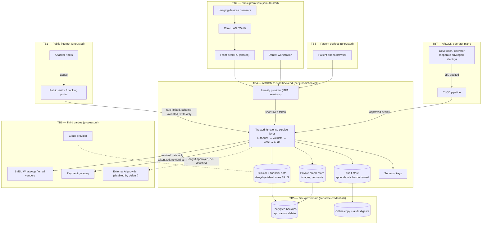
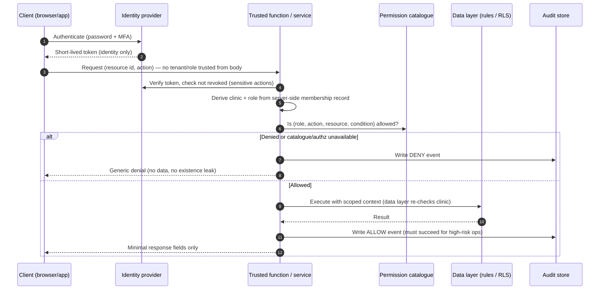
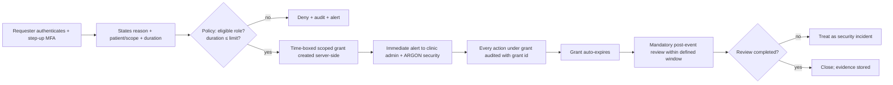
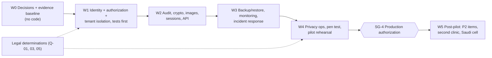

# ARGON Dental — Security Architecture Assessment

**Cloud 1 — ARGON Health Security Architecture (independent research and design report)**
**Product scope:** ARGON Dental — Jordan Pilot (Saudi Arabia second)
**Document ID:** ARGON-DENTAL-SEC-ARCH-001 · **Version:** 0.1 DRAFT FOR SPECIALIST REVIEW · **Date:** 2026-11-07
**Status:** PROPOSED — research and design only. Nothing in this report has been implemented, deployed, tested, or certified. **ARGON is not claimed to be production-ready.**

---

## 0. Document control and evidence legend

### 0.1 How to read this report

Every material statement carries one of five evidence tags. The tags are never merged: a design document saying something exists is **not** evidence that software does it.

| Tag | Meaning | What it proves |
|---|---|---|
| **[V-REPO]** | Verified by reading the ARGON-HEALTH repository at commit `fb6e3e38` (2026-10-10) | That the *document* says this. It does **not** show the system does it. |
| **[V-WEB]** | Verified by reading an external source on 2026-11-07 (primary or secondary, stated per source in §14) | That the source said this on the access date. Secondary sources are labelled and require confirmation against official text. |
| **[D]** | Documented design in ARGON-HEALTH, status PROPOSED | A design intention only. |
| **[R]** | Recommendation of this team | Our proposal; needs owner/specialist approval. Parameters marked [R] are starting values, not facts. |
| **[A]** | Unverified assumption | Must be confirmed before reliance. Each is listed in §13. |

### 0.2 Priority definitions (used for controls, risks, tests)

| Priority | Meaning | Gate |
|---|---|---|
| **P0** | Release-blocking. Must be verified with evidence before **any** real patient data enters the system. Equivalent to "Critical" in the repo's gate model. | Blocks pilot go-live (SG-4). |
| **P1** | Required before pilot go-live, or covered by a named, time-limited, owner-signed risk acceptance with compensating controls. | Blocks SG-4 unless accepted. |
| **P2** | Required before a second clinic, before any Saudi deployment, or within 90 days after pilot go-live — whichever is first. | Blocks SG-5 / scale-out. |

### 0.3 Constraints observed in producing this report

Research, analysis, design, and documentation only. No repository was modified; the ARGON-HEALTH repository was cloned read-only into scratch space solely to read it. No production system was contacted. No real patient data was used; all examples are synthetic. No paid tool is recommended without a stated reason why a free option is insufficient.

---

## 1. Executive summary

**Purpose.** This report defines the security architecture, threat model, access model, control set, risk register, test requirements, and release gates for ARGON Dental, designed for a single-clinic Jordan pilot first and Saudi Arabia second, on a $0/month budget, improving the existing ARGON work rather than replacing it.

### 1.1 Ten conclusions an implementation team must act on

1. **The repository is a target architecture, not a system.** Its own README states that nothing described has been implemented, deployed, or tested **[V-REPO]**. Every control in its security map (three-layer authorization, Keycloak, PostgreSQL RLS, Cloud Run) is **[D]**.
2. **The repository contains no ARGON Dental security content and no pilot plan.** It is multi-specialty, hospital-scale, and priced for managed cloud services. A search of the repo finds no treatment of dental radiographs/CBCT, medical-image malware or metadata handling, AI prompt-injection, DPIAs, or the $0 budget **[V-REPO]**. Its reference stack (Cloud Run, Cloud SQL HA + PITR, Memorystore, Cloud Armor, Keycloak) is paid or operations-heavy **[D]**; we did not price it. **The pilot's security cannot be inherited from the repo; it has to be specified.** This report does that in a substrate-neutral way (§5.2).
3. **The only first-hand evidence about real ARGON security failure is two dated incidents** recorded in the repo: the `clinic_auth_map` incident (a Firebase Rules change deployed before its supporting Cloud Function was live → privilege-escalation exposure, outage, emergency rollback) and the blocked 2026-08-23 rebuild (non-functional build environment; forensic audit found real defects in generated code) **[V-REPO]**. We convert both into mandatory controls (SEC-TEN-06, SEC-SDL-08).
4. **Previously reported audit findings on the live legacy system are P0 until re-verified.** Earlier project work reported that Firebase Rules enforce clinic isolation but **not role authorization** (any authenticated staff member could self-escalate or read other members' credential hashes) and that append-only protections were bypassable by rule cascading **[A]**. The source files were not available to this team, so we neither confirm nor dismiss them; we treat them as **P0 hypotheses** (AR-01, AR-02) with direct tests (ST-01…ST-06).
5. **Authorization must be enforced on the server for every operation, including every write to financial, audit, role, and finalized-clinical data.** UI hiding is not a control **[D]**. For a Firebase-based pilot this means: client rules deny writes to sensitive paths; all such writes go through trusted backend functions that authorize, validate, and audit **[R]**.
6. **Jordan's PDPL is in force and treats health data as sensitive.** Verified from the MODEE-hosted text of Law No. 24 of 2023 **[V-WEB]**: health data is "Sensitive Personal Data" (Art. 2); a Data Protection Officer is required when processing sensitive data or transferring databases outside the Kingdom (Art. 11); serious breaches require notice to affected people within **24 hours** and to the regulator Unit within **72 hours** of discovery (Art. 20); non-adequate cross-border transfer is restricted with a medical-treatment exception and a consent route (Art. 15). **Breach detection and decision-making must therefore operate in hours, not days** (SEC-PRV-04).
7. **Data residency is a likely hard blocker for Saudi and an open legal question for Jordan.** Public Firebase documentation reviewed lists Realtime Database locations only in the US, Belgium and Singapore, and no Gulf region **[V-WEB — re-check at the official locations page]**. Saudi sources report that SDAIA enforces PDPL since 14 Sep 2024 with a separate transfer regulation, and that localisation duties moved from NCA controls to NDMO **[V-WEB, secondary]**. We recommend per-jurisdiction deployment cells (SEC-HOST-04) and **no Saudi production PHI until a Saudi legal determination exists**.
8. **The three highest-leverage controls for a $0 pilot are free:** (a) a server-side permission catalogue with an automatically generated ALLOW/DENY test for every cell, run in CI against the Firebase Emulator Suite **[A: verify tooling]**; (b) isolated, encrypted, non-deletable-by-app backups with scheduled restore drills; (c) hash-chained, server-written audit events with offline-anchored daily digests.
9. **A single developer is both the platform operator and the largest insider risk.** The design therefore separates operator identities from daily accounts, forbids standing production PHI access, requires independent review of every rules/functions change, and relies on automated gates (SEC-INS-06, SEC-SDL-01…).
10. **No jurisdiction-specific compliance status may be claimed.** The repo's compliance matrix lists every jurisdiction row as DISCOVERED or UNKNOWN **[V-REPO]**. This report does not change that; it supplies controls that a legal reviewer can map to.

### 1.2 Headline numbers

| Item | Count |
|---|---|
| Security controls specified | 135 (P0: 64 · P1: 55 · P2: 16) |
| Threat scenarios | 34 |
| Risk register entries | 31 (P0: 14 · P1: 12 · P2: 5) |
| Required security tests | 51 |
| Open questions requiring human/specialist approval | 23 |

### 1.3 Recommended sequence (detail in §11)

W0 decisions and evidence baseline → W1 identity + authorization + tenant isolation core, **tests first** → W2 audit, crypto, images, sessions → W3 backup/restore, monitoring, incident response → W4 privacy operations, penetration test, pilot readiness → SG-4 production authorization → W5 post-pilot (scale, Saudi cell, AI, field encryption).

---

## 2. Scope, method, and non-goals

### 2.1 In scope

ARGON Dental for one Jordanian clinic initially; architecture must not preclude multiple clinics, branches, and later medical complexes/pharmacies/labs/radiology **[R, consistent with D]**. The 14 analysis areas requested (identity; RBAC/ABAC; role permissions; tenant isolation; encryption; images/attachments; audit and tamper detection; sessions and recovery; backup/DR/ransomware; API/integration; insider threat; AI privacy; hosting/residency; threat modeling), plus three cross-cutting areas we judged necessary: privacy operations (PRV), secure development and supply chain (SDL), and monitoring/incident response (MON).

### 2.2 Out of scope

Writing or changing code, rules, functions, or infrastructure; deployment; penetration testing of any live system; legal opinions (we identify questions and map controls; a qualified Jordanian/Saudi lawyer must decide); clinical-safety hazard analysis beyond security touchpoints; pricing analysis of cloud services.

### 2.3 Method

1. Read the ARGON-HEALTH repository: README, governance, master documents 03/04/07/08/13/17, assurance kit (risk register, verification matrix, release gates, security/tenant test plan), audit documents including legacy lessons and DO-NOT-BUILD-YET, and the compliance traceability matrix.
2. Gap-scanned the repo for topics relevant to this assignment (§3.3).
3. Verified legal and platform facts against external sources, preferring primary text (§4, §14).
4. Built the architecture, threat model, matrices, controls, risks, tests, and gates from the above, tagging each statement's evidence class.

---

## 3. Evidence base

### 3.1 Documents read (ARGON-HEALTH @ `fb6e3e38`, 2026-10-10)

| Document | Why it matters to this report | Status in repo |
|---|---|---|
| `README.md` | States target ≠ implemented; "nothing described has been implemented" | PROPOSED |
| `docs/master/07-MASTER-SECURITY-MAP.md` | Authorization model, MFA, refresh rotation, bulk access, break-glass, OWASP mapping, control-plane separation | PROPOSED / DESIGN |
| `docs/master/08-MASTER-COMPLIANCE-MAP.md`, `docs/compliance/COMPLIANCE-TRACEABILITY-MATRIX.md` | Status lifecycle; every jurisdiction row ≤ DISCOVERED | PROPOSED |
| `docs/master/04-MASTER-DATA-MAP.md` | Data classes, tenant isolation for jobs/exports/caches, retention/legal-hold mechanism | PROPOSED |
| `docs/master/13-…INFRASTRUCTURE`, `17-…DISASTER-RECOVERY` | Target hosting; restore-test rule; ransomware, regional outage, IdP outage scenarios | PROPOSED |
| `docs/master/03-MASTER-DOMAIN-MAP.md` (Audit, Documents, AI, Observability sections) | Domain-level security claims | PROPOSED |
| `docs/assurance/*` (risk register, verification matrix, release gates G0–G5, security test plan, acceptance catalog) | Existing assurance structure this report aligns to | PROPOSED |
| `docs/audit/LEGACY-LESSONS-AND-REQUIREMENTS.md`, `LEGACY-VS-TARGET-BOUNDARY.md`, `DO-NOT-BUILD-YET.md`, `FINAL-GAP-REGISTER.md` | Real incidents; legacy vs target boundary; deferred items | PROPOSED / RUNTIME EVIDENCE (incidents) |

### 3.2 What the repository establishes (all **[D]** unless stated)

- **Authorization:** `JWT → Tenant Context → Authorization Service → PostgreSQL RLS`; RBAC + ABAC + relationship + purpose-of-use + break-glass; fail closed on Authorization Service outage; Control Plane access structurally separate from clinical PHI access.
- **Identity:** OIDC on Keycloak; MFA mandatory for PHI roles; WebAuthn/passkeys "where justified"; refresh-token rotation with reuse detection; short-lived service identities, no shared static keys.
- **Bulk access** is a separate control tier with its own audit category (GAP-003, marked closed in design).
- **Async tenant isolation:** single-tenant jobs; exports through the same authorization; tenant-namespaced cache keys (GAP-005).
- **Retention:** anonymization/restriction rather than hard deletion for clinical records; legal-hold flag; **exact retention periods UNKNOWN — REQUIRES LEGAL VERIFICATION**.
- **DR:** "a backup is not complete until its restore has been tested"; RTO/RPO figures are **TBD pending business sign-off**.
- **Release gates:** G0–G5 with stop-the-line rules; **any confirmed cross-tenant PHI disclosure or uncontrolled privilege escalation is a release stop** **[V-REPO]**.
- **Rule L15:** no phase may be marked IMPLEMENTED without an independently verified working build environment and an adversarial/forensic audit of generated code **[V-REPO]**.

### 3.3 Gaps in the repository relative to this assignment (**[V-REPO]** — absence confirmed by search)

| # | Gap | Consequence for ARGON Dental |
|---|---|---|
| G-1 | **No ARGON Dental-specific content** (no odontogram/radiograph/CBCT data classes; "dental" appears only in unrelated words) and **no $0-budget or pilot plan** | Dental data classes, image workflows, and pilot substrate must be specified here |
| G-2 | **"Tamper-evident" audit is asserted (domain map) but no mechanism is described** (no hash chain, WORM, anchoring) | SEC-AUD-04 specifies one |
| G-3 | **No medical-image controls** (no malware scanning, metadata stripping, upload validation; signed URLs appear only in a test plan) | SEC-IMG-* |
| G-4 | **No AI privacy treatment** beyond "model providers: future, unspecified": no prompt-injection, external-provider exposure, de-identification | SEC-AI-* |
| G-5 | **No DPIA/impact-assessment concept** | SEC-PRV-06 |
| G-6 | **No insider-threat model** beyond a template mention | SEC-INS-* |
| G-7 | **No pilot-grade substrate**: the target is Postgres/Keycloak/Cloud Run; the live system is Firebase; the bridge is staged and trigger-gated, none fired | SD-1 (§5.2) |
| G-8 | **No jurisdiction mapping of controls**; all legal rows DISCOVERED/UNKNOWN | §4 |
| G-9 | **No numeric session, lockout, or rate-limit parameters**; no named MFA factor type beyond "MFA"/"WebAuthn where justified" | Proposed values [R] in §6 |
| G-10 | **Account-recovery method deferred** (GAP-008 PARTIALLY CLOSED) | SEC-SES-04 proposes one |

### 3.4 Previously reported legacy-system findings (**[A]** — not verifiable by this team)

The legacy ARGON system is a live Firebase system serving five paying clinics **[V-REPO via argon-governance as cited in LEGACY-VS-TARGET-BOUNDARY]**. Earlier project work reported: (a) rules enforce clinic isolation but no role authorization; (b) a staff member could self-escalate to admin; (c) a member could read/overwrite another member's password hash; (d) financial/audit append-only protections were bypassable via rule cascading; (e) a corrected rules design was proposed but not deployed. **Because the source files were not provided to this team, none of (a)–(e) is verified here.** They define the first tests (ST-01…ST-06) and risks AR-01/AR-02. If any is confirmed, **a live-system incident process (SEC-MON-06, SEC-PRV-04) applies independently of this pilot** — five clinics may be exposed.

---

## 4. Regulatory baseline (security-relevant extract)

> **This section is an engineering extract, not legal advice.** The repo's rule applies: no row below moves beyond DISCOVERED until a qualified legal review exists. Where we cite a law, we state whether we read primary text.

### 4.1 Jordan — Personal Data Protection Law No. 24 of 2023 **[V-WEB, primary text]**

Source read: MODEE-hosted PDF of the law (English rendering alongside Arabic; the Arabic text is authoritative **[A]** — the English is a translation of unstated official status). Published in the Official Gazette 17 Sep 2023; effective six months later (Art. 1); one-year adjustment period (Art. 23).

| Article | Provision (paraphrased) | Design driver | Controls |
|---|---|---|---|
| Art. 2 | "Sensitive Personal Data" includes **health, physical or mental condition**, genetic, biometric, financial status | Entire clinical and billing data = sensitive class | SEC-AZ-*, SEC-CRY-*, SEC-PRV-* |
| Art. 4 | Data-subject rights: access, withdraw consent, correct/update, restrict, erase/conceal (per law), object, portability, **be notified of breaches** | Rights workflows; patient access to own data and access log | SEC-PRV-03, SEC-AUD-07 |
| Art. 5 | Valid consent: explicit, documented, specific in purpose and duration, plain language; **guardian consent for persons lacking capacity**; invalid if purpose changes without new consent | Consent registry; guardian model for minors (dentistry has many child patients) | SEC-PRV-02, SEC-PRV-08 |
| Art. 6(A)(2) | Processing **without consent** is lawful where necessary for preventive medicine, **medical diagnosis, or provision of care by a licensed practitioner** | Care processing has a statutory basis; **non-care purposes** (marketing, analytics, AI beyond care, sharing with vendors) need consent/another basis | SEC-AZ-10, SEC-AI-01 |
| Art. 6(B) | Processed data must not be retained after the purpose ends unless legislation says otherwise | Retention config + legal hold; medical-record retention law **not verified** | SEC-PRV-05 |
| Art. 8 | Controller must apply security, technical and organizational measures per Council instructions; complaint handling; enable rights | The control set in §6 | all |
| Art. 9 | Prior notice to the data subject incl. **the processor**, duration, and **security measures adopted** | Patient notice must name ARGON/hosting processors | SEC-PRV-02 |
| Art. 10 | Erase/conceal on request in listed cases; **does not apply to Art. 6 processing** | Erasure of care records is not a general right | SEC-PRV-03 |
| Art. 11 | **DPO required** if primary activity is processing, **sensitive data**, minors, financial data, or **transferring databases outside the Kingdom** | A DPO designation is needed for the clinic as controller; ARGON role TBD | SEC-PRV-01 |
| Art. 12–13 | Processor duties: stay within purpose/duration, erase/return data, no unauthorized disclosure; data under processing is confidential | Processor contract; offboarding return/erasure | SEC-HOST-05, SEC-HOST-08 |
| Art. 14 | Transfer/exchange to any recipient requires consent and conditions; **controller must keep transfer records**; recipient bound by same duties; parties must be able to **detect and track breaches** | Transfer register; breach detection capability | SEC-PRV-07, SEC-MON-02 |
| Art. 15 | No transfer outside the Kingdom if protection is lower than the law, **except** incl. exchange of medical data when necessary for treatment, or consent after informing of insufficient protection; controller must verify recipient protection beforehand | Foreign-hosted databases and foreign vendors need a legal determination | SEC-HOST-02 |
| Art. 17 | Council issues licences/permits and a **list of countries deemed adequate** | Check for the list and licence regime [A: status unknown] | Q-03 |
| Art. 18(D) | The Unit keeps a registry of controllers, processors, DPOs | Registration obligations [A] | Q-04 |
| **Art. 20** | Serious breach likely to cause significant harm: notify affected people **within 24 h** and the Unit **within 72 h** of discovery; liability for gross negligence | Detection → triage → decision → notification in hours | SEC-PRV-04 |
| Art. 21–22 | Daily fines up to JOD 500 capped at 3% of prior-year revenue; criminal fine JOD 1,000–10,000, doubled for repeats; court may order data destroyed | Penalty exposure informs risk ranking | §9 |
| Art. 24 | Implementing regulations to follow (licences, consent procedures, disclosure) | **Existence and content of regulations/instructions not verified** | Q-03 |

**Not verified in this pass (do not assume):** the content of any implementing regulations or Council instructions; whether a controller/DPO registry is operating; Jordanian medical-record retention rules; Ministry of Health or professional-association confidentiality and e-health requirements; Jordan's Cybersecurity Law No. 17 of 2023 (we know of it only by name **[A]**); e-invoicing (ISTD) technical security requirements (listed in repo as DISCOVERED).

### 4.2 Saudi Arabia **[V-WEB, secondary sources only]**

We did not obtain official SDAIA or NCA text. The following comes from commercial legal/compliance publications retrieved on 2026-11-07 and **must be confirmed against official sources before reliance**.

| Item | What sources report | Reliability | Design effect |
|---|---|---|---|
| PDPL basis | Royal Decree M/19 (2021), amended by M/148 (2023); in force 14 Sep 2023; full enforcement from 14 Sep 2024 after a one-year grace period; SDAIA supervises | Multiple consistent secondary sources | Treat as in force and enforced |
| Breach notification | Notify SDAIA within **72 hours** of awareness (harm-based test per most sources; one source states "regardless of harm" — **sources disagree**); notify individuals without undue delay | Secondary; **conflict noted** | Design to the stricter reading: 72 h to regulator for any breach; decide harm test with counsel |
| Cross-border | Separate Transfer Regulation (updated 1 Sep 2024); risk assessment required before certain transfers incl. sensitive data on a continuous/large-scale basis | Secondary | No Saudi PHI to non-approved regions without legal determination |
| Localisation | Several sources state that in-Kingdom hosting sub-controls were **removed from NCA ECC-2:2024 and CCC-2:2024** and "moved to" the National Data Management Office (NDMO); one source states CST's cloud framework requires higher data levels to be hosted in-Kingdom by CST-licensed providers; healthcare data is subject to MOH/SFDA standards | Secondary; **mutually partial** | Treat residency as **UNKNOWN — REQUIRES LEGAL REVIEW**; design for in-Kingdom option |
| NCA ECC scope | ECC-2:2024 applies to government bodies and private entities operating critical national infrastructure; commonly used as a procurement reference | Secondary | A private dental clinic is probably not directly in scope **[A]**; payers/government integrations may impose it contractually |
| Registry | National Data Governance Platform enrolment for controllers processing sensitive data | One secondary source | Q-06 |

**Not verified:** MOH health-information policies for private facilities; SFDA rules on software as a medical device (relevant to AI features); NDMO classification of health data; insurer/NPHIES integration security requirements; professional licensing rules affecting delegation of charting.

### 4.3 What the law forces into the design (summary)

1. Health and billing data are sensitive → server-side authorization, encryption, audit, minimization everywhere.
2. Care processing is lawful without consent; **everything else needs a purpose record** → purpose-of-use/consent flags that gate non-care processing (marketing messages, analytics, AI, external sharing).
3. **24-hour / 72-hour breach clocks** → pre-built detection, triage roles, notification templates, and offline contact data (SEC-PRV-04).
4. **Foreign hosting and foreign vendors are transfers to be analysed**, including CDN/WAF proxies that terminate TLS (SEC-HOST-06).
5. **Children are routine in dentistry** → guardian relationship model and guardian-scoped access (SEC-PRV-08).
6. **A DPO is required** for the controller in practice → someone with this role must exist before go-live (SEC-PRV-01).

---

## 5. Security architecture

### 5.1 Architectural principles **[R, aligned with D]**

| # | Principle | Meaning for ARGON Dental |
|---|---|---|
| P-1 | **Server-side authority** | Identity, role, clinic membership, and tenant are decided by trusted server code or data-layer rules, never by client-supplied values |
| P-2 | **Default deny, enumerated allow** | A versioned permission catalogue (resource × action × role × condition) is the single source for enforcement *and* test generation |
| P-3 | **Three independent chances to stop a bad request** | Edge/app check → trusted service check → data-layer rule. The data layer must stop cross-tenant access even if app code has a bug **[D]** |
| P-4 | **Append-only where truth matters** | Finalized clinical notes, invoices, payments, and audit events are corrected by new versions/entries, never overwritten |
| P-5 | **Separate planes of privilege** | Platform operation (ARGON), clinic administration, and clinical access are different privilege domains; none implies another **[D]** |
| P-6 | **Fail closed, degrade visibly** | Authorization or audit failure on a high-risk operation denies it; downtime has a documented paper fallback |
| P-7 | **Evidence over assertion** | No control is "done" without a stored artifact; no compliance claim without the repo's lifecycle (§0, repo `08`) |
| P-8 | **Evolve, don't rewrite** | Harden the working system in staged, reversible steps (ADR-000/ADR-019 **[V-REPO]**); coupled changes ship atomically (SEC-TEN-06) |
| P-9 | **Free first, justified paid** | Every control has a free realization; paid options appear only where a free one is insufficient |
| P-10 | **Cell per jurisdiction** | One independent deployment (project, data, keys, backups) per legal jurisdiction; no cross-border replication by default |

### 5.2 Substrate decision SD-1 (requires owner approval)

The repo targets Java/Spring/PostgreSQL/Keycloak/GCP **[D]**, while the live system is Firebase **[V-REPO]**; the budget is $0. We therefore express security as **control objectives** that must hold on *any* substrate, with two realizations.

| Option | Description | Cost position | Security position | Verdict |
|---|---|---|---|---|
| **A — Harden the legacy Firebase stack for the pilot** (RTDB/Firestore + Auth + Functions + Storage) | Evolve what five clinics already use; move all sensitive writes behind trusted functions; add test harness | Lowest; Cloud Functions are believed to require the pay-as-you-go plan **[A]**, which the legacy system likely already uses (it has Cloud Functions **[V-REPO]**) — **confirm** | Workable for single-jurisdiction pilot **if** P0 controls pass; Realtime DB has no Gulf region **[V-WEB]**; fine-grained policy in rules is hard to reason about **[A]** | **Recommended for the Jordan pilot, conditional** on §3.4 re-audit, SD-2 residency decision, and all P0 controls |
| **B — Build the target stack now** (Postgres + Keycloak + Cloud Run) | The repo's reference architecture | Paid services in the reference design **[D]**; price not evaluated; large ops burden for one developer | Strongest design on paper; **zero implemented**; prior rebuild attempt blocked **[V-REPO]** | **Not recommended for pilot**; remains the staged target, entered only when ADR-000 triggers fire |
| **C — Self-host open-source (Postgres + Keycloak) on free-tier VM** | $0 compute | Free tiers are small and unsuitable for HA/PITR; backup, patching, and hardening all become the developer's job **[A]** | High operational and ransomware risk for one person | **Not recommended** |

**Decision SD-2 (residency):** For the Jordan pilot, choose and document one of (i) accept a non-Gulf region with a legal determination under PDPL Art. 15/11(5)/14; (ii) use a service with a Middle East region if one fits the free/low-cost envelope and is verified **[A: Google Cloud Middle East regions exist; confirm per-service availability and price]**; (iii) clinic-local/on-prem storage for images with cloud metadata. **No default is assumed.**

**Rule:** All controls below are written so they are testable under Option A and mappable to Option B. §5.3 gives the mapping.

### 5.3 Control-objective realization map

| Control objective | Pilot realization (Option A) **[R]** | Target realization (repo) **[D]** |
|---|---|---|
| Identity & MFA | Firebase Authentication; MFA requires upgrading to Identity Platform **[V-WEB]**; SMS MFA cost and TOTP availability **[A]** | Keycloak OIDC, MFA mandatory for PHI roles |
| Tenant + role authority | Custom claims set **only** by a trusted function; membership map in server-only path | JWT → Tenant Context → Authorization Service |
| Data-layer enforcement | Database Security Rules (deny-by-default) | PostgreSQL Row-Level Security |
| Sensitive writes | Callable/HTTPS functions with Admin SDK: authorize → validate schema → write → audit | Domain command handlers behind Authorization Service |
| Audit store | Separate path/project, server-write-only, hash-chained, daily digest exported offline | Append-only Audit domain + cold archive |
| Secrets | Function secret config / secret manager; no keys in client or repo | Secret Manager + KMS |
| Images | Private bucket, server-mediated short-lived access, per-object authorization record | Object storage via Documents domain |
| Backups | Scheduled exports to separate credential domain + offline encrypted copy | PITR + versioned object storage |
| Edge protection | Provider defaults + App Check **[A]**; CDN/WAF only after SEC-HOST-06 analysis | Cloud Armor / Cloudflare |
| Monitoring | Structured, PHI-free logs; alert rules to a human | Observability domain (OpenTelemetry) |

### 5.4 Logical architecture and trust boundaries



### 5.5 Authorization decision sequence (every request)



### 5.6 Break-glass (emergency access) flow



### 5.7 Roles used in this report **[R — requires clinic approval; see Q-08]**

| Code | Role | Intent | Hard constraints |
|---|---|---|---|
| **DEN** | Dentist | Diagnose, chart, plan, prescribe, view images, sign clinical notes | Only role that can finalize/sign clinical entries; amends by new version |
| **AST** | Dental assistant | Chairside support, capture images, draft chart entries under supervision, inventory | Cannot finalize clinical notes or prescribe; delegation rules **[A: jurisdiction-dependent — Q-09]** |
| **REC** | Receptionist | Scheduling, registration, front-desk payments, insurance data, consent collection | No clinical chart/image/prescription access |
| **ACC** | Accountant | Financial reporting, reconciliation, adjustments | No clinical chart/image access; sees procedure *category and price* only, not notes |
| **ADM** | Clinic administrator | Staff accounts/roles, clinic settings, approvals | **No clinical-content access by default**; a person who is also a dentist holds DEN explicitly as a second, separately audited role |
| **PAT** | Patient (portal), incl. guardian for minors | Own appointments, released records, consent | Own/dependent data only |
| **PUB** | Unauthenticated public visitor | Request an appointment | Write-only, minimal fields, no read-back |
| **OPS** | ARGON platform operator | Tenant provisioning, licensing, platform health | **No standing PHI access**; PHI only via break-glass |
| **AUD** | Compliance/security reviewer | Read audit trail | Audit-only; no PHI content |

---

## 6. Detailed controls by domain

**Table conventions.** *Purpose* = why the control exists. *Implementation implications* = what the implementing team must build or decide (pilot **[R]** / target **[D]** where different). *Verification evidence* = the artifact that proves it. *Pri* = priority per §0.2. Numeric parameters marked [R] are proposals requiring approval and tuning, not facts.

### 6.1 Authentication and identity management (SEC-AUTH)

| ID | Control | Purpose | Implementation implications | Verification evidence | Pri |
|---|---|---|---|---|---|
| SEC-AUTH-01 | Use a managed identity provider for all authentication; no custom password storage or hashing in application code | Avoid credential-handling bugs; owner-reported legacy exposure of other members' credential hashes **[A]** must be impossible by design | Pilot: Firebase Auth. Remove any application-level credential/hash fields from readable data paths. Target: Keycloak. | Data-model review showing no credential material in app data; ST-03 | P0 |
| SEC-AUTH-02 | MFA mandatory for every staff role (DEN, AST, REC, ACC, ADM) and every privileged ARGON identity; TOTP minimum, WebAuthn/passkey where devices allow; SMS never the sole factor for ADM/OPS | Staff accounts are the main path to PHI; SIM-swap and cost make SMS weakest | Pilot: upgrade to Identity Platform to obtain MFA **[V-WEB]**; confirm TOTP support and SMS pricing **[A]**. Plan enrolment, device-loss recovery (SEC-SES-04). | Config export showing enforcement; ST-07 (login without MFA fails) | P0 |
| SEC-AUTH-03 | Password policy: minimum length 12 [R], screen against breached-password lists, no forced periodic rotation without compromise, no composition-rule theatre | Resist credential stuffing and guessing | Map to OWASP ASVS 5 authentication requirements **[A: choose exact IDs]**; enforce server-side where the provider allows, otherwise via blocking function | Policy file + ST-08 | P1 |
| SEC-AUTH-04 | Invite-only staff provisioning: no self-service creation of a clinic membership; ADM invites, account is bound to one clinic and role, activation requires MFA enrolment | Prevents attacker-created staff accounts and tenant hopping | Membership record created only by trusted function; email-domain/self-signup disabled for staff pools | ST-09 (self-signup into clinic denied) | P0 |
| SEC-AUTH-05 | **Role and clinic claims are written only by trusted server code.** A client must be unable to create, modify, or read-to-modify its own role, clinic, or permission data | Directly addresses the `clinic_auth_map`/self-escalation class **[V-REPO incident; A reported finding]** | Custom claims set by a privileged function after server-side checks; role records live on a path no client rule permits writing; changes force token refresh | ST-01, ST-02, ST-04; rules diff review | P0 |
| SEC-AUTH-06 | Service identities: no shared static API keys; backend credentials never on laptops or in client code; CI uses short-lived federation where available **[A]** | Compromised developer machine = full production access otherwise | Inventory every credential; rotate any that touched a laptop; separate service accounts per function group, least privilege | IAM/credential inventory; gitleaks clean; ST-33 | P0 |
| SEC-AUTH-07 | Public booking portal: no authentication, **no read of any existing patient data**, anti-abuse (rate limit, bot challenge/App Check **[A]**), minimal fields | Booking forms are the most exposed surface | Write-only endpoint, schema-validated, throttled per IP/clinic; same response whether patient exists or not | ST-22, ST-23 | P0 |
| SEC-AUTH-08 | Patient portal authentication via one-time code to a verified channel with rate limits; guardian accounts linked to dependents explicitly | Patient access is a data-leak path; minors need guardian model | OTP delivery cost/abuse controls; verify channel ownership at registration; no PHI in OTP messages | ST-24 | P2 |
| SEC-AUTH-09 | Brute-force/credential-stuffing defense: progressive back-off, per-account and per-IP throttling, alert on spikes | Reduce account takeover | Use provider protections; add blocking function logic if needed; alert via SEC-MON-02 | ST-08 | P1 |
| SEC-AUTH-10 | Break-glass for identity-provider outage: pre-provisioned offline credential path held by two custodians, drill-tested, every use audited and retired | If login is down, nobody can fix login **[V-REPO scenario 3]** | Sealed credentials; documented procedure; quarterly drill | Drill record | P1 |
| SEC-AUTH-11 | Privileged ARGON identities separate from daily identities, hardware-key MFA, no shared accounts | The operator is the highest-privilege target | Two identities per operator; production project access only from privileged identity | Access review record | P0 |

### 6.2 Role-based and attribute-based access control (SEC-AZ)

| ID | Control | Purpose | Implementation implications | Verification evidence | Pri |
|---|---|---|---|---|---|
| SEC-AZ-01 | Every operation is authorized server-side; the UI is never the enforcement point **[D]** | A hidden button is not a control | Enforce in functions *and* data-layer rules; direct-API tests must fail when UI hides function | ST-01…ST-06 | P0 |
| SEC-AZ-02 | **Permission catalogue**: a versioned, machine-readable list of (resource, action, role, condition) is the single source for enforcement and for generated tests; deny by default | Prevents drift between intent, code, and tests; satisfies repo DoD "every sensitive operation has ALLOW and DENY tests" **[D]** | Author the catalogue from §7 matrix; generate one ALLOW and one DENY test per cell; CI fails if a route/rule lacks a catalogue entry | Catalogue file; coverage report = 100% | P0 |
| SEC-AZ-03 | Separation of duties for privilege changes: role changes require ADM + step-up MFA; nobody can change their own role; the last active ADM cannot be removed; ADM cannot grant OPS or AUD roles | Stops self-escalation and lock-out | Role-change function enforces rules; every change audited and notified to all ADMs | ST-02, ST-10 | P0 |
| SEC-AZ-04 | Attribute/relationship conditions: clinic scope always; branch scope when branches exist; for multi-dentist settings, clinical-chart read limited to treating/assigned/recently-scheduled patients unless break-glass | Limits snooping inside a clinic | Decision Q-10: in a single-dentist pilot clinic-wide clinical read for DEN may be acceptable *with* SEC-INS-03 monitoring; build the condition engine now so tightening is configuration | ST-11 | P1 |
| SEC-AZ-05 | Field-level minimization: national ID, date of birth, phone, address masked by default in lists and shown only to roles that need them; ACC sees masked identity + priced procedure categories | Reduces exposure per query and per screenshot | Server returns role-specific projections; never "return full record and hide in UI" | Response-shape tests (ST-12) | P1 |
| SEC-AZ-06 | **Bulk-access tier**: any response above a small fixed record count (proposal: 20 [R]), tenant export, cross-patient search, or report with identifiers is "bulk"; requires entitled role, rate limit, separate audit category, and for large exports ADM + second approval **[D]** | A stolen session should not equal mass exfiltration | Page size caps; export functions behind approval; export files watermarked with user ID | ST-13 | P0 |
| SEC-AZ-07 | Append-only semantics enforced server-side: finalized clinical notes, signed consents, invoices, payments, and audit events cannot be updated or deleted by any role; correction = new version linked to the original | Legal and clinical integrity; ransomware/insider damage limiting | Version chain fields; rules deny update/delete; **test for cascade bypass** (a permissive parent rule must not re-enable child writes) | ST-05, ST-06 | P0 |
| SEC-AZ-08 | Fail closed: if the catalogue, authorization function, or role record is unreachable, deny | Outage must not widen access **[D]** | Default-deny wrappers; chaos test | ST-14 | P0 |
| SEC-AZ-09 | Object-level authorization on every identifier path (record, image, invoice, consent), including list, search, export, and report endpoints | Defeats IDOR/BOLA **[D]** | Re-derive ownership from server data, never trust a client-supplied clinic or owner field | ST-15 | P0 |
| SEC-AZ-10 | Purpose-of-use and consent flags gate **non-care** processing (marketing messages, analytics beyond operations, AI, external sharing) | Art. 6(A)(2) covers care only; other purposes need consent **[V-WEB]** | Purpose registry; default off; functions check flag before executing | ST-25 | P1 |
| SEC-AZ-11 | Patient/guardian authorization: patient sees only own and dependents' released records; guardian link is explicit, audited, and revocable | Minors are common in dentistry | Guardian relationship record with verification step | ST-24 | P2 |

### 6.3 Role permission model (SEC-ROLE)

| ID | Control | Purpose | Implementation implications | Verification evidence | Pri |
|---|---|---|---|---|---|
| SEC-ROLE-01 | Adopt the §7 data-access matrix as the initial catalogue after clinic and clinical approval; every deviation is a recorded exception | Avoids ad hoc grants | Clinic owner and a practising dentist sign the matrix | Signed matrix (Q-08) | P0 |
| SEC-ROLE-02 | A person holding multiple roles (e.g., owner-dentist) uses explicit role switching; audit records the *active* role per action | Prevents the admin/clinical privilege domains collapsing silently | Session carries active role; step-up when switching to ADM | ST-16 | P1 |
| SEC-ROLE-03 | Quarterly access review by ADM, evidenced; dormant accounts disabled after 30 days of no login [R] | Privilege creep and ex-employee risk | Report of users × roles × last login; sign-off record | Review record (repo VFY-SEC-010) | P1 |
| SEC-ROLE-04 | Temporary elevation (e.g., locum dentist) is time-boxed, expires automatically, audited | Avoid permanent exceptions | Expiry timestamp on role grants | ST-17 | P2 |
| SEC-ROLE-05 | Financial correction roles cannot delete: voids/refunds are new entries with reason and, above a threshold [R], second approval | Fraud and error control | Ledger design append-only | ST-18 | P1 |

### 6.4 Patient data isolation between clinics and organizations (SEC-TEN)

| ID | Control | Purpose | Implementation implications | Verification evidence | Pri |
|---|---|---|---|---|---|
| SEC-TEN-01 | Tenant (clinic) identity is derived from validated server context; client-supplied tenant IDs are never authoritative **[D]** | Core cross-tenant defense | Reject mismatches; test tampered body/query/header | ST-19 (repo SEC-TEN-02) | P0 |
| SEC-TEN-02 | Every data path and object key is clinic-scoped; the data layer denies cross-clinic access independently of app code | Bug in function code must not leak a clinic **[D]** | Rules keyed on clinic claim *and* membership record; storage prefix per clinic | ST-19, ST-20 | P0 |
| SEC-TEN-03 | Public booking carve-out is write-only to a clinic-addressed inbox path; no listing; unguessable clinic slug; identical errors for unknown/known clinics | Public carve-outs are a classic isolation hole **[V-REPO: "public booking portal carve-outs" is a known risk area]** | Separate path with strict schema validation; no read rule | ST-22 | P0 |
| SEC-TEN-04 | Asynchronous paths are tenant-scoped: one job = one clinic; exports through the same authorization; cache and object keys namespaced by clinic **[D]** | RLS-style rules do not protect jobs, exports, caches for free | Job payloads carry clinic id verified at run time | ST-21 | P0 |
| SEC-TEN-05 | Cross-tenant operator access only via break-glass, time-boxed, audited, and **visible to the clinic** | Operator cannot silently read a clinic | Clinic-visible access log | ST-26 | P0 |
| SEC-TEN-06 | **Coupled changes ship atomically**: a rules change and its supporting function/claim migration are one jointly verified release, with rehearsed rollback; migration scripts run and verify before strict rules publish | The `clinic_auth_map` incident **[V-REPO]** | Release checklist with staged emulator rehearsal, canary clinic, rollback script; no manual console edits | Release record; ST-27 | P0 |
| SEC-TEN-07 | Tenant-isolation regression suite runs in CI on every change to rules, functions, or data model | Isolation regressions are silent | Emulator-based tests; fail build on any cross-tenant success | CI log | P0 |
| SEC-TEN-08 | Tenant offboarding/export procedure: verified return/erasure of data, key and backup handling | Processor duties **[V-WEB Art. 12]** | Runbook; deletion verification | Runbook + test | P2 |

### 6.5 Encryption at rest and in transit (SEC-CRY)

| ID | Control | Purpose | Implementation implications | Verification evidence | Pri |
|---|---|---|---|---|---|
| SEC-CRY-01 | TLS 1.2+ (1.3 preferred [R]) on every connection; HSTS; no mixed content; certificates auto-renewed | Protect PHI in transit on clinic Wi-Fi and the internet | Enforce at hosting layer; test with free scanners | ST-46 report | P0 |
| SEC-CRY-02 | Confirm and record provider encryption at rest for every store (database, object storage, backups, logs) | Baseline at-rest protection | Provider default encryption is believed enabled **[A: confirm in provider documentation per service]**; record evidence; customer-managed keys are optional and may cost — adopt only if a legal reviewer requires | Provider documentation excerpts + settings screenshots | P1 |
| SEC-CRY-03 | No secrets in source, client bundles, or logs; secret scanning in CI; documented rotation procedure | Leaked keys are a leading cause of cloud breaches | Public web API keys are identifiers, not secrets, but must be restricted by referrer/API **[A: confirm provider guidance]**; admin credentials server-side only | ST-33 | P0 |
| SEC-CRY-04 | Backup encryption with keys held **outside** the production project (e.g., offline, two custodians) | Cloud-account compromise must not expose or destroy backups | Free tools (e.g., age/GPG) **[A: confirm]**; key escrow procedure; tested decrypt | ST-37 | P0 |
| SEC-CRY-05 | Client-side data at rest: policy for any cached patient data on shared front-desk/dentist PCs (e.g., browser storage/IndexedDB): minimum necessary, short TTL, cleared on logout/idle lock, never on unmanaged personal devices | Browsers persist PHI to disk unencrypted by default | If caching exists or is planned, store only IDs/non-clinical fields, or encrypt with a session-held key; OS disk encryption mandated at clinic | ST-51; clinic checklist | P1 |
| SEC-CRY-06 | Field-level encryption for national ID and other highest-risk identifiers (with HMAC lookup token) — **defer** until threat justifies | Limits damage from data-layer read compromise | Costs searchability and complexity; for a $0 pilot rely on SEC-AZ-05 masking and data-layer isolation first | Decision record | P2 |
| SEC-CRY-07 | Domain security: registrar and DNS accounts under MFA, CAA records, DNSSEC where supported, expiry monitoring | Domain takeover defeats all other controls | Document owners and recovery contacts | Config export | P1 |
| SEC-CRY-08 | No custom cryptography; documented algorithm list | Avoid design flaws | Review checklist | Review record | P1 |

### 6.6 Medical images, consents, and attachments (SEC-IMG)

Dental image classes assumed **[A — confirm with clinic]**: intraoral photos, periapical/bitewing/panoramic radiographs, optionally CBCT volumes, signed consent forms, scanned referral letters, insurance documents. DICOM/PACS is deferred **[V-REPO DO-NOT-BUILD-YET]**; if added, SEC-API-10 applies.

| ID | Control | Purpose | Implementation implications | Verification evidence | Pri |
|---|---|---|---|---|---|
| SEC-IMG-01 | Private by default: no public buckets, no public download URLs, no listing | Images are among the most sensitive artifacts | Bucket rules deny all direct client access; access only through a trusted function after SEC-AZ checks | ST-20, ST-34 | P0 |
| SEC-IMG-02 | Access via short-lived, user-and-object-bound URLs (proposal: ≤ 5 minutes [R]); no reuse across users; each issuance audited | Leaked links (e.g., shared in chat apps) expire quickly | Function mints URL after authorization; no long-lived tokens stored in records | ST-34 | P0 |
| SEC-IMG-03 | Object keys unguessable and clinic-prefixed; authorization record in database is the source of truth, not the key | Defeat enumeration and cross-clinic access | Random identifiers; metadata record per object with owner patient and clinic | ST-20 | P0 |
| SEC-IMG-04 | Upload validation: server-side size limit, content-type check by file signature (not extension), allow-list, reject executables/archives/scripts, reject active content in PDFs/SVGs | Uploads are an attack vector and cost vector | Validate in the trusted upload function, not in the client | ST-35 | P0 |
| SEC-IMG-05 | Malware scanning for any file originating outside the clinic's trusted capture path (patient-uploaded or emailed documents) before it becomes retrievable | Prevent malware relay to staff | Pilot: **disable patient uploads** until a scanning path exists; free scanner option (ClamAV) **[A]** needs a host and updates — a real operations cost for one developer | ST-35 | P1 |
| SEC-IMG-06 | Metadata handling: strip location/device identifiers from non-diagnostic photos; preserve clinically required metadata for radiographs in controlled fields | EXIF can disclose location and device | Re-encode photos server-side; never expose raw metadata to unauthorized roles | ST-36 | P1 |
| SEC-IMG-07 | Integrity: store SHA-256 at upload; verify on export and during restore drills | Detect corruption/tampering of diagnostic evidence | Hash field in metadata record; periodic sample verification | ST-37 | P1 |
| SEC-IMG-08 | Sharing/referral: no public share links; referral exports are authenticated, time-limited, watermarked with recipient/user and date, and audited | Referrals are the usual exfiltration route | Export function; recipient receives access-controlled package | ST-13 | P1 |
| SEC-IMG-09 | Retention and deletion apply to object versions and backups, subject to legal hold | Prevent "deleted" images persisting unnoticed | Lifecycle design aligned with SEC-PRV-05 | ST-50 | P2 |
| SEC-IMG-10 | Quotas and size caps per clinic/user to prevent storage and bandwidth exhaustion | Free-tier limits are a denial-of-service and cost lever **[A: confirm current free-tier quotas]** | Per-clinic counters; alert at 70/90% | ST-23 | P1 |
| SEC-IMG-11 | Clinic LAN baseline for imaging devices and PCs: OS updates, disk encryption, device passwords, separate guest Wi-Fi, no shared logins, vendor remote-access disabled when unused | Cloud controls cannot protect compromised clinic endpoints | One-page clinic hardening checklist signed by clinic ADM at go-live | Signed checklist | P1 |

### 6.7 Audit trails and tamper detection (SEC-AUD)

| ID | Control | Purpose | Implementation implications | Verification evidence | Pri |
|---|---|---|---|---|---|
| SEC-AUD-01 | Audit event schema: server timestamp, actor, **active role**, clinic, action, resource type/id, patient id, outcome, purpose/grant id, correlation id, client context class; **no clinical content** in events | Reconstruct who did what without creating a second PHI store | Schema in repo; validated on write | Schema + sample events | P0 |
| SEC-AUD-02 | Completeness: every PHI read, create, update, amend, export, auth event, role change, setting change, break-glass use, and denied attempt is audited | Detection and legal accountability | Generate coverage matrix from the permission catalogue; CI fails if an operation lacks an audit event type **[D DoD]** | ST-30 | P0 |
| SEC-AUD-03 | Audit writes only by trusted server code; application roles cannot update or delete; **high-risk operations fail if the audit write fails** **[D]** | Prevent silent, unaudited high-risk actions | Write-then-commit ordering; separate path/credentials | ST-32 | P0 |
| SEC-AUD-04 | **Tamper evidence:** per-clinic hash chain (each event includes the hash of the previous); a scheduled job verifies the chain and writes a signed daily digest exported to a separate trust domain (offline copy / separate account / email to clinic owner); chain break raises a high-severity alert | The repo asserts "tamper-evident" without mechanism **[V-REPO gap G-2]** | Free: standard hashing; digest signing key held offline; verification script in CI and nightly | ST-31 | P0 |
| SEC-AUD-05 | Separate audit store and credentials; ARGON operators cannot edit or delete events; nightly copy to backup domain | Operators are in the insider threat set | Distinct path/project and IAM | ST-31, ST-38 | P1 |
| SEC-AUD-06 | Server-side time only; reject client-supplied timestamps in audit | Prevent backdating | NTP/provider time | Code review | P1 |
| SEC-AUD-07 | Audit access is itself audited; ADM sees own clinic's non-PHI audit view; patients can request an **access report** for their record (supports Art. 4 access right **[V-WEB]**) | Meta-accountability and rights | Role-filtered query; patient report generator | ST-30, ST-49 | P1 |
| SEC-AUD-08 | Audit retention period set by legal determination; until then, retain and do not purge **[A]** | Avoid early loss; avoid unlawful over-retention | Parameterized retention | Q-05 | P2 |

### 6.8 Session security and account recovery (SEC-SES)

| ID | Control | Purpose | Implementation implications | Verification evidence | Pri |
|---|---|---|---|---|---|
| SEC-SES-01 | Short-lived tokens with server-side revocation honored on sensitive operations **[D]**; deactivation and role change take effect within a stated window | A fired employee's session must die quickly | Pilot: revoke refresh tokens and check revocation on sensitive calls **[A: confirm provider mechanism]**; document the maximum window (proposal ≤ 5 min for sensitive ops [R]) | ST-28 | P0 |
| SEC-SES-02 | Idle and absolute timeouts: idle 15 min and absolute 12 h for clinical staff, idle 10 min for ADM [R]; screen lock at shared front-desk PCs | Shared workstations are common in clinics | UX tested with the clinic so timeouts do not push staff to share logins | ST-28 | P1 |
| SEC-SES-03 | Session inventory: users and ADM can see active sessions and revoke; new-device sign-in notifies the user and ADM | Detect takeover | Session metadata store | ST-28 | P2 |
| SEC-SES-04 | **Account recovery requires step-up, never a bare email link**: staff — ADM re-issues invitation plus fresh MFA enrolment after identity check; ADM — out-of-band verification by ARGON through a documented channel with a cooling-off period; all admins notified; patients — verified channel plus code **[resolves repo GAP-008 method, pending approval]** | Recovery is the usual takeover path | Written procedure; audit events | ST-29 | P0 |
| SEC-SES-05 | Browser hardening: strict Content-Security-Policy, no inline script, output encoding, no unsafe HTML injection, frame-ancestors none, secure cookie/token handling, Subresource Integrity for any third-party script | XSS steals sessions and PHI; vanilla-JS apps commonly build HTML strings **[A]** | Audit all DOM-injection sites; adopt template/escaping helpers; CSP report-only first then enforce | ST-41 | P0 |
| SEC-SES-06 | No PHI or tokens in URLs, referrers, analytics, or error pages | Leakage via logs and history | Route design review | ST-40 | P1 |
| SEC-SES-07 | Logout-everywhere on deactivation, role change, suspected compromise | Rapid containment | Admin action triggers revocation | ST-28 | P1 |

### 6.9 Backups, disaster recovery, and ransomware resilience (SEC-DR)

| ID | Control | Purpose | Implementation implications | Verification evidence | Pri |
|---|---|---|---|---|---|
| SEC-DR-01 | Backups to a **separate credential domain** the production and operator credentials cannot delete or overwrite (write-only/pull model), plus a periodic offline copy | Ransomware/compromised admin typically destroys backups first | Scheduled export function writes to a destination in another account/project; deletion restricted to a different identity | ST-38 | P0 |
| SEC-DR-02 | Backups encrypted (SEC-CRY-04); restore keys escrowed with two custodians | Backup theft ≠ data theft | Documented custody | ST-37 | P0 |
| SEC-DR-03 | **Restore drills** on a schedule (proposal: monthly during pilot, then quarterly [R]) into an isolated project with integrity reconciliation and clinician spot-checks; a failed drill blocks any "DR-ready" claim **[D rule]** | An untested backup is not a backup | Drill script + record; compare counts, hashes, sampled charts | ST-37 | P0 |
| SEC-DR-04 | Business-approved RPO/RTO documented; interim proposal for discussion: RPO ≤ 24 h, RTO within the working day [R] | Repo leaves all numbers TBD **[V-REPO]**; we do not invent them as facts | Clinic owner signs; measure achieved values in drills | Signed targets + drill results | P1 |
| SEC-DR-05 | Ransomware/mass-delete runbook: freeze writes, disable service credentials, revoke sessions, identify last good point, restore, rotate every credential with write access, notify per SEC-PRV-04 **[D scenario 1, adapted]** | Speed matters; panic causes errors | Written runbook; tabletop | ST-39 | P0 |
| SEC-DR-06 | Destructive-operation guard rails: bulk delete/overwrite scripts refuse to run against production without two-person approval and a fresh backup check; development tooling cannot hold production write credentials | Most data loss is self-inflicted | Environment checks; separate projects | ST-27, ST-33 | P0 |
| SEC-DR-07 | Downtime fallback: daily encrypted offline copy of next-day appointments and emergency contacts; paper procedures for chairside operation; documented re-entry reconciliation | Clinic must treat patients during an outage | One-page procedure held at clinic | Tabletop | P1 |
| SEC-DR-08 | Configuration as code: rules, functions, schemas, and settings in version control with the ability to redeploy to a fresh project | Recover from account loss | Repository + rebuild runbook; rehearsal | Rebuild rehearsal log | P1 |

### 6.10 API and integration security (SEC-API)

| ID | Control | Purpose | Implementation implications | Verification evidence | Pri |
|---|---|---|---|---|---|
| SEC-API-01 | Strict schema validation with allow-listed fields; unknown fields rejected; no generic "update record with JSON" endpoints **[D]** | Stops mass assignment | Validators per command | ST-15 | P0 |
| SEC-API-02 | Rate limiting and abuse control per user, IP, and clinic; stricter on public and OTP endpoints | Brute force, enumeration, cost exhaustion | Provider quotas + application counters | ST-23 | P1 |
| SEC-API-03 | CORS allow-list; no wildcard with credentials; security headers set | Cross-origin data theft | Hosting config | ST-41 | P1 |
| SEC-API-04 | Inbound webhooks: signature verification, timestamp/nonce replay protection, idempotency keys **[D]** | Forged or replayed events | Verify before processing; store seen ids | ST-15 | P1 |
| SEC-API-05 | Outbound integrations (SMS/WhatsApp/email, payment, e-invoicing): vendor review (SEC-HOST-05), **minimal content (no diagnosis or procedure in messages)**, destination allow-list (SSRF), per-integration secrets with rotation | Messages are an accidental PHI leak route | Template library reviewed by DPO | ST-44 | P0 |
| SEC-API-06 | Payments: no card data stored or handled by ARGON; hosted payment page/tokenization; PCI scope assessment before any claim **[D]** | Avoid becoming a card-data processor | Gateway selection with hosted fields | Scope memo | P1 |
| SEC-API-07 | Errors: generic messages, no stack traces, no PHI; correlation id only | Information leakage | Central error handler | ST-40 | P1 |
| SEC-API-08 | Third-party scripts on authenticated pages prohibited unless reviewed, pinned, and SRI-protected | Supply-chain XSS | Dependency policy | ST-41 | P1 |
| SEC-API-09 | API/contract versioning and contract tests | Prevent unsafe behavior changes | CI contract suite | CI log | P2 |
| SEC-API-10 | Interoperability (FHIR/HL7/DICOM, government adapters) remain **do-not-build-yet** until a trigger fires; on activation a dedicated threat model and conformance evidence are required **[V-REPO]** | Avoid premature attack surface | Gate in roadmap | Gate record | P2 |

### 6.11 Insider threats and unauthorized employee access (SEC-INS)

| ID | Control | Purpose | Implementation implications | Verification evidence | Pri |
|---|---|---|---|---|---|
| SEC-INS-01 | Least privilege and separation of duties per §7; no role can both create and approve its own sensitive action | Limit abuse by any one person | Catalogue conditions | ST-10, ST-18 | P0 |
| SEC-INS-02 | Protected-record flags: staff-related patients, VIPs, and own/family records trigger a prompt for reason and an alert to ADM | Classic snooping cases | Flag attribute; function check | ST-42 | P1 |
| SEC-INS-03 | Simple anomaly rules (free): many distinct charts per hour, access to patients with no appointment, off-hours access, repeated failed lookups, export spikes; thresholds tuned during pilot [R] | Detect misuse early | Scheduled queries over audit events; alert to ADM and ARGON | ST-42 | P1 |
| SEC-INS-04 | Joiner/mover/leaver procedure with same-day deactivation; dormant account disable (30 days [R]) | Ex-employee access | Checklist; automation | ST-28 | P0 |
| SEC-INS-05 | Login banner and confidentiality/acceptable-use acknowledgment, annual refresh, sanction notice | Deterrence and legal footing | Static text + acknowledgment record | Record | P2 |
| SEC-INS-06 | **Operator controls:** no standing production PHI access; just-in-time elevation with reason; separate dev/staging/prod projects; **independent review (human or documented external review) of every change to rules, functions, or authorization data**; hardened operator laptop | One developer is both operator and primary insider risk | Change-record template; review checklist; production console access limited | Review records; access list | P0 |
| SEC-INS-07 | Confidential channel for staff to report suspected misuse | Early signal | Named contact | Procedure | P2 |
| SEC-INS-08 | Clinic workstation hygiene: screen privacy, auto-lock, no credential sharing, no PHI on personal messaging apps | Human-layer leaks | Clinic checklist (SEC-IMG-11) | Signed checklist | P1 |

### 6.12 AI privacy, prompt injection, and external AI exposure (SEC-AI)

AI features are **off by default** for the pilot **[R]**; the repo treats AI as advisory-only and with unspecified future providers **[D]**.

| ID | Control | Purpose | Implementation implications | Verification evidence | Pri |
|---|---|---|---|---|---|
| SEC-AI-01 | Every AI feature requires: written purpose, DPIA-style assessment (SEC-PRV-06), clinic opt-in, DPO sign-off, patient notice where purpose goes beyond care, and a rollback switch | AI processing is a new purpose and often a new transfer **[V-WEB Art. 5, 9, 15]** | Feature flag per clinic; documented approvals | Approval record | P1 |
| SEC-AI-02 | No identifiable PHI to any external AI provider unless: lawful basis, written processor terms (no training on data, retention limits, data location, deletion), transfer analysis, and approval. Free consumer AI tools must **not** receive PHI; this includes staff pasting notes into chat assistants and developers using production data in AI coding tools | Free tiers commonly allow retention or human review **[A: verify per provider]** | Policy + training; technical egress allow-list; synthetic-only rule for development | ST-44 | P0 |
| SEC-AI-03 | Minimize/de-identify before any external call (names, national IDs, phones, addresses, exact dates; free-text notes treated as high-risk); measure redaction failure rate on synthetic Arabic and English notes | Free-text contains identifiers; Arabic NER quality is uncertain **[A]** | Redaction service + test corpus; block call if redaction confidence is low | ST-44 | P1 |
| SEC-AI-04 | **Prompt-injection defense:** treat all uploaded or retrieved content (referral letters, patient-written forms, OCR text, report text) as untrusted data; keep instructions and data separate; give the model **no tools, no write access, no ability to fetch URLs**; validate outputs; human confirmation required | Hidden instructions in documents can exfiltrate or manipulate **[R]** | Sandboxed read-only call path; output schema validation; strip active content | ST-43 | P0 (if any AI enabled) |
| SEC-AI-05 | Least-privilege AI service identity: it receives only the single record context passed in; no database access; no cross-patient or cross-clinic context; no persistent memory between patients | Prevent cross-patient leakage | Context assembled by trusted function | ST-43, ST-44 | P1 |
| SEC-AI-06 | Outputs are advisory, labelled with model version, and **never written to the clinical record without clinician confirmation** **[D]**; regulatory classification of any clinical-decision feature as software/medical device is determined before launch | Patient safety and regulatory exposure **[A: SFDA/Jordan rules not verified — Q-12]** | UI and function-level enforcement | ST-43 | P1 |
| SEC-AI-07 | Audit each AI request (model version, input hash/summary, user, patient, outcome) without raw PHI in third-party logs | Accountability **[D]** | Audit event type | ST-30 | P1 |
| SEC-AI-08 | Any embedding/vector store is per-clinic, deletion-propagating, and covered by retention rules | Derived data is still PHI | Design before adoption | Design review | P2 |
| SEC-AI-09 | Spend and rate caps on AI calls | Preserve $0 budget; limit abuse | Hard quota | ST-23 | P1 |

### 6.13 Secure hosting and data residency (SEC-HOST)

| ID | Control | Purpose | Implementation implications | Verification evidence | Pri |
|---|---|---|---|---|---|
| SEC-HOST-01 | Maintain a **data inventory and flow map**: every store (primary, backups, logs, analytics, AI, messaging) with location, owner, and classification | Residency and breach scoping cannot be answered without it | Living document reviewed at each release | Inventory | P0 |
| SEC-HOST-02 | Legal determination for foreign-hosted processing in Jordan under PDPL Art. 15, 11(5), 14 (and any instructions/adequacy list) **[V-WEB]**; record the controller/processor roles (clinic = controller, ARGON = processor **[A]**) | Cross-border transfer is regulated; consequences include fines and orders | Lawyer opinion stored; patient notice names the processor | Opinion (Q-01) | P0 |
| SEC-HOST-03 | Region choice recorded under SD-2; Realtime Database lacks a Gulf region in reviewed docs **[V-WEB]**; evaluate alternatives within the free/low-cost envelope **[A]** | Residency is hard to change after data exists | Decision memo | SD-2 record | P0 |
| SEC-HOST-04 | **Cell per jurisdiction:** separate project/stack, data, keys, backups, and operators' access per country; no cross-border replication; Saudi production PHI blocked until a Saudi legal determination and in-Kingdom option exist **[A]** | Avoids retrofitting residency | Provisioning script parameterized by cell | Architecture + gate | P1 |
| SEC-HOST-05 | Vendor due diligence: certifications/attestations, sub-processors, breach-notice terms, data location, retention, exit; signed processor terms | Art. 12/14 duties and Repo VFY-PRIV-005 **[V-REPO]** | Vendor register | Register + contracts | P1 |
| SEC-HOST-06 | **CDN/WAF/proxy analysis:** any service that terminates TLS (e.g., a free CDN/WAF proxy) sees plaintext PHI and is a processor in the path; adopt only after inclusion in the flow map and transfer analysis; free-tier edge protection is otherwise optional | Edge tools are a hidden data path **[R]** | Document or avoid proxying authenticated traffic | Flow-map entry | P1 |
| SEC-HOST-07 | Telemetry/analytics/crash tools: PHI-free by construction, disabled on clinical screens, location documented | Third-party SDKs leak data silently | SDK inventory and config | ST-40 | P0 |
| SEC-HOST-08 | Exit and portability: documented export in an open format, return/erasure on termination **[V-WEB Art. 4, 12]** | Clinic's data rights and vendor lock-in | Export function + runbook | ST-49 | P2 |

### 6.14 Privacy operations (SEC-PRV)

| ID | Control | Purpose | Implementation implications | Verification evidence | Pri |
|---|---|---|---|---|---|
| SEC-PRV-01 | Appoint the DPO role (clinic as controller) and record ARGON's processor responsibilities and contact; check registry duties **[V-WEB Art. 11, 18]** | Mandatory for sensitive data/transfers | Named person + contract clauses | Appointment record (Q-04) | P0 |
| SEC-PRV-02 | Patient notice and consent model: notice names processors and security measures **[V-WEB Art. 9]**; care processing under Art. 6(A)(2); purpose-specific, documented consent for non-care purposes **[V-WEB Art. 5]** | Lawful basis and transparency | Arabic/English notices; consent registry | Notice text approved by counsel | P0 |
| SEC-PRV-03 | Data-subject rights workflow: access, correction, restriction, portability, objection, erasure/concealment where applicable (not for Art. 6 care records) **[V-WEB Art. 4, 10]** | Statutory rights | Request intake, identity verification, SLA, audit | ST-49 | P1 |
| SEC-PRV-04 | **Breach response 24 h / 72 h:** detection rules, severity triage, named decision-maker with deputy, pre-approved notification templates (Arabic/English), contact data available offline, regulator-notification procedure, evidence preservation; drill twice yearly **[V-WEB Art. 20]** | Clock starts at discovery; Saudi 72 h is reported by secondary sources | Runbook; offline contact export; tabletop | ST-45 | P0 |
| SEC-PRV-05 | Retention and legal hold: parameterized retention by record class; **no automated purge until a legal determination exists**; legal-hold flag **[D]** | Over- and under-retention are both unlawful | Config + scheduler disabled by default | ST-50; Q-05 | P1 |
| SEC-PRV-06 | DPIA-style assessment before AI, new analytics, new transfers, or new vendors **[R; Saudi sources mention DPIAs — A]** | Structured risk review | Template; sign-off | Completed assessments | P1 |
| SEC-PRV-07 | Transfer/disclosure register: what data went to which recipient, why, under what basis **[V-WEB Art. 14(B)]** | Statutory record | Register fed by vendor integrations | Register | P1 |
| SEC-PRV-08 | Minors and guardians: guardian consent capture, guardian relationship verification, guardian-scoped portal access, age-of-majority transition handling **[V-WEB Art. 5(A)(4)]** | Pediatric dentistry is routine | Data model before portal launch | ST-24 | P1 |

### 6.15 Secure development and supply chain (SEC-SDL)

| ID | Control | Purpose | Implementation implications | Verification evidence | Pri |
|---|---|---|---|---|---|
| SEC-SDL-01 | Repository protection: branch protection, required review (independent reviewer for authorization changes — SEC-INS-06), MFA on all accounts, no force-push to main | Source compromise = full compromise | Settings export | Screenshots/config | P0 |
| SEC-SDL-02 | Secret scanning on every commit and in history (free open-source scanner **[A]**); rotate any exposed secret rather than deleting it | Leaked keys | Pre-commit + CI | ST-33 | P0 |
| SEC-SDL-03 | SAST and dependency scanning in CI using free tools **[A: e.g., Semgrep OSS, OSV-Scanner, package-manager audit]**; vulnerability SLAs (proposal: critical ≤ 7 days, high ≤ 30 days [R]) | Known flaws | CI jobs; triage log | ST-47 | P1 |
| SEC-SDL-04 | Rules/functions are tested in an emulator in CI: unit tests for rules, generated ALLOW/DENY matrix, tenant regression | The root cause of the incidents was untested coupled change **[V-REPO]** | Emulator harness **[A: confirm current tooling]** | CI log | P0 |
| SEC-SDL-05 | Separate environments (dev/staging/prod projects); **no real patient data outside production**; synthetic data only | Prevent PHI sprawl | Seed generators; environment banners | Config + ST-33 | P0 |
| SEC-SDL-06 | CI/CD least privilege: deploy credentials scoped, short-lived where possible **[A]**, production deploy requires manual approval | A compromised CI token must not equal production control | Secrets scoped by environment | Config export | P1 |
| SEC-SDL-07 | Dependency minimization and pinning; SBOM generation **[A: free tool]**; license scan **[D]** | Supply-chain visibility | Lockfiles; CI step | SBOM artifact | P2 |
| SEC-SDL-08 | **Independent adversarial verification of AI-assisted or generated code before any claim of "implemented"** (Rule L15 **[V-REPO]**): working build environment confirmed first; audit against the code's own claims | The 2026-08-23 attempt shipped defects and a non-building environment **[V-REPO]** | Audit checklist; recorded findings | Audit report per release | P0 |
| SEC-SDL-09 | Independent penetration test of the pilot build before go-live (see §10.3 for free/low-cost options) | Scanner-clean ≠ secure **[V-REPO]** | Scope, rules of engagement, retest | Report + retest | P0 |

### 6.16 Monitoring and incident response (SEC-MON)

| ID | Control | Purpose | Implementation implications | Verification evidence | Pri |
|---|---|---|---|---|---|
| SEC-MON-01 | Telemetry is PHI-free by construction; canary strings test | A PHI line in logs is an incident **[D]** | Central logger with redaction; automated canary test | ST-40 | P0 |
| SEC-MON-02 | Security detections: failed-login spikes, MFA resets, role changes, break-glass use, export/bulk events, audit-chain break, backup failure, unusual traffic, credential-use from new locations | Satisfy "detect and track breaches" **[V-WEB Art. 14(E)]** | Scheduled queries + alert rules | ST-42 | P0 |
| SEC-MON-03 | Alert routing to a named human with out-of-hours path; documented response targets | Alerts nobody reads are noise | Rota or escalation list (single-developer risk acknowledged — add a deputy) | Alert test | P1 |
| SEC-MON-04 | Availability monitoring with free external uptime checks **[A]** and clinic-visible status | Chairside availability | Check list | Dashboard | P2 |
| SEC-MON-05 | Log retention for security events aligned with SEC-AUD-08; access controlled | Forensics | Retention config | Config | P1 |
| SEC-MON-06 | Incident response plan covering security, privacy, and clinical-safety incidents with roles, severity scale, evidence handling, regulator/patient notification, and tabletop at least twice a year **[repo VFY-IR-001]** | Structured response | Plan; contact tree | ST-45 | P0 |

---

## 7. Data classification and data access matrix

### 7.1 Dental data classes **[R; classification tiers follow repo `04` [D]]**

| ID | Data class | Examples (synthetic) | Tier | Special handling |
|---|---|---|---|---|
| DC-1 | Patient identity | name, national ID, date of birth, phone, address, guardian link | PHI (identifies a person receiving care) | Masked by default; guardian link for minors |
| DC-2 | Medical history and alerts | allergies, medications, conditions, pregnancy flag | PHI — highest sensitivity (health, Art. 2 **[V-WEB]**) | Strict role limits; safety-critical accuracy |
| DC-3 | Clinical chart | odontogram, findings, diagnoses, procedure notes | PHI — clinical-legal record | Append-only after finalization |
| DC-4 | Treatment plans and prescriptions | planned procedures, quotes, drugs | PHI + financial | Versioned; signed acceptance |
| DC-5 | Images | intraoral photos, radiographs, optional CBCT | PHI — binary | Private objects; integrity hash |
| DC-6 | Consents and signatures | signed forms, guardian consent | PHI — legal evidence | Immutable; timestamped |
| DC-7 | Financial | invoices, payments, adjustments, insurance claims | Financial (sensitive — Art. 2 **[V-WEB]**) | Exact decimals; append-only |
| DC-8 | Credentials and sessions | MFA seeds, tokens, recovery data | Secret | Never in app data paths |
| DC-9 | Audit events | access and change records | Contains fragments of PHI references | Append-only; hash-chained |
| DC-10 | Operational | schedules, inventory, staff roster | Operational | Tenant-isolated |
| DC-11 | Telemetry | logs, metrics | Must be PHI-free by construction **[D]** | Canary-tested |

### 7.2 Access matrix (PROPOSED — requires signature per SEC-ROLE-01)

**Legend.** **C** create · **R** read · **U** update non-final data · **A** amend (new linked version; no overwrite) · **F** finalize/sign · **X** export or bulk (bulk-tier controls, SEC-AZ-06) · **m** masked/minimal projection (SEC-AZ-05) · **o** own or dependent records only · **s** subject to relationship/branch condition (SEC-AZ-04) · **B** break-glass only (time-boxed, reasoned, audited) · **—** denied. *Nobody* may hard-delete DC-3, DC-6, DC-7, or DC-9.

| Resource | DEN | AST | REC | ACC | ADM | PAT | PUB | OPS | AUD |
|---|---|---|---|---|---|---|---|---|---|
| R1 Patient identity (DC-1) | C R U | R U(limited) | C R U | R m | R m | R o · U o(limited, verified) | C(request only) | B | — |
| R2 Appointments | R U | R U | C R U | R m (no reason) | R | R o · C(request) · U o(cancel/reschedule) | C(request) | — | — |
| R3 Clinical chart + alerts (DC-2/3) | C R U A F ·s | C(draft) R U(draft) ·s | — | — | — | R o (released summary) | — | B | — |
| R4 Treatment plans (DC-4) | C R U A F | R | R m (procedures + price) | R m | — | R o · accept (creates R7) | — | B | — |
| R5 Prescriptions | C R A | R | — | — | — | R o | — | B | — |
| R6 Images (DC-5) | C R · X(referral, audited) | C R | — | — | — | R o (released; short-lived access) | — | B | — |
| R7 Consents (DC-6) | C R | C R | C R | — | R | C R o | — | B | — |
| R8 Invoices and payments (DC-7) | R m (own production) | — | C R U(post payment; no delete) | R C A X | R A(approve) X | R o | — | — | — |
| R9 Insurance and claims | R m | — | C R U | R U | R | R o | — | — | — |
| R10 Inventory | R | C R U | R | R | C R U | — | — | — | — |
| R11 Staff accounts and roles | self R | self R | self R | self R | C R U (SEC-AZ-03) | — | — | initial ADM provisioning only | R m |
| R12 Clinic settings and billing policy | R | R | R | R U(billing policy) | C R U | — | — | U(licence/suspend only) | R |
| R13 Audit log (DC-9) | — | — | — | — | R (clinic, non-PHI view) | R o (access report on request) | — | R (platform scope) | R |
| R14 Backups and exports | — | — | — | — | X (approval + step-up) | — | — | operate; **no content read** | — |
| R15 Analytics and reports | R (own, aggregated) | — | R (operational) | R (financial) | R | — | — | R (de-identified) | — |
| R16 Messaging log | — | — | C R | — | R | — | — | — | — |

**Matrix rules**

1. A **—** is enforced server-side *and* at the data layer; the UI reflects it but never enforces it (SEC-AZ-01).
2. **PUB** can only submit a booking request into an inbox; it cannot read, search, or confirm whether any patient exists (SEC-AUTH-07, SEC-TEN-03).
3. **OPS** never has standing access to clinical data; **B** access is clinic-visible (SEC-TEN-05).
4. **ADM** has no clinical access; an owner-dentist uses a separate **DEN** role (SEC-ROLE-02).
5. Corrections to R3/R7/R8 are new linked entries (SEC-AZ-07); voids and refunds follow SEC-ROLE-05.
6. Every cell becomes a catalogue entry with one generated ALLOW and one DENY test (SEC-AZ-02).

---

## 8. Threat model

### 8.1 Method

STRIDE per trust boundary (§5.4), plus insider misuse, vendor compromise, supply chain, and cost-based denial of service, following the repo's threat-model template **[V-REPO]**. This is a **design-time** model: it makes no claim about the behavior of any existing endpoint, which the repo's own test plan also states **[V-REPO]**. Likelihood is intentionally not scored numerically because no measured evidence exists; priority reflects consequence and the repo's rule that cross-tenant disclosure or uncontrolled privilege escalation is a release stop.

### 8.2 Assets

| ID | Asset | Why it matters |
|---|---|---|
| A-1 | Clinical records and images (DC-2…DC-6) | Patient confidentiality and care decisions |
| A-2 | Identity data (DC-1) | Fraud, harassment, re-identification |
| A-3 | Credentials, tokens, keys (DC-8) | Control of everything else |
| A-4 | Financial ledger (DC-7) | Fraud, tax/legal exposure |
| A-5 | Audit trail (DC-9) | Detection and legal proof |
| A-6 | Backups | Recovery capability |
| A-7 | Administrative/operator privileges | Mass impact |
| A-8 | Availability of chairside workflow | Patient care continuity |
| A-9 | Source code, CI/CD, dependencies | Supply-chain integrity |
| A-10 | AI inputs/outputs | Privacy and safety |

### 8.3 Threat actors

| ID | Actor | Capability |
|---|---|---|
| TA-1 | External attacker / bot | Internet access, credential lists, automation |
| TA-2 | Malicious or curious patient/visitor | Uses booking and portal features |
| TA-3 | Compromised staff account | Valid session, limited role |
| TA-4 | Malicious insider (receptionist, accountant, assistant, dentist) | Legitimate access plus knowledge |
| TA-5 | Malicious clinic administrator | Attempts cross-clinic or role abuse |
| TA-6 | ARGON operator/developer (also a risk through compromise) | Highest technical privilege |
| TA-7 | Ransomware operator | Destroys/encrypts data and backups |
| TA-8 | Vendor/cloud/CDN compromise | Third-party data path |
| TA-9 | Supply-chain attacker | Poisoned dependency or CI token |
| TA-10 | Hostile document/content author | Crafts uploads and text that target AI or staff |

### 8.4 Threat register

| ID | STRIDE | Threat | Actor | Assets | Key controls | Tests | Pri |
|---|---|---|---|---|---|---|---|
| TM-01 | E | Staff user writes own role/admin flag through a client-writable path | TA-3/4 | A-3,A-7 | AUTH-05, AZ-03 | ST-01,02,10 | P0 |
| TM-02 | S/E | Forged, stale, or replayed claims/tokens keep access after role change or dismissal | TA-3/4 | A-1 | SES-01, INS-04 | ST-04,28 | P0 |
| TM-03 | I | Cross-clinic read by altering clinic/patient identifiers, paths, or list queries | TA-5/1 | A-1,A-2 | TEN-01…04, AZ-09 | ST-15,19,20,21 | P0 |
| TM-04 | I | Credential or MFA material of other members is readable | TA-3/4 | A-3 | AUTH-01 | ST-03 | P0 |
| TM-05 | T | Finalized notes, invoices, or consents altered/deleted through a permissive parent rule (cascade) or direct API | TA-4/3 | A-1,A-4 | AZ-07 | ST-05,06 | P0 |
| TM-06 | R/T | Audit events edited/deleted by admin, operator, or compromised service account | TA-4/6/7 | A-5 | AUD-03,04,05 | ST-31,32 | P0 |
| TM-07 | I | Receptionist/accountant reads clinical content beyond role (direct API, search, report) | TA-4 | A-1 | AZ-01,02,05 | ST-12,15 | P0 |
| TM-08 | I | Bulk export/search by stolen session or insider | TA-3/4 | A-1,A-2 | AZ-06, INS-03 | ST-13,42 | P0 |
| TM-09 | S | Credential stuffing or phishing of staff accounts | TA-1 | A-3 | AUTH-02,09, MON-02 | ST-07,08 | P0 |
| TM-10 | S | Account-recovery abuse or social engineering of ARGON support | TA-1/4 | A-3,A-7 | SES-04, AUTH-11 | ST-29 | P0 |
| TM-11 | I | Booking portal reveals whether a patient exists, or leaks data via responses/timing | TA-2/1 | A-2 | AUTH-07, TEN-03 | ST-22 | P0 |
| TM-12 | D | Booking spam, OTP pumping, upload flooding exhaust free-tier quotas or budget | TA-1/2 | A-8 | API-02, IMG-10, AI-09 | ST-23 | P1 |
| TM-13 | I | Image link shared in a chat app, guessable object keys, long-lived URLs | TA-4/1 | A-1 | IMG-01,02,03 | ST-20,34 | P0 |
| TM-14 | T/E | Malicious file (executable, active PDF/SVG, malware) reaches staff devices | TA-2/10 | A-8,A-1 | IMG-04,05 | ST-35 | P1 |
| TM-15 | I | EXIF/metadata in photos or exports discloses location/device | TA-1/2 | A-2 | IMG-06 | ST-36 | P1 |
| TM-16 | T/I | Stored or reflected XSS (e.g., via patient name or notes) steals session or PHI | TA-2/3 | A-1,A-3 | SES-05, API-03,08 | ST-41 | P0 |
| TM-17 | I | PHI written to logs, analytics, crash reports, error pages | any | A-1 | MON-01, HOST-07, API-07 | ST-40 | P0 |
| TM-18 | I | PHI cached in browser storage on shared PCs | TA-3/4 | A-1 | CRY-05 | ST-51 | P1 |
| TM-19 | D | Ransomware or mass deletion using a stolen backend key or operator machine | TA-7/6 | A-1,A-6 | AUTH-06, DR-05,06, SDL-02 | ST-33,39 | P0 |
| TM-20 | D | Backups destroyed or encrypted with the same stolen credentials | TA-7 | A-6 | DR-01,02 | ST-38 | P0 |
| TM-21 | E | Compromised GitHub/CI token or dependency deploys a malicious function | TA-9 | A-9,A-7 | SDL-01,03,06 | ST-47 | P1 |
| TM-22 | I | Service-account key or secret leaked in repo, bundle, or log | TA-1/9 | A-3 | CRY-03, SDL-02 | ST-33 | P0 |
| TM-23 | I/E | Operator reads production PHI or ships an unreviewed authorization change | TA-6 | A-1,A-7 | INS-06, SDL-08 | ST-26,27 | P0 |
| TM-24 | S/E | Ex-employee or lost device keeps a live session | TA-4 | A-1 | INS-04, SES-01,07 | ST-28 | P0 |
| TM-25 | I | Snooping on staff-related or VIP patient records | TA-4 | A-1 | INS-02,03 | ST-42 | P1 |
| TM-26 | T | Payment fraud: void/adjust cash payments without trace | TA-4 | A-4 | ROLE-05, AZ-07, AUD-02 | ST-18 | P1 |
| TM-27 | T/I | Prompt injection in uploaded or retrieved text manipulates AI or exfiltrates data | TA-10 | A-10,A-1 | AI-04,05,06 | ST-43 | P0 if AI enabled |
| TM-28 | I | Staff or developer pastes PHI into free AI tools or sends identifiable data to external providers | TA-4/6 | A-1 | AI-02,03 | ST-44 | P0 |
| TM-29 | I | Foreign hosting, CDN/WAF proxy, or messaging vendor processes PHI without legal basis; vendor breach | TA-8 | A-1 | HOST-01,02,05,06 | Document review | P0 |
| TM-30 | D | Identity provider or cloud outage prevents chairside work | TA-8 | A-8 | AUTH-10, DR-07 | ST-39 | P1 |
| TM-31 | T/D | Coupled rules/function/data migration deployed out of order opens access or locks out clinic | TA-6 (error) | A-1,A-8 | TEN-06, SDL-04 | ST-27 | P0 |
| TM-32 | I | Appointment reminders reveal treatment details to family or wrong number | TA-2 | A-2 | API-05 | ST-44 | P1 |
| TM-33 | R | Dispute over consent or treatment; records altered or timestamps unreliable | TA-4/2 | A-1,A-5 | AZ-07, AUD-06 | ST-05,30 | P1 |
| TM-34 | I | Duplicate-patient merge or identity error exposes one patient's data under another | TA-3 (error) | A-1 | AUD-02, AZ-02 | Clinical scenario test (repo TST-DATA-001) | P1 |

### 8.5 Attack scenarios (condensed)

**AS-1 — Self-escalation to administrator (TM-01).** *Precondition:* any valid staff login and a writable role record. *Steps:* the user writes an admin flag on their own membership, signs out/in to refresh claims, then reads or changes settings and other members. *Defenses:* SEC-AUTH-05, SEC-AZ-03. *Detection:* role-change audit event with actor = subject; alert. *Response:* revoke sessions, restore role record from backup, investigate window, apply SEC-PRV-04 triage. *First test:* ST-01.

**AS-2 — Cross-clinic read through a crafted request (TM-03).** *Steps:* an administrator of Clinic A replaces a clinic identifier in a path/body or calls a list endpoint without a clinic filter. *Defenses:* server-derived tenant, data-layer deny, namespaced keys. *Detection:* DENY events with mismatched clinic; spike alert. *First test:* ST-19, ST-20.

**AS-3 — Ransomware via a developer machine (TM-19, TM-20).** *Steps:* malware steals a backend credential from the operator laptop, deletes data, then deletes backups held under the same account. *Defenses:* no long-lived backend keys on laptops, separate backup credential domain, offline copy, two-person delete approval. *Detection:* deletion-volume alert, backup-failure alert. *Response:* SEC-DR-05 runbook. *First test:* ST-33, ST-38, ST-39.

**AS-4 — Receptionist bulk harvesting (TM-07, TM-08).** *Steps:* a staff user pages through patient lists or exports a report with identifiers before resigning. *Defenses:* role limits, masked projections, bulk tier, anomaly rules. *Detection:* distinct-patient count per hour, export event. *First test:* ST-12, ST-13, ST-42.

**AS-5 — Prompt injection through a referral letter (TM-27).** *Steps:* a scanned letter contains hidden text instructing the summarizer to reveal other patients' data or to write a medication to the record. *Defenses:* untrusted-data handling, no tools/DB access, single-record context, human confirmation, output validation. *Detection:* guardrail events, audit of AI requests. *First test:* ST-43.

**AS-6 — Image link leak (TM-13).** *Steps:* a staff member sends a radiograph link in a messaging app; later the link is forwarded. *Defenses:* short-lived, user-bound URLs; no public links. *Detection:* access from unexpected context denied and logged. *First test:* ST-34.

**AS-7 — Audit tampering by an administrator or operator (TM-06).** *Steps:* attacker removes events covering their access. *Defenses:* append-only writes, hash chain, offline daily digest, separate credentials. *Detection:* chain verification failure, digest mismatch. *First test:* ST-31.

**AS-8 — Out-of-order coupled release (TM-31).** *Steps:* strict rules are published before the claim migration completes (the recorded `clinic_auth_map` pattern). *Defenses:* atomic release package, emulator rehearsal, canary clinic, rollback script. *Detection:* login failure spike, DENY spike. *First test:* ST-27.

### 8.6 Residual risk statement

After all P0/P1 controls, residual risks include: compromise of a legitimately privileged user acting within role; zero-day vulnerabilities in provider services; single-developer key-person risk; clinic endpoint compromise outside ARGON's control; and unresolved legal questions (SD-2, Saudi residency). These are carried in §9 and require named owner acceptance.

---

## 9. Risk register (P0 / P1 / P2)

All entries are **OPEN**. They are risk hypotheses or design-stage risks, not confirmed vulnerabilities, unless a repo incident is cited. "Repo link" refers to risks in the repo's own register **[V-REPO]**. Likelihood is deliberately not scored: no measured evidence exists (repo RISK-001…007 use "UNKNOWN" for the same reason).

| ID | Pri | Risk | Consequence | Linked threats / controls | Required action | Owner role | Repo link |
|---|---|---|---|---|---|---|---|
| AR-01 | P0 | **Role authorization absent or weak in live Firebase rules** (self-escalation; credential material readable) — previously reported, unverified **[A]** | Any staff account can become admin; patient data and credentials exposed across five live clinics | TM-01,04 · AUTH-01,05, AZ-03 | Re-audit the live rules and functions this week; if confirmed, run incident process (MON-06, PRV-04) independent of the pilot | Security lead / developer | RISK-001 |
| AR-02 | P0 | Append-only protections for financial, audit, and finalized clinical data bypassable via rule cascade **[A]** | Silent alteration of records and evidence | TM-05,06 · AZ-07, AUD-03 | Cascade tests (ST-05, ST-06); redesign write paths behind trusted functions | Developer | RISK-001, RISK-002 |
| AR-03 | P0 | Cross-clinic disclosure through paths, lists, jobs, caches, exports, or public carve-outs | Mass confidentiality breach; release stop per repo | TM-03 · TEN-01…07 | Tenant regression suite in CI; adversarial review | Security lead | RISK-001 |
| AR-04 | P0 | Backups untested, or deletable with the same credentials as production | Unrecoverable loss under ransomware or error | TM-19,20 · DR-01…06 | Separate credential domain; restore drill passed before go-live | Operations owner | RISK-003 |
| AR-05 | P0 | No breach detection/decision/notification capability matching 24 h / 72 h duties **[V-WEB]** | Statutory breach; patient harm; fines | PRV-04, MON-02,06 | Runbook, templates, offline contacts, tabletop (ST-45) | DPO + operations | RISK-004 |
| AR-06 | P0 | Hosting/vendor processing outside Jordan without legal determination; region decision (SD-2) open | Unlawful transfer; forced re-architecture after data exists | TM-29 · HOST-01…06 | Counsel opinion; decision memo; data-flow map | Owner + counsel | RISK-004 |
| AR-07 | P0 | Single operator: standing production access, unreviewed authorization changes, credentials on a personal laptop | One compromise or one mistake affects all clinics | TM-19,22,23 · AUTH-06,11, INS-06, SDL-01 | Separate identities, JIT access, independent review, credential rotation | Owner | RISK-005 |
| AR-08 | P0 | Out-of-order coupled deployment (rules vs function/claims vs data migration) | Outage or exposure — has happened once **[V-REPO]** | TM-31 · TEN-06, SDL-04 | Atomic release package, emulator rehearsal, canary, rollback | Developer | RISK-002 |
| AR-09 | P0 | XSS / unsafe DOM construction in a vanilla-JS client **[A]** | Session theft, PHI exfiltration | TM-16 · SES-05 | DOM-injection audit; CSP report-only → enforce | Developer | — |
| AR-10 | P0 | No audit tamper-evidence mechanism **[V-REPO gap]** | Cannot prove integrity of access history | TM-06 · AUD-03,04,05 | Hash chain + offline digest | Developer | RISK-001 |
| AR-11 | P0 | Image and attachment access via public or long-lived links; guessable keys **[A: legacy storage state unknown]** | Radiographs leaked | TM-13 · IMG-01…03 | Private-by-default, short-lived bound URLs | Developer | — |
| AR-12 | P0 | PHI in logs, analytics, crash reports, error pages | Silent, widespread leakage | TM-17 · MON-01, HOST-07 | Canary test; SDK inventory | Developer | — |
| AR-13 | P0 | Production PHI used in development or pasted into AI tools | Uncontrolled disclosure to third parties | TM-28 · SDL-05, AI-02 | Policy; synthetic-only environments; training | Owner | RISK-004 |
| AR-14 | P0 | MFA not achievable inside the $0 envelope (plan upgrade, SMS costs, TOTP availability unverified) | A P0 control may be infeasible as budgeted | TM-09 · AUTH-02 | Verify current pricing/capability; decide funding or alternative factor | Owner | — |
| AR-15 | P1 | Free-tier quota or cost exhaustion through booking spam, OTP pumping, uploads | Service unavailable or unexpected charges | TM-12 · API-02, IMG-10, AI-09 | Quotas, alerts, budget caps | Developer | RISK-007 |
| AR-16 | P1 | Malware or active content via patient-supplied files | Staff-device compromise | TM-14 · IMG-04,05 | Disable patient uploads at pilot; scan before enabling | Developer | — |
| AR-17 | P1 | Insider snooping and bulk harvesting | Patient privacy violations | TM-07,08,25 · AZ-06, INS-02,03 | Masking, bulk tier, anomaly rules | Clinic ADM | — |
| AR-18 | P1 | RPO/RTO unsigned and restore time unmeasured | False confidence in recovery | DR-03,04 | Sign targets; measure in drills | Clinic owner | RISK-003, RISK-007 |
| AR-19 | P1 | Account-recovery abuse | Account takeover incl. admin | TM-10 · SES-04 | Step-up recovery procedure | Developer + ADM | — |
| AR-20 | P1 | Clinic endpoints and shared workstations compromised | Bypasses cloud controls | TM-18,24 · IMG-11, CRY-05, SES-02 | Hardening checklist; idle locks | Clinic ADM | — |
| AR-21 | P1 | No guardian/minor model | Unlawful access/consent for children | PRV-08, AZ-11 | Data model before portal launch | Developer + counsel | RISK-004 |
| AR-22 | P1 | Unsupported "compliant/secure" claims in sales material | Legal and trust exposure | PRV-02 | Claim review against repo status lifecycle | Owner | RISK-004 |
| AR-23 | P1 | Key-person dependency: no deputy for alerts, incidents, or break-glass | Delayed response; missed 24 h clock | MON-03, AUTH-10 | Named deputy; escalation list | Owner | RISK-005 |
| AR-24 | P1 | Retention periods unknown → premature purge or unlawful over-retention | Loss of records or statutory breach | PRV-05 | Disable purge; legal determination | Counsel | RISK-004 |
| AR-25 | P1 | Evidence goes stale after change | False assurance | SDL-04, release record | Bind evidence to commit; expiry dates | QA owner | RISK-006 |
| AR-26 | P1 | Generated or AI-assisted code accepted without adversarial audit | Defects like those recorded on 2026-08-23 **[V-REPO]** | SDL-08 | Independent audit per release | Security lead | RISK-005/006 |
| AR-27 | P2 | Saudi cell, in-Kingdom hosting, and registry duties undefined | Cannot lawfully onboard Saudi clinics | HOST-04 | Saudi legal review; cell design | Counsel | RISK-004 |
| AR-28 | P2 | AI features introduce external PHI flows | Transfer and confidentiality violation | AI-01…09 | Keep disabled; assessment before enabling | DPO | RISK-004 |
| AR-29 | P2 | No field-level encryption for national IDs | Larger blast radius on data-layer compromise | CRY-06 | Decide after threat review | Developer | — |
| AR-30 | P2 | Supply-chain visibility (SBOM, licenses) absent | Undetected vulnerable/unlicensed components | SDL-07 | Add CI steps | Developer | — |
| AR-31 | P2 | Interoperability adapters activated without threat model | New attack surface | API-10 | Gate in roadmap | Architect | — |

---

## 10. Required security tests and release gates

### 10.1 Test conventions

All tests use **synthetic** clinics, users, and records only (Appendix A). Run against dev/staging or isolated emulators — never production data. Each test records: build/commit id, environment, actor, clinic, resource, expected vs observed outcome, reviewer, evidence file, defect id **[aligned with repo security test plan]**. Priority = the gate at which the test must be passing (P0 → SG-4).

### 10.2 Security test catalogue

| ID | Objective | Method (synthetic) | Pass criterion | Pri |
|---|---|---|---|---|
| ST-01 | Self-escalation to admin | Staff user attempts to write own role/admin flag via client SDK path and direct API | Denied; DENY audit event; role unchanged | P0 |
| ST-02 | Writing role/claims paths | Any client attempts to create/modify membership, claim, or role data | Denied for all roles incl. ADM except via role-change function | P0 |
| ST-03 | Credential material exposure | Member A attempts to read/overwrite member B's credential-related fields | No such data readable/writable by clients | P0 |
| ST-04 | Forged/stale claims | Use token minted before role removal; modify claim client-side | Rejected within the stated revocation window | P0 |
| ST-05 | Finalized-record immutability | Attempt update/delete on signed note, consent, invoice, payment, audit event | Denied for every role and the application service account | P0 |
| ST-06 | Rule-cascade bypass | Probe child paths beneath permissive parents; attempt write via parent-level operations | No child write succeeds where policy denies | P0 |
| ST-07 | MFA enforced | Sign in with password only, then with wrong/expired second factor | Access to PHI denied | P0 |
| ST-08 | Password and brute-force controls | Weak/breached passwords; repeated failures from one IP and across accounts | Rejected; back-off/lockout; alert raised | P1 |
| ST-09 | Self-signup into a clinic | Create account and attempt to join a clinic without invitation | Denied | P0 |
| ST-10 | Role-change separation of duties | Change own role; remove last ADM; ADM grants OPS/AUD | All denied | P0 |
| ST-11 | Relationship condition | In multi-dentist fixture, access chart of unassigned patient | Denied or break-glass path only | P1 |
| ST-12 | Role projections | Request patient record as REC/ACC via every route (detail, list, search, report) | Only permitted/masked fields returned | P0 |
| ST-13 | Bulk/export controls | Page beyond cap; request tenant export; referral export | Capped/denied without entitlement and approval; separate audit category; watermark present | P0 |
| ST-14 | Fail-closed | Make catalogue/authorization/role store unavailable | All protected operations deny | P0 |
| ST-15 | Object-level authorization | Alter identifiers on read/write/export for every resource class; send unknown fields | Denied; unknown fields rejected | P0 |
| ST-16 | Role switching | Owner-dentist performs ADM and DEN actions | Audit shows active role; step-up for ADM | P1 |
| ST-17 | Temporary elevation | Grant expiring role; use after expiry | Denied after expiry | P2 |
| ST-18 | Ledger correction rules | REC/ACC attempt delete/void without approval | Only new linked entries; second approval above threshold | P1 |
| ST-19 | Tenant identifier tampering | Authenticate to Clinic A; change tenant in body/query/header/path | No Clinic B data; security event | P0 |
| ST-20 | Storage cross-clinic | Access Clinic B image/object key and metadata from Clinic A | Denied; keys unguessable | P0 |
| ST-21 | Async-path isolation | Run job/export/cache read for A while B data exists; poison cache key | No cross-clinic output | P0 |
| ST-22 | Public booking read-back and enumeration | Submit bookings for existing/non-existing synthetic patients; time responses | Identical responses; no read path | P0 |
| ST-23 | Abuse and cost limits | Flood booking, OTP, upload endpoints | Throttled; alert; quota not exhausted | P1 |
| ST-24 | Patient and guardian access | Patient reads another patient; guardian reads non-dependent; revoked guardian | Denied | P1 |
| ST-25 | Purpose/consent gating | Trigger marketing/analytics/AI with consent flag off | Blocked | P1 |
| ST-26 | Operator access | Operator attempts PHI read without break-glass; break-glass without reason/expired | Denied; clinic-visible log | P0 |
| ST-27 | Coupled release rehearsal | Stage full release (rules + function + migration) from clean emulator; fail midway; roll back | Consistent end states; no exposure; rollback restores access | P0 |
| ST-28 | Session lifecycle | Idle/absolute timeout; deactivate user; role removal; logout-everywhere | Access ends within stated windows | P0 |
| ST-29 | Account recovery | Attempt recovery with email-only, forged identity, or without ADM/step-up | Denied; admins notified | P0 |
| ST-30 | Audit completeness | Run full permission catalogue; compare actions to events | 100% of operations audited; no PHI content in events | P0 |
| ST-31 | Audit tamper detection | Modify/delete/reorder an event; break digest | Chain verification fails; high-severity alert | P0 |
| ST-32 | Audit failure blocks high-risk op | Make audit store unavailable during finalize/export/role change | Operation fails closed | P0 |
| ST-33 | Secrets and credential inventory | Secret scan of repo/history/bundles/logs; list service-account keys; check laptops/CI | No active secrets exposed; no long-lived admin keys on laptops | P0 |
| ST-34 | Image URL controls | Reuse URL after expiry, by another user, from another clinic | Denied; issuance audited | P0 |
| ST-35 | Upload validation and malware | Upload mismatched type, oversized, executable, active PDF/SVG, EICAR test file | Rejected or quarantined | P1 |
| ST-36 | Metadata handling | Upload photo with location tags; export | Identifying metadata removed in non-diagnostic outputs | P1 |
| ST-37 | Backup restore drill | Restore latest backup to isolated project; reconcile counts, hashes, sampled charts; time it | Pass; achieved RTO/RPO recorded; dentist spot-check signed | P0 |
| ST-38 | Backup deletion resistance | Attempt delete/overwrite of backups using production and operator credentials | Denied | P0 |
| ST-39 | Ransomware tabletop | Run scenario incl. credential theft, mass delete, outage of IdP | Runbook executed; gaps logged | P0 |
| ST-40 | Telemetry PHI canary | Inject synthetic canary strings in inputs; trigger errors | Canary absent from logs, traces, analytics, errors, URLs | P0 |
| ST-41 | XSS/CSP/headers/CORS | Stored and reflected payloads in names/notes; header/CORS scan | No script execution; policy enforced | P0 |
| ST-42 | Insider anomaly alerts | Replay patterns: many charts, off-hours, VIP, export spike | Alerts fire within target | P1 |
| ST-43 | AI prompt injection | Documents with hidden instructions; cross-patient data requests; write attempts | No leakage, no unconfirmed write, no tool use | P0 if AI on |
| ST-44 | Outbound data minimization | Inspect payloads to AI, SMS/WhatsApp, email, payment vendors | No identifiers/clinical detail beyond policy | P0 |
| ST-45 | Breach notification drill | Simulated serious breach at a stated time | Decision, patient notice drafts, and regulator notice ready inside 24 h / 72 h targets | P0 |
| ST-46 | TLS configuration | Scan all public endpoints | Policy-compliant protocols/ciphers; HSTS | P0 |
| ST-47 | SAST/dependency/supply chain | Run scanners; verify branch protection and CI scopes | No unresolved critical/high; settings match | P1 |
| ST-48 | Independent penetration test | External tester per agreed scope; retest | No open critical/high | P0 |
| ST-49 | Data-subject rights | Execute access, correction, portability, restriction requests on synthetic patient | Completed within procedure targets; audited | P1 |
| ST-50 | Retention and legal hold | Apply hold; run retention scheduler in test | Held records untouched; no purge without approval | P1 |
| ST-51 | Client-side cache hygiene | Inspect browser storage after use/logout/idle | No readable PHI beyond policy | P1 |

### 10.3 Tooling and independent-test options (free first)

All tool names are **[A — confirm current availability, licence, and fit before adopting]**.

| Need | Free option | Why a paid option is not recommended now |
|---|---|---|
| Rules/function tests and tenant regression | Provider emulator suite and its rules-testing library | Free and purpose-built for the substrate |
| Dynamic web testing | OWASP ZAP; Burp Community for manual work | Adequate for pilot scope |
| SAST / dependencies / secrets | Semgrep OSS, OSV-Scanner or package-manager audit, a secret scanner (e.g., gitleaks) | Cover the P0/P1 needs |
| TLS | testssl.sh or an online grader | Adequate |
| Malware scanning | ClamAV | Requires a host and updates; patient uploads stay disabled until feasible |
| Backup encryption | age or GPG | Adequate |
| **Penetration test** | A volunteer-or-student programme with a signed scope and retest, or a reviewer from a trusted professional network | **Scanner output alone is not a penetration test** **[V-REPO]**. If none is obtainable for $0, record a time-limited, owner-signed acceptance of AR-risk and do not claim a penetration test was done. A paid test becomes justified before Saudi onboarding or any scale-out |

### 10.4 Release security gates

These specialise the repo's G0–G5 **[V-REPO]** and add dental/pilot checks. A gate reports only the scope and build it examined. **Stop-the-line (any one blocks release):** an in-scope P0 control FAIL/NOT_RUN/without current evidence; confirmed cross-tenant disclosure or privilege escalation; unresolved audit-integrity defect; restore not demonstrated; unresolved legal determination for the actual jurisdiction (SD-2, §4); no tested breach-notification path; required independent sign-off missing or expired.

| Gate | Maps to repo | Entry/exit security checks |
|---|---|---|
| **SG-0 Baseline** | G0 | SD-1 and SD-2 decided and recorded; named owners (developer, security lead, DPO, clinic ADM); permission catalogue v0 and §7 matrix drafted; data inventory exists; §3.4 re-audit of live rules completed and findings logged |
| **SG-1 Architecture approval** | G1 | Threat model §8 reviewed by someone other than the author; trust boundaries and data flows confirmed; clinic-signed role matrix (SEC-ROLE-01); legal questions Q-01, Q-03, Q-05 assigned with due dates |
| **SG-2 Implementation verification** | G2 | CI runs catalogue-generated ALLOW/DENY tests and tenant regression green; secret scan clean; SAST/dependency scan with no unresolved critical/high; independent adversarial audit of authorization and rules changes (SEC-SDL-08); reproducible build from clean environment |
| **SG-3 Staging/pilot safety** | G3 | All P0 tests ST-01…ST-07, ST-09…ST-10, ST-12…ST-15, ST-19…ST-22, ST-26…ST-34, ST-37…ST-41, ST-44…ST-46 passing on staging that mirrors production security configuration; restore drill passed; breach drill executed; clinic hardening checklist signed |
| **SG-4 Production authorization** | G4 | Exact commit/build bound to evidence; all P0 controls evidenced; P1 closed or owner-signed time-limited acceptance with compensating controls; no open Critical (P0) risk in §9; DPO appointed; patient notice and consent text approved by counsel; independent penetration test complete or documented acceptance (§10.3); on-call/escalation and rollback ready; release sign-off record complete |
| **SG-5 Operational revalidation** | G5 | Monthly restore drill; quarterly access review; audit-chain verification reports; review of break-glass events and alerts; dependency scan cadence; risk reassessment after any incident or scope change; P2 items scheduled before second clinic / Saudi |

---

## 11. Recommended implementation sequence

Principles: **tests first**, additive and feature-flagged tightening, one canary clinic before wider rollout, and every coupled change released atomically with a rehearsed rollback (SEC-TEN-06) **[R, consistent with D]**. Sizes are relative (S/M/L) planning hints **[R]**, not estimates of duration.



| Wave | Objective | Key work items (control IDs) | Depends on | Exit criteria | Size |
|---|---|---|---|---|---|
| **W0** | Decide and baseline | Approve SD-1/SD-2; name owners; **read-only re-audit of live rules/functions (AR-01, AR-02)**; verify Firebase plan, MFA capability and cost (AR-14); data inventory (HOST-01); draft permission catalogue and role matrix (AZ-02, ROLE-01); open legal questions; evidence register | none | SG-0; re-audit findings recorded; incident decision taken if AR-01/02 confirmed | M |
| **W1** | Core access control | Test harness and CI first (SDL-04, TEN-07); identity (AUTH-01, 02, 04, 05, 06, 11); authorization (AZ-01…03, 06…09); tenant isolation (TEN-01…06); append-only writes behind trusted functions; repository protection and secret scanning (SDL-01, 02, 05); operator controls (INS-06) | W0 | ST-01…07, 09, 10, 12…15, 19…22 green in CI; independent adversarial audit of authorization changes (SDL-08) | L |
| **W2** | Integrity and confidentiality | Audit schema, hash chain, offline digest (AUD-01…05); transport and secrets (CRY-01…04); private images, bound short-lived URLs, validation (IMG-01…04); sessions, recovery, CSP/XSS fixes (SES-01, 02, 04, 05, 06); API validation and outbound minimization (API-01, 05, 07); telemetry canary and SDK inventory (MON-01, HOST-07) | W1 | ST-26…34, 40, 41, 46 green; SG-2 | L |
| **W3** | Resilience and response | Separate-domain encrypted backups and restore drill (DR-01…08); detections and alerts (MON-02, 03); incident plan, breach runbook, tabletop (MON-06, PRV-04); insider rules (INS-02…04); downtime fallback (DR-07) | W2 | ST-37…39, 42, 45 pass; restore time recorded; targets signed (DR-04) | M |
| **W4** | Pilot readiness | Privacy operations (PRV-01…03, 05…08); notices and consent text approved; clinic hardening checklist (IMG-11, INS-08); independent penetration test or documented acceptance (SDL-09, ST-48); full staging rehearsal on synthetic data; evidence bound to the release candidate | W3, legal answers | SG-3 then **SG-4** | M |
| **W5** | Scale and Saudi | P2 items: guardian/patient portal controls (AUTH-08, AZ-11), field-level encryption decision (CRY-06), SBOM (SDL-07), AI enablement process (AI-*), interoperability gate (API-10), **Saudi cell and legal determination (HOST-04, AR-27)**; recurring SG-5 cadence | SG-4 + signed pilot data | SG-5; P2 closed before second clinic or any Saudi PHI | L |

**Critical path warning.** SD-2 (residency) and Q-01 (foreign-hosting legality) can force a substrate or region change. Resolve them in W0; discovering them after W4 would invalidate completed work.

**Rollback rule.** Every tightening of rules or functions ships behind a flag or in an atomic package with a rollback script, rehearsed in staging and applied first to a canary clinic **[D, from repo]**.

---

## 12. Acceptance criteria for the pilot security baseline

The pilot may not go live with real patient data until **all P0** criteria below are evidenced against one exact release candidate (SG-4).

| ID | Criterion | Verified by | Pri |
|---|---|---|---|
| AC-01 | Re-audit of live rules/functions is complete; no unresolved critical/high finding | Audit report, SG-0 | P0 |
| AC-02 | Every staff account requires MFA; self-signup into a clinic is impossible | ST-07, ST-09 | P0 |
| AC-03 | No client can create, change, or read-to-modify roles, claims, or credential material | ST-01…04 | P0 |
| AC-04 | Permission catalogue exists; coverage report shows an ALLOW and a DENY test for every cell; CI fails on any uncatalogued route/rule | Catalogue + CI | P0 |
| AC-05 | Clinic-signed role matrix matches the catalogue | Signed document | P0 |
| AC-06 | Cross-clinic access fails on every path (detail, list, search, export, job, cache, object store, public carve-out) | ST-15, 19…22 | P0 |
| AC-07 | Finalized clinical, financial, consent, and audit data cannot be altered or deleted by any role or service account | ST-05, 06 | P0 |
| AC-08 | Bulk access is capped and audited; exports require approval and carry watermarks | ST-13 | P0 |
| AC-09 | Audit events are complete, server-written, hash-chained, and tamper attempts are detected; high-risk operations fail if audit fails | ST-30…32 | P0 |
| AC-10 | Images and attachments are private; access uses short-lived, user-bound links; upload validation passes | ST-20, 34, 35 | P0 |
| AC-11 | No secrets in repo, bundles, or logs; no long-lived backend keys on laptops; separate dev/staging/prod; no production PHI outside production | ST-33 | P0 |
| AC-12 | Sessions end within stated windows after deactivation/role change; recovery requires step-up | ST-28, 29 | P0 |
| AC-13 | No script injection; CSP enforced | ST-41 | P0 |
| AC-14 | Telemetry, analytics, errors, and URLs contain no PHI (canary test) | ST-40 | P0 |
| AC-15 | Encrypted backups in a separate credential domain, not deletable with production or operator credentials; **restore drill passed** with reconciliation and clinician spot-check | ST-37, 38 | P0 |
| AC-16 | Ransomware and identity-outage runbooks exist and were exercised | ST-39 | P0 |
| AC-17 | Breach notification path is ready for the 24 h / 72 h duties; DPO appointed | ST-45; appointment record | P0 |
| AC-18 | Legal determination exists for the pilot's hosting location and vendors; patient notice/consent texts are counsel-approved | Opinion; approved texts | P0 |
| AC-19 | No identifiable data leaves to AI, messaging, or other vendors beyond policy; AI features disabled unless approved | ST-44, 43 | P0 |
| AC-20 | Operator controls in place: separate identities, JIT production access, independent review of authorization changes | Access list; review records | P0 |
| AC-21 | Independent penetration test complete with retest, **or** a time-limited owner-signed acceptance exists and no penetration-test claim is made | Report / acceptance | P0 |
| AC-22 | No public claim of legal compliance, certification, or "production-ready"; wording approved | Claim review | P1 |
| AC-23 | RPO/RTO signed by clinic; achieved values recorded | Signed targets; drill log | P1 |
| AC-24 | Clinic endpoint hardening checklist signed | Checklist | P1 |

---

## 13. Assumptions and questions requiring human or specialist approval

### 13.1 Unverified assumptions

| ID | Assumption | Resolve by |
|---|---|---|
| A-01 | The pilot runs on the existing Firebase-based stack (SD-1 Option A) | Q-02 |
| A-02 | Cloud Functions need the pay-as-you-go plan and the legacy project already uses it | Q-14 |
| A-03 | TOTP-based MFA is available and priced acceptably under the provider's upgraded identity tier; SMS MFA is billed | Q-14 |
| A-04 | Provider default encryption at rest is enabled for every service in use | W0 evidence |
| A-05 | The Arabic text of Law 24/2023 is authoritative; the English is an unofficial translation | Q-21 |
| A-06 | Implementing regulations, Council instructions, adequacy list, and licensing may or may not exist | Q-03 |
| A-07 | Saudi details are accurate as summarized by secondary sources; sources disagree on the breach harm test and on localisation mechanics | Q-06, Q-07 |
| A-08 | The legacy-system findings in §3.4 (role authorization gap, cascade bypass) are accurate | Q-15 |
| A-09 | Gulf-region cloud services exist and fit the free/low-cost envelope | SD-2 |
| A-10 | Dental image types and CBCT usage as listed in §6.6 | Q-19 |
| A-11 | The legacy client caches patient data in browser storage and builds HTML strings | W0 audit |
| A-12 | Free tools named in §10.3 remain available and suitable | W1 |
| A-13 | Token-revocation, App Check, and rules-testing capabilities behave as assumed on the chosen provider | W1 |
| A-14 | Realtime Database regions are limited to those found in indirect documentation (US, Belgium, Singapore) | Re-check official page |
| A-15 | A free CDN/WAF proxy terminates TLS and would be a processor in the path | HOST-06 analysis |
| A-16 | Clinic = controller; ARGON = processor (to be confirmed per contract and law) | Q-01 |
| A-17 | Delegation of charting to assistants is lawful and desired | Q-09 |
| A-18 | Free-tier AI services may retain or train on inputs | Provider terms |
| A-19 | Arabic de-identification quality is limited | SEC-AI-03 measurement |

### 13.2 Questions

| ID | Question | Decider | Needed by |
|---|---|---|---|
| Q-01 | Is hosting patient data outside Jordan, and using foreign sub-processors (cloud, messaging, CDN), lawful for the pilot under PDPL Art. 15, 11(5), 14? What notice or consent is required? | Jordanian counsel | SG-1 |
| Q-02 | Approve SD-1 (substrate) and SD-2 (region/residency approach) | Owner | SG-0 |
| Q-03 | Do implementing regulations, Council instructions, an adequacy list, or a licensing regime exist and apply? | Counsel | SG-1 |
| Q-04 | Who is the DPO? What registry/registration duties apply to the clinic and to ARGON? | Owner + counsel | SG-4 |
| Q-05 | Statutory retention periods for clinical, financial, image, consent, and audit data in Jordan | Counsel | SG-4 |
| Q-06 | Saudi: harm test for breach notice, registry enrolment, DPO duties | Saudi counsel | Before Saudi |
| Q-07 | Saudi: is in-Kingdom hosting required for health data (NDMO/CST/MOH)? | Saudi counsel | Before Saudi |
| Q-08 | Approve the role/permission matrix | Clinic owner + practising dentist | SG-1 |
| Q-09 | May assistants chart or draft entries? What supervision is required? | Clinic + professional rules | SG-1 |
| Q-10 | Single-dentist vs multi-dentist visibility rules; staff-related patient policy | Clinic | SG-1 |
| Q-11 | Sign RPO and RTO | Clinic owner | SG-3 |
| Q-12 | Is any AI/CDS feature regulated software (Jordan/Saudi) before enabling? | Regulatory specialist | Before AI |
| Q-13 | Penetration-test source, scope, and acceptance if none is obtainable at $0 | Owner | SG-4 |
| Q-14 | Current Firebase plan, MFA capability, and real monthly cost against $0 | Developer | SG-0 |
| Q-15 | Grant read-only access to live rules/functions for re-audit; decide incident handling if findings are confirmed | Owner | **Immediately** |
| Q-16 | Clinic endpoint inventory: PCs, Wi-Fi, imaging devices, vendor remote access | Clinic ADM | SG-3 |
| Q-17 | Messaging vendors and message-content policy | Owner + DPO | SG-2 |
| Q-18 | Payment approach (cash/POS/gateway) and PCI scope | Owner | SG-2 |
| Q-19 | Image types in use, CBCT, and whether patient uploads are allowed at pilot | Clinic | SG-1 |
| Q-20 | Named deputy for incidents, alerts, and break-glass custody | Owner | SG-3 |
| Q-21 | Official Arabic text and any official English translation of the PDPL | Counsel | SG-1 |
| Q-22 | ISTD e-invoicing scope and security obligations for the pilot | Owner + counsel | Before enabling |
| Q-23 | Approved public wording about security and compliance | Owner + counsel | SG-4 |

---

## 14. Evidence and references

All accessed **2026-11-07**. "Type" states reliability. **Secondary sources are commercial publications and must be confirmed against official text.**

### 14.1 Repository evidence (read locally, read-only)

Repository `kkbb22/ARGON-HEALTH` @ `fb6e3e38a09769e434dd9a40fb6590c8903ed744` (2026-10-10, "Merge pull request #2 … fix/assurance-gates-p0"). Paths: `README.md`; `docs/master/03, 04, 07, 08, 13, 17`; `docs/compliance/COMPLIANCE-TRACEABILITY-MATRIX.md`; `docs/assurance/RISK-REGISTER.csv`, `VERIFICATION-MATRIX.csv`, `ACCEPTANCE-TEST-CATALOG.csv`, `RELEASE-GATES.md`, `SECURITY-AND-TENANT-TEST-PLAN.md`, `THREAT-MODEL-TEMPLATE.md`; `docs/audit/LEGACY-LESSONS-AND-REQUIREMENTS.md`, `LEGACY-VS-TARGET-BOUNDARY.md`, `DO-NOT-BUILD-YET.md`, `FINAL-GAP-REGISTER.md`. (Repository access depended on the session environment; if the repository is private, treat this as the owner's own document set.)

### 14.2 External sources

| ID | Source | URL | Type | Used for |
|---|---|---|---|---|
| E-1 | Jordan Personal Data Protection Law No. 24 of 2023 (Arabic with English rendering), MODEE | https://www.modee.gov.jo/ebv4.0/root_storage/en/eb_list_page/pdpl.pdf | **Primary text** (host: Ministry; English status unofficial) | §4.1 all article citations |
| E-2 | Securiti — Jordan PDPL overview | https://securiti.ai/jordan-personal-data-protection-law-of-2023/ | Secondary | Effective date corroboration |
| E-3 | Kooch — Middle East data protection laws 2026 | https://kooch.co/en/post/middle-east-data-protection-laws-2026 | Secondary | Jordan adjustment period end (Mar 2025); sector rules note |
| E-4 | DLA Piper — Data protection laws of the world: Saudi Arabia | https://www.dlapiperdataprotection.com/?c=SA | Secondary (law firm) | PDPL dates; 72 h SDAIA notice |
| E-5 | Akin Gump — KSA PDPL and Implementing Regulations | https://www.akingump.com/en/insights/alerts/kingdom-of-saudi-arabias-new-personal-data-protection-law-and-implementing-regulations-key-obligations-responsibilities-and-rights | Secondary (law firm; dated) | Harm-based breach test; DPO/DPIA duties |
| E-6 | CMS Law-Now — One year on: Saudi PDPL | https://cms-lawnow.com/en/ealerts/2025/09/one-year-anniversary-saudi-personal-data-protection-law | Secondary (law firm) | Transfer regulation; risk assessment |
| E-7 | NHIMG — Saudi PDPL guide | https://nhimg.org/saudi-arabia-pdpl-guide | Secondary (**conflicts** with E-5 on harm test) | Conflict noted in §4.2 |
| E-8 | GRC Vantage — NCA ECC-2:2024 guide | https://www.grcvantage.com/web/blog/nca-ecc-compliance-guide | Secondary | ECC scope; hosting sub-control moved to NDMO |
| E-9 | GRC Vantage — NCA CCC explained | https://www.grcvantage.com/web/blog/nca-ccc-cloud-cybersecurity-controls | Secondary | CCC localisation change |
| E-10 | Venvera — ECC requirements | https://venvera.com/learn/saudi-ecc/requirements-explained | Secondary | Corroboration of E-8 |
| E-11 | VLink — CST cloud rules | https://vlinkinfo.com/blog/on-prem-to-cloud-saudi-arabia-cst-regulations | Secondary (vendor) | CST data-level hosting claim (unverified against CST) |
| E-12 | Firebase Authentication documentation | https://firebase.google.com/docs/auth | Primary (vendor docs; localized variants retrieved) | MFA and multi-tenancy require the Identity Platform upgrade; Spark DAU limit on upgrade |
| E-13 | Firebase blog — MFA, blocking functions | https://firebase.blog/posts/2022/07/new-firebase-auth-features | Primary (vendor; 2022) | Same, with date caveat |
| E-14 | Cloud Functions locations | https://firebase.google.com/docs/functions/locations | Primary (vendor) | Functions regions incl. Middle East entries |
| E-15 | Cloud Firestore locations | https://firebase.google.com/docs/firestore/locations | Primary (vendor; older page) | Regional list (no Gulf region shown on the retrieved page) |
| E-16 | Eventarc locations | https://cloud.google.com/eventarc/docs/locations | Primary (vendor) | **Indirect** list of Realtime Database locations (asia-southeast1, europe-west1, us-central1) |
| E-17 | firebase-tools issue #3455 | https://github.com/firebase/firebase-tools/issues/3455 | Community (2021) | Corroboration only; dated |

**To consult before reliance (not accessed in this pass):** the official SDAIA regulations page and NCA publications for ECC/CCC; the official Firebase Realtime Database locations page; Jordan's official gazette text and any MODEE instructions; Saudi MOH and SFDA publications.

---

## 15. Appendices

### Appendix A — Synthetic fixtures and examples (no real data)

**Fixtures:** clinics `CL-SYN-A`, `CL-SYN-B`; users `U-A-DEN1`, `U-A-REC1`, `U-A-ACC1`, `U-A-ADM1`, `U-B-ADM1`, `U-OPS1`; patients `SYN-P-0001` (adult), `SYN-P-0002` (minor with guardian), `SYN-P-9001` (clinic B); canary strings `CANARY-NID-7f3a`, `CANARY-NOTE-91bc`.

**A.1 Permission catalogue entry (illustrative)**

```yaml
- id: PC-R3-READ
  resource: clinical_chart
  action: read
  roles: [DEN, AST]
  conditions: [same_clinic, assigned_or_recent_if_multi_dentist]
  projection: full
  audit: phi_read
  tests: [ALLOW_DEN_same_clinic, DENY_REC, DENY_ACC, DENY_ADM, DENY_other_clinic, DENY_no_session]
```

**A.2 Audit event with hash chain (illustrative)**

```json
{
  "seq": 1042,
  "ts_server": "2026-11-07T09:15:02Z",
  "clinic": "CL-SYN-A",
  "actor": "U-A-DEN1",
  "active_role": "DEN",
  "action": "chart.read",
  "resource": {"type": "clinical_chart", "id": "CH-SYN-0001", "patient": "SYN-P-0001"},
  "outcome": "allow",
  "purpose": "care",
  "grant": null,
  "correlation": "c-5d2e",
  "prev_hash": "9a1f…",
  "hash": "b7c4…"
}
```

Daily digest = signed hash of the last event of the day, exported to the separate trust domain; verification recomputes the chain and compares.

**A.3 Test case ST-01 (self-escalation)**

1. Authenticate as `U-A-REC1` (role REC, clinic `CL-SYN-A`).
2. Using the client SDK, attempt to set `role=ADM` on own membership record; repeat through any direct API route.
3. Expected: write denied; DENY audit event (actor = target); membership unchanged; ADM notified.
4. Evidence: request/response capture, audit event id, commit id, reviewer.

### Appendix B — Traceability to the repo's verification matrix **[V-REPO IDs]**

| This report | Repo verification controls |
|---|---|
| SEC-AUTH, SEC-SES | VFY-SEC-002 |
| SEC-AZ, SEC-ROLE | VFY-SEC-003, VFY-TEST-004 |
| SEC-TEN | VFY-SEC-004, VFY-TEST-004 |
| Break-glass, privileged access, access reviews | VFY-SEC-005, VFY-SEC-009, VFY-SEC-010 |
| Threat model §8 | VFY-SEC-001 |
| SEC-SDL | VFY-SEC-006, VFY-SEC-007, VFY-SUP-001, VFY-BUILD-001 |
| Penetration test | VFY-SEC-008 |
| SEC-AUD | VFY-AUD-001, VFY-DATA-004 |
| SEC-MON, SEC-HOST-07 | VFY-PRIV-003, VFY-OPS-004, VFY-IR-001 |
| SEC-DR | VFY-OPS-002, VFY-OPS-003, VFY-OPS-007 |
| SEC-PRV, SEC-HOST | VFY-PRIV-001, VFY-PRIV-002, VFY-PRIV-004, VFY-PRIV-005, VFY-COMP-001 |
| SEC-API | VFY-API-001, VFY-API-002, VFY-API-003 |
| ST-01…ST-51 | Extend repo TST-SEC-001…004, TST-LOG-001, TST-AUD-001, TST-OPS-001, TST-IR-001 |

### Appendix C — Limitations of this report

- It does not examine the live legacy code, rules, functions, or data; §3.4 findings remain unverified.
- It contains no legal opinion; Saudi content rests on secondary sources.
- Platform capability statements marked [A] were not all verified (e.g., plan requirements, token revocation mechanics, free-tier quotas, tool availability).
- Cost figures were not researched; "free" claims are about licensing and feature availability, not guaranteed zero spend.
- No control is evidenced as implemented. **ARGON is not claimed to be production-ready.**

*End of report. No implementation was performed.*
