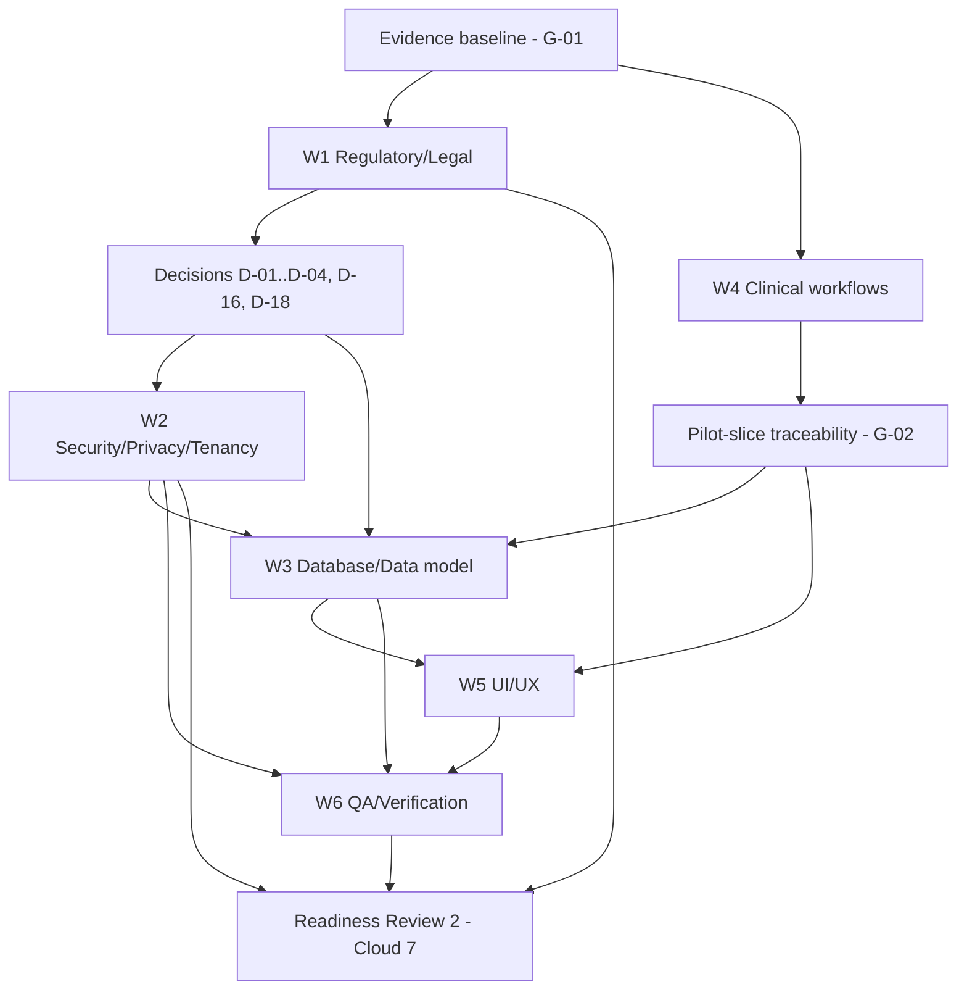
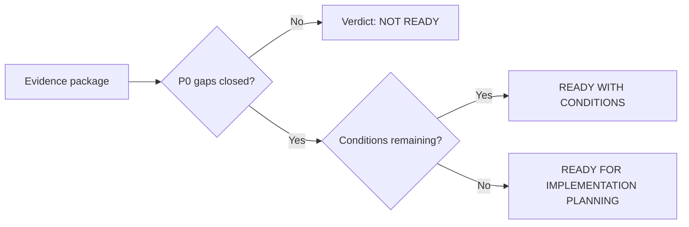
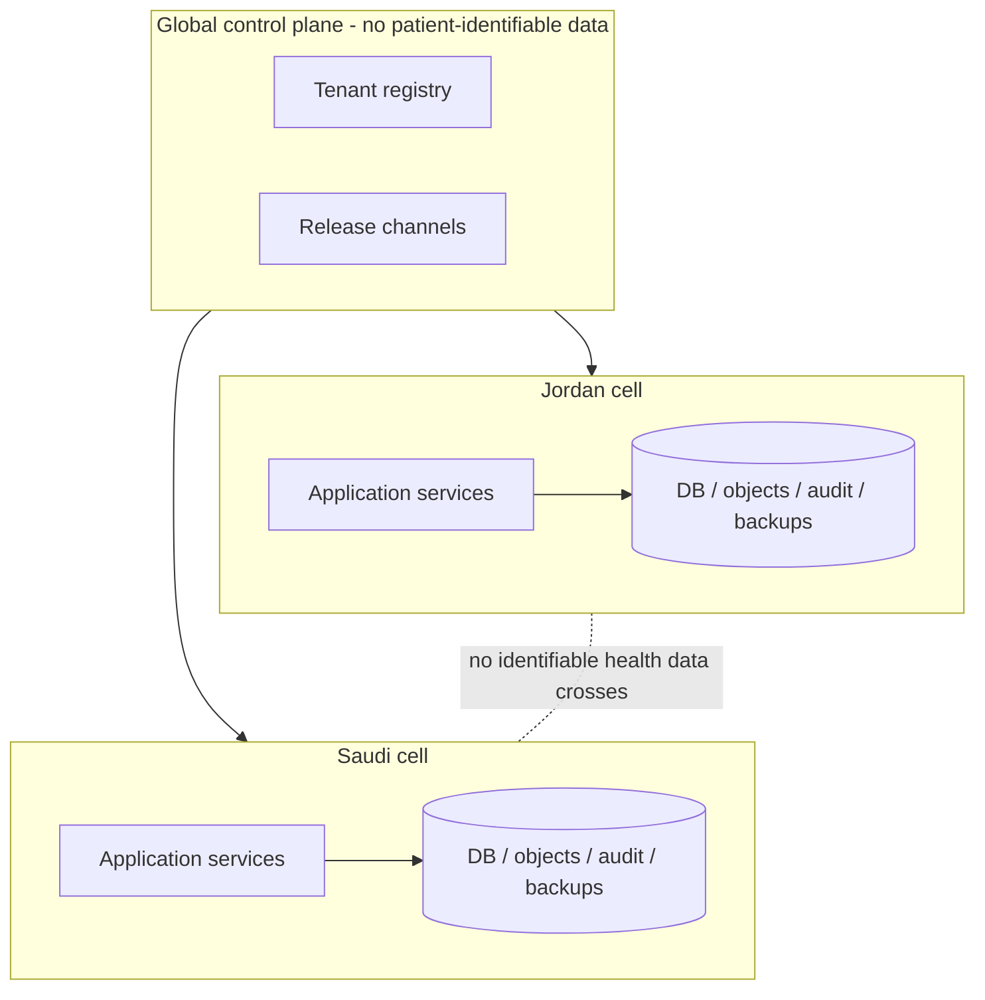

# ARGON — Cloud 7: Independent Architecture Review and Gap Analysis

| Field | Value |
|---|---|
| Product in scope | ARGON Dental — Jordan Pilot (first); Saudi Arabia (second target) |
| Reviewer role | Independent enterprise healthcare architecture reviewer (Cloud 7) |
| Report date / evidence access date | 2026-11-06 |
| Nature of work | Research, analysis, and documentation only. No repository, file, deployment, or production change. No real patient data. |
| **Final verdict** | **NOT READY** (for implementation planning approval) |
| Production-readiness claim | **None.** Nothing in this report states or implies ARGON is production-ready. |

---

## 0. How to read this report

### 0.1 Evidence classes

Every material statement carries one of these tags.

| Tag | Meaning |
|---|---|
| **[VE]** Verified Evidence | Directly observed by this reviewer in a primary source during this review. |
| **[DD]** Documented Design | Stated by the project owner or project documents as design intent. Not confirmed as implemented. |
| **[REC]** Recommendation | The reviewer's proposal. Not a fact about ARGON or the law. |
| **[UA]** Unverified Assumption | Plausible but unconfirmed. Must not be used as a basis for approval. |
| **[SEC]** Secondary source | Law-firm, vendor, or commentary source. Useful for orientation, not sufficient for legal reliance. |

### 0.2 Evidence inventory — what this review did and did not have (critical limitation)

This section governs how much weight every other section can bear.

| Input | Available to this review? | Consequence |
|---|---|---|
| ARGON-HEALTH repository contents (code, ADRs, schemas, workflow specs) | **No.** No repository access and no files were supplied in this session. | No claim about what the repository actually contains is **[VE]**. |
| Outputs of the six other specialist teams | **No.** None were supplied. | Cross-team reconciliation (Questions 4, 5, 7, 10) cannot be completed. It is reported as **CANNOT ASSESS**, not as "pass". |
| Owner-provided project context (summary) | Yes, as a summary only: ARGON-HEALTH described as 40 semantic domains, 30 semantic workflows, Control/Application/Data planes, data stack of PostgreSQL + Redis + object storage + Pub/Sub + search + warehouse, frozen decisions ACR-1 to ACR-5, ADR-024 (object-storage retrieval credentials) PROPOSED not approved, G-1 and G-7 security gates, an Assurance & Verification Kit of 67 controls all NOT_RUN as of the 2026-10-17 baseline, a legacy Firebase-based production system, and a statement that ARGON-HEALTH is still an architecture/governance project rather than a verified complete application. | All tagged **[DD]**. They are the owner's description, not verified. They may be stale (baseline is 2026-10-17; today is 2026-11-06). |
| Official Jordanian and Saudi legal texts | **Not retrieved in full.** Only partial official pages (MoDEE FAQ, SFDA guideline index) plus secondary commentary were reached. | Regulatory conclusions are provisional. No regulatory requirement below is final. |
| Live URL re-verification | URLs were returned by search on 2026-11-06. Each was not separately re-fetched for liveness. | Treat "access date" as the search-return date. Re-verify before citing externally. |

**Reviewer's rule applied:** where evidence is missing, the finding is recorded as *UNKNOWN — REQUIRES EVIDENCE* or *DECISION REQUIRED*. Nothing is inferred into a pass.

### 0.3 Inferred workstream names

The brief does not name the six other teams. From the review questions, this report **[UA]** assumes they are: (W1) regulatory/legal, (W2) security/privacy/tenancy, (W3) database/data model, (W4) clinical workflows, (W5) UI/UX, (W6) QA/verification. Cloud 7 is W7. Correct this mapping if wrong; the dependency map in §11 depends on it.

---

## 1. Independent executive assessment

**Verdict: NOT READY.**

ARGON may become a sound foundation, but on the evidence available to this review, implementation planning cannot responsibly be approved. The reasons are specific and closeable:

1. **No verified baseline.** No repository state, schema, or other-team output was available. The only ARGON description is an owner summary dated before the review. Approval on that basis would be approval on assumptions.
2. **Scope mismatch between the product and the architecture.** The product to ship first is one dental clinic in Jordan at $0/month **[DD]**. The documented target is 40 domains, 30 workflows, three planes, and a six-store data stack under an Architecture Freeze **[DD]**. No document shows which slice of that architecture the pilot needs, so the pilot cannot be planned, sized, or tested.
3. **Tenant isolation is a requirement, not yet a proven design.** With six data stores (database, cache, object storage, message bus, search index, warehouse), isolation must hold in *every* store. No evidence shows a single enforceable isolation invariant or the tests that would prove it.
4. **Jordan + Saudi "one product" is unproven and is under legal strain.** Secondary sources indicate that health data is sensitive under both regimes, that cross-border transfer is restricted in both, and that Saudi rules for sensitive data are stricter in the transfer context. A single shared global data plane for both countries is a legal risk until counsel clears it.
5. **Regulatory assumptions rest on secondary sources, and those sources disagree** (for example, on Jordan breach-notification timing and penalty levels — see §7). No primary legal text or regulator confirmation has been obtained.
6. **Medical-device/SaMD classification is undetermined** in both countries. This can change the entire program (quality system, premarket authorization) and is not mentioned as a decision in the owner context.
7. **Security gates are open.** ADR-024 is proposed and G-1/G-7 are gates **[DD]**. Dental practice depends heavily on radiographs and photos, so the object-storage retrieval path is on the critical path of the first clinic.
8. **Quality assurance has no evidence yet.** 67 controls all NOT_RUN **[DD]** means no safety or security property has been demonstrated. That is acceptable at this stage, but it means the QA question (Q7) must be answered "not proven".
9. **$0/month vs. healthcare obligations is untested.** Backups, restore testing, monitoring, incident response, and security testing all have costs (money or labor). No analysis shows they fit the budget.

**What would change the verdict.** Moving to **READY WITH CONDITIONS** requires closing the P0 items in §9 (evidence baseline, pilot-slice traceability, tenant-isolation specification, data-residency position, legal-role and legal-basis determination, device-classification determination, ADR-024 decision, and a costed $0 feasibility statement). Nothing in this list requires writing production code.

**What is positive.** The owner context indicates good discipline: architecture freeze, explicit gates, a verification kit, and a stated refusal to treat labels as proof **[DD]**. Those habits are exactly what this program needs. The gaps below are about evidence and scoping, not about the owner's rigor.

---

## 2. Scope and method

**In scope:** the ten assessment questions in the Cloud 7 brief; gap, contradiction, and missing-decision registers; priorities; sequence; dependency map; verdict.

**Out of scope:** code, repository changes, deployment, production access, real patient data, legal advice (this report is not legal advice; counsel in Jordan and Saudi Arabia must confirm every regulatory item).

**Method:** (1) inventory evidence; (2) tag every statement; (3) test the owner-described architecture against the pilot's needs and against the two jurisdictions; (4) search current public sources; (5) record contradictions and missing decisions; (6) prioritize.

---

## 3. Detailed findings by review question

Status legend: **SUPPORTED**, **PARTIAL**, **NOT SUPPORTED**, **CANNOT ASSESS (evidence missing)**.

### Q1. Does the architecture support the first dental clinic?

**Status: CANNOT ASSESS → treated as NOT SUPPORTED for approval purposes.**

- **[DD]** The architecture is general-purpose healthcare (40 domains). Whether it contains the dental-specific clinical capabilities a clinic needs is **UNKNOWN — REQUIRES EVIDENCE**.
- **[REC]** Verify coverage against this checklist of dental workflows. This is a verification list, **not** a claim that anything is missing:
  - Patient registration and identity matching; guardian linkage for minors.
  - Appointment, recall, and no-show handling.
  - Medical/dental history and allergy capture, shown at point of care.
  - Tooth chart (odontogram): tooth numbering notation, per-surface findings, primary vs. permanent dentition.
  - Periodontal charting.
  - Diagnosis and procedure coding (code system is an open decision, D-07).
  - Treatment plan: phases, alternatives, cost estimate, patient acceptance, procedure-specific consent.
  - Clinical notes, prescriptions, referrals, dental lab work orders.
  - Imaging: intraoral photos, bitewing/periapical/panoramic radiographs, CBCT if used. Storage, retrieval, viewing, and sharing (links to ADR-024).
  - Billing: estimate, invoice, payment, installments, insurer claims (Saudi) or self-pay (typical clinic case; **[UA]**).
  - Inventory/sterilization logs (clinic may need; confirm with clinic).
  - Audit trail, access control, and record correction/addendum.
- **[REC]** Produce the pilot-slice traceability matrix (gap G-02): clinic workflow → domain → semantic workflow → data entities → UI screen → test case.
- **Dependency risk:** imaging retrieval depends on ADR-024 (not approved) **[DD]**.

### Q2. Can it support Jordan and Saudi Arabia without separate incompatible products?

**Status: PARTIAL in principle; NOT SUPPORTED by evidence.**

- **[DD]** The Control/Application/Data plane split is a reasonable starting point for a "one product, regional deployments" model. No document shows what may cross planes or regions.
- **[SEC]** Both countries have modern personal-data laws that treat health data as sensitive and restrict cross-border transfer (§7). The Saudi transfer rules reportedly do not extend simplified routes to sensitive data (R9, R12). **[UA]** until counsel confirms.
- **Therefore [REC]:** design "one codebase, country packs, regional deployment cells". A **cell** is a self-contained deployment holding all patient-identifiable data of the tenants assigned to a jurisdiction. A global control plane may hold only non-patient metadata (tenant registry, release channel, billing of the SaaS itself) unless counsel approves more. See Diagram 3.
- **Country pack contents to specify (D-14, G-13):** language and calendar, coding systems, tax/e-invoice format, payer integration, national identifier handling, regulatory reporting, retention periods, consent/legal-basis templates.
- **Candidate national dependencies not verified in this review [UA]:** national e-invoicing in each country, national health-record integration (Jordan "Hakeem"), national insurance exchange (Saudi "NPHIES"). Each must be confirmed from official sources before being declared in or out of scope (R17–R21 give only secondary context).

### Q3. Are security, privacy, and tenant isolation adequately designed?

**Status: NOT SUPPORTED by evidence.**

- **[DD]** The gating structure (G-1, G-7, ADR-024) shows the right instincts. Gates are open.
- **Core issue.** The documented data stack has six stores. Isolation must be specified per store:

| Store | Typical isolation failure to design against |
|---|---|
| PostgreSQL | Missing tenant predicate in a query; shared-ID enumeration; admin/migration role bypass |
| Redis (cache/session) | Cache key without tenant namespace; stale PHI after consent withdrawal |
| Object storage | Overbroad or reusable retrieval credentials (ADR-024 scope); guessable object keys |
| Pub/Sub | Cross-tenant subscription; PHI in message payloads and dead-letter queues |
| Search index | Unfiltered query returns other tenants' records; index persists deleted data |
| Warehouse | Bulk export mixes tenants; de-identification not actually applied |

- **[REC]** Require a single written **Tenant Isolation Specification** containing: isolation model per store, the one authoritative place where tenant identity is derived and enforced, rules for service accounts and migrations, and a negative-test catalog (§13).
- **Privacy gaps to close:** controller/processor roles (D-01), legal basis per processing purpose (D-02a), purpose limitation, retention and erasure rules versus medical-record retention (D-09), breach-response procedure given conflicting timelines (§7), patient rights handling (access, correction), children's data and guardian consent, national-ID handling.
- **Audit:** an append-only, tamper-evident access log with break-glass (emergency access) review is a requirement for health systems generally **[REC]**.

### Q4. Do the database and clinical workflow models agree?

**Status: CANNOT ASSESS.**

- No schema, workflow specification, or other-team output was supplied.
- **[REC]** Reconciliation method for the next review: (a) list every semantic workflow step that creates or modifies clinical data; (b) map each to owning entity and writer service; (c) verify each entity has tenant key, provenance (who/when/why), versioning/correction semantics, and a retention class; (d) verify frozen decisions are reflected: ACR-1 (consent owned by CONSENT), ACR-2 (CLAIMS vs INSURANCE), ACR-3 (PAYMENTS vs BILLING), and exactly 30 workflows **[DD]**.
- **Specific risk to test [UA]:** a consent-centric model (ACR-1) can be mistaken for "consent is the legal basis for everything". Treatment of a patient generally has other legal bases in many regimes; the system needs a **legal-basis register** separate from consent records. Counsel must confirm the Jordan and Saudi position.

### Q5. Does UI coverage meet all clinical workflows?

**Status: CANNOT ASSESS.**

- **[DD]** A prototype was requested (staff sign-in, reception queue, patient search/registration, patient summary, encounter workspace, state screens; Arabic RTL and English LTR; synthetic data). Whether it was built, and what it covers, is **UNKNOWN**.
- **[REC]** Coverage test: each row in the Q1 checklist maps to at least one screen and each screen to at least one workflow. Plus safety-specific UI requirements:
  - Persistent patient identification banner (name, age, an additional identifier) on every clinical screen.
  - Allergy and critical-condition banner.
  - Tooth numbers, dates, doses, and amounts render unambiguously in mixed right-to-left/left-to-right text (bidirectional text is a known source of misreading; test it, T-14).
  - Hijri and Gregorian date display rules (D-14).
  - Explicit states: loading, empty, error, unauthorized, save-failed, offline.
  - Confirmation on irreversible or high-impact actions (delete, merge patients, finalize chart).

### Q6. Are regulatory assumptions supported by official evidence?

**Status: PARTIAL — only a few facts are official; most are secondary and some conflict.**

See §7 for the register. Summary:
- Jordan PDPL effective date is confirmed by an official MoDEE page (R1). Other Jordan details (breach timing, penalties, regulator readiness, implementing regulations, cross-border adequacy list) are **unresolved**.
- Saudi PDPL enforceability from 14 September 2024 and the existence of Implementing and Transfer Regulations are consistently reported by law-firm sources (R8, R10–R12). Provisions affecting health data need primary-text verification.
- Device regulation: the SFDA official guideline index shows a Software as a Medical Device guidance (R13). Newer digital-health guidance (reported as MDS-G27, August 2025) is reported only by a non-official source (R14). Whether an electronic dental record or practice-management system is regulated as a medical device in either country is **undetermined**.

### Q7. Does the QA plan prove the required safety and security properties?

**Status: NOT SUPPORTED.**

- **[DD]** 67 controls, all NOT_RUN at the 2026-10-17 baseline. A control list is not proof. No control has produced evidence.
- **[REC]** Gaps to close in the plan itself:
  1. Traceability: requirement → control → test → evidence artifact → result.
  2. Negative tests for isolation (§13) and authorization, not only happy paths.
  3. Defined evidence format and retention (so a result can be audited later).
  4. Separation of "design review controls" (can be completed on paper now) from "runtime controls" (need running software).
  5. Release criteria: which controls must be PASS before real patient data touches the system (P0 list in §14).
  6. Clinical-safety testing (wrong-patient, wrong-tooth, wrong-dose display), distinct from security testing.
  7. Restore and disaster-recovery drills, not only backup existence.

### Q8. Is the architecture unnecessarily complex?

**Status: PROBABLY YES for the pilot; evidence needed.**

- **[DD]** For a single clinic at $0/month: three planes and six data stores, 40 domains and 30 workflows, under a freeze.
- **[REC]** Define a **Pilot Profile** that states, for each component, "required / deferred / disabled" with a written reason:
  - Likely required **[UA]**: relational database, encrypted object storage for imaging, authentication and authorization, audit log, backup.
  - Candidates to defer until a measured need exists **[UA]**: separate cache, message bus (a database-backed job table may suffice for one clinic), dedicated search engine (database text search may suffice), warehouse/analytics.
  - Each deferred component removes an isolation surface, an operating cost, and a failure mode. Each should be re-admitted only by an ADR with a measured trigger.
- **Architecture Freeze caveat [REC]:** a freeze must not block corrective changes required by legal or safety findings. Define a **freeze-exception** path (who approves, evidence required, record in an ADR). Otherwise the freeze can lock in a non-compliant design.
- **Caution:** "unnecessarily complex" is a hypothesis until the traceability matrix (G-02) shows which domains the pilot touches.

### Q9. Are critical dependencies or decisions missing?

**Status: YES.** See §6 (Missing Decision Register). Highest impact: legal roles and basis, hosting region and cost, device classification, tenant-isolation model, identity provider, interoperability scope, retention, backup/DR targets.

### Q10. Do any requirements contradict each other?

**Status: YES — several apparent contradictions.** See §5 (Contradiction Register). The most important: "$0/month" versus healthcare-grade controls; "one product for two countries" versus data residency; "improve, don't replace" and "architecture freeze" versus the migration from a legacy Firebase-based system.

---

## 4. Architecture Gap Register

Priority: **P0** blocks approval of implementation planning. **P1** must be closed before real patient data. **P2** can follow.
"Closure evidence" says what a reviewer must see to close the gap.

| ID | Gap | Evidence class | Impact | Pri | Closure evidence |
|---|---|---|---|---|---|
| G-01 | No verified evidence baseline: repository state not pinned; other-team outputs not collected; owner summary dates from 2026-10-17 | [DD] stale | All findings provisional | P0 | Pinned commit SHAs, file inventory, and the six team deliverables attached to a review package |
| G-02 | No pilot-slice traceability (clinic workflow → domain → workflow → entity → screen → test) | Absence | Cannot size, plan, or test the pilot; cannot judge complexity | P0 | Completed matrix with zero unmapped rows |
| G-03 | Tenant Isolation Specification absent across six stores | Absence | Cross-tenant PHI exposure | P0 | Signed spec + negative-test catalog mapped to tests |
| G-04 | Data residency and cross-border position undefined for Jordan and Saudi | [SEC] | Legal exposure; may force architecture change late | P0 | Counsel memo per country; deployment-cell design |
| G-05 | Controller/processor roles, legal-basis register, consent model not validated against both laws | [UA] | Unlawful processing; wrong data model | P0 | Counsel memo; data-model change list if needed |
| G-06 | Regulatory claims rest on secondary sources; sources conflict | [SEC] | Wrong requirements baked into design | P0 | Primary legal text (Arabic original where official) reviewed by counsel; register in §7 updated |
| G-07 | Medical device / SaMD classification undetermined (Jordan JFDA, Saudi SFDA) | [SEC] | Possible premarket authorization and quality-system obligations | P0 | Written regulator or counsel determination for the pilot's intended-use statement |
| G-08 | ADR-024 proposed; G-1/G-7 gates open; imaging path blocked | [DD] | Dental imaging cannot be designed safely | P0 | Approved ADR-024 with threat model, or approved alternative |
| G-09 | QA plan has no evidence; no requirement→test traceability | [DD] | Cannot prove safety/security | P0 | Traceability table; first design-review controls marked PASS/FAIL with artifacts |
| G-10 | $0/month feasibility not demonstrated for backups, restore tests, monitoring, incident response, security testing, and DR | [UA] | Unsafe or unfunded operation; free-tier terms may not permit patient data | P0 | Costed Pilot Profile; for each provider, current free-tier terms (region, DPA, backup/PITR, SLA, data-use terms) recorded from the provider's own documentation |
| G-11 | Dental clinical model coverage unverified (Q1 checklist) | Absence | Pilot unusable or unsafe | P1 | Checklist completed against data model and workflows |
| G-12 | Role model for dental staff and RBAC/ABAC matrix absent | Absence | Over-broad access | P1 | Role × data-category × action matrix; break-glass rules |
| G-13 | Country-pack (jurisdiction configuration) design absent | Absence | Forks per country; the "incompatible products" risk | P1 | Country-pack spec; test that a country switch changes behavior without code fork |
| G-14 | National identifier handling (storage, matching, display, masking) undefined | Absence | Sensitive-ID exposure; duplicate patients | P1 | Data-handling rule; patient-matching design |
| G-15 | Backup, restore, RPO/RTO targets and drills undefined | Absence | Data loss | P1 | Targets approved; restore drill result on synthetic data |
| G-16 | Offline / unreliable-connectivity behavior undefined | Absence | Lost clinical entries; unsafe workarounds | P1 | Decision D-11; scenario T-17 passes |
| G-17 | Legacy Firebase-based system coexistence/migration path undefined | [DD] | Dual sources of truth; "improve not replace" unclear | P1 | Migration/coexistence ADR; data-mapping inventory |
| G-18 | Interoperability scope undefined (national health record, insurer exchange, FHIR version, terminology) | [SEC] | Late rework | P1 | Decision D-08 with official specifications attached |
| G-19 | Billing/e-invoicing regulatory dependency unverified in both countries | [UA] | Non-compliant invoices | P1 | Official specification per country; scope decision |
| G-20 | Secrets, keys, encryption at rest/in transit, key custody, and rotation undefined | Absence | Compromise impact | P1 | Key-management design; rotation test |
| G-21 | Audit-log integrity and review process undefined | Absence | Undetectable misuse | P1 | Spec + tamper test T-09 |
| G-22 | Incident response and breach-notification procedure undefined, given conflicting timelines | [SEC] | Missed legal deadline | P1 | Procedure with the stricter assumption until counsel confirms |
| G-23 | Supply-chain and licensing hygiene (dependency scanning, SBOM, free-tool license terms) | Absence | Vulnerable or non-redistributable components | P1 | Policy + scan evidence |
| G-24 | Arabic/RTL clinical-safety rendering requirements not specified | Absence | Misread tooth numbers, dates, doses | P1 | Rendering rules + T-14 |
| G-25 | Data retention, legal hold, and erasure-vs-retention conflicts undefined | Absence | Unlawful retention or premature deletion | P1 | Retention schedule approved by counsel and clinic |
| G-26 | Patient-safety hazard analysis (wrong patient, wrong tooth, wrong treatment plan) absent | Absence | Patient harm | P1 | Hazard log with mitigations mapped to tests |
| G-27 | Warehouse/analytics: de-identification and secondary-use rules undefined | Absence | Re-identification; unlawful secondary use | P2 | Defer until pilot stable; rules approved before enabling |
| G-28 | Multi-branch, pharmacy, laboratory, radiology, hospital readiness | [DD] | Premature complexity | P2 | Deferred by explicit decision; extension points documented |
| G-29 | AI/decision-support features (if any) and their device implications | [UA] | Device classification trigger | P2 | Explicit "no AI clinical function in pilot" decision, or classification analysis |

---

## 5. Contradiction and Inconsistency Register

| ID | Contradiction / inconsistency | Sources | Why it matters | Proposed resolution [REC] |
|---|---|---|---|---|
| C-01 | **Scope:** first product = one dental clinic; architecture = 40 domains, 30 workflows, frozen | Brief vs [DD] | The pilot's minimum is unknown; effort and risk cannot be estimated | G-02 matrix; Pilot Profile |
| C-02 | **Budget:** $0/month vs six-store data stack and healthcare operational controls | Brief vs [DD] | Controls without funding become paper controls | G-10 costed feasibility; defer components |
| C-03 | **Product/jurisdiction:** "one product for Jordan and Saudi" vs data residency and sector rules that are country-specific | Q2 vs [SEC] | Late forks or unlawful transfers | Deployment cells + country packs |
| C-04 | **Change policy:** "improve, don't replace" and Architecture Freeze vs a target architecture that differs from the legacy Firebase-based production system | Brief vs [DD] | No defined path from current to target | Migration/coexistence ADR; freeze-exception process |
| C-05 | **Consent ownership (ACR-1)** vs lawful processing that may not rest on consent | [DD] vs [UA] | Data model may force consent where another basis applies, or imply consent is sufficient | Legal-basis register separate from consent lifecycle; counsel decision |
| C-06 | **Exactly 30 workflows** vs jurisdiction- and dental-specific flows (insurer exchange, imaging, recall, national-record sync) | [DD] | Freeze may force overloaded workflows or hidden side-flows | Map pilot needs to existing 30; if gaps, use freeze-exception path |
| C-07 | **Imaging need vs ADR-024 status:** imaging is central to dental care; its retrieval design is unapproved | Domain vs [DD] | Pilot cannot ship safely without it | Prioritize ADR-024 decision |
| C-08 | **Status labels vs proof:** status documents reported inconsistent in a sibling repository; assurance controls NOT_RUN | [DD] | Readiness claims can't be trusted without evidence | Evidence package (G-01) before any approval |
| C-09 | **Secondary sources disagree on Jordan PDPL:** breach notice to data subjects within 24 hours (R5) vs to a Council within 72 hours (R6); penalty ranges JOD 1,000–10,000 (R5) vs up to JOD 1 million (R6); regulator "not fully established" (R5, R7) vs "Council" duties described (R6) | [SEC] | Different design and runbook outcomes | Do not rely on any; counsel verifies primary text; use the strictest assumption operationally until then |
| C-10 | **Saudi sensitive data transfer:** commentary says reforms eased transfers (R12 context) but health data reportedly excluded from simplified routes (R9, R12) | [SEC] | A multi-region design may be unlawful | Counsel memo; keep Saudi health data in-Kingdom by default |
| C-11 | **Naming:** product "ARGON Dental — Jordan Pilot" vs repository/platform "ARGON-HEALTH" and a separate AI-OS repository | Brief vs [DD] | Ambiguity over which repository and which artifacts constitute the pilot | One-page naming/boundary statement |
| C-12 | **"Do not assume documented architecture is implemented" vs review expected to judge readiness** | Brief | Judging readiness requires implemented evidence that may not exist | Reviewer verdict limited to *planning* readiness; implementation readiness separate |

---

## 6. Missing Decision Register

Each decision needs an owner, evidence, and a recorded outcome (ADR or signed memo).

| ID | Decision required | Options | Needs input from | Blocks |
|---|---|---|---|---|
| D-01 | Legal roles: is the clinic the controller and ARGON a processor, or are roles joint, per country? | Controller/processor splits | Jordan and Saudi counsel; clinic owner | G-05, contracts |
| D-02 | Legal basis per processing purpose (care, billing, recalls, analytics, marketing), separate from consent | Register of purposes | Counsel; DPO | Data model, UI consent flows |
| D-03 | Hosting region and provider for the Jordan pilot, within $0 | In-country / abroad; provider choice | Counsel; infrastructure lead | G-04, G-10 |
| D-04 | Saudi deployment: in-Kingdom cell vs other | Cell per country | Saudi counsel | Saudi readiness |
| D-05 | Tenant isolation model per store | Shared schema + row-level enforcement / schema per tenant / database per tenant | Security lead | G-03 |
| D-06 | Identity: provider, MFA, session policy, staff onboarding, device policy | Self-hosted / managed free tier | Security lead | G-12 |
| D-07 | Clinical coding and notation: diagnosis, procedure, tooth numbering, terminology service | To be confirmed with dentists and national bodies | Clinic dentist; regulators | Data model, UI |
| D-08 | Interoperability scope: national health record, insurer exchange, standards and versions | In / out / later, per country | Regulators; counsel | G-18 |
| D-09 | Retention, legal hold, erasure rules | Per record class | Counsel; clinic | G-25 |
| D-10 | RPO / RTO and backup destinations | Targets | Clinic owner; engineering | G-15 |
| D-11 | Offline behavior | None (require connectivity) / limited / local-first | Clinic; engineering | G-16 |
| D-12 | Imaging strategy: formats, viewer, device integration, retrieval design (ADR-024) | Per device inventory | Clinic; security lead | G-08 |
| D-13 | Billing and e-invoicing scope per country | In / out / later | Counsel; accountant | G-19 |
| D-14 | Localization: Arabic RTL, calendars, number formats, units | Per country pack | Clinic; UI | G-13, G-24 |
| D-15 | AI/decision-support in pilot | Exclude / include with classification analysis | Product owner; counsel | G-29, G-07 |
| D-16 | Device-classification process: who asks which regulator, with what intended-use statement | Counsel-led request | Counsel | G-07 |
| D-17 | Pilot clinic: identity, workflows, success criteria, go-live gate (synthetic-only vs real patients) | Gate definition | Product owner; clinic | Everything |
| D-18 | Breach/incident ownership and clock rules | Stricter-assumption rule until counsel confirms | DPO; counsel | G-22 |
| D-19 | Freeze-exception process | Approval path | Architecture owner | C-04, C-06 |
| D-20 | Legacy system coexistence/migration | Parallel / cut-over / never merge | Owner | G-17 |

---

## 7. Regulatory Evidence Register

Authority tier: **Primary-official** (government/regulator), **Secondary** (law firm, journal, government commercial guide), **Tertiary** (vendor, blog, aggregator). Only Primary-official sources can settle a requirement; none below is a complete legal text.

### 7.1 Jordan

| Topic | What sources say | Tier | Status |
|---|---|---|---|
| Personal Data Protection Law No. 24 of 2023: effective date | The official Ministry of Digital Economy page states the law took effect on 17 March 2024 and applies to data processed before that date as well (R1). Law-firm sources agree on publication on 17 September 2023 (R2, R4). | Primary-official + Secondary | **Confirmed date** |
| Transition period ending 17 March 2025 | One tertiary source (R7) | Tertiary | **Unverified** |
| Health-data transfers | Law-firm sources describe cross-border restrictions with exceptions that include data exchange necessary for medical treatment and for public health (R2, R3). | Secondary | **Provisional; needs primary text** |
| Breach notification | R5 states notification to data subjects within 24 hours; R6 states notification to a Council within 72 hours | Tertiary | **Conflict — do not rely** |
| Penalty levels | R5 states JOD 1,000–10,000; R6 states up to JOD 1 million | Tertiary | **Conflict — do not rely** |
| Regulator readiness | R5 and R7 state the data-protection authority was not fully established as of 2025 | Tertiary | **Unverified; check current status** |
| Medical devices | JFDA regulates devices; the definition reportedly covers software necessary for a device's use (R16) | Tertiary | **Classification of ARGON undetermined** |
| National EHR "Hakeem" | Government-linked sources describe a national program, spreading to private facilities, using SNOMED support (R17–R19) | Secondary | **Integration obligation unknown** |
| Cloud regulation | A vendor page states there was no uniform cloud regulation in Jordan (R20); its date is unknown | Tertiary | **Unverified; check current rules** |

### 7.2 Saudi Arabia

| Topic | What sources say | Tier | Status |
|---|---|---|---|
| PDPL enforceability | Became fully enforceable on 14 September 2024 after a grace period (R8) | Secondary | **Consistent across sources; confirm in primary text** |
| Sensitive data includes health data | Reported by commentary (R10, R11) | Secondary | **Provisional** |
| Health-sector rules | Executive-regulation commentary says health-data controllers must follow Ministry of Health and Health Council requirements (R10, draft stage); IAPP notes the cross-check burden on controllers (R11) | Secondary | **Final text to verify; sector rules to collect** |
| Cross-border transfer | SDAIA updated the Transfer Regulation on 1 September 2024 (R12); a law-firm note says the eased route does not apply to health data (R9) | Secondary | **Critical; counsel must confirm** |
| National controller registry | Commentary lists registration triggers that include sensitive-data processing and cross-border transfer (R22) | Tertiary | **Verify** |
| Device regulation | SFDA official index shows a Software as a Medical Device guidance (R13); a tertiary source reports digital-health guidance MDS-G27 (August 2025) with health-IT such as electronic records listed as a category, plus related cybersecurity and AI guidance (R14); peer-reviewed analysis covers the AI guidance MDS-G010 (R15) | Primary-official (index), Tertiary, Secondary | **Whether ARGON needs authorization: undetermined** |
| National insurance exchange (NPHIES) | Only vendor marketing found (R21); no official specification retrieved | Tertiary | **Unverified; official specs required** |

### 7.3 Not researched in this review (candidate dependencies to verify)

Each of the following is a **[UA]** candidate dependency: Saudi national cybersecurity controls for organizations; Saudi health-sector data policies and the Ministry's licensing of health IT; Jordan's cybercrime and cybersecurity laws; Jordan medical-liability and clinic-licensing rules; Jordan's and Saudi Arabia's national e-invoicing systems; professional-association rules for dental records. None can be added to requirements without official sources.

---

## 8. Security, Privacy, and Safety Considerations

### 8.1 Security requirements proposed for the readiness gate [REC]

| ID | Requirement |
|---|---|
| SEC-01 | One authoritative tenant-resolution point; every data access carries tenant identity; no bypass path for application roles |
| SEC-02 | Tenant isolation specified and tested per store (database, cache, object storage, message bus, search, warehouse) |
| SEC-03 | Object retrieval uses short-lived, scoped, non-reusable credentials; design approved through ADR-024 or a replacement |
| SEC-04 | Authentication with MFA for all staff; session expiry; secure recovery process |
| SEC-05 | Authorization by role and data category, with deny-by-default and break-glass with mandatory review |
| SEC-06 | Encryption in transit everywhere; encryption at rest; documented key custody and rotation |
| SEC-07 | Append-only, tamper-evident audit log of reads and writes of clinical data |
| SEC-08 | No patient identifiers in logs, analytics, error reports, or message payloads unless justified and protected |
| SEC-09 | Secrets never in source control; secret scanning in the pipeline |
| SEC-10 | Dependency and license scanning; SBOM kept |
| SEC-11 | Backups encrypted, access-controlled, and restore-tested |
| SEC-12 | Threat model for the pilot reviewed before real data |
| SEC-13 | Incident-response runbook with named roles and the stricter breach clock until counsel decides |
| SEC-14 | Test and development environments use synthetic data only |

### 8.2 Privacy requirements proposed [REC]

| ID | Requirement |
|---|---|
| PRV-01 | Records of processing purposes with legal basis, separate from consent |
| PRV-02 | Patient rights process: access, correction, restriction, objection, and handling of erasure requests versus retention |
| PRV-03 | Guardian authority and minors' data rules (dental practice has many minor patients) |
| PRV-04 | Data minimization for national identifiers; masked display by default |
| PRV-05 | Cross-border transfer register; default no transfer of identifiable health data out of the country cell |
| PRV-06 | Consent withdrawal propagates to every store, including cache and search |
| PRV-07 | Processor contract template for the clinic–ARGON relationship, reviewed by counsel |

### 8.3 Clinical-safety requirements proposed [REC]

| ID | Requirement |
|---|---|
| SAF-01 | Two-identifier patient confirmation before clinical actions and image attachment |
| SAF-02 | Allergy and critical medical alerts visible at point of care |
| SAF-03 | Tooth, surface, and dentition identification unambiguous in both languages and directions |
| SAF-04 | Corrections preserve history (addendum, not overwrite) |
| SAF-05 | Patient merge/unmerge reversible and audited |
| SAF-06 | Treatment plan version and acceptance are traceable |
| SAF-07 | A hazard log is maintained and linked to tests |

---

## 9. P0 / P1 / P2 Priority List

### P0 — must close before implementation planning can be approved

1. G-01 Evidence baseline and complete review package
2. G-02 Pilot-slice traceability matrix
3. G-03 Tenant Isolation Specification
4. G-04 Data residency position (Jordan and Saudi)
5. G-05 Roles, legal basis, and consent-model validation
6. G-06 Primary-source regulatory verification and resolution of conflicts (C-09, C-10)
7. G-07 Device/SaMD classification determination
8. G-08 ADR-024 decision and security gates G-1/G-7
9. G-09 QA traceability and first design-review evidence
10. G-10 Costed $0 feasibility, including current provider terms for any service touching patient data

### P1 — must close before any real patient data

G-11 through G-26 (see §4): dental model coverage, roles, country packs, national IDs, backup/DR, offline, legacy coexistence, interoperability, e-invoicing, key management, audit integrity, incident response, supply chain, RTL safety, retention, hazard analysis.

### P2 — can follow the pilot

G-27 warehouse/analytics rules, G-28 multi-branch and ancillary modules, G-29 AI features.

---

## 10. Recommended Implementation Sequence (planning sequence — no implementation implied)

Gates, not dates. A phase may not start until the prior gate's exit evidence exists.

**Phase 0 — Evidence baseline.** Pin repository states; collect the six team outputs; record one-page naming/boundary statement (C-11). *Exit:* G-01 closed.

**Phase 1 — Decisions and legal verification (parallel).** Counsel in Jordan and Saudi Arabia review primary texts; close D-01, D-02, D-03, D-04, D-16, D-17, D-18. *Exit:* regulatory register §7 has no unresolved conflict for P0 topics; device-classification path agreed.

**Phase 2 — Pilot slice and Pilot Profile.** Build the traceability matrix; produce the Pilot Profile (required/deferred/disabled per component); define the freeze-exception path. *Exit:* G-02, G-10, C-01, C-02 closed.

**Phase 3 — Security and data design proofs on paper.** Tenant Isolation Specification, role matrix, key management, audit design, ADR-024 decision, threat model. *Exit:* G-03, G-08, G-12, G-20, G-21 closed at design level.

**Phase 4 — Model reconciliation.** Reconcile data model, workflows, and UI against the traceability matrix; fix contradictions C-05, C-06; add clinical-safety hazard log. *Exit:* Q4 and Q5 can be answered with evidence.

**Phase 5 — QA plan upgrade.** Requirement→control→test→evidence traceability; negative-test catalog; define evidence artifacts; run design-review controls. *Exit:* G-09 closed.

**Phase 6 — Readiness Review #2 (Cloud 7 re-run).** Re-assess against §14 acceptance criteria. *Exit:* verdict recalculated.

**Phase 7 (only after an approved verdict, and out of scope here) — Walking-skeleton planning** for one clinic on synthetic data.

---

## 11. Dependency Map Between Workstreams

Workstream names follow the inference in §0.3 **[UA]**.

### Diagram 1 — Dependency map

### Diagram 2 — Readiness gate flow

### Diagram 3 — Proposed deployment-cell concept [REC]

### Dependency table

| Item | Depends on | Reason |
|---|---|---|
| Tenant Isolation Spec (W2) | D-03, D-04, D-05, Pilot Profile | Isolation model depends on hosting and stores in use |
| Data model reconciliation (W3) | Legal basis D-02, traceability matrix | Entities need legal-basis and consent semantics |
| Clinical model completeness (W4) | D-07 coding/notation | Charting and procedure data depend on code systems |
| UI coverage (W5) | Traceability matrix, D-14 | Screens derive from workflows and localization |
| Imaging workflow | ADR-024 / D-12 | Retrieval security |
| QA plan (W6) | All of the above | Tests derive from requirements and decisions |
| Saudi readiness | D-04, D-16, D-18, NPHIES evidence | Residency, device status, and payer exchange |

---

## 12. Requirements (for the readiness gate and for converting this review into tasks)

| ID | Requirement | Verified by |
|---|---|---|
| REQ-01 | A pinned evidence package exists: repository SHAs, document inventory, six team deliverables | Reviewer inspection |
| REQ-02 | The traceability matrix has no unmapped dental workflow, entity, screen, or test | Matrix audit |
| REQ-03 | A Pilot Profile lists each component as required/deferred/disabled with reason and cost | Document review |
| REQ-04 | A Tenant Isolation Specification covers every data store in the Pilot Profile | Document review + T-01…T-06 designed |
| REQ-05 | A legal-basis register and controller/processor determination exist per country | Counsel signature |
| REQ-06 | Primary legal sources are cited for every regulatory requirement used in design; no tertiary-only requirement | Register §7 audit |
| REQ-07 | A device-classification determination exists per country for the stated intended use | Counsel/regulator note |
| REQ-08 | ADR-024 is approved or replaced; gates G-1/G-7 have recorded outcomes | ADR status |
| REQ-09 | Each QA control maps to a requirement, a test, and an evidence artifact | Traceability audit |
| REQ-10 | A costed $0 feasibility statement exists, with current provider terms recorded from provider documentation | Document review |
| REQ-11 | A freeze-exception process is documented | Document review |
| REQ-12 | Legacy-system coexistence/migration is decided | ADR |
| REQ-13 | A clinical-safety hazard log exists and maps to tests | Hazard log audit |
| REQ-14 | Country-pack specification exists; a country switch requires no code fork | Spec review; later T-19 |
| REQ-15 | Incident-response procedure exists using the strictest breach clock until counsel decides | Runbook review |

---

## 13. Test Scenarios

All scenarios use **synthetic data only**. They describe what the future test plan must prove. They are not executed in this review and no results are claimed.

| ID | Scenario | Expected result |
|---|---|---|
| T-01 | User of tenant A requests a record ID belonging to tenant B through every API path | Denied; no existence leak; audit entry |
| T-02 | Search query by tenant A terms matching tenant B records | Zero tenant B results |
| T-03 | Reuse or modification of an object-retrieval credential (ADR-024) for another tenant's or patient's object, and after expiry | Denied |
| T-04 | Cache key collision attempt across tenants | No cross-tenant read |
| T-05 | Subscribe to another tenant's message topic or inspect dead-letter content | Denied; payloads free of identifiers where required |
| T-06 | Warehouse export for one tenant | Contains only that tenant's data; de-identification rules applied |
| T-07 | Reception role tries to read clinical notes and images | Denied unless the role matrix allows |
| T-08 | Break-glass access | Allowed with reason; flagged for review; audited |
| T-09 | Attempt to alter or delete audit entries as an administrator | Fails or is detected |
| T-10 | Restore a backup into an isolated environment | Complete, consistent, and only the intended tenant's data |
| T-11 | Saudi-cell tenant data written or replicated to the Jordan cell, and the reverse | Blocked by configuration and network egress controls |
| T-12 | Consent withdrawal or purpose change | Propagates to cache, search, and exports |
| T-13 | Erasure request on a record under legal retention | Handled per retention schedule with documented outcome |
| T-14 | Mixed Arabic/English clinical text with tooth numbers, dates, doses, and amounts | Rendered unambiguously in both directions |
| T-15 | Patient merge and unmerge | Reversible; history preserved; audited |
| T-16 | Two patients with similar names scheduled the same day | Identification safeguards prevent wrong-patient entries |
| T-17 | Connection loss during saving of a treatment entry | No silent loss; clear user state per decision D-11 |
| T-18 | Replay of an old retrieval credential | Rejected |
| T-19 | Switch a tenant between country packs | Coding, calendar, invoice fields, and templates change with no code fork |
| T-20 | Secret and dependency scans on the pipeline | No unaddressed critical findings |
| T-21 | Disaster-recovery drill | RPO/RTO targets met per D-10 |
| T-22 | Freeze-exception request | Follows the documented path and is recorded |

---

## 14. Acceptance Criteria

### 14.1 To upgrade from NOT READY to READY WITH CONDITIONS

All must be true:

- **AC-01** REQ-01 through REQ-10 are satisfied with attached evidence.
- **AC-02** No P0 gap is open.
- **AC-03** Every regulatory statement used in design is traced to a primary source, or is labelled "assumption, counsel review pending" and has a fail-safe design choice.
- **AC-04** A named owner exists for every open P1 gap with a closure criterion.
- **AC-05** No contradiction in §5 remains unresolved at C-01, C-02, C-03, C-05, C-07.

### 14.2 To upgrade to READY FOR IMPLEMENTATION PLANNING

- **AC-06** All of §14.1 and no open conditions.
- **AC-07** REQ-11 through REQ-15 satisfied.
- **AC-08** The QA plan maps every P0/P1 security and safety requirement to a test from §13 or an equivalent, with defined evidence artifacts.
- **AC-09** Counsel in each target country has confirmed in writing the residency, legal-basis, and device-classification positions (for Saudi Arabia, this may be a separate later gate if the pilot is Jordan-only; record that decision explicitly).

### 14.3 Gate before real patient data (not part of this review's approval)

- **AC-10** All P1 gaps closed; T-01 to T-12, T-14 to T-18, and T-21 passed with archived evidence on the actual deployment; clinic and counsel sign-off.

---

## 15. Risks

| ID | Risk | Likelihood [UA] | Impact | Mitigation |
|---|---|---|---|---|
| RK-01 | Building on stale or unverified architecture claims | High | High | G-01, evidence package |
| RK-02 | Cross-tenant data exposure through a secondary store | Medium | Very high | G-03, T-01…T-06 |
| RK-03 | Unlawful cross-border handling of health data | Medium | Very high | Deployment cells, counsel |
| RK-04 | Device-classification surprise late in the program | Medium | High | D-16 early |
| RK-05 | $0 budget leads to skipped backups or monitoring | High | High | G-10, Pilot Profile |
| RK-06 | Scope creep from 40-domain architecture | High | Medium | Traceability matrix, deferral decisions |
| RK-07 | Misreading of mixed-direction text causes clinical error | Medium | High | G-24, T-14 |
| RK-08 | Conflicting legal sources cause wrong breach procedure | Medium | High | Stricter-assumption rule, counsel |
| RK-09 | Imaging workflow ships without approved retrieval security | Medium | High | ADR-024 first |
| RK-10 | Dual systems of record during legacy coexistence | Medium | High | D-20 |
| RK-11 | Architecture Freeze blocks needed corrective change | Medium | Medium | D-19 |
| RK-12 | Free-tier terms forbid or fail to protect patient data | Medium | High | Record provider terms before use |

---

## 16. Final Readiness Verdict

**NOT READY.**

Basis: no verified baseline (G-01), no pilot-slice traceability (G-02), no demonstrated tenant isolation design (G-03), unresolved residency, legal-role, and device-classification questions (G-04, G-05, G-07), regulatory assumptions without primary evidence (G-06), an open security gate affecting imaging (G-08), and a QA plan with no evidence yet (G-09). This verdict is about **implementation planning readiness**. ARGON is **not** claimed ready for production, for real patient data, or for deployment in either country.

The verdict is not a criticism of the design direction. It reflects missing evidence. Closing the P0 list in §9 is realistic without writing production code.

---

## 17. Questions Requiring Human or Specialist Approval

**Project owner / product**
1. Is the pilot Jordan-only for go-live, with Saudi Arabia as design-only for now? (D-17, D-04)
2. Will the pilot use real patients, or synthetic data only, and what is the written go-live gate? (D-17)
3. Which repository is the pilot's system of record, and what is the relationship to the legacy Firebase-based system? (C-04, C-11, D-20)
4. Is any AI or decision-support function planned for the pilot? (D-15)

**Jordanian counsel / regulator contact**
5. Who are the controller and processor? What is the legal basis for care, billing, and recalls? (D-01, D-02)
6. What are the breach-notification obligations and the regulator's current status? (C-09)
7. May identifiable health data be hosted outside Jordan for this pilot, and under what conditions? (D-03)
8. Is the system a regulated medical device (JFDA)? (D-16)
9. Are private dental clinics required or expected to integrate with the national health record? (D-08)
10. What are the clinic-record retention rules? (D-09)

**Saudi counsel / regulators**
11. Is in-Kingdom hosting of identifiable health data required for a dental clinic system? (D-04, C-10)
12. Does an electronic dental record or practice-management system need SFDA marketing authorization? (D-16)
13. What is required to integrate with the national insurance exchange, and is it mandatory for the target clinics? (D-08)
14. Are controller registration and sector-specific requirements triggered? (R22)

**Clinic / dentist**
15. Which tooth-numbering notation, coding system, and clinical forms does the clinic use? (D-07)
16. What imaging equipment exists, and what formats does it produce? (D-12)
17. What are tolerable downtime and data-loss limits? (D-10, D-11)

**Security lead / infrastructure**
18. Which isolation model per store, and which hosting providers meet the $0 limit with their current terms? (D-05, D-03, G-10)
19. Approve or replace ADR-024. (D-12, G-08)

---

## 18. Evidence and References

All entries were returned by web search on **2026-11-06** (access date). Direct re-fetch of each URL was not performed; verify before external citation. Tier as defined in §7.

| Ref | Source | URL | Tier | Used for |
|---|---|---|---|---|
| R1 | Jordan Ministry of Digital Economy and Entrepreneurship — FAQs | https://modee.gov.jo/EN/Pages/FAQs | Primary-official | PDPL effective date 17 Mar 2024; applies to earlier-collected data |
| R2 | Clyde & Co — Jordan issues first personal data protection law (Oct 2023) | https://www.clydeco.com/en/insights/2023/10/jordan-issues-first-personal-data-protection-law | Secondary | Publication date; medical-data exchange exception |
| R3 | Al Tamimi — Jordan's new data protection law | https://www.tamimi.com/news/jordans-new-data-protection-law-safeguarding-personal-data | Secondary | Cross-border restrictions and exceptions |
| R4 | DataGuidance — Jordan | https://www.dataguidance.com/jurisdiction/jordan | Secondary | Publication and effective dates; regulator named as Personal Data Protection Directorate |
| R5 | ConsentStack — Jordan PDPL | https://consentstack.io/regulations/jo-pdpl | Tertiary | Conflicting breach and penalty claims; regulator status claim |
| R6 | FlexyConsent — Jordan PDPL guide | https://flexyconsent.com/blog/jordan-pdpl-law-24-cookie-consent-compliance-guide/ | Tertiary | Conflicting breach and penalty claims |
| R7 | Clym — Law No. 24 of 2023 | https://regulations.clym.io/law-no-24-of-2023-jordan | Tertiary | Claimed transition end date |
| R8 | Clyde & Co — Saudi PDPL becomes enforceable (Sep 2024) | https://www.clydeco.com/en/insights/2024/09/saudi-arabia-s-personal-data-protection-law-become | Secondary | Enforceability date 14 Sep 2024; SDAIA publications |
| R9 | BSA Law — Saudi data transfer note | https://bsalaw.com/?p=4471 | Secondary | Health data excluded from eased transfer route |
| R10 | Baker McKenzie — Saudi regulator invites comments on PDPL executive regulations | https://insightplus.bakermckenzie.com/bm/data-technology/saudi-arabia-regulator-invites-comments-on-the-executive-regulations-to-the-personal-data-protection-law | Secondary (draft stage) | Health-data controller obligations |
| R11 | IAPP — Saudi Arabia publishes final PDPL | https://iapp.org/news/a/saudi-arabia-publishes-final-personal-data-protection-law | Secondary | Sector authority cross-check burden |
| R12 | Securiti — Regulation on Personal Data Transfer Outside the Kingdom | https://securiti.ai/regulation-on-personal-data-transfer-outside-the-kingdom | Tertiary | Transfer regulation of 1 Sep 2024; sensitive-data limits |
| R13 | SFDA — Guidelines index | https://sfda.gov.sa/en/guide?page=7 | Primary-official | Existence of Software as a Medical Device guidance |
| R14 | MedDeviceGuide — SFDA MDS-G27 | https://meddeviceguide.com/blog/saudi-sfda-mds-g27-digital-health-products-regulation-guide | Tertiary | Reported digital-health guidance scope |
| R15 | Springer, Asian Bioethics Review — SFDA MDS-G010 analysis | https://link.springer.com/article/10.1007/s41649-024-00285-6 | Secondary (peer-reviewed) | AI/ML device guidance context |
| R16 | RegDesk — Jordan device regulation | https://www.regdesk.co/alerts-library/jordan | Tertiary | Device definition including software |
| R17 | U.S. Trade.gov — Jordan healthcare country commercial guide | https://www.trade.gov/country-commercial-guides/jordan-healthcare | Secondary | Hakeem scope; import certification note |
| R18 | Petra (Jordan News Agency) — Healthcare expansion | https://petra.gov.jo/index.php/en/news/jordan-expands-healthcare-capacity-digital-services-specialized-treatment | Secondary (government news) | Hakeem scale |
| R19 | Jordan News — Public hospital digitalization | https://www.jordannews.jo/Section-109/News/Jordan-to-Complete-Digitalization-of-Public-Health-Sector-Hospitals-by-End-of-2024-37183 | Secondary | SNOMED support in Hakeem |
| R20 | Microsoft — Trusted cloud, Jordan healthcare | https://microsoft.com/MEA/trustedcloud/jordan/healthcare-services.aspx | Tertiary (vendor, undated) | Cloud regulation statement |
| R21 | Practo Insta; Waseel — NPHIES vendor pages | https://www.instahms.com/blog/preparing-your-clinic-for-nphies-integration ; https://waseel.com/?p=25960428 | Tertiary (vendor) | NPHIES described as provider requirement; unverified |
| R22 | Captain Compliance — Saudi PDPL anniversary | https://captaincompliance.com/?p=9828 | Tertiary | Registry triggers |

**Owner-provided project context** (not an external reference): the ARGON-HEALTH and related handoff summaries described in §0.2, all **[DD]**.

**Reviewer limitations:** no repository access; no other-team outputs; no direct fetch of full legal texts; no counsel review. Any reader should treat §7 as a research lead list, not as legal findings.

---

*End of report. No implementation was performed. No repository, local file, or production system was modified.*
