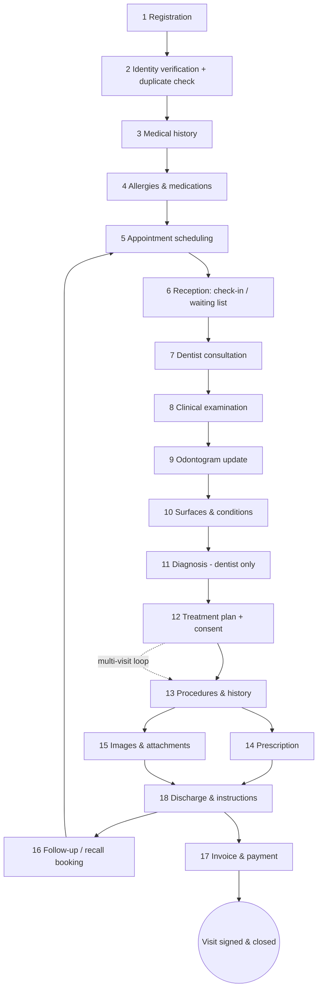
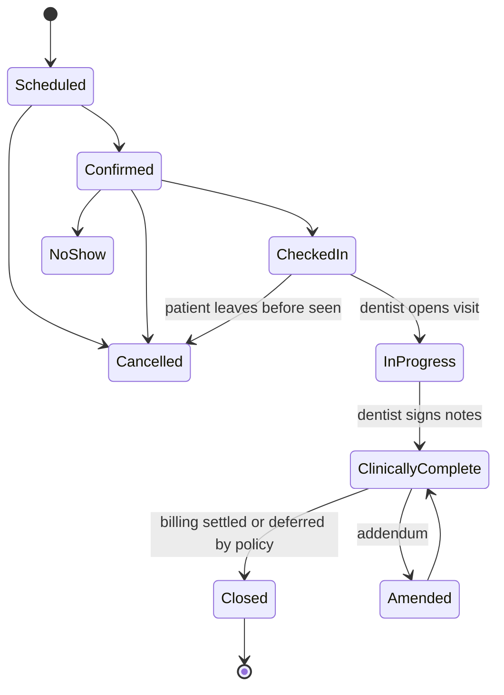
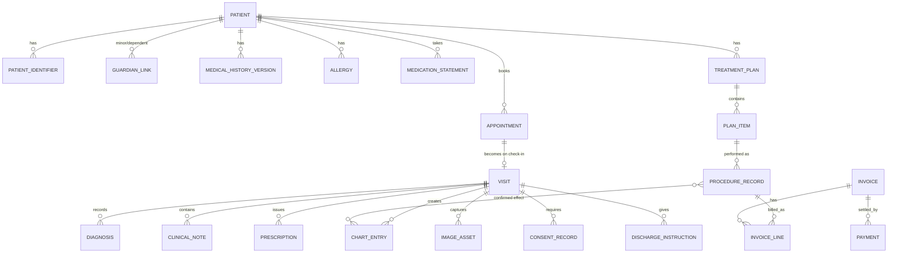
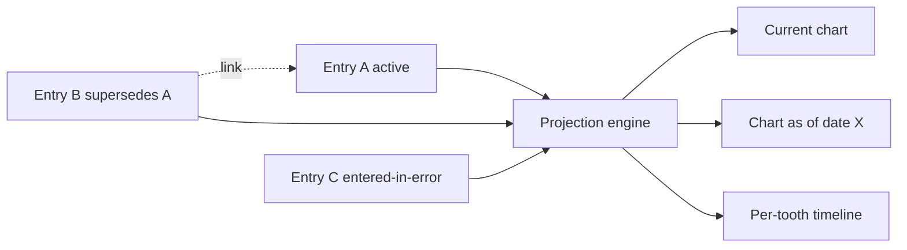
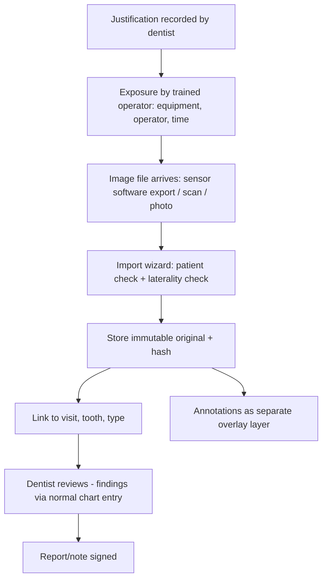

# ARGON Dental — Jordan Pilot
## Cloud 3: Dental Clinical Workflow and Requirements

| | |
|---|---|
| **Document ID** | ARGON-DENTAL-C3-REQ-001 |
| **Version** | 1.0 (research draft for specialist review) |
| **Date** | 2026-11-08 |
| **Team** | Cloud 3 — Dental clinical informatics (1 of 7 independent research teams) |
| **Status** | Research and design only. **Not an implementation. ARGON is not claimed to be production-ready, clinically validated, or legally compliant.** |
| **Audience** | Engineering teams (to convert into tasks), practising dentists (clinical review), legal/regulatory advisers (legal review) |
| **Data used** | Synthetic examples only. No repository, local file, production system or real patient data was accessed or changed. |

---

## 0. How to read this document

### 0.1 Evidence labels (used throughout)

Every non-trivial statement carries one of these labels, as the project rules require.

| Label | Meaning |
|---|---|
| **[V]** Verified evidence | Read directly from a cited source during this research (source and access date in §26). |
| **[D]** Documented design | Described in ARGON's own design documentation/skills available to this team (e.g., the appointment slot-lock design). **A design is not evidence that it is implemented.** No ARGON repository was inspected by Cloud 3. |
| **[R]** Recommendation | Cloud 3's proposal. Needs dentist and/or specialist approval before it becomes a requirement. |
| **[A]** Unverified assumption | Believed true or plausible but **not** verified. Must be confirmed before reliance. |
| **[K]** General professional knowledge | Standard dental-informatics knowledge not re-verified against a source in this pass (e.g., Universal/Palmer numbering). Requires dentist confirmation. |

### 0.2 Requirement basis tags

Each requirement is tagged with *why* it exists, so legally-required documentation is never confused with clinical best practice (a stated deliverable requirement).

| Tag | Meaning |
|---|---|
| **LEG-V** | Legal/regulatory duty found in a source read by this team. |
| **LEG-U** | Probably legally relevant but **not verified** — needs legal verification. Treated as "must design for, cannot claim required." |
| **CLIN** | Clinical best practice / professional guidance (not a legal duty). |
| **SAFE** | Patient-safety control derived from the hazard analysis (§12). |
| **OPS** | Operational/business need of the clinic. |
| **ARCH** | Needed for consistency with ARGON's documented architecture. |

### 0.3 Priority tags

**P0** = needed for the first pilot clinic go-live · **P1** = needed soon after (within pilot) · **P2** = later phase / second market / multi-site.

---

## 1. Executive summary

**What this document is.** A complete clinical and operational requirements specification for a dental clinic management system, covering the 18-step patient journey from registration to discharge, with workflows, functional requirements, screen requirements, a clinical data dictionary, synthetic patient journeys, failure cases, a dentist review checklist and clinical acceptance criteria.

**Headline design positions**

1. **The chart is a history, not a state.** The odontogram is a *projection* of append-only chart entries. Nothing clinical is overwritten or deleted; corrections are new entries that supersede with a reason, author and time. This matches the append-only principle already documented for ARGON visits and billing **[D]** and the practice guidance that late entries/corrections must show the date and time they were added **[V: ADA]**.
2. **Four different things are kept apart:** *finding* (what was observed), *diagnosis* (what the dentist concluded), *plan item* (what is proposed), *procedure* (what was done). Most dental-software harm comes from blurring these.
3. **FDI/ISO 3950 two-digit numbering is the canonical internal storage key** (permanent 11–48; primary 51–85) **[V]**; Universal and Palmer are display options **[K]**.
4. **No autonomous clinical decisions.** The system shows what the clinician entered, flags *deterministic* rule matches (e.g., a recorded penicillin allergy vs. a penicillin prescription), and asks a human to acknowledge. It never proposes diagnoses, treatments, doses or radiograph indications (§2.3).
5. **Licensed code sets are not embedded by default.** The ADA's CDT code set requires a commercial licence to use in software **[V]**; with a $0 budget, ARGON should use its own procedure catalogue with stable internal codes and *optional mapping slots* to external systems (SNOMED CT, ICD, payer codes) **[R]**.
6. **Legal vs. clinical is tagged per requirement.** From sources read: Jordan's Medical and Health Liability Law No. 25 of 2018 requires patient consent before diagnosis/treatment (except emergencies) and that patients be informed of diagnosis/severity (with exceptions) **[V: Al Tamimi summary]**; Jordan's PDPL No. 24 of 2023 classes health data as sensitive and requires consent in writing for processing unless an exemption (including licensed preventive/diagnostic care) applies **[V: Clyde & Co]**. Beyond those, specific *documentation formats* (a signed dental consent form, record-retention years, radiographic logs) were **not found** in sources accessible to this team and are marked **LEG-U**.

**What this team could and could not verify**

- Verified: numbering standard, ICDAS code structure, ADA/FDA radiograph selection guidance, ADA record-writing guidance, AHA 2021 endocarditis high-risk list, Jordan PDPL and Medical Liability Law headline provisions (via law-firm summaries, not the Gazette text), Saudi PDPL dates and regulator (via law-firm summary), CDT licensing position, DICOM IO modality, FHIR ImagingStudy and HL7 Dental Data Exchange IG scope.
- **Not** verified (blocking items listed in §25): Jordanian record-retention period; Jordan Nuclear Regulatory Commission (JNRC) requirements for dental X-ray equipment; MOH Jordan dental-clinic licensing document list (page blocked to automated fetch); Jordan Dental Association ethics/documentation rules; Saudi MOH/CHI/NPHIES dental data and claims requirements; any medical-device (software-as-a-medical-device) classification position in either country.

**Top risks (detail in §22):** wrong-tooth/wrong-side charting; stale or unreviewed medical history; duplicate-patient merges; unlicensed code-set use; unverified legal retention/consent format; imaging storage on a $0 budget; Arabic-name matching accuracy; designs mistaken for implemented software.

---

## 2. Scope

### 2.1 In scope
The complete clinical and front-of-house workflow of a single dental clinic (pilot), designed so it extends to multiple branches/clinics (tenant → clinic → branch → provider) without redesign of clinical data:

registration · identity verification · duplicate detection · medical history · allergies and medications · appointments · reception and waiting list · consultation · clinical examination · odontogram · tooth surfaces and conditions · diagnosis · treatment planning · procedures and history · prescriptions · images and attachments · follow-up · invoices and payments · discharge and patient instructions.

Cross-cutting: permanent/primary/mixed dentition; numbering systems; terminology; chart history and corrections; multi-visit plans; consent; clinical notes and signatures; imaging workflows; safety warnings.

### 2.2 Out of scope for Cloud 3 (owned by other teams; dependencies noted)
Infrastructure/hosting, database technology choice, authentication mechanics, encryption design, e-invoicing integration (Jordan tax authority), payment-gateway integration, messaging-provider integration, mobile/offline engineering, AI/ML features, laboratory/pharmacy/hospital modules. Where Cloud 3 requires something of those areas it is listed as a **dependency** (§24).

### 2.3 The "no autonomous clinical decision" boundary (normative)

| The system **MAY** | The system **MUST NOT** |
|---|---|
| Store and display what a licensed clinician entered | Suggest or infer a diagnosis from findings, images or history |
| Show deterministic alerts from *recorded* data (allergy ↔ prescribed drug class; anticoagulant recorded ↔ extraction planned; high-risk cardiac condition recorded ↔ invasive procedure planned) as **"check"** prompts requiring clinician acknowledgment | Recommend a treatment, material, drug, dose, or radiograph |
| Pre-fill from earlier entries (clearly marked "copied from <date>") | Auto-mark a tooth as treated, extracted or sound |
| Compute simple arithmetic (invoice totals, plan cost sums) | Auto-close, auto-complete or auto-sign any clinical entry |
| Show published reference intervals as *informational text* labelled with source (e.g., ADA/FDA radiograph guidance) after specialist approval | Block a clinician from proceeding where a clinician override is clinically legitimate (alerts are *interruptive, acknowledgeable, auditable* — except hard identity/consent gates, §12) |
| Ask "are you sure?" for contradictions it can detect structurally (e.g., procedure on a tooth charted as extracted) | Calculate drug doses (excluded from pilot; **[R]** revisit only with pharmacist/dentist approval) |

**[R]** If any future feature moves across this boundary, the product may become a regulated medical device/clinical-decision-support product; regulatory status in Jordan and Saudi Arabia is **[A]** unverified (§25 Q-LEG-6).

### 2.4 Assumptions about the existing ARGON platform (all **[A]/[D]**)
Per project rules, documented architecture is not treated as implemented. Cloud 3 assumes only the following *documented* patterns and flags where requirements depend on them:

- Multi-tenant paths scoped by `clinic_id`; claims-based role access **[D]** (ARGON appointment skill).
- Appointment booking via an atomic slot-lock transaction on provider/day/time before writing the appointment record; status lifecycle `scheduled → confirmed → checked-in → in-progress → completed` with `no-show`/`cancelled` branches; recurring follow-ups as independent appointments; waitlist entries that become appointments only through the same lock **[D]**.
- Append-only visits/billing; deletion = status-based anonymisation, never physical erasure **[D]** (ARGON compliance-gap notes; legal sufficiency unresolved — §25 Q-LEG-3).
- Firebase RTDB as current store **[D/A]**. **This document specifies requirements database-agnostically.** Where RTDB's lack of multi-path transactions or range queries matters, it is called out as a design dependency for Cloud 1/2 rather than solved here.

---

## 3. Regulatory and professional landscape (what is legally required vs. recommended)

> **Not legal advice.** Summaries below come from law-firm and academic summaries, not the official Gazette text. Every row must be validated by a licensed Jordanian (and later Saudi) healthcare/data-protection lawyer before any compliance claim.

### 3.1 Jordan

| # | Instrument / body | What the sources say **[V]** | Consequence for requirements | Status |
|---|---|---|---|---|
| J1 | **Medical and Health Liability Law No. 25 of 2018** (in force 31 Aug 2018) — Al Tamimi summary | Art. 5: services per professional ethics and established scientific standards. Art. 7: provider must inform patient of diagnosis and severity, unless disclosure is against the patient's interest or the patient is not psychologically prepared. Art. 8: prohibits treating without consent (except emergencies where prior approval is difficult), diagnosing before examining, unauthorised disclosure of confidential information, among others. Fines JD 3,000–5,000 for breach of Art. 7 and most of Art. 8. Hospitals/medical centres must hold malpractice cover. The summary does **not** address medical-record content or retention. | Consent **before diagnosis/treatment** must be captured/recorded (LEG-V for the duty; the *form* and whether written is required for dentistry are LEG-U). "Examine before diagnose" → system enforces exam-before-diagnosis ordering (CLIN/LEG-V spirit). Disclosure-of-diagnosis duty → record "diagnosis explained to patient" with exception reason. | Legal verification needed for dental specifics |
| J2 | **Personal Data Protection Law No. 24 of 2023** — Clyde & Co summary | Published 17 Sep 2023; effective 17 Mar 2024; one-year compliance period. Health condition = sensitive data. Processing needs prior consent that is **clear, in writing**, states period and purpose, in plain language — unless an exemption applies; exemptions include **preventive medical care, diagnosis or healthcare by a licensed practitioner**, protecting life/vital interests, legal requirement. No "legitimate interests" basis. Breach causing serious harm: notify data subjects within **24 h** and the oversight Unit within **72 h** (per summary). Cross-border transfer restricted unless recipient protection adequate, with an exception for **medical data needed for the data subject's treatment**. DPO required where core activities involve sensitive data. Fines JOD 1,000–10,000, doubled for repeat. Oversight Unit within Ministry of Digital Economy and Entrepreneurship plus a Personal Data Protection Board. | Clinical care processing may rest on the medical-care exemption, but **non-care uses** (marketing messages, analytics, sharing images externally, research/teaching use of images) need explicit consent flags. Breach-response procedure with 24/72 h clocks must exist. Hosting region and transfers → dependency for infra teams. DPO question → §25. | In force **[V]**; applicability details LEG-U |
| J3 | **Ministry of Health (MOH)** — dental clinic licensing; **Jordan Dental Association (JDA)** | The MOH publishes a "Licensing a Dental Clinic" e-service (search listing seen; **page could not be opened by this team's fetch tool — blocked by robots policy**). Wikipedia lists the JDA's governing laws incl. a 2001 licensing system for dental clinics and centres and a 2002 Medical Council law; it does **not** state mandatory membership or documentation rules. | Clinic must be licensed (OPS/LEG-U); license numbers and dentist registration IDs stored as fields. Documentation rules from MOH/JDA **unknown** → §25. | **Gap** |
| J4 | **Radiation regulator (JNRC)** | Wikipedia states the JNRC was formed in 2007 as successor to the Jordan Nuclear Energy Commission; the page gives **no** statement on dental X-ray licensing. | Dental X-ray equipment registration/licensing requirement **unverified**. System stores equipment ID and operator for every exposure so that any later regulator-driven log requirement can be met (SAFE/LEG-U). | **Gap** |
| J5 | **Electronic Health Solutions (EHS) / Hakeem** | Petra (2025 article on EHS progress): Hakeem covers 447 Ministry of Health and Royal Medical Services facilities; page does not say private clinics are connected and does not mention HL7/SNOMED/ICD. SNOMED International lists EHS as Jordan's representative (does not itself confirm membership terms). | No Hakeem integration is assumed or required for the pilot. Keep patient/encounter identifiers and terminology mappable. Free SNOMED CT use in Jordan **[A]** unverified → ask EHS. | Informational |
| J6 | **Record retention period** | **Not found** in any accessible Jordanian source. | Design must support configurable retention, legal hold and *no physical deletion*; the number of years is an open legal question (Q-LEG-2). | **Gap — blocking for retention policy** |

### 3.2 Saudi Arabia (second market — extension points only)

| # | Instrument / body | What the sources say **[V]** | Consequence |
|---|---|---|---|
| S1 | **Personal Data Protection Law (PDPL)** — Clyde & Co (Sept 2024) | Effective 14 Sep 2023; fully enforceable 14 Sep 2024; regulator **SDAIA**; DPO mandatory for organisations processing sensitive data as a core activity; transfer outside KSA to non-adequate countries needs safeguards (SDAIA standard contractual clauses etc.); risk assessment for continuous/widespread sensitive transfers. | Design data-residency and transfer-consent hooks now; no Saudi go-live without Saudi legal review. |
| S2 | Health-data specifics — Bird & Bird (2025) | Health data carries additional requirements; controllers must also consider requirements from the **Ministry of Health, Saudi Health Council and Council of Health Insurance**; SDAIA had not yet issued further health guidance at publication. Need-to-know access, access-rights audits, data mapping, minimisation. | Role-based access + access-audit reporting are P0 anyway. |
| S3 | MOH / SCFHS / NPHIES / SFDA | Search results only (not opened): MOH dental forms, SCFHS practitioner services, NPHIES clinic-system guidance. **Not verified.** | Treated as **[A]**. Extension fields: practitioner licence/classification number, national-ID/Iqama types, Hijri date display, payer pre-authorisation, claim-code mapping. |

### 3.3 Legally required documentation vs. clinical recommendation (summary matrix)

| Item | Legally required? | Clinical recommendation? | Cloud 3 treatment |
|---|---|---|---|
| Consent before diagnosis/treatment | **Yes (Jordan Law 25/2018 Art. 8) [V]**, emergency exception | Yes — procedure-specific, documented | Mandatory *recorded* consent event before any procedure marked in-progress; form content = CLIN + LEG-U |
| Informing patient of diagnosis & severity | **Yes, with exceptions (Art. 7) [V]** | Yes | "Diagnosis discussed" checkbox + exception reason (free text) |
| Written signed consent for routine dentistry | **Unverified (LEG-U)** | Yes for invasive/irreversible/ risky procedures **[K]** | Capture signature (drawn or scanned) for P0 procedure classes defined by dentists; confirm with lawyer |
| Written consent for personal-data processing | PDPL: yes unless exemption **[V]**; care exemption likely covers clinical processing (LEG-U) | — | Privacy notice acknowledgement + separate opt-ins for marketing/image sharing |
| Medical history/allergy documentation | Not found as explicit statute **[A]** | Strong (safety) **[K]** | P0 SAFE |
| Clinical entries identifiable to author, dentist sign-off, dated corrections | Not found as statute **[A]** | **Yes [V: ADA]** | P0 ARCH/CLIN |
| Retention period | Unknown | — | Configurable; no deletion |
| Radiograph justification/records | Unknown (JNRC) | **Yes — take only when expected to affect care; start from exam/history/risk [V: ADA/FDA]** | Justification field mandatory; guidance text informational |
| Prescription content/format | Unknown for dental in Jordan (A) | Yes | Structured prescription; print template needs MOH/dentist approval |
| Invoice/tax invoice | Jordan e-invoicing exists **[D/A]** (other team) | — | Out of scope; dependency |
| Breach notification | **Yes, 24 h / 72 h (PDPL) [V]** | — | Incident workflow & contact registry |

---

## 4. Clinical foundations

### 4.1 Dentition

| Dentition | Teeth | Typical presence **[K]** | System rule |
|---|---|---|---|
| **Primary (deciduous)** | 20 (5 per quadrant: central incisor, lateral incisor, canine, first molar, second molar) **[V: FDI]** | The 20 primary teeth begin to appear from about 6 months of age and are shed at various times through childhood **[V: ADA MouthHealthy page text; per-tooth ages are in downloadable charts that this team did not read]** | Per-tooth status, not a per-patient "child/adult" switch |
| **Permanent** | 32 (8 per quadrant: central incisor, lateral incisor, canine, first premolar, second premolar, first molar, second molar, third molar) **[V: FDI]** | All 32 usually erupted by ~21 years **[V: ADA MouthHealthy text]** | Third molars frequently absent/impacted/extracted — never assume present |
| **Mixed (transitional)** | Primary and permanent teeth coexist | Roughly late childhood to early adolescence **[K]** | **Must be first-class**: one chart may show 55 and 16 together; a quadrant can have 51-85 and 11-48 codes simultaneously |

**Requirements derived**
- Chart must render all 52 tooth positions (32 + 20); which are *shown by default* is derived from entered statuses plus age-based default (a display convenience only, always overridable). **[R]**
- "Unerupted", "congenitally absent", "extracted", "exfoliated" are different statuses and must not be collapsed into "missing". **[CLIN]**
- Replacement of a primary tooth by its successor is a *chart event pair* (primary → exfoliated; permanent → erupted), not an edit of one tooth record. **[R]**

### 4.2 Tooth numbering systems

**Canonical internal key: FDI two-digit notation, ISO 3950** ("Dentistry — Designation system for teeth and areas of the oral cavity", ISO 3950:2016 **[V: Wikipedia citing ISO 3950]**).

- Quadrant digit: permanent **1** = upper right, **2** = upper left, **3** = lower left, **4** = lower right; primary **5, 6, 7, 8** respectively **[V]**.
- Tooth digit counted from midline outward: permanent 1–8 (1 = central incisor … 8 = third molar); primary 1–5 (1 = central incisor … 5 = second molar) **[V]**.
- Charts are traditionally drawn from the **dentist's view**, so the patient's right appears on the **left** of the chart **[V]**. *This is the single most important orientation rule for wrong-side-error prevention* (§12, HAZ-02).

**Display alternatives** (user/clinic preference; never used as storage key) **[K — dentist to confirm local usage]**

| System | Permanent | Primary | Notes |
|---|---|---|---|
| FDI/ISO 3950 | 11–18, 21–28, 31–38, 41–48 | 51–55, 61–65, 71–75, 81–85 | Canonical |
| Universal (USA) | 1–32 (1 = upper-right third molar, 16 = upper-left third molar, 17 = lower-left third molar, 32 = lower-right third molar) | A–T (A = upper-right second molar … J = upper-left second molar; K = lower-left second molar … T = lower-right second molar) | Common in US-trained clinicians |
| Palmer | Quadrant symbol + 1–8 | Quadrant symbol + A–E | Rendered as text e.g. `UR6`, `LL5`, `URE` in ARGON (graphic bracket symbols are a rendering option) |

**Deterministic conversion (for engineering; to be unit-tested exhaustively, §20)**
Let `d` = tooth digit.

| FDI quadrant | Universal index |
|---|---|
| 1 | 9 − d |
| 2 | 8 + d |
| 3 | 25 − d |
| 4 | 24 + d |
| 5 (A–E = 1–5) | 6 − d |
| 6 (F–J = 6–10) | 5 + d |
| 7 (K–O = 11–15) | 16 − d |
| 8 (P–T = 16–20) | 15 + d |

Check values: 18→1, 11→8, 21→9, 28→16, 38→17, 31→24, 41→25, 48→32; 55→A, 51→E, 61→F, 65→J, 75→K, 71→O, 81→P, 85→T. Any implementation must reproduce this table exactly (acceptance test AT-NUM-1).

**Requirements**
- **FR-NUM-01 (P0, CLIN)** Store tooth identity as FDI string (`"11"`…`"85"`), validated against the 52 legal codes. Reject anything else (no `"9"`, no `"0"`).
- **FR-NUM-02 (P0, CLIN)** Per-user display preference (FDI default, Universal, Palmer); the **active numbering system is always visible** on the chart header and printed outputs, and printed documents show FDI *plus* the chosen alternative in parentheses to prevent cross-system misreads (e.g., "16" is FDI upper-right first molar but Universal upper-left third molar). **[R]**
- **FR-NUM-03 (P0, SAFE)** Where the same digits are valid in two systems, free-text notes are never auto-parsed for tooth numbers.
- **FR-NUM-04 (P1)** Whole-area scopes: quadrant, sextant, arch (upper/lower), full mouth — as separate scope types rather than lists of teeth.

### 4.3 Surfaces, regions and structures

| Concept | Canonical code | Meaning | Notes |
|---|---|---|---|
| Mesial | `M` | Surface towards the midline along the arch | |
| Distal | `D` | Surface away from the midline | |
| Occlusal | `O` | Chewing surface (premolars/molars, posterior primary) | Not valid on anterior teeth |
| Incisal | `I` | Cutting edge (incisors, canines) | Not valid on posterior teeth (canine = anterior) |
| Buccal / Labial / Facial | `B` | Surface toward cheek/lip | Display as B on posteriors, "F/Lab" optionally on anteriors |
| Lingual / Palatal | `L` | Toward tongue / palate | Display "P" automatically on maxillary teeth (FDI quadrant 1/2/5/6) to match local convention; stored as `L` so there is one unambiguous code |
| Root | `R` + root id (e.g., `R-MB`) | Root-level findings (resorption, furcation) | Optional P1 |
| Canal | `C` + canal id | Endodontic work (e.g., MB1, MB2, D, P) | P1 for endodontic procedures |
| Cervical region | modifier `cervical` on B/L | Non-carious cervical lesions, Class V restorations | Modifier, not a seventh surface |

**Rules**
- **FR-SURF-01 (P0, CLIN)** Surface sets are order-independent sets (`{M,O,D}` = "MOD"); display as the conventional string.
- **FR-SURF-02 (P0, CLIN)** Validity matrix: tooth type determines allowed surfaces (anterior: M, D, B, L, I; posterior: M, D, B, L, O). Invalid combos are rejected with a message, not silently corrected.
- **FR-SURF-03 (P0, SAFE)** Surface-level entry must be possible by clicking five zones per tooth in the chart and by a keyboard entry shortcut (e.g., `46 MO`) for speed; both feed the same entry model.
- **FR-SURF-04 (P1)** Whole-tooth statuses (missing, implant, crown, root-canal-treated) apply to the *tooth* (all surfaces), not to individual surfaces.

### 4.4 Conditions, findings and diagnoses — terminology strategy

The dental vocabulary has three layers; ARGON stores them separately.

| Layer | Question answered | Author | Example (synthetic) |
|---|---|---|---|
| **Finding / chart condition** | What is observed or recorded on a tooth/surface? | Dentist (assistant may draft) | "Cavity, visible dentin, 46-O" |
| **Diagnosis** | What does the dentist conclude? | **Dentist only** | "Symptomatic irreversible pulpitis, 46" |
| **Plan item / Procedure** | What is proposed / what was done? | Dentist (assistant may record some preventive procedures if the clinic allows) | "Root canal treatment 46" / "Composite restoration 36-DO" |

**Code systems and licensing position**

| System | Use | Position | Evidence |
|---|---|---|---|
| **ARGON internal catalogue** (stable internal IDs + EN/AR display names) | Primary vocabulary for P0 | **Recommended default** — no licence cost, fully controllable, dentist-reviewed | [R] |
| **ICDAS** (caries severity per surface) | Optional structured caries severity | Code structure verified (see §4.5). Use as *optional* detail on caries findings, dentist decides | [V: StatPearls] |
| **SNOMED CT / SNODENT** | Interoperability mapping (P2) | HL7 Dental Data Exchange IG uses SNOMED CT value sets for tooth identification, oral cavity area, dental observation codes; HL7's own QA page marks SNOMED as an externally licensed code system that implementers must review separately **[V]**. Jordan's SNOMED representative is EHS **[V]**; whether Jordanian users get free affiliate use is **[A]** → ask EHS (Q-TERM-1). | |
| **ADA CDT** (procedure codes) | US payer billing | Any party that uses, copies or distributes CDT in a product needs a **commercial licence from the ADA**; includes software; fees not published on the page **[V]**. **Do not embed CDT** in a $0-budget pilot (Rule 12). | [V] |
| **ICD-10 (WHO)** diagnosis codes | Possible insurer/regulator reporting | WHO classification; chapter-level use **[K]**; licensing/fees and local mandate **[A]** → verify. Store as optional mapped code only | |
| **Local payer/regulator procedure lists** (Jordan insurers; Saudi billing code lists) | Claims | Not found → Q-BILL-1 | **Gap** |

**Requirements**
- **FR-TERM-01 (P0, ARCH)** Every catalogue item has an immutable `code` (internal), `display_en`, `display_ar`, `category`, `valid_from/valid_to`, and a nullable `external_mappings[]` array `{system, code, version, licence_note}`. Items are never edited in a way that changes meaning; meaning changes create a new item and retire the old (old chart entries keep pointing at the old item).
- **FR-TERM-02 (P0, CLIN)** A "Clinical Content Panel" (≥2 practising dentists, ideally one paediatric and one endodontic/oral-surgery) must approve the initial catalogue **before** go-live; approval record stored with version number (§25 Q-CLIN-1).
- **FR-TERM-03 (P0, LEG-U)** The UI never displays a licensed code (e.g., CDT) unless a valid licence is recorded in tenant configuration.
- **FR-TERM-04 (P1, CLIN)** Free-text is always allowed alongside coded entries, but coded entries drive reporting.

### 4.5 ICDAS (optional structured caries severity)

Verified structure **[V: StatPearls ICDAS summary]**: each tooth surface gets a two-part code — *status/restoration code* and *caries code*.

| Caries code | Meaning (abridged) |
|---|---|
| 0 | Sound surface (fluorosis, wear, stains, developmental defects scored sound) |
| 1 | First visual change in enamel (seen only after prolonged air drying; confined to pit/fissure) |
| 2 | Distinct visual change in enamel (visible when wet, still visible dry) |
| 3 | Localised enamel breakdown, no visible dentin |
| 4 | Underlying dark shadow from dentin, ± enamel breakdown |
| 5 | Distinct cavity with visible dentin |
| 6 | Extensive distinct cavity, visible dentin, ≥ half the surface, possibly pulp |

| Status code | Meaning |
|---|---|
| 0 | Unrestored, unsealed |
| 1 / 2 | Partial / full sealant |
| 3 | Tooth-coloured restoration |
| 4 | Amalgam |
| 5 | Stainless steel crown |
| 6 | Porcelain/gold/PFM crown or veneer |
| 7 | Lost or broken restoration |
| 8 | Temporary restoration |
| 9 | Missing/special: 96 not examinable, 97 missing due to caries, 98 missing other reasons, 99 unerupted |

- **FR-CAR-01 (P1, CLIN)** If the clinic enables ICDAS, the caries finding form offers "ICDAS code 0–6" per surface as an optional field. ARGON never converts ICDAS into "needs filling" — that's the dentist's treatment decision.
- **[A]** Whether the dentists at the pilot clinic use ICDAS at all is unknown (Q-CLIN-2). If not, keep it hidden.

### 4.6 Procedure terminology and "chart effect"

Each procedure catalogue item defines:
`scope` (tooth | surface | root/canal | quadrant | sextant | arch | mouth | patient), `allowed_surfaces`, `consent_class` (none | verbal-record | written-signature), `requires_anaesthesia_record` (bool), `typical_visits` (informational), and **`proposed_chart_effect`** (e.g., "Composite restoration on surfaces S" → *proposes* a chart entry "existing restoration: composite, surfaces S").

> **Rule (SAFE, P0):** On completing a procedure, the proposed chart effect is shown to the dentist as a **pre-filled, editable confirmation**. It is never applied silently. The dentist confirms, edits or declines, and the decision is audited.

Starter categories (to be approved by the Clinical Content Panel): Diagnostic · Preventive · Restorative · Endodontic · Periodontal · Prosthodontic (fixed/removable) · Oral & maxillofacial surgery (extraction, implant, biopsy) · Orthodontic · Paediatric · Emergency/palliative · Other/free-text with reason.

---

## 5. Odontogram (dental chart) specification

### 5.1 Principles
1. **Append-only entry log; chart = projection.** The "current chart" is computed from entries; "chart as of date X" is computable for medico-legal reconstruction.
2. **Status vs. history.** Each tooth shows *current* statuses; a per-tooth timeline shows every entry ever made, including superseded and entered-in-error.
3. **Planned ≠ done.** Planned items are drawn distinctly (outline/hatch) from existing/treated (solid), with a legend; colour is never the only differentiator (accessibility, and many clinics print in monochrome).
4. **Provenance.** Each entry stores who/when/where: `recorded_by`, `recorded_at`, `visit_id`, `source` (`examined_this_visit` | `reported_by_patient` | `imported_from_legacy` | `from_outside_records` | `from_radiograph_review`), and the owning `clinic_id`/`branch_id`. Findings imported or reported must not look identical to those personally examined.

### 5.2 Chart entry model (summary; full fields in §14)

| Field | Notes |
|---|---|
| `entry_id`, `patient_id`, `visit_id` | |
| `tooth_fdi` or `area_scope` | Exactly one of tooth or area |
| `surfaces[]` | Subset of M,D,O,I,B,L; empty = whole tooth |
| `entry_kind` | `finding` \| `existing_treatment` \| `tooth_status` \| `planned_item_ref` \| `treated_here` |
| `catalog_code` | From condition/procedure catalogue |
| `attributes` | Material, ICDAS, mobility grade, etc. (typed by catalogue item) |
| `state` | `active` \| `superseded` \| `entered_in_error` \| `resolved` |
| `supersedes_entry_id`, `superseded_by_entry_id`, `reason_code`, `reason_text` | Correction links |
| `recorded_by`, `recorded_at`, `signed_by`, `signed_at` | |
| `source` | See §5.1 |

### 5.3 Tooth statuses (mutually-exclusive *whole-tooth* status; exactly one active)

`present_natural` · `unerupted` · `partially_erupted` · `impacted` · `congenitally_absent` · `extracted` · `exfoliated` (primary) · `retained_root` · `implant` (with crown/abutment sub-attributes) · `pontic` · `abutment` · `unknown_not_examined`.

Default state on chart creation for a new patient = **`unknown_not_examined`** for all teeth the clinician has not yet examined — **not** "present/healthy" (SAFE: a chart that defaults to healthy teeth implies findings that were never made). **[R]**

### 5.4 Chart interactions and states

- **FR-ODO-01 (P0, CLIN)** Show upper and lower arches in dentist's view with FDI numbers on each tooth; mixed dentition shows primary teeth in an inner/outer row or overlay as designed by the Clinical Content Panel.
- **FR-ODO-02 (P0, SAFE)** Orientation label "Patient's right" / "Patient's left" on the chart edges; an on-screen setting for "view from dentist" vs. "view from patient" (default dentist view) that is shown on the header and on prints.
- **FR-ODO-03 (P0, CLIN)** Select tooth → side panel: statuses, active findings, treatment history, planned items, images linked to this tooth, notes.
- **FR-ODO-04 (P0, CLIN)** Add finding / existing treatment / status through a catalogue picker with surface selector; Undo before save only.
- **FR-ODO-05 (P0, ARCH/CLIN)** No delete. Provide **Correct** (supersede with replacement) and **Mark entered-in-error** (no replacement). Both require reason code + optional text; both are visible on the timeline.
- **FR-ODO-06 (P0, CLIN)** "Chart as of date" selector (read-only) and a **compare two dates** view (P1).
- **FR-ODO-07 (P0, SAFE)** On any procedure linked to a tooth whose current status is `extracted`, `congenitally_absent` or `unerupted` → warn (HAZ-01).
- **FR-ODO-08 (P0, CLIN)** Print/PDF chart snapshot with patient identifiers, date/time, numbering system, orientation, legend, author/clinic — for referral and patient copy.
- **FR-ODO-09 (P1, CLIN)** Periodontal screening fields (e.g., BPE/probing depth sets) as an *optional* module, only after periodontal specialist approval (§25 Q-CLIN-3). Not part of the minimal odontogram.
- **FR-ODO-10 (P1, CLIN)** Occlusion/malocclusion, TMJ and orthodontic records — captured in structured notes at pilot; dedicated charting later.
- **FR-ODO-11 (P2)** Root/canal-level graphic charting; implant detail; bridges spanning several teeth drawn as a connected unit.

### 5.5 Dental chart corrections (detailed)

| Case | Meaning | Allowed action | Required |
|---|---|---|---|
| **C1 Clinical progression** | Tooth was restored, later extracted | New entry (not a correction). Old entry stays `active` as history or becomes `resolved` with reason "superseded by clinical event" | none beyond normal entry |
| **C2 Typo / wrong surface** | Entry says 46-MO, should be 46-DO | **Correct** → new entry; old becomes `superseded` | reason: `data_entry_error` |
| **C3 Wrong tooth** | Entered on 36, should be 46 | **Move** = new entry on 46 + old on 36 `entered_in_error` with link both ways | reason `wrong_tooth`; if any plan item, procedure or invoice line references the old entry → **hard stop** until each is re-pointed by an authorised user |
| **C4 Wrong patient** | Entire entry belongs to another patient | **Entered-in-error** on source patient; **new** entry on the correct patient (never "move" ids across patients); both entries cross-reference by opaque incident id (no cross-patient data leak in UI) | reason `wrong_patient`; **clinic manager notified; incident record opened** (SAFE) |
| **C5 Late entry** | Clinical event documented after visit | New entry flagged `late_entry=true` with *event date* and *entry date* both shown | Per ADA guidance "belated entries… show the date and time they were added" **[V]** |
| **C6 After sign-off** | Visit already signed | **Addendum only** (new dated entry); original text immutable | Dentist who signed or another dentist with reason |
| **C7 After billing** | Linked invoice exists | Correction allowed clinically; financial effect handled by credit-note/adjustment flow, never by editing the invoice (ARCH) | Finance reviewer informed |
| **C8 Legal dispute flag** | Complaint/claim opened | **Record freeze**: further edits only as addenda by admin-approved role; export snapshot | Mirrors ADA warning not to alter records after a claim/complaint **[V]** |

### 5.6 Multi-visit treatment plans (summary — full spec in §9)
Plan → phases → items (tooth/surface/area, catalogue procedure, sequence, estimated visits, estimated fee, status). Items are *proposals* and never appear on the odontogram as treated until completed and confirmed.

---

## 6. Architecture and workflow diagrams

### 6.1 End-to-end patient journey (18 steps)

*(The numbers match the project's 18-step list; the order of 16/17/18 in practice is flexible — see W-16…W-18.)*

### 6.2 Visit (encounter) state machine

Appointment states `scheduled/confirmed/checked-in/in-progress/completed/no-show/cancelled` are as documented **[D]**; `ClinicallyComplete/Closed/Amended` are Cloud 3 additions **[R]** (appointment lifecycle ≠ clinical visit lifecycle; a no-show never creates a clinical visit).

### 6.3 Core entities

### 6.4 Chart projection and correction flow

### 6.5 Imaging workflow

---

## 7. Detailed workflows (patient journey W-01 … W-18)

**Roles used:** Reception (R), Dentist (D), Dental Assistant (A), Clinic Manager (M), Finance (F), System (S), Patient/Guardian (P). Full permission matrix in §15.
**Notation:** `→` next step · `⚠` warning/alert · `✖` hard stop · `⟲` alternative/failure path.

---

### W-01 Patient registration
- **Trigger:** New patient arrives, phones, or is referred. **Actors:** R (A, D may also).
- **Preconditions:** Staff logged in to a clinic context (`clinic_id`) **[D]**.
- **Main flow**
  1. R selects *New patient*. S first runs a **search-before-create** on whatever is typed (name fragments, phone, ID) to reduce duplicates (links to W-02).
  2. R enters minimum dataset: name (AR and/or EN — at least one; full 4-part name recommended **[A]**), date of birth (full date; "approximate age" allowed only with explicit flag `dob_estimated`), sex (as recorded on identity document or as stated), mobile number, preferred language, how patient heard of clinic (optional).
  3. R records **identifier(s)** (type + value) or marks `no_identifier` with reason (e.g., child without ID).
  4. R records contact preferences and **consents**: privacy-notice acknowledged (Y/N, date, version); separate opt-ins for reminders/marketing, sharing images for teaching/referral. Default = **not opted in** to non-care uses **[R, PDPL consent logic LEG-U]**.
  5. For patients < 18 (age computed from DOB; threshold configurable per country, **[A]** 18 in Jordan): S requires **guardian link** (W-01a).
  6. S creates patient with a system `patient_id` and a human-friendly `file_number` (per clinic, sequential, no reuse). Clinical alerts panel starts as "**History not yet taken**" (never blank).
- **W-01a Guardian/dependent:** guardian is itself a patient or a contact record; relationship type (mother, father, legal guardian, other); `can_consent` boolean (LEG-U — who may consent for a minor in Jordan is a legal question); `can_receive_information`; one guardian may link to many children (siblings).
- **Alternative flows:** ⟲ *Emergency walk-in with unknown details* → create **provisional patient** (`registration_status=provisional`, minimum: name/approx age/phone) so care is never blocked; must be completed or merged within a configurable period (flag on reports). ⟲ *Patient refuses an ID* → proceed with `no_identifier` + reason, recorded.
- **Validations:** mobile number format (`+962 7X XXXXXXX` for Jordan; `+966 5X XXXXXXX` for KSA **[A]**); date of birth not in future; Arabic and Latin character rules; max lengths; duplicate rule outcomes (W-02).
- **Data written:** `patient`, `patient_identifier[]`, `guardian_link[]`, `consent_flags[]`.
- **Exit criteria:** Patient exists with ≥1 name, DOB, mobile (or documented reason), guardian (if minor), privacy-notice acknowledgement status recorded.

---

### W-02 Identity verification and duplicate detection

**A. Point-of-care identification (every visit — SAFE, P0)**
1. At check-in R confirms **two identifiers** with the patient (e.g., full name + date of birth; for a child, the guardian states them). Confirmation checkbox is recorded (`identity_confirmed_by`, time) on the visit.
2. S shows **similar-name alert** if another active patient in the same clinic has a similar normalised name and the same DOB, or a sibling/twin link: "⚠ Another patient with a similar name exists — verify date of birth".
3. Dentist workspace header always displays full name (AR and EN if present), age/DOB, sex, file number, and the alert banner (§12).

**B. Identifier verification**
- Verification method values: `document_sighted` (default; **no image stored**), `document_scanned` (image stored — **sensitive, requires reason + restricted access**), `unverified`, `verified_by_third_party` (future). Minimising stored ID images is a **[R]** data-minimisation choice (PDPL minimisation theme **[V: Bird & Bird]**; applicability LEG-U).
- **[A]** Identifier types: Jordanian national number (a number on the national ID) for citizens; passport and residence/ work permit numbers for non-citizens; for Saudi Arabia, national ID/Iqama. Formats and check-digit rules **not verified** → no format validation beyond length/numeric until verified (Q-ID-1).

**C. Duplicate detection**
- **Normalisation for matching** (original text always preserved): strip diacritics (tashkeel) and tatweel; unify alef forms (أ إ آ → ا); unify ya/alef-maqsura (ى → ي); treat ta-marbuta/ha (ة/ه) as equivalent *for matching only*; join "عبد" with the following token (so "عبد الله" = "عبدالله"); drop leading "ال" for comparison; Latin names lower-cased with known variant sets (Mohammad/Mohammed/Muhammad, etc. — curated list approved by clinic staff); tokenise to first / father / grandfather / family where possible.
- **Match signals and tiers**

| Tier | Rule (any) | System behaviour |
|---|---|---|
| **T1 Exact** | Same identifier type+value | ✖ Block creation: "This identifier belongs to existing patient <name, DOB>". R may *open the existing patient*. Override only by Manager with reason (e.g., identifier typo in the old record). |
| **T2 Strong** | Normalised full name equal **and** DOB equal | ✖ Must review side-by-side before continuing; choose *Same person (open existing)* / *Different person (record reason)*. |
| **T3 Possible** | Family name + first name similar (edit-distance threshold set during pilot tuning) and (DOB equal **or** phone equal) | ⚠ Soft warning list; continue allowed. |
| **T4 Household** | Same phone/email, different first name/DOB | No warning about duplication; *offer* household link (siblings/parents commonly share a phone) **[R]** — never treat a phone number alone as a duplicate. |

- **Merge workflow (P1, ARCH/SAFE):** Manager (or dentist-in-charge) selects *Primary* and *Secondary* records → S shows side-by-side for demographics, alerts, allergies, medications, chart entries counts, open plans, balances → merge produces a `patient_link{type=merged_into}` and **re-points nothing destructively**: secondary stays readable (marked "merged into …"), new work goes to primary. **Allergy and alert lists are unioned** (never lost) and flagged "review after merge". Both patients' chart entries are retained with original `patient_id`; the primary's chart projection includes secondary entries (with provenance label). **Unmerge** possible by Manager with reason while no conflicting new data blocks it; otherwise manual. Every step audited. *No automatic merging ever.*
- **Failure modes:** ⟲ wrongly merged two people → unmerge path + incident report (HAZ-05). ⟲ Twins/siblings → T2 reviewed, "different person" decision creates a persistent `not_duplicate` link so the warning does not re-fire endlessly, but the similar-name alert at check-in continues (W-02A).

---

### W-03 Medical history
- **Trigger:** New patient; recall visit past review interval; patient reports change. **Actors:** P (self or guardian), A/R may assist, D reviews & signs.
- **Main flow**
  1. S presents the **structured questionnaire** (AR/EN) in categories (see below). Patient may complete on tablet or by interview; `source` is stored (`patient_self`, `guardian`, `interview_by_staff`, `outside_records`).
  2. Each category supports `none` / `yes + details` / `not_asked` / `declined_to_answer`. **Blank ≠ "no"**.
  3. S saves as a new **`medical_history_version`** (immutable once saved).
  4. **Dentist review step (mandatory before any clinical procedure):** D opens the version, marks reviewed, may add clinician notes, may escalate (e.g., "medical clearance requested" → follow-up task). `reviewed_by`, `reviewed_at` stored.
  5. S derives **alert chips** from structured answers (e.g., "Anticoagulant", "Diabetes", "Prosthetic valve", "Pregnant", "Allergy: penicillin") — chips show only what was **entered**; they do not conclude anything.
  6. At recall visits, D may use **"No changes since <date>"** — recorded as an explicit attestation (patient-confirmed + D-confirmed), creating a lightweight new version that references the previous one.
- **Questionnaire categories (starter list; dentists approve — Q-CLIN-1):** reason for visit/chief complaint; cardiovascular (including **prosthetic heart valve/valve repair material, previous infective endocarditis, congenital heart disease, heart transplant** — the four highest-risk categories named in the AHA 2021 statement for endocarditis prophylaxis around gum-manipulating procedures **[V]**); blood pressure; bleeding disorders and anticoagulant/antiplatelet use; diabetes (type, control as reported); respiratory/asthma; epilepsy/neurological; liver/kidney disease; thyroid/endocrine; cancer/chemo/radiotherapy to head & neck; immunosuppression/steroids; **bone-modifying drugs (bisphosphonates/denosumab)** **[K]**; bleeding after previous dental treatment; reactions to local anaesthetic; infectious diseases (hepatitis, HIV, TB — voluntary, `declined` allowed, handled with standard precautions for all patients, **restricted visibility**); pregnancy/breast-feeding; smoking/shisha/chewing tobacco; bruxism/TMJ symptoms; dental anxiety; previous dental complications; last dental visit; current pain.
- **Review interval:** configurable per clinic; **default is a dentist decision** (Q-CLIN-4). System shows "History last reviewed: <date>" next to the alert banner and turns it amber when older than the interval.
- **Failure modes:** ⟲ Patient can't read → assisted interview; `source` records it. ⟲ Unconscious/emergency → provisional: "History not obtainable — emergency", still **visible banner**. ⟲ Conflicting statements across visits → both versions kept; D resolves in a new version.
- **Gate (SAFE):** the **first clinical entry of a visit** (diagnosis, procedure start, prescription) is blocked until a history exists and has been dentist-reviewed (or an emergency override with reason is recorded). Reception/assistant cannot satisfy the review.

---

### W-04 Allergies and medications
- **Allergies (structured list, separate from the history questionnaire so it is queryable):** allergen (catalogue + free text), category (drug, material, latex, food, environmental, other), reaction (rash, urticaria, swelling, breathing difficulty, anaphylaxis, GI, other, unknown), severity (mild / moderate / severe / unknown), certainty (patient-reported / clinician-confirmed / tested), onset, status (`active` | `inactive` | `entered_in_error`), recorded_by/at. **"No known allergies"** is an explicit assertion with date, distinct from `not_asked`.
- **Dental-relevant allergen catalogue (starter, dentist/pharmacist-approved):** penicillins; other beta-lactams (cephalosporins); macrolides; NSAIDs/aspirin; paracetamol; local anaesthetics (amide/ester types, with sulphite/preservative sensitivity free-text); latex; nickel/metals; acrylic/methacrylate; iodine; chlorhexidine; eugenol; sulphonamides; codeine/opioids; other.
- **Medications (statement list):** name (generic + brand/free text), dose/frequency (free text), indication (optional), **drug class tag** (anticoagulant, antiplatelet, antihypertensive, antidiabetic, antiresorptive, immunosuppressant, corticosteroid, antiepileptic, anticoagulant-reversal? etc.), start date, status (`active`/`stopped`/`entered_in_error`), source (patient report, pharmacy label sighted, referral letter). "No medications" is explicit. Unstructured/unknown-name medications are accepted but flagged "⚠ not checked by alerts".
- **Alert engine (deterministic, §12):** rule triggers only on *structured, active* allergy/drug-class/history facts vs. *structured* planned/prescribed items. Rule content (e.g., which classes cross-react) is **owned by a clinical/pharmacy panel**, versioned, and visible in an admin screen (Q-CLIN-5). Cloud 3 does not invent the cross-reactivity list.
- **Failure modes:** ⟲ Patient doesn't know the name of a drug → "unknown medication — described as …" + photo of box allowed as attachment. ⟲ Allergy retracted → set `inactive` with reason and author; never delete.

---

### W-05 Appointment scheduling
- **Trigger:** Patient calls/walks in/requests; follow-up from visit; plan item scheduling. **Actors:** R, M, D (for own calendar).
- **Resources:** provider (dentist), **chair/operatory**, special room/equipment (X-ray/OPG/CBCT), optionally assistant. Real clinics are constrained by chairs and equipment, not only dentists; the documented slot-lock design is keyed by `provider/date/time` **[D]** → **dependency:** extend locking to chair/equipment when those resources are scheduled (Q-ARCH-1).
- **Main flow**
  1. R finds patient (or creates provisional), selects **appointment type** (catalogue: new-patient exam, recall exam, emergency, procedure types with default duration, follow-up, consultation-only, imaging-only).
  2. S proposes slots from provider working hours minus holidays/leave/blocks; R selects slot.
  3. S performs the booking via the **atomic slot-lock transaction first, appointment record second** **[D]**; failure → "Slot just taken — choose another" (no partial appointment).
  4. R records reason category (patient words), urgency flag (**set by humans**: routine / soon / urgent-pain/ emergency), language need, "guardian must attend" (auto for minors), accessibility needs, medical-alert-present marker (icon only; no detail on calendar).
  5. Confirmation: patient notified per consent (messaging team's design); status → `scheduled` → `confirmed`.
- **Duration & multi-visit:** procedures that require several visits create a *series of independent appointments*, each with its own lock **[D]**, tied to the plan item(s).
- **Rescheduling / cancelling:** new appointment + cancellation of old with reason (`patient_request`, `clinic_request`, `no_show`, `illness`, `other`); history retained; cancellation inside a configurable window raises a *flag* (not a fee — fees are a clinic policy decision).
- **Offline booking:** queued bookings must replay as slot-lock **transactions**, never as raw writes **[D]**; the UI marks "pending sync" appointments visibly (dependency on offline-resilience design).
- **Failure modes:** ⟲ Double-click/duplicate submission → idempotency key. ⟲ Provider unavailable after booking → clinic-initiated reschedule workflow with patient notification. ⟲ Clock/timezone/DST: store UTC + clinic-local; Jordan/KSA display; Hijri calendar display is a **P2** option (Q-I18N-1).

---

### W-06 Reception, check-in and waiting list
- **Two separate concepts** (do not conflate):
  - **Waiting room queue** — patients present today, ordered; 
  - **Cancellation waitlist** — patients wanting an earlier slot **[D]** (becomes an appointment only via slot lock).
- **Check-in flow**
  1. R opens today's list; selects patient; **identity check** (W-02A).
  2. S shows pre-visit checklist: privacy notice acknowledged? history due for review? outstanding consents? guardian present (minors)? balance outstanding (information only — **never a barrier to emergency care**)? forms pending?
  3. R sets status `checked_in` → S creates the **Visit** (draft) and adds the patient to the waiting queue with arrival time **[D lifecycle]**.
  4. Dentist/assistant *calls* the patient (`called`), then `in_chair`; when finished → `finished`.
- **Queue rules:** default FIFO by appointment time then arrival; **priority override** (`emergency`, `elderly`, `child`, `walk-in`) requires a reason and is audited; walk-ins join a separate segment. Estimated wait is informational.
- **Privacy:** any waiting-room display shows **queue number or first name initial only** **[R]** (health-data exposure in public screens is a confidentiality risk **[LEG-U; Law 25/2018 Art. 8 prohibits unauthorised disclosure of confidential information V]**).
- **Failure modes:** ⟲ Patient leaves without being seen → status `left_without_being_seen` with time; visit closed as cancelled, **no clinical record created**. ⟲ Late arrival → rule configurable (wait / reschedule). ⟲ Wrong patient checked in → reversal with reason before visit starts; after start → follow wrong-patient procedure (§5.5 C4).

---

### W-07 Dentist consultation (visit opening)
- **Trigger:** Patient `in_chair`. **Actors:** D, A.
- **Main flow**
  1. D opens the visit → **Patient context header** loads (name, age, file no., alert banner, "history last reviewed", today's appointment reason, last visit date + summary, open plan items, outstanding follow-ups).
  2. **History review gate** (W-03 step 4) if due.
  3. **Chief complaint** (patient's words, free text + optional category), **history of presenting complaint** (onset, duration, character, severity 0–10 optional, aggravating/relieving factors, previous treatment). Templates by complaint type are allowed (dentist-edited).
  4. **Red-flag checklist** — clinician-ticked items (spreading facial swelling, difficulty breathing/swallowing, trismus, fever, uncontrolled bleeding, trauma with loss of consciousness, non-healing ulcer > 3 weeks, unexplained numbness) → creates a visible banner and a "consider urgent referral" *task for the dentist* (a reminder to a human, not advice). Panel to approve the list (Q-CLIN-6) **[K for list contents]**.
  5. D proceeds to examination (W-08) or documents "consultation only".
- **Time stamps:** `consultation_started_at`, `…ended_at` for medico-legal timeline.
- **Failure modes:** ⟲ Interpreter used → record `interpreter_used` with name/type. ⟲ Patient declines examination → documented refusal (`informed_refusal` record, §10).

---

### W-08 Clinical examination
- **Extra-oral:** facial symmetry, swelling, lymph nodes, TMJ (clicking, deviation, mouth opening in mm optional), skin lesions.
- **Intra-oral soft tissue:** lips, buccal mucosa, tongue, floor of mouth, palate, oropharynx, gingiva (colour/contour/bleeding), frenum, salivary flow; free text + structured quick-picks (normal / abnormal-describe).
- **Hard tissue:** captured via the odontogram (W-09/W-10).
- **Periodontal:** structured *optional* module (P1) — (e.g., screening scores or probing depths) **only after periodontal specialist approval of fields/scales**; P0 uses structured notes.
- **Occlusion:** Angle-class descriptors/crossbite/open bite etc. as quick-picks (P1) **[K]**.
- **Tooth-level tests (observation type `tooth_test`):** percussion, palpation, cold test, electric pulp test (numeric), mobility grade (0–3), furcation, probing — each stored with tooth + result + time. Values are recorded; **no interpretation is generated**.
- **Gate (LEG-V spirit):** a **diagnosis cannot be saved** unless the visit contains at least one examination section *or* a documented reason (e.g., `telephone_advice`, `emergency_palliative`) — reflecting Jordan Law 25/2018 Art. 8's prohibition of diagnosing before examining **[V: Al Tamimi]**.
- **Failure modes:** ⟲ Patient in too much pain to allow full exam → partial exam documented with reason (`exam_limited`).

---

### W-09 Dental odontogram update (during/after exam)
1. First visit: S creates the chart with all teeth `unknown_not_examined` (§5.3).
2. D (or A at dictation) enters tooth statuses (present/unerupted/extracted/etc.), existing treatments (restorations/crowns/implants) and findings (caries, fractures…), each with `source`.
3. **Draft → confirm:** assistant-entered entries are `draft` until D confirms (`confirmed_by`); drafts shown dashed. 
4. Whole-chart "**Charting complete**" action by D sets `chart_baseline_complete=true` with date (a statement that the baseline chart was examined). Before that, S shows banner "Baseline charting incomplete".
5. At recall: "**Chart reviewed — no changes**" (D attestation) or add changes.
- **Validation:** surfaces valid for tooth type; no active finding of `caries` on a tooth with active status `extracted`; mutually exclusive whole-tooth statuses; mixed-dentition consistency (e.g., primary 55 *and* permanent 15 can coexist only if 55 not `exfoliated` — display as supported mixed state, permitted).
- **Failure modes:** corrections per §5.5.

---

### W-10 Tooth surfaces and dental conditions
- Surface selector per tooth (M, D, O/I, B, L) with multi-select; conditions from catalogue (§4.4, Appendix B). Attributes depend on condition (caries: ICDAS optional, depth descriptor free text; restoration: material; fracture: Ellis-type descriptor optional; mobility: grade).
- **Lesion vs. restoration vs. status** are separate entry kinds (e.g., recurrent caries under an amalgam = two entries).
- **Visual rules:** each condition has a **shape + colour + label code**; palette must pass colour-blind-safe check and monochrome print legibility (AT-UX-3).
- **Bulk operations:** "All teeth in quadrant = not examined/present"; "mark missing: 18, 28, 38, 48" — preview before confirm.

---

### W-11 Diagnosis (dentist only)
- D adds **diagnoses** at patient, tooth, area or arch level. Fields: catalogue term or free text; status (`provisional`, `confirmed`, `ruled_out`, `resolved`); basis (free text: "cold test lingering; PA radiolucency 46 apex" — **typed by D**); linked chart findings/images; optional external code mapping; `discussed_with_patient` (boolean) + `not_discussed_reason` (e.g., `patient_not_psychologically_prepared`, `emergency`, `patient_declined_to_know`) — operationalises the **duty to inform the patient of diagnosis and severity, with exceptions (Law 25/2018 Art. 7) [V]**.
- **Hard rules:** (SAFE) *No system-generated diagnoses; no "suggested" diagnoses; no auto-population from findings/images.* Assistants cannot create diagnoses (permission).
- **Change history:** diagnosis edits create new versions; `ruled_out`/`resolved` keep history.

---

### W-12 Treatment planning
Full spec in §9. Flow: D builds plan items from confirmed diagnoses/findings → organises into phases/options → S computes cost estimate (sum of price-list entries) → D presents → patient accepts/declines/defers per item → consent captured per procedure class (§10) → items become schedulable (W-05).

---

### W-13 Procedures and treatment history
1. D/A starts a procedure from a **plan item** (or *unplanned* with reason) in the visit workspace.
2. **Pre-start checklist** (S shows; D acknowledges): identity re-confirmed; alerts reviewed; consent recorded for this procedure class; **tooth/side/site "time-out"** (name tooth FDI + position in words, e.g., "46 — lower right first molar"); anaesthesia plan recorded if applicable.
3. D records: tooth/surfaces actually treated (may differ from plan — variance flagged), materials, anaesthesia (agent, amount in cartridges/mL, site, batch if clinic records), technique notes, complications, outcome, time in/out, assistant.
4. **Complete** → S proposes the *chart effect* (§4.6) → D confirms/edits → chart entries created; plan item status updated (`completed` or `partially_completed`).
5. **Variance rule:** if performed tooth/procedure ≠ planned → system marks **plan variation** and requires note; if scope increased (e.g., filling → RCT) → re-present cost/consent (§9.5).
6. **Treatment history** view: chronological per patient, filter per tooth/category/dentist, shows consent and image links.
- **Implants/prostheses traceability (P1):** capture product/lot/serial where clinic stocks it **[K]**; lab work orders (prescription to technician, shade, due date, receipt) link to procedure (P1).
- **Failure modes:** ⟲ Procedure aborted (e.g., anaesthesia failure) → `aborted` with reason; no chart change; billing none unless policy. ⟲ Complication (e.g., broken instrument, perforation, nerve symptoms) → `adverse_event` record with severity and disclosure-to-patient note; flagged for manager review (supports duty-to-inform logic **[V Art. 7 context]**, medical-liability insurance requirement **[V]**).

---

### W-14 Prescriptions
- **Who:** Dentist only (P0). **What:** structured lines — drug (catalogue or free text), strength, dosage form, route, dose, frequency, duration, quantity, instructions (AR/EN), indication/diagnosis link optional, `weight_kg` (required field when patient age < 12 or clinic-configured) — **recorded, not used to compute doses**.
- **Safety checks (deterministic, acknowledge-able):** (1) structured active allergy vs. drug class/ingredient mapping; (2) structured active medication class vs. prescribed class per the **panel-approved** interaction list (Q-CLIN-5); (3) pregnancy/breast-feeding flag displayed; (4) "unstructured medication on record — not checked" notice; (5) duplicate active prescription for same drug issued < N days ago (info).
- **Override:** For **severe** recorded allergy matches, override needs **typed reason** (≥ N characters) and is flagged for manager review; for others, a click-acknowledge with optional note.
- **Output:** printed/PDF prescription with clinic and dentist identity (name, registration/licence number **[A: format unknown]**), patient name + DOB/age, date, lines, signature area (wet or e-signature per clinic policy — LEG-U), unique prescription number; copy stored. Issued prescriptions are immutable → **void & re-issue** with reason.
- **Controlled medicines / opioid analgesics:** **excluded from P0** (legal handling unverified — Q-LEG-5).
- **Failure modes:** ⟲ Wrong patient → void + incident; ⟲ Drug not in catalogue → free text with "not checked" banner; ⟲ Printer failure → reprint (marks "reprint").

---

### W-15 Medical images and attachments
Full spec in §11. Flow: **justification** → exposure record → file import → patient/laterality verification → link to visit/tooth → dentist review noted → (optional) annotation → included in referral/export.

---

### W-16 Follow-up visits
- At visit close, D may set: **follow-up** (specific reason + target interval or date + linked plan item) and **recall** (general periodic review interval chosen by D).
- S creates a **follow-up task** and (with R) an appointment via W-05. At follow-up check-in, **carry-forward panel** shows: previous visit summary, procedures done, instructions given, open issues, outstanding items.
- **Outcome capture:** healing/complication/no issue, new findings, further treatment needed → new plan items.
- **Overdue list:** follow-ups with no appointment after due date; patients with plan items accepted but unscheduled; recall due. Outreach follows consent (§3.1 J2).
- **Failure modes:** ⟲ Patient with a complication calls out-of-hours → complication visit linked to the original procedure.

---

### W-17 Invoices and payments
- **Invoice generation:** from **completed** procedures (not plan items) priced from the versioned price list; clinic may issue *quotes* from plans. Invoice lines reference `procedure_id`; each line shows tooth/area for transparency.
- **Adjustments:** discounts (reason + approver role), insurer share (P2), write-offs (Manager). Prices changed only in the price list (not on lines) except by Manager override with reason.
- **Payments:** method (cash, card, bank transfer, insurer, other), amount (integer minor units — JOD has 3 decimal places **[K]**), date/time, received_by, reference (no card numbers/CVV stored), partial payments, deposits/advance, instalment schedules (P1).
- **Corrections:** void/credit note via **reversal entries**; invoices never edited after issue **[D append-only billing]**.
- **E-invoicing / tax:** Jordan tax-authority electronic invoicing integration is a dependency owned by another team **[D/A]**; Cloud 3 requires only that invoice lines carry a stable procedure description and that an invoice can reference an external e-invoice id.
- **Visit-close rule:** every completed procedure is either invoiced, or marked `no_charge` with reason, or `deferred_billing` with reason (prevents silent unbilled work, SAFE/OPS).
- **Privacy:** invoice shows procedure names; **never** shows diagnosis text or medical history; copies to third parties require patient consent flag.
- **Failure modes:** ⟲ Payment recorded on wrong invoice → reversal + re-entry; ⟲ Overpayment → credit balance; ⟲ Refund → refund record with approver; ⟲ Day-end cash mismatch → reconciliation record (P1).

---

### W-18 Discharge and patient instructions
- **Instruction bundle** assembled from **dentist-approved templates** (AR/EN) keyed to procedure category (post-extraction, post-restoration, post-endodontic, post-scaling, post-surgical, orthodontic appliance, paediatric, general). Free-text additions by D.
- **Mandatory content blocks (CLIN, wording by dentists):** what to expect/normal reactions; what to avoid (e.g., chewing while numb); medication reminder (from the prescription); **warning signs and when/how to contact the clinic (clinic phone, emergency pathway)**; next appointment/follow-up.
- **Delivery:** printed, shown on screen, or sent via messaging with consent. S records: `instructions_version_ids`, `given_by`, `given_at`, `method` (verbal, printed, digital), `recipient` (patient/guardian), `understanding_confirmed` (Y/N).
- **Visit sign-off checklist (all must be true or explicitly overridden with reason):** clinical notes signed by D (§10) · procedures confirmed & chart effects resolved · required consent present · prescription (if any) issued · images linked or noted · billing resolved (W-17) · discharge instructions recorded · follow-up decision recorded.
- **Failure modes:** ⟲ Patient leaves early → `departed_before_discharge` with note; instructions sent later with consent.

---

## 8. Functional requirements

Format: **ID · Requirement · Basis · Priority**. "Shall" = mandatory for the stated priority. Requirements are phrased so an engineering team can derive tasks and tests without further clinical interpretation; clinical *content* (catalogues, templates, rule lists) is owned by the Clinical Content Panel (§25).

### 8.1 Registration, identity, duplicates (FR-REG / FR-ID / FR-DUP)

| ID | Requirement | Basis | Pri |
|---|---|---|---|
| FR-REG-01 | Shall create a patient with ≥1 name (AR or EN), DOB (or `dob_estimated` flag), sex, mobile or documented reason, preferred language. | OPS/CLIN | P0 |
| FR-REG-02 | Shall store names exactly as typed plus a normalised search copy; shall support Arabic and Latin scripts, right-to-left rendering, and mixed-script names. | OPS | P0 |
| FR-REG-03 | Shall support a **provisional patient** for emergencies, flagged until completed or merged; shall never block emergency care for missing data. | SAFE | P0 |
| FR-REG-04 | Shall assign immutable `patient_id` and per-clinic `file_number`; numbers never reused. | ARCH | P0 |
| FR-REG-05 | Shall require a **guardian link** for patients under the configured age of majority (default 18 **[A]**) and record `can_consent` and `can_receive_information`. | LEG-U/SAFE | P0 |
| FR-REG-06 | Shall record privacy-notice acknowledgement (date, version, language) and separate, default-off opt-ins for reminders/marketing, teaching/photo use, external image sharing. | LEG-V (PDPL consent regime)/LEG-U (scope) | P0 |
| FR-REG-07 | Shall let staff record patient preferences: language, contact channel, preferred gender of clinician (free text), accessibility needs. | OPS | P1 |
| FR-ID-01 | Shall store identifiers as typed records `{type, value, issuing_country, verification_method, verified_at, verified_by}`; no format validation beyond non-empty until formats are verified (Q-ID-1). | ARCH | P0 |
| FR-ID-02 | Shall by default **not** store images of identity documents; if enabled, access restricted to Manager/Reception-lead and audited. | LEG-U (minimisation) | P0 |
| FR-ID-03 | Shall require **two-identifier confirmation** at every check-in and record who confirmed. | SAFE | P0 |
| FR-ID-04 | Shall show a **similar-name alert** at check-in and in the dentist header when a similar normalised name with equal DOB exists in the clinic. | SAFE | P0 |
| FR-ID-05 | Shall support household/sibling links without merging. | OPS | P1 |
| FR-DUP-01 | On create/edit, shall run duplicate detection (tiers T1–T4, §W-02) using normalised Arabic/Latin names, DOB, identifiers, phone, guardian. | SAFE | P0 |
| FR-DUP-02 | T1 shall hard-block; T2 shall force a side-by-side decision with reason; T3 soft warn; T4 offers household link only. | SAFE | P0 |
| FR-DUP-03 | **No automatic merge.** Merge/unmerge only by Manager/dentist-in-charge with reason; allergies/alerts unioned; both records retained; fully audited. | SAFE/ARCH | P1 |
| FR-DUP-04 | Shall persist `not_duplicate` decisions between two patients. | OPS | P1 |
| FR-DUP-05 | Shall expose matching thresholds as admin configuration and log match decisions to tune accuracy during the pilot. | OPS | P1 |

### 8.2 Medical history, allergies, medications (FR-MH / FR-ALG / FR-MED)

| ID | Requirement | Basis | Pri |
|---|---|---|---|
| FR-MH-01 | Shall capture a versioned, structured medical history (AR/EN) with answer states `none / yes+detail / not_asked / declined`. | CLIN/SAFE | P0 |
| FR-MH-02 | Each version shall be immutable; changes create a new version referencing the previous. | ARCH | P0 |
| FR-MH-03 | Shall require **dentist review** (reviewed_by/at) before the first clinical entry of a visit; emergency override requires reason. | SAFE | P0 |
| FR-MH-04 | Shall display "history last reviewed" with an amber state beyond the clinic's configured interval (default set by dentists, Q-CLIN-4). | SAFE | P0 |
| FR-MH-05 | Shall support "No changes since <date>" attestations by patient and dentist. | CLIN | P0 |
| FR-MH-06 | Shall derive alert chips only from structured answers. | SAFE | P0 |
| FR-MH-07 | Infectious-disease and other highly sensitive answers shall be visible only to clinical roles; Reception sees only "medical alert present". | LEG-U (PDPL sensitive data)/OPS | P0 |
| FR-MH-08 | Shall support guardian-completed histories with guardian identity recorded. | SAFE | P0 |
| FR-MH-09 | Shall capture pregnancy/breast-feeding status where applicable, with date; value is informational. | CLIN/SAFE | P0 |
| FR-MH-10 | Shall allow attaching outside records (medical letters) linked to the history version. | CLIN | P1 |
| FR-ALG-01 | Shall hold a structured allergy list with allergen, category, reaction, severity, certainty, onset, status; explicit "No known allergies" assertion with date, distinct from not-asked. | SAFE | P0 |
| FR-ALG-02 | Allergies are never deleted; retract = `inactive` or `entered_in_error` with reason/author. | ARCH | P0 |
| FR-ALG-03 | Allergy banner shall be visible on **every** clinical screen, prescription screen and printed clinical summary. | SAFE | P0 |
| FR-ALG-04 | Severe allergies shall render with distinct, non-colour-only indicators (icon + text). | SAFE | P0 |
| FR-MED-01 | Shall hold a medication statement list with name, dose/frequency (free text), class tag, status, source; explicit "No medications". | SAFE | P0 |
| FR-MED-02 | Unstructured items shall display "not checked by alerts". | SAFE | P0 |
| FR-MED-03 | Drug-class catalogue for alerts (~dental-relevant set) shall be maintained in an admin screen with versioning and pharmacist/dentist approval metadata. | SAFE | P0 |

### 8.3 Appointments, reception, waiting (FR-APT / FR-REC)

| ID | Requirement | Basis | Pri |
|---|---|---|---|
| FR-APT-01 | Shall support provider calendars with working hours, breaks, leave, holidays, and clinic closures. | OPS | P0 |
| FR-APT-02 | Booking shall use the documented atomic slot-lock transaction **before** writing the appointment record; no check-then-write. | ARCH [D] | P0 |
| FR-APT-03 | Shall define appointment types with default duration and buffer; procedure types may chain multiple appointments. | OPS | P0 |
| FR-APT-04 | Shall support chair/room/equipment resources and prevent double-use (requires lock extension, Q-ARCH-1). | OPS | P1 |
| FR-APT-05 | Shall store reason category, urgency flag set by staff/clinician, guardian-must-attend, language/accessibility needs, medical-alert-present marker (no detail). | OPS/SAFE | P0 |
| FR-APT-06 | Reschedule/cancel shall create history, reasons; no hard delete. | ARCH | P0 |
| FR-APT-07 | Shall record no-shows and show a no-show/cancellation history to staff. | OPS | P0 |
| FR-APT-08 | Recurring/follow-up series shall generate independent appointments, each locked separately **[D]**. | ARCH | P1 |
| FR-APT-09 | Cancellation waitlist per provider/day that converts to appointments only through the slot-lock path **[D]**. | ARCH | P1 |
| FR-APT-10 | Shall render day/week views for multiple providers; performance target in §20 (AT-PERF-1). | OPS | P0 |
| FR-APT-11 | Appointment lifecycle changes shall be appended events (not silent overwrites) **[D]**. | ARCH | P0 |
| FR-APT-12 | Offline-queued bookings shall replay as transactions; UI marks pending ones. | ARCH [D] | P1 |
| FR-REC-01 | Check-in shall run the pre-visit checklist (identity, privacy notice, history due, consents pending, guardian, balance info). | SAFE/OPS | P0 |
| FR-REC-02 | Checking-in shall create the **Visit** (draft) from the appointment, or create a walk-in visit. | ARCH | P0 |
| FR-REC-03 | Shall maintain a waiting-room queue with states `waiting → called → in_chair → finished/left`. | OPS | P0 |
| FR-REC-04 | Priority overrides require reason and are audited. | OPS | P0 |
| FR-REC-05 | Public displays shall show only queue number/initials. | LEG-U (confidentiality; Art. 8 V) | P0 |
| FR-REC-06 | Outstanding balance shall be shown to Reception as information; never as a clinical blocker. | SAFE | P0 |
| FR-REC-07 | "Left without being seen" shall close visit as cancelled with no clinical record. | OPS | P0 |

### 8.4 Consultation, examination, diagnosis (FR-CON / FR-EXA / FR-DX)

| ID | Requirement | Basis | Pri |
|---|---|---|---|
| FR-CON-01 | Visit header shall show name (AR/EN), age/DOB, sex, file no., alert banner, last-review date, appointment reason. | SAFE | P0 |
| FR-CON-02 | Shall capture chief complaint (patient's words), history of presenting complaint, optional pain scale. | CLIN | P0 |
| FR-CON-03 | Shall provide a clinician-ticked red-flag checklist that raises a visible banner and a reminder task; no automated advice. | CLIN/SAFE | P1 |
| FR-CON-04 | Shall record interpreter use. | CLIN | P1 |
| FR-CON-05 | Shall timestamp consultation start/end. | LEG-U (timeline) | P0 |
| FR-EXA-01 | Shall capture extra-oral and intra-oral soft-tissue findings as structured quick-picks plus free text. | CLIN | P0 |
| FR-EXA-02 | Shall capture tooth-level tests (percussion, palpation, cold, EPT, mobility, probing) as observations with tooth + value + time; no interpretation. | CLIN | P0 |
| FR-EXA-03 | Shall support limited-examination documentation with reason. | CLIN | P0 |
| FR-EXA-04 | Periodontal charting module (probing, BPE-style scoring) — only after specialist approval. | CLIN | P1 |
| FR-EXA-05 | Shall support clinic-specific exam templates edited by dentists, versioned. | OPS | P1 |
| FR-DX-01 | Only users with Dentist role may create/edit diagnoses. | LEG-U/SAFE | P0 |
| FR-DX-02 | Diagnosis save is gated on an exam section existing or a documented `no_exam_reason` (Art. 8 spirit). | LEG-V (principle)/SAFE | P0 |
| FR-DX-03 | Diagnoses carry status, basis text, links to findings/images, and `discussed_with_patient` with exception reasons. | LEG-V (Art. 7) | P0 |
| FR-DX-04 | The system shall not generate, suggest, rank or auto-fill diagnoses. | SAFE (§2.3) | P0 |
| FR-DX-05 | Diagnosis changes append versions; `ruled_out/resolved` retained. | ARCH | P0 |

### 8.5 Odontogram, conditions, history (FR-ODO / FR-NUM / FR-SURF / FR-TERM)
See §4.2–§4.6 and §5 (FR-NUM-01…04, FR-SURF-01…04, FR-TERM-01…04, FR-ODO-01…11, FR-CAR-01). Additional:

| ID | Requirement | Basis | Pri |
|---|---|---|---|
| FR-ODO-12 | Entries made by assistants shall be `draft` until confirmed by a dentist; drafts are visually distinct and excluded from "current confirmed chart" exports unless labelled. | SAFE | P0 |
| FR-ODO-13 | Chart shall provide per-entry provenance (`source`) in the tooth panel. | CLIN | P0 |
| FR-ODO-14 | Corrections shall follow §5.5 cases C2–C8 exactly; wrong-tooth correction shall hard-stop if downstream records reference the entry. | SAFE | P0 |
| FR-ODO-15 | Shall support "chart reviewed — no changes" attestation at recall. | CLIN | P0 |
| FR-ODO-16 | Chart colours/shapes shall pass colour-vision-deficiency and monochrome checks (AT-UX-3). | SAFE | P0 |
| FR-ODO-17 | Tooth numbers shall always render with Western digits in a left-to-right isolated span in both Arabic and English UI. | SAFE (HAZ-17) | P0 |

### 8.6 Treatment planning, procedures, history (FR-TP / FR-PRO)

| ID | Requirement | Basis | Pri |
|---|---|---|---|
| FR-TP-01 | Plan = versioned set of items grouped by phase and optional alternative option; see §9. | CLIN | P0 |
| FR-TP-02 | Item states: `proposed → presented → accepted | declined | deferred → scheduled → in_progress → completed | partially_completed | cancelled | superseded`. | CLIN | P0 |
| FR-TP-03 | Plan changes create a new version; prior versions immutable and viewable. | ARCH | P0 |
| FR-TP-04 | Shall compute cost estimates as a simple sum from the price list with validity date; display "estimate, may change". | OPS | P0 |
| FR-TP-05 | Item acceptance shall be recorded per item with who, when, method. | LEG-U/CLIN | P0 |
| FR-TP-06 | Scope increase vs. accepted item → "plan variation" requiring re-presentation before proceeding (soft gate; emergency override with reason). | SAFE | P0 |
| FR-TP-07 | Shall support dependencies/sequence (e.g., endodontic before crown) as *dentist-entered* links; no auto-sequencing. | CLIN | P1 |
| FR-TP-08 | Shall support alternatives (Option A/B) with patient choice recorded. | CLIN | P1 |
| FR-TP-09 | Printable plan (AR/EN) with options, estimates, disclaimer text approved by clinic/legal. | OPS/LEG-U | P0 |
| FR-PRO-01 | Procedure record shall capture tooth/surfaces/areas actually treated, material, anaesthesia details (as recorded), duration, operator, assistant, outcome, complications. | CLIN | P0 |
| FR-PRO-02 | Starting a procedure shall display the pre-start checklist and tooth/side time-out; acknowledgement is audited. | SAFE | P0 |
| FR-PRO-03 | Completing shall present the proposed chart effect for confirm/edit/decline. | SAFE | P0 |
| FR-PRO-04 | Unplanned procedures permitted with reason. | OPS | P0 |
| FR-PRO-05 | `aborted` and `adverse_event` records supported; adverse events notify Manager. | SAFE | P0 |
| FR-PRO-06 | Per-tooth and per-patient treatment history views with filters. | CLIN | P0 |
| FR-PRO-07 | Lot/serial capture for implants/prostheses; lab-order tracking. | CLIN/OPS | P1 |
| FR-PRO-08 | Multi-tooth procedures (bridge) as one procedure with tooth roles. | CLIN | P1 |

### 8.7 Prescriptions (FR-RX)

| ID | Requirement | Basis | Pri |
|---|---|---|---|
| FR-RX-01 | Only Dentist role may issue prescriptions. | LEG-U/SAFE | P0 |
| FR-RX-02 | Structured lines per W-14; free-text drugs allowed with "not checked" banner. | SAFE | P0 |
| FR-RX-03 | Allergy/medication rule checks per panel-approved, versioned rule set; severe-allergy override requires typed reason and Manager review flag. | SAFE | P0 |
| FR-RX-04 | `weight_kg` captured for patients < 12 (configurable); **no dose calculation in pilot**. | SAFE (§2.3) | P0 |
| FR-RX-05 | Issued prescriptions immutable; void-and-reissue with reason; each with unique number. | ARCH/LEG-U | P0 |
| FR-RX-06 | Print/PDF in AR and EN with dentist name and registration number fields (format unknown **[A]**), clinic details, date, patient identifiers. | LEG-U | P0 |
| FR-RX-07 | Controlled/narcotic prescribing excluded until legal clarification (Q-LEG-5). | LEG-U | P0 |
| FR-RX-08 | Show pregnancy/breast-feeding flag at the point of prescribing. | SAFE | P0 |

### 8.8 Images and attachments (FR-IMG)
See §11 for full list (FR-IMG-01…18).

### 8.9 Follow-up, billing, discharge (FR-FU / FR-BIL / FR-DIS)

| ID | Requirement | Basis | Pri |
|---|---|---|---|
| FR-FU-01 | Visit close shall prompt for a follow-up decision (follow-up with reason/target date; recall interval; none). | CLIN | P0 |
| FR-FU-02 | Follow-up and recall tasks produce an overdue list for staff. | OPS | P0 |
| FR-FU-03 | Follow-up visits shall be linked to the originating visit/procedure and show a carry-forward panel. | CLIN | P0 |
| FR-FU-04 | Complication return visits linked to the original procedure. | SAFE | P0 |
| FR-FU-05 | Outreach for recall follows consent flags. | LEG-U | P1 |
| FR-BIL-01 | Invoices generated from completed procedures (and quotes from plans); lines reference `procedure_id`. | OPS/ARCH | P0 |
| FR-BIL-02 | Price list versioned; line price comes from the price list unless Manager override with reason. | OPS | P0 |
| FR-BIL-03 | Discounts require reason and approver role. | OPS | P0 |
| FR-BIL-04 | Payments with method, amount (integer minor units), reference (no card data), received_by; partial and deposits supported. | OPS | P0 |
| FR-BIL-05 | Void/refund/credit via reversal entries only; no edits post-issue. | ARCH [D] | P0 |
| FR-BIL-06 | Visit close requires each completed procedure to be invoiced, `no_charge` (reason) or `deferred_billing` (reason). | OPS/SAFE | P0 |
| FR-BIL-07 | Invoice shall contain procedure descriptions only — no diagnoses or history. | LEG-U | P0 |
| FR-BIL-08 | Hook for external e-invoice id and tax fields (integration owned elsewhere). | OPS [dep] | P0 |
| FR-BIL-09 | Insurer split, pre-authorisation, claim export. | OPS | P2 |
| FR-BIL-10 | Day-end cash reconciliation report. | OPS | P1 |
| FR-DIS-01 | Dentist-approved bilingual instruction templates keyed by procedure category; free-text addendum. | CLIN | P0 |
| FR-DIS-02 | Record instructions given (versions, by whom, method, recipient, understanding). | LEG-U/CLIN | P0 |
| FR-DIS-03 | Visit sign-off checklist per W-18 with override reasons. | SAFE | P0 |
| FR-DIS-04 | Instructions printable and sendable by consented channel. | OPS | P1 |

### 8.10 Cross-cutting (FR-NOTE / FR-SIG / FR-CNS / FR-AUD / FR-ACC / FR-I18N / FR-RPT)

| ID | Requirement | Basis | Pri |
|---|---|---|---|
| FR-NOTE-01 | Clinical notes (progress, procedure, phone, referral, addendum) with author, role, timestamp; optional SOAP structure. | CLIN [V ADA] | P0 |
| FR-NOTE-02 | Every entry linked to its author; the dentist signs off all entries, whoever drafted them. | CLIN [V ADA] | P0 |
| FR-NOTE-03 | Notes complete and signed within a clinic-configurable target (default flag at 24 h after visit) with an "unsigned notes" worklist. | CLIN [V ADA suggests within 24 h] | P0 |
| FR-NOTE-04 | After signing, content is immutable; further changes by dated addendum only. | CLIN/ARCH | P0 |
| FR-NOTE-05 | Copy-forward text shall be visibly marked "copied from <date>". | SAFE | P1 |
| FR-SIG-01 | Sign-off requires re-authentication (e.g., PIN/password re-entry); signature record stores user, time, document hash. | LEG-U/ARCH | P0 |
| FR-SIG-02 | Patient signatures: drawn on tablet or scanned paper; stored with consent record and hash; e-signature legal weight unverified (Q-LEG-4). | LEG-U | P0 |
| FR-CNS-01 | Consent records per §10 with template version, scope, who explained, to whom, method, validity, withdrawal. | LEG-V (duty)/LEG-U (form) | P0 |
| FR-CNS-02 | Procedure start gate for consent classes `written-signature` (hard, emergency override with reason) and `verbal-record` (soft). | SAFE/LEG-V | P0 |
| FR-CNS-03 | Informed refusal records. | CLIN | P0 |
| FR-CNS-04 | Consent templates managed by Manager, versioned; legal text supplied by clinic/lawyer — ARGON authors no legal wording. | LEG-U | P0 |
| FR-AUD-01 | Immutable audit log of reads of clinical data (view patient, view image), writes, corrections, overrides, prints/exports, logins, role changes. | LEG-U/ARCH | P0 |
| FR-AUD-02 | "Break-glass" access for a clinician outside their normal assignment, with reason and manager review. | SAFE/LEG-U | P1 |
| FR-AUD-03 | Audit viewer for Manager/DPO with filters (patient, user, date, action). | LEG-U | P1 |
| FR-ACC-01 | Role-based access per §15; server-side enforcement; tenant/clinic scoping **[D]**. | LEG-U/ARCH | P0 |
| FR-ACC-02 | Need-to-know access: staff see only patients of their clinic/branch; periodic access review report. | LEG-U (S2 V Bird & Bird theme) | P1 |
| FR-I18N-01 | Full Arabic (RTL) and English UI; clinical terms bilingual; mixed-direction text handled; dates Gregorian by default; Hijri display P2. | OPS | P0 |
| FR-I18N-02 | Printed/PDF outputs bilingual option; fonts embed Arabic glyphs; numbers rendered consistently (Q-I18N-1). | OPS | P0 |
| FR-RPT-01 | Minimal operational reports: daily schedule, no-shows, unsigned notes, unbilled procedures, overdue follow-ups, outstanding balances, duplicate-review queue. | OPS | P0 |
| FR-RPT-02 | Patient record export (PDF + structured JSON) for the patient or another provider, with audit and consent check. | LEG-U (data-subject rights) | P1 |
| FR-RET-01 | No physical deletion of clinical data; retention policy configurable; **legal hold** flag; anonymisation approach pending legal confirmation (Q-LEG-2/3). | LEG-U/ARCH | P0 |

---

## 9. Treatment planning specification

### 9.1 Structure
`TreatmentPlan` (patient, created_by, version, status) → `Option` (A/B/…, optional) → `Phase` → `PlanItem`.

**Standard phases (editable by dentists):** (1) Urgent/Emergency · (2) Disease control (caries, perio, infection) · (3) Definitive/Restorative/Prosthetic · (4) Maintenance/Review. **[R — Clinical Content Panel to confirm names/order]**

### 9.2 PlanItem fields
`item_id`, `plan_version`, `phase`, `option`, `procedure_code` (catalogue), `scope` + `tooth_fdi[]`/`surfaces[]`/`area`, `diagnosis_ref[]` (optional), `sequence_no`, `depends_on[]` (dentist-set), `estimated_visits`, `estimated_duration_min`, `estimated_fee` (price-list ref + computed), `status`, `acceptance{by, role, date, method}`, `consent_ref[]`, `scheduled_appointment_ids[]`, `performed_procedure_ids[]`, `notes`, `superseded_by`.

### 9.3 Rules
1. Plans are **proposals**; they do not alter the odontogram except via the "planned" overlay.
2. Only Dentist role creates/edits items. Assistants may *view* and print.
3. Presenting a plan stores `presented_at/by`, language, and whether cost estimate was disclosed.
4. **Acceptance** may be partial: items accepted/declined individually. Declined items are retained (with reason) so that a later complication can be traced to a declined recommendation (medico-legal protection) **[R]**.
5. **Validity:** estimate has a "valid until" date; stale estimates show warning.
6. **Versioning:** any change after presentation creates a new plan version; accepted items carried forward only if unchanged; changed items revert to `proposed`.
7. **Link to scheduling:** a plan item (or group) can generate the *series of appointments* it needs (W-05).
8. **Link to billing:** the plan never creates invoice lines; only completed procedures do (FR-BIL-01). Deposits can be taken against an accepted plan.

### 9.4 Multi-visit execution example (synthetic)
Tooth 46 symptomatic: Plan items: (1) emergency pulp therapy 46, (2) root canal completion 46, (3) core build-up + crown 46. Visits 1–2–3 (+ lab visit). Each visit: consent check, procedure record, chart effect confirm, plan status update (`partially_completed` after visit 1).

### 9.5 Plan variation
If intra-operative findings change the plan (e.g., planned filling → root canal): D records a **variation** (reason, new item, fee impact). S sets the original item `superseded`, new item `proposed`, and the visit shows "⚠ Plan variation — re-present to patient". Emergency/pain-relief exception allows proceeding with a documented reason; consent status recorded after the fact.

### 9.6 Requirements summary
FR-TP-01…09 (§8.6). Additional: **FR-TP-10 (P0, SAFE)** Declined/deferred items remain visible on the plan with reasons. **FR-TP-11 (P1)** Plan comparison between versions. **FR-TP-12 (P1)** "Unscheduled accepted treatment" worklist.

---

## 10. Consent, clinical notes and signatures

### 10.1 Types of consent/ acknowledgement

| # | Type | Basis | Notes |
|---|---|---|---|
| C-1 | **Privacy notice acknowledgement** (data processing) | LEG-V: PDPL requires consent in writing unless an exemption applies; the licensed-practitioner care exemption likely covers clinical processing (LEG-U) **[V Clyde & Co]** | Record notice version/language |
| C-2 | **Non-care data uses** (marketing, reminders beyond care, teaching/publication of photos, external image sharing, research) | LEG-V/LEG-U | Separate, default-off flags |
| C-3 | **General treatment consent** (clinic terms) | LEG-U | Optional; not a substitute for procedure-level consent |
| C-4 | **Procedure-specific consent** | LEG-V (Law 25/2018 Art. 8: consent before treatment) | Form/ writing requirements for dentistry unverified (Q-LEG-1) |
| C-5 | **Informed refusal** | CLIN | Records what was explained and the refusal |
| C-6 | **Guardian consent** for minors/dependents | LEG-U | Who may consent for a minor: Q-LEG-1 |
| C-7 | **Emergency treatment without prior consent** | LEG-V: emergency exception where prior approval is difficult **[V Art. 8 per Al Tamimi]** | Record reason, who decided, when consent was later discussed |
| C-8 | **Imaging consent** (clinical photographs, CBCT, sharing) | LEG-U/CLIN | Part of C-2 |

### 10.2 Consent record fields
`consent_id`, `type`, `template_id+version`, `language`, `patient_id`, `signer_role` (patient/guardian), `signer_name`, `relationship`, `capacity_age_check` (adult/minor/ lacks capacity?), `scope` (plan items / procedure classes / teeth), `risks_discussed` (checklist from template + free text), `alternatives_discussed`, `questions_answered` (Y/N), `explained_by` (user), `interpreter_used`, `method` (`verbal_recorded` | `signed_paper_scanned` | `signed_on_device`), `signature_asset_id`+`hash`, `witness` (optional), `given_at`, `valid_until` (null or date), `status` (`active` | `withdrawn` | `expired` | `superseded`), `withdrawn_at/by/reason`.

### 10.3 Consent classes per procedure (gate configuration)
Each catalogue procedure has `consent_class`: `none` (e.g., routine exam when attending, scaling per clinic policy) · `verbal-record` (documented verbal consent) · `written-signature`. **Default assignment is for the Clinical Content Panel and lawyer to decide**; Cloud 3 recommends starting conservative: written for extractions, surgery, endodontics, implants, crowns/bridges, sedation, orthodontic starts; verbal-record for restorations/hygiene **[R]**.

**Gate behaviour:** start of a procedure requires an `active` consent whose scope covers the item; `written-signature` is a **hard gate** (override only for emergency with typed reason and manager notification); `verbal-record` is a soft gate (acknowledge). Scope change or plan variation (§9.5) marks consent `superseded`/insufficient. Consent never auto-extends to different teeth.

### 10.4 Clinical notes
- **Types:** progress note, procedure note, consultation/telephone note, referral letter, addendum, complication note.
- **Format:** free text with optional SOAP template **[V: ADA suggests SOAP as an option]**; structured fields where available (exam, tests, procedures) feed the note view.
- **Authorship:** the creating user is stored on every entry; **dentist signs off on all entries regardless of who drafted them [V ADA]**; assistants' drafts are marked.
- **Timeliness:** unsigned notes surfaced on a worklist; default alert at 24 h **[V: ADA article suggests completing treatment notes within 24 hours; clinic may configure]**.
- **Immutability:** signing locks; later changes = addendum with date/time **[V: ADA — belated entries and corrections should show date/time added]**.
- **Do-not-alter rule:** when a complaint, board inquiry or claim is flagged, record freeze (§5.5 C8) **[V ADA warning against altering records in these circumstances]**.
- **Content hygiene:** objective language; ambiguous abbreviations discouraged via clinic glossary; no personal opinions about patients.

### 10.5 Signatures
| Signature | Mechanism (P0) | Evidence stored |
|---|---|---|
| Dentist sign-off of notes/prescriptions | Authenticated session + re-auth at sign-off | user id, time, content hash, IP/device id |
| Patient consent | Drawn on device or scanned paper | image asset, hash, device id, signer name, timestamp |
| Guardian | as above + relationship | |
| Witness (optional) | as above | |

**Legal weight of electronic signatures in Jordan/KSA is not verified (Q-LEG-4);** until confirmed, clinics should be able to fall back to wet-ink + scan. Cloud 3 does **not** assert that any of these methods satisfies a legal formality.

---

## 11. Dental imaging workflows and requirements

### 11.1 Evidence base
- **Radiograph selection principles [V: ADA/FDA guidance, revised 2012, FDA page current as of 06/20/2019]:** the guidance supports dentist judgment and is "not intended as standards of care, requirements or regulations"; radiographs should be taken only when expected to affect patient care; start with clinical examination, health history and caries-risk assessment; no radiographic screening before clinical examination; digital and film both acceptable; apply ALARA once indicated. It tabulates image types and intervals by patient category (new / recall; primary / transitional / adolescent / adult dentate / edentulous; caries risk). Recommendations are "subject to clinical judgment and may not apply to every patient."
- **DICOM [V]:** Intra-Oral Series Module defines modality value `IO` for digital intra-oral X-ray series (DICOM PS3.3, section C.8.11.8). Panoramic (`PX`) and CT (CBCT) modality codes **[K — verify in DICOM PS3.3/PS3.16 before use]**.
- **FHIR [V]:** `ImagingStudy` represents the *metadata* of a DICOM study (series/instances); it does **not** store the images; non-DICOM images use `DocumentReference`. HL7 *Dental Data Exchange* IG (v2.0.0-ballot, FHIR R4) defines profiles for referral/consult notes, dental condition/finding and value sets for tooth identification and oral cavity area; the guide is a ballot build, "not an authorized publication" **[V]**.

> **Design consequence [R]:** ARGON stores images as **immutable files + metadata** in P0 (no PACS, no DICOM networking). Metadata is shaped so that a later FHIR `ImagingStudy`/`DocumentReference` or DICOM export is possible without remodelling.

### 11.2 Image/attachment classes

| Class | Examples | P0 storage | Notes |
|---|---|---|---|
| Intra-oral radiograph | Periapical (PA), bitewing (BW), occlusal | JPEG/PNG/DICOM file | DICOM modality `IO` [V] |
| Extra-oral radiograph | Panoramic (OPG), cephalometric | JPEG/PNG/DICOM | |
| CBCT | 3D volumes | **Pointer record** (location, size, hash) — files stay on the imaging workstation/vendor software | Hundreds of MB; $0-budget storage risk (§22 R-IMG-1) **[R]** |
| Clinical photographs | Intra/extra-oral photos | JPEG/PNG | Consent C-2/C-8 |
| Scanned documents | Referral letters, lab reports, outside records, consent scans | PDF/JPEG | |
| Other | Study casts scans, IOS (STL) | file attachment | P2 viewer |

### 11.3 Workflow (see diagram §6.5)
1. **Justification (before exposure).** Dentist selects image type, tooth/region and **clinical reason** (free text + quick-picks) — mandatory field. System optionally displays the ADA/FDA interval table as *informational text with citation* (only after specialist approval); it never states that an image is "due" or "not indicated" (§2.3). Pregnancy/breast-feeding flag shown (informational).
2. **Exposure record.** Equipment (from register), operator, date/time, number of exposures, retakes with reason code. Technical parameters (kV/mA/time/DAP) optional fields.
3. **Acquisition.** In P0, images come from the clinic's sensor/OPG software as exported files; the user imports via upload (drag-drop, scanner, camera). Direct device integration is P2.
4. **Import verification (SAFE).** Wizard step requires: patient chosen is the one in chair (shown with photo-optional header), image class, tooth link(s), **laterality marker verified ("R/L marker on image matches")** for intra-oral series. DICOM files: patient name/ID/study date read from metadata and compared with the selected patient — mismatch → ✖ block with override by Dentist only.
5. **Storage.** Original is immutable; SHA-256 hash stored; duplicates (same hash) flagged. Derived thumbnails/previews are separate assets. No lossy re-compression of originals (diagnostic integrity); display-resolution previews allowed.
6. **Linking.** To visit, patient, teeth (FDI), arch/quadrant, procedure/plan item, diagnosis.
7. **Review.** Dentist records interpretation as a **normal clinical note/chart entry** (findings authored by the dentist); image-level annotations are separate overlay objects (arrows, text, measurements) saved as layers, never burned into the original.
8. **Sharing/export.** Referral packs (selected images + letter) require consent flag C-2/C-8 or documented legal basis; exports watermark patient name/date; secure link expiry; each export audited. 
9. **Retention.** Same as clinical record; no deletion; `entered_in_error` marks mis-filed images (patient id corrected via move workflow with incident log, like §5.5 C4).

### 11.4 Imaging requirements

| ID | Requirement | Basis | Pri |
|---|---|---|---|
| FR-IMG-01 | Shall support upload of JPEG, PNG, PDF and DICOM (`.dcm`) files with size limits configurable; unsupported types rejected with message. | OPS | P0 |
| FR-IMG-02 | Justification field mandatory when class is a radiograph. | CLIN [V ADA/FDA principle] | P0 |
| FR-IMG-03 | Exposure/operator/equipment records stored for radiographs taken in the clinic; equipment register with ID, type, location, last QA/service date (optional). | LEG-U (regulator logs unknown)/SAFE | P0 |
| FR-IMG-04 | Import wizard shall require patient re-confirmation and laterality verification. | SAFE | P0 |
| FR-IMG-05 | DICOM metadata mismatch with chosen patient shall block save (Dentist override with reason). | SAFE | P1 |
| FR-IMG-06 | Originals immutable; hash stored; derived previews generated separately. | ARCH | P0 |
| FR-IMG-07 | Images shall link to ≥0 teeth (FDI), region, visit, plan item. | CLIN | P0 |
| FR-IMG-08 | Viewer: zoom, pan, brightness/contrast, invert, flip/rotate **as display transforms only**, side-by-side compare of two images, tooth-linked filmstrip (FMX-style layout P1). | CLIN | P0 |
| FR-IMG-09 | Rotation/flip shall be indicated by an on-screen badge ("Display flipped") to avoid laterality confusion. | SAFE | P0 |
| FR-IMG-10 | Measurement tools only after calibration; uncalibrated measurements labelled "not calibrated — not for diagnosis". | SAFE | P1 |
| FR-IMG-11 | Annotation layers stored separately with author/time; original untouched. | ARCH | P1 |
| FR-IMG-12 | Retake log with reason codes for QA statistics. | CLIN | P1 |
| FR-IMG-13 | Mis-filed image correction by move-with-incident; never silent re-assignment. | SAFE | P0 |
| FR-IMG-14 | Sharing/export with consent check, watermark, expiry, audit. | LEG-U | P1 |
| FR-IMG-15 | CBCT pointer records (location/size/hash) when volume stays outside ARGON. | OPS | P1 |
| FR-IMG-16 | Optional display of ADA/FDA selection guidance as informational reference (citation + "not a requirement"). | CLIN | P1 (needs specialist OK) |
| FR-IMG-17 | Image access logged (view/download/export). | LEG-U | P0 |
| FR-IMG-18 | Imaging metadata model shall be mappable to FHIR `ImagingStudy`/`DocumentReference` fields (modality, bodySite, laterality, started, performer, endpoint). | ARCH | P1 |

### 11.5 Free/low-cost technology notes (budget $0) — **[A] candidates, unevaluated**
- DICOM server and web viewer options exist as open-source projects **[K]**; whether to adopt belongs to infrastructure/architecture teams and requires evaluation of storage and hosting cost. P0 does not require them.
- Storage cost is the binding constraint: panoramic and photo sets are manageable; CBCT is not within a free tier. Decision owner: Cloud 1/infra (§24).

---

## 12. Clinical safety: warnings, hazards and controls

### 12.1 Alert taxonomy

| Level | Behaviour | Use |
|---|---|---|
| **Hard stop (✖)** | Blocks the action; only a named override path exists | Identity/consent/ gating where proceeding is unsafe by construction |
| **Interruptive (⚠)** | Modal; requires acknowledge (+ typed reason for severe) | Rule matches that require clinician judgment |
| **Banner** | Persistent, non-modal | Allergies, medical alerts, history review state |
| **Info (ℹ)** | Inline hint | Informational context |

**Alert-fatigue controls (SAFE):** every warning must have an approved owner and rationale; warnings are individually switchable only by Manager with audit; override counts reported per rule monthly; any rule overridden > X % is reviewed by the Clinical Content Panel (X set in pilot, Q-CLIN-5). No rule is added without a test case (§20).

### 12.2 Warning catalogue (deterministic rules — content to be approved by the panel)

| ID | Trigger (uses only recorded/structured data) | Level | Message intent | Override |
|---|---|---|---|---|
| WRN-01 | No dentist-reviewed history version when first clinical entry attempted | ✖ | "Medical history missing/not reviewed" | Emergency reason + audit |
| WRN-02 | History reviewed date older than clinic interval | Banner | "History last reviewed <date>" | — |
| WRN-03 | Active structured allergy matches drug/ingredient/class in a prescription line (mapping per approved list) | ⚠ | "Recorded allergy: <x> — prescribed: <y>" | Ack; **severe → typed reason** + manager flag |
| WRN-04 | Recorded allergy to a material class (latex, metal, acrylic, etc.) vs. planned/recorded material | ⚠ | "Recorded allergy to <material>" | Ack + note |
| WRN-05 | Active anticoagulant/antiplatelet recorded + planned procedure in panel-defined "bleeding-risk" list | ⚠ | "Recorded anticoagulant — check before <procedure>" (no advice) | Ack |
| WRN-06 | Any of the four AHA 2021 highest-risk cardiac categories recorded **[V]** + planned procedure in panel-defined "manipulates gingiva/periapical region/perforates mucosa" list **[V text]** | ⚠ | "Recorded high-risk cardiac condition — check current prophylaxis guidance" | Ack |
| WRN-07 | Recorded antiresorptive/bone-modifying drug + extraction/surgical procedure planned | ⚠ | "Recorded bone-modifying medication — check" **[K]** | Ack |
| WRN-08 | Pregnancy/breast-feeding recorded + radiograph or prescription or planned procedure | ℹ/⚠ (panel decides) | "Pregnancy/breast-feeding recorded" | Ack |
| WRN-09 | Other medical-alert chips (diabetes, hypertension, bleeding disorder, epilepsy, asthma, immunosuppression) | Banner | Chips only | — |
| WRN-10 | Procedure targeting tooth with status extracted/absent/unerupted/implant mismatch | ⚠ | "Tooth <FDI> is charted as <status>" | Ack + reason |
| WRN-11 | Surface not valid for tooth type | ✖ | Invalid combination | None (fix input) |
| WRN-12 | Image DICOM metadata ≠ selected patient | ✖ | Identity mismatch | Dentist + reason |
| WRN-13 | Patient < age of majority without guardian presence/consent recorded for non-emergency procedure | ✖ | "Guardian consent required" | Emergency reason |
| WRN-14 | Consent missing/expired/insufficient scope for planned procedure (class written) | ✖ | "Consent required" | Emergency reason + manager notification |
| WRN-15 | Similar-name patient with same DOB in clinic | ℹ | "Verify identity" | — |
| WRN-16 | Duplicate T1/T2 at registration | ✖/⚠ per tier | See W-02 | Manager (T1) / decision (T2) |
| WRN-17 | Diagnosis save without exam section/reason | ✖ | "Examination not documented" | Documented `no_exam_reason` |
| WRN-18 | Plan variation scope↑ | ⚠ | "Re-present plan" | Emergency reason |
| WRN-19 | Completed procedure unbilled at close | ⚠ | "Billing decision required" | Choose no_charge/deferred |
| WRN-20 | Baseline charting incomplete | Banner | | |
| WRN-21 | Unstructured medication/allergy present | ℹ | "Not checked by alerts" | — |
| WRN-22 | Same drug prescribed within N days | ℹ | "Recent prescription exists" | — |
| WRN-23 | Record under legal hold | ✖ | "Record frozen: addendum only" | Admin role |
| WRN-24 | Prescription for patient < 12 without weight recorded | ⚠ | "Weight not recorded" | Ack + reason |
| WRN-25 | Image display flipped/rotated | Banner badge | "Display flipped" | — |

*The mapping tables (which drugs belong to which allergy class, which procedures belong to which risk list) are clinical content, not engineering — Cloud 3 supplies the mechanism and the questions, not the content (Rule 8: don't invent capabilities).*

### 12.3 Hazard register (preliminary; review with dentists)

| Haz | Hazard | Potential harm | Principal controls (req refs) | Residual note |
|---|---|---|---|---|
| HAZ-01 | **Wrong tooth** treated/charted | Irreversible harm (e.g., wrong extraction) | FDI storage FR-NUM-01; tooth time-out FR-PRO-02; WRN-10; chart corrections hard-stop FR-ODO-14; image–tooth link FR-IMG-07 | Time-out is human behaviour; training needed |
| HAZ-02 | **Wrong side/laterality** (left/right mix-up) | Wrong-site treatment | Orientation labels FR-ODO-02; image laterality verification FR-IMG-04/09; printed orientation on all outputs | Mirror conventions vary by clinician |
| HAZ-03 | Allergy missed | Anaphylaxis | History gate WRN-01; banner FR-ALG-03; WRN-03/04; "not checked" notices | Unstructured data not checked |
| HAZ-04 | Stale/unreviewed medical history | Complications | FR-MH-03/04; recall attestation | Interval is clinical policy |
| HAZ-05 | **Wrong patient** (similar names, bad merge) | Any harm | Two-identifier check FR-ID-03; similar-name alert FR-ID-04; no auto-merge FR-DUP-03 | Twins remain high-risk |
| HAZ-06 | Chart overwritten/history lost | Medico-legal, clinical | Append-only FR-ODO-05/14; as-of view | Depends on storage design |
| HAZ-07 | Consent absent/invalid | Legal/ethical | FR-CNS-01/02; WRN-14 | Legal form unknown |
| HAZ-08 | Numbering system misread (FDI vs Universal) | Wrong tooth | Active system shown; prints show FDI + alternative FR-NUM-02 | Cross-clinic referrals |
| HAZ-09 | Image mislabelled/flipped/mis-assigned | Misdiagnosis | FR-IMG-04/05/09/13 | |
| HAZ-10 | Stale treatment plan acted upon | Unwanted/incorrect treatment | Plan versions; variation rule FR-TP-06 | |
| HAZ-11 | Prescription error (drug/patient/dose) | Harm | Structured lines; rule checks; immutable issue; no dose calc | Dose accuracy rests with dentist |
| HAZ-12 | Clinical–billing mismatch | Financial/ethical | FR-BIL-01/06 | |
| HAZ-13 | Minor/guardian mismatch | Consent invalid | FR-REG-05; WRN-13 | |
| HAZ-14 | System unavailable at chairside | Care delay/loss of data | Downtime procedure (paper forms) + reconciliation workflow; dependency on infra | **Gap — needs DR/offline team** |
| HAZ-15 | Alert fatigue | Ignored real alerts | §12.1 controls | |
| HAZ-16 | Unauthorised access/disclosure | Privacy breach | FR-ACC, FR-AUD, FR-MH-07 | |
| HAZ-17 | Arabic/English rendering: Arabic-Indic vs Western digits, RTL mixing | Tooth numbers misread | FR-ODO-17; printing tests | |
| HAZ-18 | Date/time/Hijri/timezone errors | Wrong appointment/ record order | Store UTC + local; Gregorian default | |
| HAZ-19 | Edits after sign-off or during dispute | Legal | FR-NOTE-04; WRN-23 | |
| HAZ-20 | Auto-copied text propagates errors | Wrong clinical statement | FR-NOTE-05 marking | |

**Downtime procedure [R]:** printable paper forms (history, consent, chart, prescription) with matching field order; *post-downtime entry flows* flagged `late_entry` with scan of paper original.

---

## 13. Screen-by-screen requirements

Common to **all clinical screens:** patient header (name AR/EN, age/DOB, sex, file no., clinic); alert banner (allergies, medical chips, history-review state); active numbering system label; unsaved-changes guard; audit of view; session timeout with draft preservation; keyboard navigation; RTL/LTR; minimum touch target 44 px on tablet; works on a clinic workstation and a tablet (browser) **[A]**; no PHI in URLs, titles or logs.

| # | Screen | Primary users | Must show / do | Must prevent / validate | Pri |
|---|---|---|---|---|---|
| S-01 | **Patient search & list** | R, D, A | Search by name (AR/EN fuzzy), phone, file no., ID; recent patients; masks sensitive details for Reception | Results limited to clinic; min chars; audited | P0 |
| S-02 | **New patient / edit demographics** | R | Fields of W-01; guardian block; consent flags; live duplicate panel | T1 block, T2 forced decision; DOB validity | P0 |
| S-03 | **Duplicate review (side-by-side)** | R, M | Two records compared; decision buttons; reasons | No auto-merge; merge only by M | P0 (review) / P1 (merge) |
| S-04 | **Medical history form** | P, A, D | Category accordion; `none/yes/not asked/declined`; progress indicator; AR/EN toggle; signature/attestation | Blank ≠ no; version on save | P0 |
| S-05 | **History review (dentist)** | D | Diff vs previous version; mark reviewed; add clinician note | Only D can review | P0 |
| S-06 | **Allergies & medications** | A, D | Lists with status; NKA assertion; drug-class tags; "not checked" flags | No delete; reasons | P0 |
| S-07 | **Calendar (day/week; multi-provider)** | R, D, M | Slots, types, colours (+ icons), status icons, medical-alert marker; drag-reschedule with lock | Slot-lock transaction; conflict messages | P0 |
| S-08 | **Appointment create/edit** | R | Type, duration, reason, urgency, guardian flag, language | Lock first; idempotency | P0 |
| S-09 | **Cancellation waitlist** | R | Entries per provider/day; offer slot; convert via lock | | P1 |
| S-10 | **Reception board / check-in** | R | Today's list; checklist; identity confirm; queue states; priority override | Reason for override; privacy of public display | P0 |
| S-11 | **Visit workspace (dentist home)** | D, A | Tabs: Summary · Complaint/Exam · Chart · Dx · Plan · Procedures · Rx · Images · Notes · Consent · Billing · Discharge; sign-off checklist | Gates WRN-01/17 etc. | P0 |
| S-12 | **Complaint & exam form** | D | W-07/W-08 structure; tooth tests table; red-flag checklist | Diagnosis gate on exam | P0 |
| S-13 | **Odontogram** | D, A | Arch view; mixed dentition; legend; planned vs existing; tooth side panel; as-of selector; print | Surface validity; orientation labels; draft vs confirmed styling | P0 |
| S-14 | **Tooth detail / timeline** | D | All entries (incl. superseded), tests, images, procedures, plan items; correct/error actions | Reasons; hard-stop on dependents | P0 |
| S-15 | **Diagnosis** | D | List with status, basis, `discussed_with_patient` | No suggestions; D only | P0 |
| S-16 | **Treatment plan builder** | D | Phases/options/items; estimate; versions; present/accept per item; print | Variation prompts; consent link | P0 |
| S-17 | **Procedure record** | D, A | Pre-start checklist/time-out; materials; anaesthesia; complications; chart-effect confirmation | Consent gate; unplanned reason | P0 |
| S-18 | **Prescription** | D | Lines; alert panel; override dialog; print preview AR/EN | WRN-03/22/24; immutable once issued | P0 |
| S-19 | **Images gallery & import** | D, A | Grid by type/date/tooth; import wizard; metadata; sharing | Hash dup check; laterality verification; mismatch block | P0 |
| S-20 | **Image viewer** | D | Zoom/contrast/invert/compare; display-transform badges; annotation (P1) | Never alter original | P0 |
| S-21 | **Consent capture** | D, A, P | Template (versioned), risks/alternatives checklist, signature pad, scan upload, withdrawal | Scope/validity; guardian when minor | P0 |
| S-22 | **Clinical notes & sign-off** | D, A | Note list, SOAP template, draft/sign; addendum; unsigned worklist | Immutable after signing; author tags | P0 |
| S-23 | **Follow-up & recall** | D, R | Set follow-up/recall; overdue list; carry-forward panel | Consent for outreach | P0 |
| S-24 | **Invoice & payment** | F, R | Lines from completed procedures; discounts; payments; receipts; balances; credit notes | Reversal-only edits; reasons | P0 |
| S-25 | **Discharge & instructions** | D, A | Template bundle; additions; delivery log; sign-off checklist | Mandatory blocks; record of delivery | P0 |
| S-26 | **Patient summary (printable)** | D | Demographics, alerts, history, chart snapshot, plan, procedures; consented export | Excludes billing unless needed | P1 |
| S-27 | **Audit & access reports** | M, DPO | Filter by patient/user/action; break-glass review | Read-only | P1 |
| S-28 | **Admin: catalogues** | M (+ panel) | Conditions, procedures, templates, price list, rule lists; version history & approval metadata | No in-place meaning change; effective dates | P0 |
| S-29 | **Admin: users & roles** | M | Role assignment (dentist registration no. field); training attestation | Least privilege | P0 |
| S-30 | **Operational reports** | M | FR-RPT-01 list | | P0 |
| S-31 | **Incident / correction log** | M | Wrong-patient/ tooth, adverse events, overrides | | P1 |

---

## 14. Clinical data dictionary

Conventions: `PK` primary key, `FK` foreign key, **R** required, *O* optional. Every table also carries `clinic_id`, `created_at`, `created_by`, `updated_at` (only where updates allowed), `record_state` (`active|entered_in_error`) where applicable — omitted below for brevity. Timestamps in UTC plus clinic-local display. **[D]** Field types are logical, not database-specific.

### 14.1 Patient and identity
| Entity.field | Type | Req | Allowed values / rule | Notes |
|---|---|---|---|---|
| patient.patient_id | id | R | system-generated | PK |
| patient.file_number | string | R | unique per clinic; never reused | |
| patient.name_ar | text | O* | at least one of name_ar/name_en | |
| patient.name_en | text | O* | | |
| patient.name_norm | text | S | system-generated normalised copy | for matching |
| patient.dob | date | R | not future; | |
| patient.dob_estimated | bool | R | default false | |
| patient.sex | enum | R | `female|male|other|unknown` **[A]** (labels per clinic policy; stored as recorded) | |
| patient.mobile_e164 | string | O | E.164 | |
| patient.email | string | O | | |
| patient.preferred_language | enum | R | `ar|en|other` | |
| patient.registration_status | enum | R | `provisional|complete` | |
| patient.merged_into_id | id | O | set only via merge | |
| patient_identifier.type | enum | R | `jo_national_number|passport|residence_permit|ksa_national_id|iqama|other|none_minor|none_declined` **[A]** | |
| patient_identifier.value | string | R unless `none_*` | | encrypted at rest (infra) |
| patient_identifier.verification | enum | R | `sighted|scanned|unverified` | |
| guardian_link.guardian_patient_id | id | R | | |
| guardian_link.relationship | enum | R | mother, father, legal_guardian, other | |
| guardian_link.can_consent | bool | R | | LEG-U |
| consent_flag.kind | enum | R | `privacy_notice|reminders|marketing|teaching_photos|external_sharing|research` | |
| consent_flag.status/ version/ at | — | R | | |

### 14.2 Medical history, allergies, medications
| Entity.field | Type | Req | Values | Notes |
|---|---|---|---|---|
| medical_history_version.version_id | id | R | | immutable |
| …previous_version_id | id | O | | |
| …taken_at / taken_by / source | ts/user/enum | R | `patient_self|guardian|interview|outside_records` | |
| …answers[] | list | R | `{category, state(none|yes|not_asked|declined), detail}` | |
| …reviewed_by / reviewed_at | user/ts | O (R before clinical entry) | dentist only | |
| …attestation_no_change | bool | O | | |
| allergy.allergen_code / text | code/text | R | catalogue or free text | |
| allergy.category | enum | R | drug|material|latex|food|environmental|other | |
| allergy.reaction | enum[] | R | rash|urticaria|swelling|breathing_difficulty|anaphylaxis|gi|other|unknown | |
| allergy.severity | enum | R | mild|moderate|severe|unknown | |
| allergy.certainty | enum | R | patient_reported|clinician_confirmed|tested | |
| allergy.status | enum | R | active|inactive|entered_in_error | |
| allergy_assertion | enum | per patient | `nka|has_allergies|not_asked` + date | |
| medication_statement.name | text | R | | |
| …class_tag | enum | O | anticoagulant|antiplatelet|antihypertensive|antidiabetic|antiresorptive|immunosuppressant|corticosteroid|antiepileptic|other | drives WRN-05/07 |
| …dose_text, frequency_text | text | O | | |
| …status | enum | R | active|stopped|entered_in_error | |
| pregnancy_status | enum | O | not_applicable|not_pregnant|pregnant|breastfeeding|unknown + date | informational |

### 14.3 Scheduling and visit
| Entity.field | Type | Req | Values |
|---|---|---|---|
| appointment.appointment_id | id | R | |
| …provider_id, resource_ids[] | id | R/O | |
| …type_code | code | R | |
| …start_utc, end_utc | ts | R | |
| …status | enum | R | scheduled|confirmed|checked_in|in_progress|completed|no_show|cancelled **[D]** |
| …reason_category / reason_text | enum/text | O | |
| …urgency | enum | R | routine|soon|urgent|emergency (set by humans) |
| …guardian_required | bool | R | |
| …created_via | enum | R | front_desk|follow_up|waitlist|recurring |
| appointment_event | — | R | append-only status/changes with `by`, `at`, `reason` |
| visit.visit_id | id | R | |
| …appointment_id | id | O | null for walk-in |
| …state | enum | R | draft|in_progress|clinically_complete|amended|closed|cancelled |
| …identity_confirmed_by/at | user/ts | R | |
| …started_at / ended_at | ts | R | |
| …signed_by / signed_at / content_hash | — | R at sign-off | |
| queue_entry.state | enum | R | waiting|called|in_chair|finished|left_without_being_seen |
| queue_entry.priority_reason | text | O | required if override |

### 14.4 Examination, chart, diagnosis
| Entity.field | Type | Req | Values / rule |
|---|---|---|---|
| exam_section.kind | enum | R | extra_oral|soft_tissue|periodontal|occlusion|tmj|other |
| exam_section.finding_text / quick_picks | text/list | R | |
| tooth_test.tooth_fdi | string | R | one of 52 legal codes |
| tooth_test.test | enum | R | percussion|palpation|cold|ept|mobility|probing|other |
| tooth_test.result | text/number | R | numeric for EPT/mobility/probing |
| chart_entry.* | — | — | per §5.2 |
| chart_entry.entry_kind | enum | R | finding|existing_treatment|tooth_status|planned_item_ref|treated_here |
| chart_entry.tooth_fdi | string | R* | **52 legal codes only** (*or area_scope) |
| chart_entry.area_scope | enum | R* | quadrant|sextant|arch|full_mouth |
| chart_entry.surfaces | set | O | ⊆ {M,D,O,I,B,L}; validity per tooth type |
| chart_entry.state | enum | R | active|superseded|entered_in_error|resolved |
| chart_entry.reason_code | enum | O (R on correction) | data_entry_error|wrong_tooth|wrong_patient|clinical_progression|late_entry|other |
| chart_entry.source | enum | R | examined_this_visit|patient_reported|imported_legacy|outside_records|radiograph_review |
| chart_entry.confirmed_by/at | user/ts | R for non-draft | dentist |
| condition_catalog.code / display_en / display_ar / category / allowed_attributes | — | R | |
| diagnosis.diagnosis_id | id | R | |
| diagnosis.scope | enum | R | patient|tooth|area |
| diagnosis.term_code / free_text | — | R | |
| diagnosis.status | enum | R | provisional|confirmed|ruled_out|resolved |
| diagnosis.basis_text | text | O | |
| diagnosis.discussed_with_patient | bool | R | |
| diagnosis.not_discussed_reason | enum | R if false | patient_not_prepared|emergency|patient_declined|other |
| diagnosis.created_by | user | R | role=dentist |

### 14.5 Plans, procedures, prescriptions
| Entity.field | Type | Req | Values |
|---|---|---|---|
| treatment_plan.version / status | int/enum | R | draft|presented|active|superseded|closed |
| plan_item.* | — | — | per §9.2 |
| plan_item.status | enum | R | proposed|presented|accepted|declined|deferred|scheduled|in_progress|completed|partially_completed|cancelled|superseded |
| procedure_record.procedure_id | id | R | |
| …plan_item_id | id | O | null if unplanned (reason required) |
| …procedure_code | code | R | |
| …targets[] | list | R | `{tooth_fdi|area_scope, surfaces, role(abutment|pontic|primary_target)}` |
| …materials[] | list | O | name, shade, lot |
| …anaesthesia | object | O | agent, amount_value+unit, site, technique |
| …performed_by, assisted_by | user | R/O | |
| …started_at, ended_at | ts | R | |
| …outcome | enum | R | completed|partially_completed|aborted |
| …complication | text/enum | O | adverse_event link |
| …chart_effect_decision | enum | R at completion | confirmed|edited|declined |
| prescription.prescription_no | string | R | unique per clinic |
| prescription_line.drug_code/text, strength, form, route, dose, frequency, duration, quantity, instructions_ar/en | — | R | |
| prescription.weight_kg | decimal | O/R | <12 y |
| prescription.state | enum | R | issued|voided |
| prescription.void_reason | text | R if voided | |
| prescription_alert_ack.rule_id, level, override_reason | — | R | |

### 14.6 Imaging, consent, notes, billing, discharge
| Entity.field | Type | Req | Values |
|---|---|---|---|
| image_asset.asset_id / patient_id / visit_id | id | R | |
| …class | enum | R | periapical|bitewing|occlusal|panoramic|cephalometric|cbct_pointer|clinical_photo|document|other |
| …modality_code | string | O | `IO` etc. for DICOM **[V IO]** |
| …tooth_links[] | FDI list | O | |
| …region / laterality | enum | O | |
| …acquired_at | ts | R | |
| …operator_id / equipment_id | id | R for in-clinic radiographs | |
| …justification | text | R for radiographs | |
| …sha256 / size / mime | — | R | |
| …laterality_verified_by | user | R for intra-oral | |
| …state | enum | R | active|entered_in_error |
| exposure_log.retake_reason | enum | O | positioning|motion|exposure|equipment|other |
| consent_record.* | — | — | per §10.2 |
| clinical_note.note_id / type / body / author / state(draft|signed|addendum) / signed_by/at | — | R | |
| invoice.invoice_no / state / currency / total_minor | — | R | draft|issued|voided|paid|part_paid |
| invoice_line.procedure_id / description / unit_minor / qty / discount_minor / discount_reason | — | R | |
| payment.method / amount_minor / received_by / reference / at | — | R | |
| price_list.version / effective_from / item_code / price_minor | — | R | |
| discharge_record.template_version_ids / given_by / method / recipient / understanding_confirmed | — | R | |
| followup_task.type | enum | R | followup|recall|post_op_check|complication |
| followup_task.due_date / linked_visit_id / status | — | R | |
| audit_event.actor, action, object_type/id, patient_id, at, ip/device, outcome | — | R | append-only |

---

## 15. Roles and permissions (minimum matrix)

R = Reception · A = Dental assistant/hygienist* · D = Dentist · M = Clinic Manager · F = Finance · DPO = data-protection role · Pt = patient (future portal)
(*Scope of practice for hygienists/assistants differs by country — Q-LEG-7.)

| Capability | R | A | D | M | F | DPO |
|---|---|---|---|---|---|---|
| Register/edit demographics | ✔ | ✔ | ✔ | ✔ | — | — |
| View alert **presence** | ✔ | ✔ | ✔ | ✔ | — | — |
| View medical-history details | — | ✔ | ✔ | (policy) | — | — |
| View infectious-disease answers | — | — | ✔ | — | — | — |
| Enter history (draft) | ✔(P) | ✔ | ✔ | — | — | — |
| Review/sign history | — | — | ✔ | — | — | — |
| Enter chart entries | — | draft | confirm | — | — | — |
| Create diagnosis | — | — | ✔ | — | — | — |
| Create/edit treatment plan | — | view | ✔ | view | — | — |
| Start/complete procedure | — | assist | ✔ | — | — | — |
| Issue prescription | — | — | ✔ | — | — | — |
| Import images | — | ✔ | ✔ | — | — | — |
| View images | — | ✔ | ✔ | (policy) | — | audit |
| Capture consent | — | ✔ | ✔ | ✔ | — | — |
| Sign notes | — | — | ✔ | — | — | — |
| Merge patients | — | — | (✔ in charge) | ✔ | — | — |
| Create invoice/payments | ✔ | — | — | ✔ | ✔ | — |
| Edit price list | — | — | — | ✔ | ✔ | — |
| Override hard stops | — | — | ✔ (listed ones) | ✔ (listed ones) | — | — |
| View audit logs | — | — | — | ✔ | — | ✔ |
| Manage catalogues/templates | — | — | propose | ✔ approve | — | — |
| Break-glass access | — | — | ✔ | — | — | review |

*Cell values are proposals for approval (Q-CLIN-7/Q-LEG-7). Enforcement is server-side and tenant-scoped **[D]**.*

---

## 16. Security, privacy and safety considerations (clinical-workflow view)

Cloud 3 does not design infrastructure or cryptography (other teams). This section lists **what the clinical workflow requires of them** and what privacy duties shape workflow design.

| # | Consideration | Requirement / dependency | Evidence |
|---|---|---|---|
| SEC-01 | **Health data is sensitive** under Jordan's PDPL (health or physical/mental condition) and Saudi PDPL (health data carries additional requirements) | Role-based visibility (§15); need-to-know; reception sees alert *presence* only | [V Clyde & Co; Bird & Bird] |
| SEC-02 | **Breach response clocks:** Jordan PDPL summary: affected individuals within 24 h and the Unit within 72 h for breaches causing serious harm | Incident workflow (S-31) with timestamps, contact list, templates; owned jointly with security team | [V Clyde & Co summary — verify in Gazette text] |
| SEC-03 | **Cross-border transfer:** Jordan PDPL restricts transfer unless adequate protection; summary lists an exception for medical data needed for the data subject's treatment. Saudi PDPL requires safeguards for non-adequate destinations | **Dependency (infra team):** confirm cloud region of the current store; the skill notes this as an *unchecked* gap **[D]**. Clinical features that share data externally (image export, referral, messaging) follow consent + audit | [V] / [D] |
| SEC-04 | **Data minimisation** | Don't store ID images by default; don't store card numbers; don't put diagnoses on invoices/SMS; avoid free-text PHI in calendar | [V Bird & Bird theme] / [R] |
| SEC-05 | **Audit** of reads/writes/prints/exports; periodic access review | FR-AUD-01…03, FR-ACC-02 | [V Bird & Bird: audit access rights regularly] |
| SEC-06 | **Immutability** | No physical delete; corrections/addenda; legal hold; reconciles with PDPL deletion right via anonymisation **only if legal confirms** | [D]; Q-LEG-3 |
| SEC-07 | **Patient rights** (access, correction, objection etc. under PDPL) | Record export (FR-RPT-02); correction via addendum workflow; request log (P1) | [D skill: rights listed; LEG-U] |
| SEC-08 | **Tenant isolation** | `clinic_id` scoping and server-side role enforcement on every clinical path; tested with cross-tenant negative tests (§20) | [D] |
| SEC-09 | **No real patient data in dev/test**; synthetic data only | Synthetic fixtures (§17) | Project rule |
| SEC-10 | **Messaging** content minimal: appointment time/clinic only; no diagnosis/procedure | Communication team dependency; consent flags FR-REG-06 | [R] |
| SEC-11 | **Screen/print privacy:** public queue display, printed consents, shared workstations | FR-REC-05; auto-lock; PHI-free window titles | [R] |
| SEC-12 | **Third-party processors** (cloud, SMS) need agreements | Dependency (legal/infra) | [A] |
| SEC-13 | **Medical-device status of software** (CDS boundary) | Keep §2.3 boundary; ask regulator if any feature crosses it | Q-LEG-6 |
| SEC-14 | **Time source integrity** (server time for signatures/entries) | Server-side timestamps; client clock never authoritative | [R] |
| SEC-15 | **Downtime/disaster recovery** | HAZ-14; downtime forms; restore tested (dependency) | [D skill reference: restore testing] |

---

## 17. Synthetic patient journeys

All persons, numbers and events are **fictional test data**. Phone numbers use the unassigned pattern `+962-7-0000-xxxx`.

### J1 — Adult new patient, symptomatic molar, multi-visit endodontic treatment (penicillin allergy)
**Persona:** *Synthetic Patient 001*, 34 y, female, SYN-0001. Pain lower right molar for 5 days; **recorded penicillin allergy (severe: swelling)**; no medications; not pregnant.

| Step | Workflow | What happens | Expected system state |
|---|---|---|---|
| 1 | W-01/W-02 | Reception searches, none found; creates patient; privacy notice acknowledged; reminders opt-in = yes; marketing = no | patient + flags saved; "History not yet taken" banner |
| 2 | W-05 | Booked "New patient exam – urgent" Thursday 10:00 with Dr. Synthetic-A; slot lock succeeds | appointment `scheduled → confirmed` |
| 3 | W-06 | Check-in; identity (name + DOB) confirmed; checklist shows history due | visit draft; queue `waiting` |
| 4 | W-03/04 | Assistant takes history; allergy entered: penicillins, severe; Dentist reviews | history v1 reviewed; allergy banner visible |
| 5 | W-07/08 | Complaint: lingering pain to hot/cold, night pain; exam: tooth tests on **46** (percussion +, cold lingering) | exam + `tooth_test` entries |
| 6 | W-15 | Dentist records justification "pain 46, assess periapical status"; PA taken; imported; laterality verified; linked to 46 | image asset + exposure log |
| 7 | W-09/10 | Chart baseline: 18, 28, 38, 48 `unknown→` dentist marks present/absent as found; 46 finding: caries (ICDAS 6 on O optional); existing restoration 36 MO composite | entries confirmed |
| 8 | W-11 | Dentist enters diagnosis "Symptomatic irreversible pulpitis, 46" (status confirmed), basis typed by dentist; `discussed_with_patient=true` | diagnosis v1 |
| 9 | W-12 | Plan: emergency pulpectomy 46 → RCT completion 46 → core + crown 46; estimate JOD sum; patient accepts items 1–2, defers 3 | plan v1: items accepted/deferred |
| 10 | Consent | Written consent for endodontic treatment signed on tablet | consent active, scope items 1–2 |
| 11 | W-13 | Time-out: "46 — lower right first molar"; pulpectomy done; chart effect proposed "pulp therapy 46" → dentist confirms | procedure record; chart entry `treated_here` |
| 12 | W-14 | Dentist prescribes analgesic and, intending an antibiotic, picks amoxicillin | **WRN-03 fires** (severe allergy): dentist cancels line and chooses another agent after clinical judgment — no override | prescription issued; alert acknowledged event logged |
| 13 | W-17/18 | Invoice for completed procedure + exam + radiograph; payment cash; instructions post-endo given in Arabic (printed) | invoice paid; discharge record |
| 14 | W-16 | Follow-up in 7 days for RCT completion; booked | follow-up task + appointment |
| 15 | Visit 2/3 | RCT done; crown deferred item remains "deferred"; recall booked | plan: 2 completed, 1 deferred |

**Pass criteria:** no procedure starts without history review and consent; WRN-03 appears; deferred crown remains visible; chart as-of Visit 1 shows no endo treatment on 46.

### J2 — Child with mixed dentition (guardian, primary tooth extraction and sealants)
**Persona:** *Synthetic Patient 002*, 7 y, male. Accompanied by mother (*Synthetic Guardian 002*).
1. Registration requires **guardian link**; guardian `can_consent=true`; no national ID for child → `none_minor` (documented).
2. History completed by guardian (`source=guardian`).
3. Chart: permanent 16, 26, 36, 46 and 11, 21, 31, 41 present; primary 55, 65, 75, 85 present; others exfoliated/unerupted. Mixed dentition renders both numbering ranges.
4. Finding: caries on **75-O**; plan: pulpotomy vs extraction options (Option A/B, dentist enters), cost estimate per option; guardian chooses option A.
5. **WRN-13** requires guardian consent on record before non-emergency procedure; consent signed by guardian with relationship "mother".
6. After procedure: chart effect confirm; space-maintainer plan item added (dentist decision). Instructions given to guardian; understanding confirmed.
7. Weight recorded (kg) at prescribing (no dose calculation).
**Pass criteria:** all 20 primary and 32 permanent codes selectable; consent record shows signer=guardian; instructions recipient=guardian.

### J3 — Emergency walk-in, provisional registration, anticoagulant, extraction
**Persona:** *Synthetic Patient 003*, ~60 y, male, severe pain, swelling, refuses to wait for forms; uncertain medication names.
1. Provisional patient created (name, approx age flag, phone).
2. History: "emergency — partial" with items marked `declined/not_asked` explicitly; patient says he takes "a blood thinner" (class tag **anticoagulant**, name unknown).
3. Dentist's clinical entry blocked by **WRN-01** until a history version exists → dentist records the partial version and sets emergency override reason; audit event created.
4. Dentist plans extraction of tooth 37 → **WRN-05** fires (recorded anticoagulant + bleeding-risk procedure) → dentist acknowledges (system gives no advice) and documents his own decision/communication with physician in the note.
5. Consent: emergency pathway (C-7) with reason; later written consent for any subsequent non-emergency treatment.
6. After visit: staff must complete registration within the configured period; a duplicate check on completion finds possible T3 match with an older record → side-by-side review decides "same person" → merge (Manager) with allergy/alert union and review flag.
**Pass criteria:** emergency care not blocked; overrides audited; merge preserves both histories; completed registration fields no longer flagged.

### J4 — Duplicate and look-alike patients (Arabic name variants, siblings, twins)
**Setup:** Existing: "عبد الله محمد" (name tokens: عبد + الله) DOB X. New registration typed "عبدالله محمّد" with diacritic. 
1. Normalisation (join "عبد", strip diacritics) → T2 match with equal DOB → forced side-by-side; staff chooses "same person" → opens existing.
2. Twins *Synthetic Twin A/B* (same DOB, same family name, similar first names, same phone): T2 shown at registration; staff chooses "different persons" with reason → `not_duplicate` stored; check-in shows **WRN-15** similar-name alert for both forever.
3. Siblings with same phone, different DOB → T4 only offers household link; no duplicate warning.
**Pass criteria:** no false auto-merge; twins never silently merged; household link optional.

### J5 — Wrong-tooth charting discovered at the next visit
1. Visit 1: assistant draft "occlusal caries" on **36** (should be 46); dentist confirmed in a hurry; plan item created for 36; patient accepted; invoice not yet created.
2. Visit 2: dentist notices X-ray linked to 46 shows the lesion → opens tooth timeline of 36 → chooses **Move**.
3. System **hard-stops** (C3): entry referenced by plan item #7 and image link → dentist re-points plan item and image link to the new 46 entry; then entry on 36 becomes `entered_in_error` with `reason=wrong_tooth`; new entry on 46 created with link; both visible in timelines; incident log entry created for review.
4. Chart "as of Visit 1 date" still shows the original (wrong) entry — medico-legal reconstruction intact.
**Pass criteria:** no deletion; links preserved; correction reason and author stored; consent scope (if tied to 36) flagged as insufficient for 46 until re-captured.

### J6 — Patient declines recommended treatment; later returns with complication
1. Dentist recommends extraction of 48 (diagnosis typed by dentist); patient declines. **Informed refusal** recorded (what was explained: risks of not treating, alternatives; patient signature).
2. Plan item stays `declined` with reason.
3. Six months later patient returns with swelling at 48: **complication/new problem visit** shows the declined item and refusal record in carry-forward panel; new diagnosis by dentist; new plan version.
**Pass criteria:** declined items and refusal remain retrievable; no auto-reactivation; new version created.

### J7 — Imaging: DICOM identity mismatch and flipped display
1. Assistant imports `.dcm` file for Synthetic Patient 001; DICOM metadata patient name ≠ selected patient → ✖ **WRN-12** block; dentist verifies mix-up (sensor software had the wrong patient open) and cancels import; incident log entry.
2. Correct image imported; dentist flips it horizontally to match viewing preference; viewer shows **"Display flipped"** badge (WRN-25); original unchanged; hash unchanged.
3. Dentist notes finding "periapical radiolucency 46 apex" as a typed note/finding (system doesn't detect lesions).
**Pass criteria:** no image linked to wrong patient; display transforms never altered stored original; findings authored by dentist only.

---

## 18. Edge cases and failure scenarios

| # | Area | Scenario | Required behaviour |
|---|---|---|---|
| E-01 | Identity | Patient has no ID and is an adult | `none_declined`/`none_other` with reason; proceed |
| E-02 | Identity | Same phone for entire family | T4 only; never flagged duplicate |
| E-03 | Identity | Name entered in Arabic by one staff and Latin by another | Dual-name storage; matching across scripts uses curated transliteration variants + DOB; no auto-merge |
| E-04 | Identity | DOB unknown (elderly/ refugee) | `dob_estimated=true`; year-only allowed with flag |
| E-05 | Identity | Patient changes name/ID later | New identifier record; old retained (history) |
| E-06 | History | Patient answers "no" to everything but has meds list | Show contradictions as info only; dentist decides |
| E-07 | History | Allergy reported later after treatment started | Add allergy immediately; banner updates; WRN checks re-run on active plan/prescriptions |
| E-08 | History | Patient cannot recall drug name | Free-text with description; "not checked" notice |
| E-09 | History | Pregnancy discovered after radiograph | Record fact; incident optional; informational |
| E-10 | Schedule | Two receptionists book same slot simultaneously | Slot lock: one succeeds, other gets "slot taken" |
| E-11 | Schedule | Offline booking replay conflicts | Transactional replay; loser flagged for staff to resolve; patient not told confirmed until sync **[D]** |
| E-12 | Schedule | Provider calls in sick | Bulk reschedule list; patient outreach per consent; audit |
| E-13 | Schedule | Emergency overbook | Allowed with reason; priority flag |
| E-14 | Schedule | Appointment spans clinic closing/holiday | Block or warn |
| E-15 | Reception | Patient arrives with wrong appointment | Reverse check-in before visit start |
| E-16 | Chart | Two dentists chart the same tooth in one visit | Both entries kept; conflict banner; senior dentist confirms (no last-write-wins) |
| E-17 | Chart | Primary and permanent tooth positions coexist | Allowed; no auto-conversion |
| E-18 | Chart | Supernumerary/ mesiodens / retained root | `tooth_status` + free-text; FDI has no standard slot — use area scope entry with description **[R]**; dentist-panel decides coding (Q-CLIN-8) |
| E-19 | Chart | Transposed/ectopic teeth | Charted by FDI of position + note |
| E-20 | Chart | Third molars absent | Mark `extracted`/`congenitally_absent`/`unerupted` explicitly; default `unknown` |
| E-21 | Chart | Surface invalid (e.g., "O" on canine) | WRN-11 reject |
| E-22 | Chart | Existing restoration found on re-exam differs from earlier record | New entry; no overwrite; reason `clinical_progression` or `data_entry_error` |
| E-23 | Chart | Bridge over missing tooth | Procedure with roles abutment/pontic; chart statuses accordingly (P1) |
| E-24 | Diagnosis | Dentist wants to change a diagnosis | New version; history kept |
| E-25 | Plan | Patient accepts then cancels one item | `cancelled` with reason; estimate recomputed; version created |
| E-26 | Plan | Estimate expired | Banner; re-present |
| E-27 | Plan | Item performed on different tooth than planned | Variation flag + note; WRN-18 if scope↑ |
| E-28 | Consent | Patient withdraws consent mid-course | Status `withdrawn`; stop gates; note; manager notification |
| E-29 | Consent | Guardian unavailable; urgent pain relief needed | Emergency pathway C-7 with reason; minimal intervention documented |
| E-30 | Consent | Consent signed on device but signature capture fails | Fall back to paper scan; record method |
| E-31 | Rx | Patient has two active allergies mapped to the same drug class | Single combined alert showing both |
| E-32 | Rx | Drug not in catalogue | Free text; "not checked" |
| E-33 | Rx | Prescription needs correction after printing | Void and reissue; printed copy marked void |
| E-34 | Imaging | Image upload interrupted | Resume/ retry; no partial asset visible |
| E-35 | Imaging | Same image uploaded twice | Hash duplicate warning |
| E-36 | Imaging | Image attached to wrong patient | Move-with-incident workflow |
| E-37 | Imaging | CBCT too large for storage | Pointer record (location/hash) |
| E-38 | Billing | Procedure completed but invoice voided | Visit shows unbilled; WRN-19 |
| E-39 | Billing | Patient pays in two currencies or partial | Currency fixed per invoice; partial supported; multi-currency P2 |
| E-40 | Billing | Price list changed between quote and invoice | Quote retains old price; invoice uses effective price; Manager can honour quote with reason |
| E-41 | Sign-off | Dentist forgets to sign notes | Worklist and reminders; unsigned status visible; no auto-sign |
| E-42 | Sign-off | Dentist leaves clinic/ account disabled with unsigned notes | Manager reassigns for co-signature with disclosure "signed on behalf" **[R; Q-LEG-8]** |
| E-43 | System | Network drops at chairside | Local draft retained; saving indicator; paper downtime fallback; post-hoc entries flagged `late_entry` |
| E-44 | System | Browser/session timeout mid-entry | Draft preserved; re-auth; no data loss |
| E-45 | System | Clock skew on client device | Server timestamps authoritative |
| E-46 | System | Printer unavailable | PDF/save; reprint marked |
| E-47 | I18N | Arabic text with embedded Latin and tooth numbers | Isolate tooth numbers LTR with Western digits (HAZ-17) |
| E-48 | I18N | Hijri/Gregorian date mismatch | Store ISO Gregorian; Hijri only display option |
| E-49 | Data | Legacy chart import with ambiguous numbering | Import flagged `imported_legacy`, unmapped teeth queued for dentist review; no silent mapping |
| E-50 | Legal | Complaint received | Record freeze (C8); export snapshot; admin-only addenda |
| E-51 | Access | Dentist needs record of patient outside their branch in emergency | Break-glass with reason; manager review |
| E-52 | Patient rights | Patient requests correction of their record | Addendum/correction workflow; original retained; response logged (legal details Q-LEG-3) |

---

## 19. Dentist review checklist (for the Clinical Content Panel)

Instruction: each item to be marked **Approve / Change / Reject** with initials and date by at least two practising dentists (ideally including paediatric and endodontic/oral-surgery experience). Unresolved items block go-live of the related feature.

**A. Charting and terminology**
- [ ] A1. FDI two-digit numbering as storage key is acceptable; confirm which display system the pilot clinic's dentists prefer (FDI/Universal/Palmer).
- [ ] A2. Tooth-surface set (M, D, O, I, B, L; palatal displayed on maxillary) and validity matrix are correct for local practice.
- [ ] A3. Default of `unknown_not_examined` for all teeth on a new chart is clinically acceptable.
- [ ] A4. Whole-tooth status list (§5.3) is complete; add/remove items.
- [ ] A5. Starter condition catalogue (Appendix B) reviewed; Arabic display names reviewed.
- [ ] A6. Starter procedure catalogue categories, scopes, allowed surfaces and **proposed chart effects** reviewed.
- [ ] A7. Handling of supernumerary teeth, retained roots, transposition (Q-CLIN-8).
- [ ] A8. ICDAS: used or hidden at this clinic?
- [ ] A9. Colour/shape legend readable in print and for colour-vision deficiency.
- [ ] A10. Mixed-dentition display layout approved.

**B. History, allergies, medications**
- [ ] B1. Questionnaire categories and wording (AR/EN) approved.
- [ ] B2. History review interval default (Q-CLIN-4).
- [ ] B3. Allergen catalogue and cross-reaction mapping list approved by dentist **and** pharmacist (Q-CLIN-5).
- [ ] B4. Drug-class tags and rule list for WRN-05/06/07 approved; confirm the procedure lists that trigger them.
- [ ] B5. Pregnancy/breast-feeding handling and radiograph policy approved.
- [ ] B6. Who may see infectious-disease answers.

**C. Examination, diagnosis**
- [ ] C1. Exam sections and tooth-test list complete.
- [ ] C2. Red-flag checklist content approved (Q-CLIN-6).
- [ ] C3. Diagnosis term list (starter) approved; free text allowed.
- [ ] C4. "Discussed with patient" exceptions list approved by clinic (legal check).

**D. Plans, procedures, consent**
- [ ] D1. Phase names/order.
- [ ] D2. Consent class per procedure (none/verbal/written) — approved with legal advice (Q-LEG-1).
- [ ] D3. Consent templates (risks/alternatives checklists) — provided by dentists/lawyer.
- [ ] D4. Time-out wording; pre-start checklist content.
- [ ] D5. Anaesthesia record fields appropriate (units, agents).
- [ ] D6. Adverse-event categories.

**E. Prescriptions**
- [ ] E1. Fields and print layout match local practice; registration number location.
- [ ] E2. Confirm exclusion of controlled medicines in pilot.
- [ ] E3. Confirm no dose calculation in pilot.

**F. Imaging**
- [ ] F1. Image classes and justification quick-picks.
- [ ] F2. Use of ADA/FDA interval table as informational text? (Y/N)
- [ ] F3. Laterality verification step acceptable in workflow speed.
- [ ] F4. Who may take radiographs in the clinic (operator qualification) and what the local regulator requires (Q-LEG-9).

**G. Notes, sign-off, discharge**
- [ ] G1. SOAP vs clinic template; abbreviation glossary.
- [ ] G2. Sign-off timeliness target (24 h default).
- [ ] G3. Discharge instruction templates (post-extraction, post-RCT, etc.) reviewed in AR/EN.
- [ ] G4. Follow-up/recall defaults.

**H. Safety and workflow**
- [ ] H1. WRN catalogue (§12.2) reviewed; remove or downgrade noisy alerts.
- [ ] H2. Hard-stop list acceptable; emergency override path acceptable.
- [ ] H3. Downtime paper forms approved.
- [ ] H4. Synthetic journeys J1–J7 walked through on paper by the panel — do they reflect real practice?

---

## 20. Test scenarios

All tests use **synthetic data only**. "Pass" = expected result observed and audit event present where stated. Test IDs map to requirements; engineering may split further.

### 20.1 Numbering, surfaces, chart

| ID | Scenario | Expected | Req |
|---|---|---|---|
| AT-NUM-1 | Convert all 52 FDI codes to Universal/Palmer and back | Matches §4.2 formulas and check values; 32 unique Universal numbers 1–32, 20 unique letters A–T; round-trip identity | FR-NUM-01/02 |
| AT-NUM-2 | Attempt to save tooth `"9"`, `"19"`, `"49"`, `"56"` (invalid primary 56), `"00"` | Rejected, nothing stored | FR-NUM-01 |
| AT-NUM-3 | Print chart with Universal display | Print shows FDI and Universal; system and orientation labelled | FR-NUM-02 |
| AT-SURF-1 | Add `O` on tooth 13 (canine), `I` on tooth 16 | Rejected with WRN-11 | FR-SURF-02 |
| AT-SURF-2 | Select surfaces M,O,D by click and by shortcut `46 MOD` | Identical entry created | FR-SURF-03 |
| AT-ODO-1 | New patient chart | All teeth `unknown_not_examined`; banner "Baseline charting incomplete" | §5.3, WRN-20 |
| AT-ODO-2 | Mixed dentition: enter 55 present and 16 present | Both accepted; chart renders both | FR-ODO-01 |
| AT-ODO-3 | Correct a wrong-surface entry (C2) | Old `superseded`, new `active`, reason required; timeline shows both | FR-ODO-05 |
| AT-ODO-4 | Wrong tooth (C3) with dependent plan item | Hard stop until plan item re-pointed; then success | FR-ODO-14 |
| AT-ODO-5 | Chart as-of earlier date | Shows state at that date, read-only | FR-ODO-06 |
| AT-ODO-6 | Assistant adds finding | Stored as `draft`, dashed; excluded from confirmed export until dentist confirms | FR-ODO-12 |
| AT-ODO-7 | Delete attempt via any UI/API | No delete path exists; API returns not-allowed | FR-ODO-05 |
| AT-ODO-8 | Plan procedure on tooth with status `extracted` | WRN-10 interruptive | FR-ODO-07 |
| AT-UX-3 | Render chart legend under simulated protanopia/deuteranopia/tritanopia and grayscale print | Every condition distinguishable by shape/label | FR-ODO-16 |
| AT-I18N-1 | Arabic UI shows tooth numbers | Western digits, LTR isolate, correct bidi order in sentence | FR-ODO-17 |

### 20.2 Registration, identity, duplicates

| ID | Scenario | Expected | Req |
|---|---|---|---|
| AT-REG-1 | Create adult with minimum data | Saved; banner "History not yet taken" | FR-REG-01 |
| AT-REG-2 | Create minor without guardian | Blocked | FR-REG-05 |
| AT-REG-3 | Provisional patient in emergency | Created; flagged; care not blocked | FR-REG-03 |
| AT-DUP-1 | Same identifier as existing | T1 block; only Manager override | FR-DUP-02 |
| AT-DUP-2 | "عبدالله" vs "عبد الله" same DOB | T2 forced review | FR-DUP-01 |
| AT-DUP-3 | Diacritics/alef variants of same name | Matched after normalisation | FR-DUP-01 |
| AT-DUP-4 | Siblings, same phone | No duplicate flag; household offer | FR-DUP-02 |
| AT-DUP-5 | Twins, "different persons" decision | `not_duplicate` stored; WRN-15 at check-in persists | FR-DUP-04/FR-ID-04 |
| AT-DUP-6 | Merge with differing allergy lists | Union; review flag; both records retained; audit | FR-DUP-03 |
| AT-DUP-7 | Unmerge | Restored; audit | FR-DUP-03 |
| AT-ID-1 | Check-in without two-identifier confirmation | Blocked | FR-ID-03 |

### 20.3 History, allergies, medications

| ID | Scenario | Expected | Req |
|---|---|---|---|
| AT-MH-1 | Dentist attempts diagnosis without reviewed history | WRN-01 hard stop; emergency override requires reason and logs | FR-MH-03 |
| AT-MH-2 | Assistant tries to mark history reviewed | Not permitted | FR-MH-03/§15 |
| AT-MH-3 | History older than interval | Amber state | FR-MH-04 |
| AT-MH-4 | "No change" attestation | New version references previous | FR-MH-05 |
| AT-MH-5 | Reception views history | Only "alert present" | FR-MH-07 |
| AT-ALG-1 | Retract allergy | Status inactive; history retained; reason stored | FR-ALG-02 |
| AT-ALG-2 | Banner visible on Rx, chart, plan, images, notes screens | Yes on all | FR-ALG-03 |
| AT-ALG-3 | NKA vs not asked | Distinct displays | FR-ALG-01 |
| AT-MED-1 | Free-text medication | "Not checked" notice | FR-MED-02 |

### 20.4 Scheduling and reception

| ID | Scenario | Expected | Req |
|---|---|---|---|
| AT-APT-1 | Two concurrent bookings same provider/time | Exactly one succeeds; no orphan appointment record | FR-APT-02 |
| AT-APT-2 | Offline booking replays on reconnect | Replayed as transaction; conflict surfaces | FR-APT-12 |
| AT-APT-3 | Cancel with reason | History retained | FR-APT-06 |
| AT-APT-4 | Recurring series of 3 | 3 independent appointments, each locked | FR-APT-08 |
| AT-APT-5 | Waitlist conversion | Via lock only | FR-APT-09 |
| AT-PERF-1 | Day view, 5 providers × 20 appointments | Renders within agreed target (**[R] suggested ≤ 2 s on clinic workstation; target to be set by QA team**) | FR-APT-10 |
| AT-REC-1 | Public queue screen content | Number/initials only | FR-REC-05 |
| AT-REC-2 | Left without being seen | Visit cancelled; no clinical record | FR-REC-07 |
| AT-REC-3 | Outstanding balance on emergency patient | Info only; care not blocked | FR-REC-06 |

### 20.5 Examination, diagnosis, plan, procedure

| ID | Scenario | Expected | Req |
|---|---|---|---|
| AT-DX-1 | Assistant attempts to create diagnosis | Denied | FR-DX-01 |
| AT-DX-2 | Diagnosis without exam section | WRN-17 block; with `no_exam_reason` allowed | FR-DX-02 |
| AT-DX-3 | Search UI/API for any "suggest/recommend" diagnosis feature | None exists (static review) | FR-DX-04 |
| AT-TP-1 | Edit presented plan | New version; old immutable | FR-TP-03 |
| AT-TP-2 | Accept two items, decline one | Per-item statuses; declined retained | FR-TP-05/10 |
| AT-TP-3 | Estimate sum | Equals sum of price-list entries; expires on date | FR-TP-04 |
| AT-TP-4 | Scope increase during procedure | WRN-18; new item; original superseded | FR-TP-06 |
| AT-PRO-1 | Start procedure without consent (class written) | WRN-14 hard stop; emergency override logs and notifies Manager | FR-CNS-02 |
| AT-PRO-2 | Time-out shown and acknowledged | Logged | FR-PRO-02 |
| AT-PRO-3 | Complete procedure | Proposed chart effect displayed; nothing applied until confirmed | FR-PRO-03 |
| AT-PRO-4 | Unplanned procedure | Requires reason | FR-PRO-04 |
| AT-PRO-5 | Aborted procedure | No chart change; billing prompt | FR-PRO-05 |

### 20.6 Prescription, imaging

| ID | Scenario | Expected | Req |
|---|---|---|---|
| AT-RX-1 | Prescribe drug in class matching severe active allergy | WRN-03; override requires typed reason; manager flag | FR-RX-03 |
| AT-RX-2 | Void issued prescription | Reissue with new number; void retained | FR-RX-05 |
| AT-RX-3 | Child < 12 without weight | WRN-24 | FR-RX-04 |
| AT-RX-4 | Controlled drug attempt | Not available | FR-RX-07 |
| AT-RX-5 | Assistant attempts to issue | Denied | FR-RX-01 |
| AT-IMG-1 | Radiograph without justification | Blocked | FR-IMG-02 |
| AT-IMG-2 | DICOM metadata mismatch | WRN-12 block | FR-IMG-05 |
| AT-IMG-3 | Same file twice | Duplicate warning | FR-IMG-06 |
| AT-IMG-4 | Flip display | Badge shown; original hash unchanged | FR-IMG-06/09 |
| AT-IMG-5 | Export with no sharing consent | Blocked or consent capture required | FR-IMG-14 |
| AT-IMG-6 | Mis-filed image correction | Incident created; no silent move | FR-IMG-13 |

### 20.7 Consent, notes, billing, discharge, cross-cutting

| ID | Scenario | Expected | Req |
|---|---|---|---|
| AT-CNS-1 | Consent scope excludes tooth treated | Insufficient; gate | FR-CNS-02 |
| AT-CNS-2 | Withdraw consent | Status withdrawn; later procedure blocked | FR-CNS-01 |
| AT-CNS-3 | Minor, guardian consent | signer_role=guardian recorded | FR-REG-05 |
| AT-CNS-4 | Emergency pathway | Reason mandatory; later follow-up prompt | §10 C-7 |
| AT-NOTE-1 | Edit signed note | Not allowed; addendum only | FR-NOTE-04 |
| AT-NOTE-2 | Unsigned notes > 24 h | In worklist | FR-NOTE-03 |
| AT-NOTE-3 | Assistant draft | Marked; requires dentist sign-off | FR-NOTE-02 |
| AT-BIL-1 | Procedure completed, no invoice at close | WRN-19 | FR-BIL-06 |
| AT-BIL-2 | Edit issued invoice | Impossible; credit note path | FR-BIL-05 |
| AT-BIL-3 | Discount without reason | Rejected | FR-BIL-03 |
| AT-BIL-4 | Invoice content | Procedure names only | FR-BIL-07 |
| AT-DIS-1 | Close visit with missing discharge record | Checklist blocks or override with reason | FR-DIS-03 |
| AT-AUD-1 | View patient/image/print/export | Audit events exist | FR-AUD-01 |
| AT-ACC-1 | User of clinic A requests clinic B patient | Denied server-side; logged | FR-ACC-01 |
| AT-ACC-2 | Role matrix sampling (every cell in §15) | Matches | FR-ACC-01 |
| AT-RET-1 | Attempt hard delete of clinical object | Impossible | FR-RET-01 |
| AT-FRZ-1 | Legal hold on record | WRN-23; addendum by admin only | §5.5 C8 |
| AT-DT-1 | Downtime drill: paper forms used then entered | Entries flagged `late_entry`; scans attached | HAZ-14 |
| AT-SAFE-1 | Alert regression suite: every WRN rule has positive and negative cases | All pass | §12.1 |

---

## 21. Clinical acceptance criteria

*Go/no-go gates for a supervised pilot in one clinic.* Criteria are written so that a dentist and a tester can each decide pass/fail.

### 21.1 Content approval (before any clinical use)
- **AC-01** The Clinical Content Panel (≥ 2 dentists) has signed the §19 checklist; every "Change/Reject" item is resolved or the dependent feature is disabled.
- **AC-02** Condition and procedure catalogues are version-stamped with approver and date.
- **AC-03** Allergy/drug class mappings and WRN rule lists are approved by a dentist **and** a pharmacist (or are disabled and the UI states "drug checks not active").
- **AC-04** Consent classes and templates are approved by the dentists and a licensed lawyer.
- **AC-05** Legal questions marked **blocking** in §25 have written answers (or the dependent feature is documented as "not relied upon").

### 21.2 Functional safety
- **AC-06** Numbering: AT-NUM-1…3 pass; two dentists confirm by sight that 20 randomly selected FDI numbers appear on the correct tooth and side on screen and print.
- **AC-07** Orientation: every chart view/print shows the orientation label; wrong-side error rate in the dentists' supervised simulation (§21.4) = 0.
- **AC-08** No path exists to delete or silently overwrite clinical data (AT-ODO-7, AT-RET-1, AT-NOTE-1).
- **AC-09** All hard stops (WRN-01, 11, 12, 13, 14, 16/T1, 17, 23) behave exactly as §12.2 including override logging.
- **AC-10** Every WRN rule has positive and negative tests passing (AT-SAFE-1).
- **AC-11** No feature generates diagnoses, treatments, doses or radiograph indications (AT-DX-3 + code/UX review by an independent reviewer).

### 21.3 Clinical correctness
- **AC-12** For J1–J7, two dentists walk through on screen; each step's outcome matches the "expected system state" without workarounds.
- **AC-13** Chart as-of view reproduces the state at any selected past date for J1 and J5.
- **AC-14** A mixed-dentition chart (J2) renders all 52 positions correctly; dentists confirm clinical plausibility.
- **AC-15** Treatment plan version history for J1 and J6 shows deferred/declined items with reasons.
- **AC-16** Prescription printout (AR and EN) reviewed and approved by dentists for content, layout and legibility; reprint/void flows verified.
- **AC-17** Imaging import (J7) prevents wrong-patient link and preserves original (hash equal before/after viewing).
- **AC-18** Consent records for J1/J2 show scope, who explained, signer, method, timestamps.

### 21.4 Usability under clinical conditions
- **AC-19** In a supervised simulation of ≥ 20 patient visits by ≥ 2 dentists using synthetic data, median time to chart a 4-surface restoration and complete the visit-close checklist is acceptable to the dentists (**threshold [A] to be agreed with them**, not set by Cloud 3).
- **AC-20** Arabic and English UIs pass bidi/digit checks (AT-I18N-1) on workstation and tablet.
- **AC-21** Alert override rates measured during simulation; any rule overridden > the agreed threshold is reviewed (§12.1).

### 21.5 Privacy and governance
- **AC-22** Role matrix tests (AT-ACC-2) pass; reception cannot see sensitive history content.
- **AC-23** Audit entries exist for all read/write/print/export test actions.
- **AC-24** Incident workflow with 24 h / 72 h clocks is exercised once in a tabletop drill.
- **AC-25** Downtime drill (AT-DT-1) completed; clinic staff can operate on paper and reconcile.

### 21.6 Explicit non-claims
Passing these criteria does **not** make ARGON "production-ready", "PDPL compliant", certified or a medical device approval; it only means the clinical workflow specification has been implemented and reviewed for a supervised pilot.

---

## 22. Risks and gaps

| ID | Risk / gap | Likelihood | Impact | Mitigation | Owner |
|---|---|---|---|---|---|
| R-LEG-1 | Legal formality of dental consent and record retention unknown | High | High | Q-LEG-1/2 to lawyer before go-live; design retention-agnostic | Clinic + lawyer |
| R-LEG-2 | PDPL summaries (secondary sources) may differ from Gazette text | Med | High | Obtain official text; lawyer review | Legal |
| R-LEG-3 | Software may be a regulated medical device if CDS features creep in | Low–Med | High | §2.3 boundary; regulator enquiry | Product owner |
| R-LEG-4 | Radiation regulator requirements for dental X-ray unknown | Med | Med | Contact regulator; store equipment/operator logs | Clinic |
| R-LEG-5 | Saudi requirements (MOH/CHI/NPHIES/SDAIA health guidance) unverified | High | Med (second market) | Separate Saudi study before any Saudi pilot | Product owner |
| R-TERM-1 | CDT licensing cost/obligation if payers or customers ask for CDT | Med | Med | Internal catalogue + mapping slots; no CDT shipped | Product owner |
| R-TERM-2 | SNOMED CT free-use eligibility for Jordan unverified | Med | Low (P2) | Ask EHS | Product owner |
| R-CLIN-1 | Dentist panel not yet convened; catalogues are only starter lists | High | High | Phase 0 deliverable | Clinic lead |
| R-CLIN-2 | Alert fatigue or alert gaps from poorly tuned rules | Med | High | §12.1 controls; pilot metrics | Panel |
| R-SAFE-1 | Wrong-tooth/side/patient errors despite controls | Med | Very high | Time-out, numbering labels, identity checks; training; incident log | Clinic + dev |
| R-ID-1 | Arabic name matching produces false positives/negatives | High | Med | Thresholds tunable; log decisions; never auto-merge | Dev |
| R-ID-2 | National-ID formats/verification unknown | Med | Low | No format validation until known | Dev |
| R-IMG-1 | Image storage on $0 budget (esp. CBCT) | High | Med | Pointer records, storage quotas, store only compressed previews + originals for radiographs; infra decision | Infra |
| R-IMG-2 | DICOM interoperability expectations from sensor vendors | Med | Med | P0 file upload only; evaluate open-source tools later | Infra |
| R-ARCH-1 | Documented design (slot locks, append-only) assumed but not verified as implemented | High | High | Gap analysis against existing repos (§23 step 0.3) | Dev lead |
| R-ARCH-2 | RTDB constraints (no multi-path transactions, limited queries) complicate chart projections/audit | Med | High | Cloud 1/2 evaluation; projection/ denormalised views | Platform team |
| R-OPS-1 | Chairside downtime | Med | High | Paper downtime kit; offline strategy by other team | Infra/Ops |
| R-OPS-2 | Single-developer capacity vs. scope | High | High | Phase gating (§23), P0/P1/P2 | Product owner |
| R-I18N-1 | Arabic/English bidi and digit issues, print fonts | Med | Med | AT-I18N-1; print tests | Dev |
| R-DATA-1 | Legacy chart import ambiguity | Med | Med | `imported_legacy` flag; no silent mapping | Dev + dentists |
| R-ROLE-1 | Scope of practice of assistants/hygienists differs and is unverified | Med | Med | Q-LEG-7 | Clinic |
| R-PRIV-1 | Cross-border hosting vs PDPL transfer rules | Med | High | Confirm region; legal review | Infra + legal |

**Information gaps (explicit):** Jordanian retention years · dental-specific documentation rules from MOH/JDA · JNRC dental X-ray requirements · e-signature legal weight · Jordanian prescription format rules for dentists · Saudi MOH/SCFHS/NPHIES dental requirements · whether private clinics can/should connect to Hakeem · local payer procedure code lists · local convention for numbering (FDI vs Universal) · age of majority and guardian-consent rules for dental care.

---

## 23. Recommended implementation sequence

Principle: **improve existing repositories, don't replace them** (project rule). **Governance rule [D]:** schema/rules/function ordering follows ARGON governance (rules before functions, additive changes, backward compatibility) — Cloud 3 does not restate or alter those rules.

### Phase 0 — Governance, content and gap analysis (no code)
- 0.1 Convene Clinical Content Panel (≥ 2 dentists); schedule checklist review (§19).
- 0.2 Send legal questions (§25 LEG) to a Jordanian healthcare/data-protection lawyer; obtain official PDPL & Medical Liability Law text.
- 0.3 **Existing-code gap analysis** (read-only): for each requirement ID in §8/§11/§12 mark `Exists | Partial | Missing | Unverified` with evidence (file/commit/test) — template in Appendix D.
- 0.4 Finalise starter catalogues (Appendix B and procedure catalogue) with Arabic names.
- 0.5 Decide storage approach for images with infra team.
**Exit:** signed panel decisions on A–H groups sufficient for Phase 1–2; list of blocked features.

### Phase 1 — Foundations
Patient, identifiers, guardians, consent flags; duplicate detection (T1–T4, no merge yet); medical history versions, allergy list, medication list; roles & permissions; audit log; catalogue admin (versioned); numbering utility with exhaustive tests.
**Exit:** AT-REG, AT-DUP-1…5, AT-MH, AT-ALG, AT-MED, AT-ACC, AT-AUD, AT-NUM pass.

### Phase 2 — Scheduling and reception
Calendar, appointment types, slot-lock booking, status events, check-in with checklist, queue, cancellation waitlist (P1), follow-up task skeleton.
**Exit:** AT-APT, AT-REC, AT-ID-1 pass; concurrency test with two clients.

### Phase 3 — Visit workspace, examination, odontogram, diagnosis
Visit entity and state machine, patient header/banner, exam forms, tooth tests, odontogram (entries log, projection, corrections, as-of view, print), diagnosis with gates.
**Exit:** AT-ODO, AT-SURF, AT-DX, AT-UX-3, AT-I18N-1 pass; dentists review chart on synthetic J1/J2/J5.

### Phase 4 — Plans, consent, procedures, notes
Treatment plan versions, acceptance, estimates; consent records and gates; procedure records with time-out and chart-effect confirmation; clinical notes with sign-off and addenda.
**Exit:** AT-TP, AT-PRO, AT-CNS, AT-NOTE pass; J1, J6 pass.

### Phase 5 — Prescriptions, images, billing, discharge, follow-up
Rx with deterministic alert rules (only approved content), print; image upload, justification, import wizard, viewer; invoices/payments (integration hooks); discharge templates; follow-up/recall lists; operational reports.
**Exit:** AT-RX, AT-IMG, AT-BIL, AT-DIS pass; J1–J7 pass.

### Phase 6 — Pilot hardening (still synthetic)
Merge/unmerge (P1), break-glass, audit viewer, incident log, downtime drill, role matrix full test, dentist simulation (§21.4), alert tuning, performance checks.
**Exit:** §21 acceptance criteria met → *supervised* pilot decision by clinic owner; run paper in parallel for an initial agreed period **[R]**.

### Phase 7+ — P1/P2
Periodontal charting; ICDAS use; FHIR/SNOMED mapping; DICOM metadata/PACS; insurer split/claims; Hijri; Saudi extension; multi-branch; hygienist/orthodontic modules.

---

## 24. Dependencies on other teams/workstreams (names of the other six teams were not provided; roles are generic)

| Dependency | Needed from | Why |
|---|---|---|
| Data model/storage feasibility for append-only entries, projections, as-of queries, audit | Platform/Architecture | §5, FR-AUD |
| Chair/equipment locking beyond provider slot locks (Q-ARCH-1) | Platform/Architecture | FR-APT-04 |
| Encryption, key management, tenant isolation tests | Security | SEC-08 |
| Hosting region/cross-border position | Infra + Legal | SEC-03 |
| Backup/restore, offline/downtime strategy | Infra/Ops | HAZ-14 |
| Messaging provider/consent integration | Communications | reminders, instructions |
| E-invoicing (Jordan) and payments | Billing/Integrations | FR-BIL-08 |
| Localization/RTL/fonts, print engine | UX | FR-I18N |
| Test automation, synthetic data generation | QA | §20 |
| Legal/regulatory answers | Legal/Regulatory | §25 |

---

## 25. Questions requiring human or specialist approval

**Legal / regulatory (lawyer / regulator)**
- **Q-LEG-1 (blocking)** Is written, signed consent required for dental procedures in Jordan, and what must it contain? Who may consent for minors/dependents; what is the age of majority for healthcare decisions?
- **Q-LEG-2 (blocking)** Mandatory retention period for adult and minor dental records (and radiographs) in Jordan (private clinics); any separate period in Saudi Arabia?
- **Q-LEG-3** Does status-based anonymisation satisfy PDPL deletion/anonymisation rights for health records given clinical/legal retention duties?
- **Q-LEG-4** Legal validity of on-screen signatures and e-signatures for consent/prescriptions/notes in Jordan and KSA.
- **Q-LEG-5** Rules for dentist prescribing (format, mandatory fields, registration number, controlled drugs) in Jordan.
- **Q-LEG-6** Is ARGON (as specified here) a medical device/regulated software in Jordan (JFDA) or KSA (SFDA)? Which features cross the line?
- **Q-LEG-7** Scope of practice for assistants/hygienists (who may chart, take radiographs, record procedures).
- **Q-LEG-8** Rules about co-signing/entering notes on behalf of absent dentists.
- **Q-LEG-9** Radiation-protection requirements for dental X-ray (registration, personnel, logs) and the correct authority (JNRC and/or MOH).
- **Q-LEG-10** Does a DPO need to be appointed for the pilot operator, and can the founder hold the role?
- **Q-LEG-11** Is processing of reminders/follow-up recall within the care exemption or does it need consent under PDPL?

**Clinical (dentist panel)**
- **Q-CLIN-1 (blocking)** Approve starter catalogues, templates, and exam/history content.
- **Q-CLIN-2** Is ICDAS used at the clinic?
- **Q-CLIN-3** Periodontal charting scales and fields.
- **Q-CLIN-4** Default medical-history review interval and re-take policy.
- **Q-CLIN-5 (blocking for Rx alerts)** Allergy cross-reaction mappings, interaction rules, procedure risk lists; alert-override review threshold.
- **Q-CLIN-6** Red-flag checklist content.
- **Q-CLIN-7** Role permission matrix cells (§15).
- **Q-CLIN-8** Coding approach for supernumerary teeth, retained roots, transposition, partially erupted.
- **Q-CLIN-9** Radiograph-justification quick-picks; whether to display ADA/FDA table.
- **Q-CLIN-10** Post-operative instruction templates and warning-sign wording (AR/EN).

**Terminology / data**
- **Q-TERM-1** Is SNOMED CT available free of charge to implementers in Jordan via EHS? Is any Jordanian national dental terminology expected?
- **Q-BILL-1** Which payers/insurers operate in the pilot clinic and what procedure code lists do they require?
- **Q-ID-1** Formats and verification rules for Jordanian and Saudi identifiers (national, residence).
- **Q-ARCH-1** How to lock chair/equipment resources in addition to provider slots.
- **Q-I18N-1** Preferred digit style on printed documents (Western vs Arabic-Indic) and Hijri date display.

**Business**
- **Q-BIZ-1** Is the pilot clinic's current record system paper, spreadsheet or another EMR (legacy import)? Which dentists will join the panel?
- **Q-BIZ-2** Duration of paper-in-parallel period during the supervised pilot.

---

## 26. Evidence and references

**Access date for all web sources: 2026-11-08.** "Opened" = page content retrieved and read by this team's tools; "Listed" = appeared only in search results and was **not** opened; "Blocked" = could not be retrieved. Secondary sources (law firm notes, Wikipedia, vendor blogs) are labelled; primary legal texts were **not** accessed and must be obtained.

### 26.1 Sources opened
| Ref | Source | URL | Used for | Type |
|---|---|---|---|---|
| E1 | FDI World Dental Federation notation (Wikipedia, citing ISO 3950:2016) | https://en.wikipedia.org/wiki/FDI_World_Dental_Federation_notation | FDI quadrants, tooth digits, ISO 3950, chart orientation | Tertiary |
| E2 | Clyde & Co, "Jordan issues first personal data protection law" (17 Oct 2023) | https://www.clydeco.com/en/insights/2023/10/jordan-issues-first-personal-data-protection-law | Jordan PDPL dates, consent, exemptions, breach clocks, transfers, DPO, penalties, regulator | Law-firm summary |
| E3 | Al Tamimi & Co, "Introducing a Medical Liability Law in Jordan…" | https://www.tamimi.com/law-update-articles/introducing-a-medical-liability-law-in-jordan-in-an-attempt-to-regulate-medical-negligence-claims/ | Law No. 25 of 2018: Arts. 5, 7, 8, insurance, claims | Law-firm summary |
| E4 | Bird & Bird, "Saudi Arabia: Health data under the PDPL" (2025) | https://twobirds.com/en/insights/2025/saudi-arabia-health-data-under-the-personal-data-protection-law | Saudi health-data controller expectations; other authorities | Law-firm summary |
| E5 | Clyde & Co, "Saudi Arabia's PDPL becomes enforceable" (Sept 2024) | https://www.clydeco.com/en/insights/2024/09/saudi-arabia-s-personal-data-protection-law-become | Saudi PDPL effective/enforcement dates, SDAIA, DPO, transfers | Law-firm summary |
| E6 | Kiteworks, PDPL compliance for Saudi healthcare (vendor blog, updated 25 Mar 2026) | https://www.kiteworks.com/regulatory-compliance/pdpl-compliance-saudi-healthcare-data-protection/ | **Not relied upon** (marketing content) | Vendor |
| E7 | ADA, CDT licensing for commercial users | https://www.ada.org/en/publications/ada-store-products/licensing-for-commercial-users | CDT licence requirement incl. software | Primary (owner) |
| E8 | HL7 Dental Data Exchange IG (continuous build) and QA page | https://build.fhir.org/ig/HL7/dental-data-exchange/ ; https://build.fhir.org/ig/HL7/dental-data-exchange/qa-hta.html | Scope, profiles, SNOMED/CDT/SNODENT licence notes (ballot, non-authoritative) | Standards (draft) |
| E9 | StatPearls ICDAS summary | https://www.statpearls.com/point-of-care/157875 | ICDAS status/caries codes | Secondary clinical reference |
| E10 | DICOM PS3.3 C.8.11.8 Intra-Oral Series Module | https://dicom.nema.org/medical/dicom/current/output/chtml/part03/sect_C.8.11.8.html | Modality `IO` | Primary standard |
| E11 | HL7 FHIR ImagingStudy | https://www.hl7.org/fhir/imagingstudy.html | ImagingStudy scope and elements | Primary standard |
| E12 | FDA/ADA, Selection of patients for dental radiographic examinations | https://www.fda.gov/radiation-emitting-products/medical-x-ray-imaging/selection-patients-dental-radiographic-examinations | Radiograph selection principles and tables | Government/professional |
| E13 | ADA, "What and how to write, or change, in the dental record" | https://www.ada.org/resources/practice/practice-management/writing-in-the-dental-record | Record-writing, authorship, late entries, 24 h | Professional guidance |
| E14 | AHA newsroom summary of 2021 statement (infective endocarditis) | https://newsroom.heart.org/news/good-dental-health-may-help-prevent-heart-infection-from-mouth-bacteria | Four highest-risk categories | Professional (summary) |
| E15 | Petra (Jordan News Agency), EHS 2025 | https://pt1.petra.gov.jo/en/news/digital-health-transformation-accelerates-under-ehs-in-2025 | Hakeem coverage | News agency |
| E16 | SNOMED International — Jordan | https://www.snomed.org/member/jordan | EHS as representative | Standards body |
| E17 | Jordan Dental Association (Wikipedia) | https://en.wikipedia.org/wiki/Jordan_Dental_Association | Governing laws list | Tertiary |
| E18 | Jordan Nuclear Regulatory Commission (Wikipedia) | https://en.wikipedia.org/wiki/Jordan_Nuclear_Regulatory_Commission | Founding only; **no dental X-ray rules found** | Tertiary |
| E19 | ADA MouthHealthy eruption charts | https://www.mouthhealthy.org/all-topics-a-z/eruption-charts | General eruption statements (per-tooth ages are in PDFs not read) | Professional |

### 26.2 Listed but not opened / blocked (follow up)
| Ref | Item | URL / note | Status |
|---|---|---|---|
| L1 | MOH Jordan e-service "Licensing a Dental Clinic" | https://form.jordan.gov.jo/wps/portal/Home/GovernmentEntities/Ministries/MinistryServiceDetails_en/ministry%20of%20health/services/dental%20clinic%20license?lang=en | **Blocked** (robots policy) — a human should read it; it likely lists licensing documents |
| L2 | PubMed record of the AHA 2021 scientific statement (primary source) | https://pubmed.ncbi.nlm.nih.gov/33853363/ | Listed only |
| L3 | PMC article on ICDAS | https://pmc.ncbi.nlm.nih.gov/articles/PMC2848805 | **Blocked** (anti-bot challenge) |
| L4 | Saudi MOH dental forms; SCFHS practitioner pages; NPHIES clinic-system guidance | search results only (e.g., https://www.moh.gov.sa/en/Ministry/Forms/Dental-management/Documents/dental-privileges-forms.pdf) | Not opened |
| L5 | DICOM modality code list (`PX`, `CT`) and CBCT handling | DICOM PS3.3/PS3.16 | Not verified (labelled **[K]**) |
| L6 | Jordan official Gazette text of Law No. 24/2023 and Law No. 25/2018; Saudi PDPL official text | — | Not accessed |
| L7 | Universal and Palmer numbering | General dental knowledge | Labelled **[K]**; dentists to confirm |

### 26.3 ARGON internal documentation (documented design, not verified implementation)
- ARGON appointments & scheduling skill (slot-lock design, status lifecycle, waitlist, recurring, offline replay). **[D]**
- ARGON compliance gap analysis skill (PDPL notes; append-only vs deletion open question; hosting-region open question; no compliance claims). **[D]**

### 26.4 Method note
Searches were run for: FDI/ISO 3950; Jordan PDPL; Jordan Medical Liability Law; JNRC dental X-ray; Saudi PDPL/health data/NPHIES; CDT/SNODENT licensing; ICDAS; DICOM/FHIR imaging; MOH/JDA licensing; Jordan record retention; AHA endocarditis; ADA/FDA radiograph guidance; dental record-keeping. Only claims traceable to an "opened" source carry **[V]**.

---

*End of main report. Appendices follow. Cloud 3 has not implemented anything, modified any repository or file belonging to the project, or accessed any production system or real patient data.*

---

## Appendix A — Tooth reference table (generated and self-checked)

*Generated by a script that asserts: 52 unique FDI codes; 32 unique Universal numbers 1–32; 20 unique letters A–T; and the 16 check values in §4.2. Names are standard anatomical names **[K]**; dentists confirm.*

| FDI | Dentition | Quadrant | Tooth | Universal | Palmer (text) |
|---|---|---|---|---|---|
| 11 | Permanent | Upper right | Central incisor | 8 | UR1 |
| 12 | Permanent | Upper right | Lateral incisor | 7 | UR2 |
| 13 | Permanent | Upper right | Canine | 6 | UR3 |
| 14 | Permanent | Upper right | First premolar | 5 | UR4 |
| 15 | Permanent | Upper right | Second premolar | 4 | UR5 |
| 16 | Permanent | Upper right | First molar | 3 | UR6 |
| 17 | Permanent | Upper right | Second molar | 2 | UR7 |
| 18 | Permanent | Upper right | Third molar | 1 | UR8 |
| 21 | Permanent | Upper left | Central incisor | 9 | UL1 |
| 22 | Permanent | Upper left | Lateral incisor | 10 | UL2 |
| 23 | Permanent | Upper left | Canine | 11 | UL3 |
| 24 | Permanent | Upper left | First premolar | 12 | UL4 |
| 25 | Permanent | Upper left | Second premolar | 13 | UL5 |
| 26 | Permanent | Upper left | First molar | 14 | UL6 |
| 27 | Permanent | Upper left | Second molar | 15 | UL7 |
| 28 | Permanent | Upper left | Third molar | 16 | UL8 |
| 31 | Permanent | Lower left | Central incisor | 24 | LL1 |
| 32 | Permanent | Lower left | Lateral incisor | 23 | LL2 |
| 33 | Permanent | Lower left | Canine | 22 | LL3 |
| 34 | Permanent | Lower left | First premolar | 21 | LL4 |
| 35 | Permanent | Lower left | Second premolar | 20 | LL5 |
| 36 | Permanent | Lower left | First molar | 19 | LL6 |
| 37 | Permanent | Lower left | Second molar | 18 | LL7 |
| 38 | Permanent | Lower left | Third molar | 17 | LL8 |
| 41 | Permanent | Lower right | Central incisor | 25 | LR1 |
| 42 | Permanent | Lower right | Lateral incisor | 26 | LR2 |
| 43 | Permanent | Lower right | Canine | 27 | LR3 |
| 44 | Permanent | Lower right | First premolar | 28 | LR4 |
| 45 | Permanent | Lower right | Second premolar | 29 | LR5 |
| 46 | Permanent | Lower right | First molar | 30 | LR6 |
| 47 | Permanent | Lower right | Second molar | 31 | LR7 |
| 48 | Permanent | Lower right | Third molar | 32 | LR8 |
| 51 | Primary | Upper right | Central incisor | E | URA |
| 52 | Primary | Upper right | Lateral incisor | D | URB |
| 53 | Primary | Upper right | Canine | C | URC |
| 54 | Primary | Upper right | First molar | B | URD |
| 55 | Primary | Upper right | Second molar | A | URE |
| 61 | Primary | Upper left | Central incisor | F | ULA |
| 62 | Primary | Upper left | Lateral incisor | G | ULB |
| 63 | Primary | Upper left | Canine | H | ULC |
| 64 | Primary | Upper left | First molar | I | ULD |
| 65 | Primary | Upper left | Second molar | J | ULE |
| 71 | Primary | Lower left | Central incisor | O | LLA |
| 72 | Primary | Lower left | Lateral incisor | N | LLB |
| 73 | Primary | Lower left | Canine | M | LLC |
| 74 | Primary | Lower left | First molar | L | LLD |
| 75 | Primary | Lower left | Second molar | K | LLE |
| 81 | Primary | Lower right | Central incisor | P | LRA |
| 82 | Primary | Lower right | Lateral incisor | Q | LRB |
| 83 | Primary | Lower right | Canine | R | LRC |
| 84 | Primary | Lower right | First molar | S | LRD |
| 85 | Primary | Lower right | Second molar | T | LRE |

## Appendix B — Starter condition and status catalogue (for dentist approval; **[K]**, not validated)

Each item: internal code (to be assigned), EN name, AR name (to be supplied/reviewed by dentists), allowed scope, attributes. Cloud 3 supplies English names only; Arabic wording is clinical content for the panel.

| Group | Items (starter) | Scope | Typical attributes |
|---|---|---|---|
| **Whole-tooth status** | present natural · unerupted · partially erupted · impacted · congenitally absent · extracted · exfoliated · retained root · implant · pontic · abutment · unknown/not examined | tooth | arch position, notes |
| **Caries / tooth structure loss** | caries (primary/initial/cavitated) · recurrent/secondary caries · root caries · arrested caries · non-carious cervical lesion · attrition · erosion · abrasion · abfraction · fracture (crown / crown-root / root) · crack · hypoplasia/hypomineralisation · fluorosis · discolouration (intrinsic/extrinsic) | surface / tooth | ICDAS (optional), depth descriptor, fracture descriptor |
| **Existing treatments** | restoration (composite, amalgam, glass ionomer, other, temporary) · sealant (partial/full) · inlay/onlay · crown (material) · veneer · bridge unit (abutment/pontic) · post/core · endodontically treated · pulp therapy (primary teeth) · stainless steel crown · implant (+crown) · space maintainer · orthodontic appliance (fixed/removable) · denture unit | surface / tooth / arch | material, date (if known), source |
| **Periodontal / supporting** | gingival inflammation (generalised/localised) · recession · calculus · tooth mobility (grade 0–3 **[K]**) · furcation involvement (grade **[K]**) · periodontal pocket (measurement) | tooth / sextant | measurement values |
| **Pulpal / periapical (as diagnoses, dentist-only)** | reversible pulpitis · irreversible pulpitis (symptomatic/asymptomatic) · pulp necrosis · apical periodontitis · periapical abscess · other | tooth | status |
| **Developmental / eruption** | supernumerary · mesiodens · ectopic · transposition · rotation · tilting · diastema · crowding · over-retained primary tooth · ankylosis · resorption (internal/external) | tooth/area | description |
| **Soft tissue / other** | ulcer · lesion (describe) · swelling · sinus tract · abscess · leukoplakia/erythroplakia (as *described* findings) · TMJ disorder signs · bruxism signs | area | description, size, duration |
| **Trauma** | concussion · subluxation · luxation (types) · avulsion · crown fracture types | tooth | date/time of injury, management (free text) |

**Rule:** conditions that imply a clinical *judgment* (e.g., "irreversible pulpitis", "periapical abscess") are available only as **diagnoses** (dentist role), never as assistant-entered chart findings.

## Appendix C — Glossary

| Term | Meaning in this document |
|---|---|
| **Odontogram** | Graphical dental chart; here a projection of chart entries |
| **FDI / ISO 3950** | Two-digit tooth designation system; canonical key in ARGON |
| **Permanent / primary / mixed dentition** | Adult teeth / baby teeth / both present |
| **Surface** | M, D, O, I, B, L (palatal shown on maxillary) |
| **Finding / Diagnosis / Plan item / Procedure** | Observed / concluded by dentist / proposed / performed |
| **Chart effect** | The chart change proposed after a procedure completes; applied only on dentist confirmation |
| **Superseded / entered in error** | Entry replaced by a correction / entry recorded wrongly (no replacement) |
| **Addendum** | Dated additional entry after sign-off; original unchanged |
| **Time-out** | Pre-procedure verbal/visual confirmation of patient, tooth, side, procedure |
| **ALARA** | As low as reasonably achievable (radiation exposure principle) |
| **CDT / SNODENT / SNOMED CT / ICD** | Dental procedure code set (ADA, licensed) / dental diagnostic terminology / clinical terminology / WHO disease classification |
| **ICDAS** | International Caries Detection and Assessment System |
| **DICOM / FHIR** | Medical-imaging standard / HL7 interoperability standard |
| **PDPL** | Personal Data Protection Law (Jordan No. 24/2023; Saudi Arabia's separate PDPL) |
| **Slot lock** | Atomic claim of provider/date/time preventing double-booking **[D]** |
| **Provisional patient** | Minimal record created in emergencies, to be completed or merged |
| **Break-glass** | Audited emergency access outside normal assignment |
| **WRN / HAZ / FR / AT / AC / Q** | Warning / Hazard / Functional requirement / Test / Acceptance criterion / Open question IDs |

## Appendix D — Template for the existing-repository gap analysis (Phase 0.3, read-only)

For each requirement ID, the engineering team records (without changing the repository):

| Requirement ID | Status (`Exists` / `Partial` / `Missing` / `Unverified`) | Evidence (file path, commit, test name, screenshot of synthetic run) | Gap / change needed (additive) | Risk to live clinics (per governance skill) | Owner |
|---|---|---|---|---|---|
| e.g., FR-APT-02 | | | | | |

Rules: do not treat documentation as evidence of implementation; mark `Unverified` when only a design document exists; do not run against production data.

---

## Appendix E — Requirement index (generated)

| Module | P0 | P1 | P2 | Total |
|---|---|---|---|---|
| FR-ACC | 1 | 1 | 0 | 2 |
| FR-ALG | 4 | 0 | 0 | 4 |
| FR-APT | 8 | 4 | 0 | 12 |
| FR-AUD | 1 | 2 | 0 | 3 |
| FR-BIL | 8 | 1 | 1 | 10 |
| FR-CAR | 0 | 1 | 0 | 1 |
| FR-CNS | 4 | 0 | 0 | 4 |
| FR-CON | 3 | 2 | 0 | 5 |
| FR-DIS | 3 | 1 | 0 | 4 |
| FR-DUP | 2 | 3 | 0 | 5 |
| FR-DX | 5 | 0 | 0 | 5 |
| FR-EXA | 3 | 2 | 0 | 5 |
| FR-FU | 4 | 1 | 0 | 5 |
| FR-I18N | 2 | 0 | 0 | 2 |
| FR-ID | 4 | 1 | 0 | 5 |
| FR-IMG | 10 | 8 | 0 | 18 |
| FR-MED | 3 | 0 | 0 | 3 |
| FR-MH | 9 | 1 | 0 | 10 |
| FR-NOTE | 4 | 1 | 0 | 5 |
| FR-NUM | 3 | 1 | 0 | 4 |
| FR-ODO | 14 | 2 | 1 | 17 |
| FR-PRO | 6 | 2 | 0 | 8 |
| FR-REC | 7 | 0 | 0 | 7 |
| FR-REG | 6 | 1 | 0 | 7 |
| FR-RET | 1 | 0 | 0 | 1 |
| FR-RPT | 1 | 1 | 0 | 2 |
| FR-RX | 8 | 0 | 0 | 8 |
| FR-SIG | 2 | 0 | 0 | 2 |
| FR-SURF | 3 | 1 | 0 | 4 |
| FR-TERM | 3 | 1 | 0 | 4 |
| FR-TP | 8 | 4 | 0 | 12 |
| **All** | **140** | **42** | **2** | **184** |

Other counted items: 25 warning rules (WRN), 20 hazards (HAZ), 86 test scenarios (AT), 52 edge cases (E), 31 screens (S), 7 synthetic journeys (J1–J7), 18 workflows (W-01…W-18). Counts are generated from this document's tables; requirements stated as bullets inside §4–§5 (FR-NUM/SURF/TERM/ODO-01…11/CAR) and §9 are included where tagged with a priority.

---
*End of document ARGON-DENTAL-C3-REQ-001. Stop point reached: report delivered; nothing implemented.*
