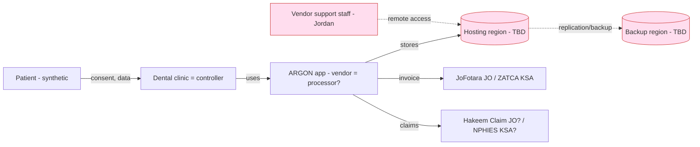
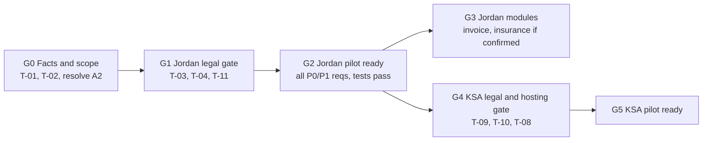

# CLOUD 5 — Jordan and Saudi Arabia Healthcare Regulatory Research

**Project:** ARGON Dental — Jordan Pilot (second market: Saudi Arabia)
**Team:** Cloud 5 — Healthcare Regulatory Research (1 of 7 independent specialist teams)
**Version:** 1.0 (desk research) | **Research/access date:** 6 November 2026
**Status:** Research and design only. No code, repositories, deployments, production systems or real patient data were touched. All examples are synthetic.

> **This document is not legal advice and is not a compliance claim.** ARGON is **not** stated or implied to be compliant with, certified under, or production-ready for any law, regulation or standard named here. Every item classified *Requires Legal Confirmation* must be reviewed by a qualified Jordanian (and, for Saudi work, Saudi) lawyer before launch. Section 14 lists the matters that need that review.

---

## 0. How to read this document

### 0.1 Evidence labels

| Label | Meaning |
|---|---|
| **Verified evidence** | Read in this session from an official source, or consistently reported by independent reputable sources. Tier is stated. |
| **Documented design** | Statements in ARGON governance/skill documents about how ARGON is built. Not verified as implemented software. |
| **Recommendation** | The research team's proposal. Not a legal requirement. |
| **Unverified assumption** | Needed to proceed; must be confirmed (Section 3). |

### 0.2 Source tiers

| Tier | Definition | Use |
|---|---|---|
| **T1** | Official government/regulator/official-portal page or official translation | Preferred basis for "Confirmed" |
| **T2** | Reputable law firm, Big-4 tax alert, trade press, academic paper | Supports a finding; article numbers from T2 must be checked against the law text |
| **T3** | Vendor marketing, blogs, aggregators | **Not relied on** for any obligation. Cited only to record conflicts |

### 0.3 Classification used in the matrices

| Class | Meaning |
|---|---|
| **CONFIRMED** | The obligation or process exists, supported by T1 evidence (or ≥2 consistent T2 sources where T1 was not retrievable — flagged). Details marked "verify" still need checking against the law text. |
| **CONDITIONAL** | Applies only if a fact is true (e.g., VAT-registered, public-sector link, revenue threshold). The condition is stated. |
| **RLC** | **Requires Legal Confirmation** — sources conflict, the primary text was not retrieved, the applicability to a software vendor or dental clinic is unclear, or the matter is too consequential to rest on desk research. |

### 0.4 "Applies to" column

**V** = software vendor (ARGON) · **C** = clinic · **B** = both.

---

## 1. Executive summary

**Bottom line.** Neither market can be cleared for launch on the evidence available. Jordan is workable for a controlled one-clinic pilot *if* a short list of legal and architecture gates (G0–G2, Section 11) is closed first. Saudi Arabia should be treated as a separate project with its own gates, not an extension of the Jordan pilot.

**Ten findings that drive decisions**

1. **Jordan's PDPL (Law No. 24 of 2023) is in force and applies now.** Published 17 Sep 2023, in force 17 Mar 2024. MoDEE states a 12-month compliance period existed, but that it *does not apply to data collected after enactment or to newly established companies, which must comply immediately* [R1]. A new pilot cannot rely on a grace period.
2. **Health data is "sensitive personal data" in both countries** [R1][R4][R30]. That triggers the strictest tier: DPO (Jordan Art. 11), DPIA expectations, heightened transfer rules, and — in Saudi Arabia — no reliance on "legitimate interests" [R31].
3. **Cross-border transfer is the single biggest architecture/legal risk.** Jordan Art. 15 prohibits transfer to lower-protection destinations unless an exception applies; MoDEE says the Council will publish an approved list [R1][R4]. Whether that list exists was **not verified**. Firebase has **no Jordan region**; Middle East options listed for Firestore/Functions are Doha (`me-central1`), Dammam (`me-central2`) and Tel Aviv (`me-west1`) [R53][R54]. Realtime Database location options were **not** retrieved. If ARGON Legacy runs on Firebase (assumption A3), hosting is almost certainly a cross-border transfer from Jordan. Whether the statutory exception for "exchange of medical data necessary for treatment" covers SaaS hosting is an open legal question (RLC), not something to assume.
4. **Saudi Arabia adds a second cross-border problem in the opposite direction.** A Jordan-based vendor *remotely accessing* Saudi patient data is itself a "transfer" under Saudi rules [R30]. No adequacy list had been published as of March 2026 [R30], so Standard Contractual Clauses plus a documented transfer risk assessment would be needed for sensitive data [R30][R32].
5. **Saudi health-data hosting/localisation is unresolved.** Reputable sources say the PDPL itself does not mandate localisation but sector rules for health data may restrict or prohibit transfer [R30]; NCA moved localisation controls out of ECC-2:2024 to NDMO [R35]. Vendor blogs asserting "health data must stay in KSA" [R51] are T3 and **not relied on**. Planning assumption (recommendation): treat KSA-resident hosting as required until counsel says otherwise.
6. **Breach clocks differ and are short.** Jordan: affected individuals within 24 h and the Unit within 72 h of discovery (per T2) [R4]. Saudi Arabia: SDAIA within 72 h of awareness; individuals without undue delay [R30]. Because the clinic is normally the controller, ARGON needs a contractual and technical path to alert the clinic in hours, not days.
7. **Roles are not settled in Jordan.** The Jordanian definition of "Controller" keys on having data "under their custody" and includes persons outside the Kingdom [R4]. A hosting vendor may be argued to be a controller, not just a processor (RLC). In Saudi Arabia the provider is almost always the controller and the vendor the processor [R34].
8. **Append-only design vs deletion right.** ARGON's documented append-only architecture means "deletion" can only be anonymisation/status-based. MoDEE publishes a *Data Erasure – Anonymization* request form [R2]. Whether anonymisation satisfies the right for clinical records, and the statutory retention period for dental records, are **not established** in either country (RLC). Do **not** import retention numbers from other countries (a "25 years" figure that surfaced in research relates to the UAE, not Saudi Arabia or Jordan).
9. **E-invoicing and insurance integrations are country-specific modules, not generic features.** Jordan: JoFotara (ISTD) mandatory phase from 1 Apr 2025 per T2 sources [R17][R18]; scope (VAT-registered only vs all sellers) conflicts among T3 sources → RLC. Saudi Arabia: ZATCA Phase 2 waves — Wave 25 (announced 24 Jul 2026) covers taxpayers above a SAR 187,500 VAT-taxable revenue threshold (reference years reported as 2022–2025 by T3 sources; confirm on ZATCA's page), integration deadline 1 Feb 2027 [R39][R40]. Insurance: Jordan "Hakeem" claims integration and Saudi NPHIES exist, but whether either is **mandatory for a private dental clinic** was not established from any official source (RLC).
10. **Source quality is uneven; conflicts are listed (Appendix B).** Several widely circulated claims (e.g., Jordan fines "up to JOD 1 million", Saudi "mandatory NPHIES", "NCA requires KSA-only health hosting") come from T3 sources and conflict with T1/T2 material. They are excluded from the matrices.

**What this report could not verify (read before relying on it)**

- The **full text of Jordan's PDPL** (official MoDEE PDF) is a scanned image with no extractable text. Jordanian article numbers come from DLA Piper (T2, modified 8 Feb 2026) and MoDEE's FAQ (T1). **Verify every article number against the Arabic text.**
- MoDEE's 2025 instruments (Security/Technical/Organizational Measures Instructions, Data Disclosure Regulation, Council working-mechanism instructions, DPIA guideline) are confirmed to **exist** [R2] but were **not read**. They may add binding detail. Reading them is task T-01 in Section 11.
- No official Saudi PDPL, Implementing Regulations, Transfer Regulation, NPHIES or ZATCA technical text was read in full. Saudi findings rest on T2 sources plus two T1 ZATCA/NCA pages seen only as search extracts.
- **Not researched at all:** medical-device-software regulation (JFDA in Jordan, SFDA in Saudi Arabia) if ARGON adds clinical decision support or AI; Saudi vendor establishment/commercial-registration requirements; tax treatment (VAT) of dental services in either country; Jordan's dental radiography licensing; DICOM/imaging rules; telehealth.

---

## 2. Scope and method

### 2.1 In scope

Regulatory research for a **dental clinic management software platform** (patient records, appointments, treatment plans, consent, billing/invoicing, insurance claims, reminders), Jordan first and Saudi Arabia second, covering the topics the task listed: facility/professional licensing context, personal-data law and health data, controller/processor duties, consent and rights, record retention/access, e-signatures, cloud hosting and cross-border transfer, e-invoicing/tax, insurance integration, cybersecurity, and (Saudi) NPHIES/HIE.

### 2.2 Out of scope

Implementation, code, deployment, penetration testing, contract drafting, real patient data, price comparisons of paid tools, and legal opinions.

### 2.3 Method

1. Searched for primary sources first (MoDEE, MoH Jordan, ISTD, NCSC; SDAIA, NCA, MoH KSA, ZATCA, CHI/NHIC, SCFHS).
2. Where a primary page was reachable, read it (MoDEE FAQ and instruments list were read in full).
3. Where the primary text was not retrievable, used T2 sources, labelled them, and downgraded confidence.
4. Rejected T3 claims as the basis for any obligation; recorded conflicts (Appendix B).
5. Built three matrices (Jordan, Saudi Arabia, comparative), derived requirements, and mapped them to a gated implementation sequence.

### 2.4 Date handling

All "Date" cells give the publication/update date **as shown by the source**. "n/s" = not stated on the page. Laws are listed by enactment/effect dates where reported.

---

## 3. Context and assumptions

| ID | Assumption | Status | Why it matters |
|---|---|---|---|
| A1 | The pilot is **one** dental clinic in Jordan (per project brief). | From brief | Fixes controller identity for the pilot. |
| A2 | ARGON governance documents describe a live system serving **five** clinics in production. | Documented design — **conflicts with A1** | If five clinics already use ARGON Legacy, PDPL duties (DPO, transfer, breach clocks) already apply to live data, not just to the pilot. **Needs human confirmation.** |
| A3 | ARGON Legacy backend is Firebase (Realtime Database / Cloud Functions / Auth). | Documented design, unverified here | Determines cross-border analysis. The actual Firebase project region(s) must be read from the console (task T-02). |
| A4 | ARGON (the vendor) is a Jordan-based sole-proprietor/new company acting for the clinic. | Unverified | Controls "newly established company" status and liability allocation. |
| A5 | Budget is $0/month. | From brief | Qualified legal review and any billing-enabled cloud plan are costs with **no free substitute** (see 10.3). |
| A6 | ARGON stores patient identity, dental charts, treatment notes, images (possibly), consent records, invoices and insurance data. | Unverified | All of it is health or financial data → sensitive in Jordan's law. |
| A7 | ARGON currently has no AI/clinical-decision-support feature. | Unverified | If it does, device-software and AI-ethics rules need a separate review. |

---

## 4. Role model and data flow

### 4.1 Likely roles (recommendation; RLC in Jordan)

| Party | Jordan (PDPL) | Saudi Arabia (PDPL) |
|---|---|---|
| Dental clinic | Controller (processes patient health data for care) | Controller [R34] |
| ARGON (vendor) | Processor for care/billing workflows; **possibly** a controller for anything it decides itself (analytics, product improvement, support tooling) — RLC | Processor; must not repurpose or anonymise except on the provider's documented instructions [R30][R31] |
| Google/Firebase (infrastructure) | Sub-processor/recipient; recipient carries controller-equivalent duties (Art. 14(d)) [R4] | Sub-processor; prior controller approval and flow-down required [R31] |
| Insurers / claims platforms | Recipients (Art. 14 consent and records) [R4] | Recipients; NPHIES participants [R41] |
| Patient | Data subject (minors/incapacitated persons raise extra duties) | Data subject (guardian consent for minors) [R30] |

### 4.2 Data-flow and transfer map (design view)



Red nodes are **transfer-sensitive**: where the data physically sits, where backups go, and where support staff sit all determine whether a cross-border transfer occurs in each country.

### 4.3 Transfer decision logic (recommendation)

```mermaid
flowchart TD
  Q1{Patient data of Jordan residents?} -->|yes| J{Stored or accessed outside Jordan?}
  J -->|no| OKJ[Jordan transfer rules not triggered]
  J -->|yes| JA{Destination on Council adequacy list<br/>or statutory exception applies?}
  JA -->|unknown| LJ[STOP - legal confirmation required]
  JA -->|yes| DJ[Document basis + consent records Art.14]
  Q2{Patient data of Saudi residents?} -->|yes| S{Stored or accessed outside KSA<br/>incl. remote support from Jordan?}
  S -->|no| OKS[KSA transfer rules not triggered]
  S -->|yes| SA{Adequacy list / SCC / BCR + risk assessment<br/>AND sector health rules allow?}
  SA -->|unknown| LS[STOP - legal confirmation required]

---

## 5. JORDAN — detailed findings

### 5.1 PDPL scope, timing and regulator (Verified, T1 + T2)

- Law No. (24) of 2023 was published in the Official Gazette on 17 Sep 2023 and came into force on **17 Mar 2024** [R1][R4][R5]. MoDEE: it applies to controllers processing personal data of citizens and residents within Jordan, "even if the data was collected and processed before" enforcement; a 12-month compliance period was granted, but it **does not apply to data collected after enactment or to newly established companies** [R1].
- It protects natural persons only; legal entities are outside scope [R1].
- **Regulator structure:** a Personal Data Protection Council and an organisational unit ("the Unit"/Directorate) at MoDEE [R1][R4]. MoDEE publishes the law, 2025 instructions, request forms and a DPO accreditation form [R2], which is T1 evidence that the Directorate is operating. Some T3 sources claim the authority is "not established"; that conflicts with MoDEE's own site and is not relied on.
- **Health data** is expressly sensitive personal data (health, physical, mental, genetic, biometric, financial, criminal record, other categories the Council designates) [R1][R4].

### 5.2 Roles — vendor vs clinic (RLC)

The law defines *Controller* as any person, inside or outside the Kingdom, who has the data "under their custody", and *Processor* as the person responsible for processing [R4]. The recipient of a transfer takes on the same legal responsibilities as the controller (Art. 14) [R4]. MoDEE tells controllers to ensure that contracts with third parties comply with the law [R1]. **Open question:** does a SaaS vendor holding clinic data "in custody" count as a controller? Until counsel answers, design ARGON so that (a) the clinic can demonstrate control (consent evidence, access rights, deletion/anonymisation, export), and (b) ARGON uses clinic data for no purpose other than delivering the service.

### 5.3 Consent, purpose and data-subject rights (CONFIRMED existence; RLC detail)

- Prior consent is the primary basis; some entities are exempt from prior consent and notification but **remain bound by all other duties** (DPO, register, security, breach notice) [R1]. MoDEE does not say in the FAQ which clinical flows are exempt. Which ARGON flows (care, billing, reminders, analytics) fall inside an exemption is **RLC** (the Jordanian Art. 6/7 text was not read).
- Processing principles (Art. 7): lawful, specific, clear purpose; aligned with collection purpose; accurate and current; must not identify the subject after purpose is fulfilled; must not harm; confidentiality and integrity [R4].
- Rights listed by MoDEE: access/copy, correction/update, objection, complaint, withdrawal of consent; MoDEE also publishes forms for **erasure/anonymisation, portability and restriction** [R1][R2]. The objection right is limited to specified cases (Art. 4(b)(6)) [R1]. Statutory response times were **not retrieved**.
- Data must not be retained once its purpose is fulfilled unless law requires otherwise [R1]. No dental-record retention period was found (see 5.6).

### 5.4 Cross-border transfer and hosting (RLC — highest severity)

- Art. 14: transfer/exchange of data to any other person needs the data subject's consent, plus conditions (legitimate interests of controller and recipient; subject sufficiently informed; no marketing without consent), and the controller must **keep records of transfers and consents** [R4].
- Art. 15: transfer outside the Kingdom to a destination with lower protection is prohibited, subject to exceptions that include **exchange of medical data necessary for the subject's treatment** and epidemic/public-health matters [R4][R5]. MoDEE says transfer and storage abroad are allowed where the recipient provides adequate protection and that the **Council will issue a list** of approved countries/organisations [R1]. Clyde & Co (Oct 2023) noted the law does not anticipate standard contractual clauses as a transfer mechanism [R5].
- **Not established:** whether the Council list has been published; whether hosting in Doha/Dammam/Belgium/Iowa counts as adequate; whether the treatment exception covers a vendor's cloud storage and backups.
- **Hosting facts:** Google lists no Jordan region. Firestore regional options include Doha (`me-central1`), Dammam (`me-central2`) and Tel Aviv (`me-west1`) [R53]; Cloud Functions 2nd-gen is available in Doha and Dammam [R54]. A Firestore location cannot be changed after provisioning [R53]. Whether the Realtime Database offers a Middle East location was **not retrieved** — check before planning any move. Moving hosting is a data-migration project that must follow ARGON governance (additive change, isolated test project, written rollback).
- **Cloud policy overlap:** MoDEE's *Cloud Policy 2020* (unofficial translation) addresses public-sector cloud and says high-classification data belongs in private cloud while medium/low may use public cloud [R13]. A 2025 NCSC "Cloud Computing Policy" is described only in an opinion article that claims data-localisation obligations [R15]; the primary document was **not retrieved**, and a Digital Cooperation Organization report (Oct 2025) says Jordan does not generally require localisation, with specific mandates in some sectors [R14]. Applicability to a private dental clinic is **unestablished (RLC)**.

### 5.5 DPO, register, breach, penalties (CONFIRMED existence; RLC detail)

- **DPO (Art. 11):** required where the primary activity is processing personal data; sensitive data; data of persons lacking legal capacity; financial data; transfer to databases outside the Kingdom; or other cases set by the Council. The DPO is a natural person, internal or external, and a liaison with the Directorate; MoDEE says qualification guidance "will be issued soon" and publishes an accreditation form [R1][R2][R4]. A dental clinic processing health data and minors' data meets several triggers. Whether a sole founder may be the DPO is **RLC**.
- **Register:** MoDEE's compliance checklist says to register in the *Personal Data Processing Register* [R1]; DLA Piper (Feb 2026) says there is no general registration obligation [R4]; a Jordan Securities Commission note (Jan 2026) describes a register for data-protection officers/processors/monitors under the Unit [R23]. **Conflict → RLC.**
- **Breach (Art. 20):** for a serious breach likely to cause significant harm, notify affected subjects within **24 h** of discovery and the Unit within **72 h**; liability for gross negligence/misconduct [R4]. MoDEE confirms the duty to notify but gives no hours [R1]. Timing rests on one T2 source → verify.
- **Penalties:** Unit warning; then Council sanctions up to licence suspension/revocation and fines up to JOD 500/day capped at 3% of prior-year revenue (Art. 21); fines JOD 1,000–10,000 and possible destruction of data/cancellation of the database (Art. 22); civil damages preserved [R4]. MoDEE confirms warnings and public disclosure of violations at the violator's expense [R1]. T3 claims of "up to JOD 1 million" are unsupported (Appendix B).
- **Security measures:** Art. 13 makes data in processing confidential [R4]. MoDEE's **Security, Technical and Organizational Measures Instructions 2025** exist [R2] — content unread (task T-01).

### 5.6 Record retention, access and electronic signatures (RLC)

- **Retention:** no Jordanian statute or MoH instruction fixing a dental-record retention period was found. The Medical and Health Liability Law No. 25 of 2018 (in force 31 Aug 2018) consolidates medical-liability rules [R12], but provisions on records, consent form and access were **not read**. **Do not hard-code a retention period.** Make it a per-tenant, per-record-class configurable policy (REQ-RET-01) and obtain the number from counsel.
- **Patient access:** PDPL gives access/copy rights [R1]; any medical-law access rule is unverified.
- **Electronic signatures:** the Electronic Transactions Law No. 15 of 2015 (replacing Law 85 of 2001) is the framework; commentary describes simple, protected and authenticated signatures, with authenticated signatures tied to a certificate from a licensed provider [R22]. Evidentiary weight of a tablet signature on a consent form or treatment plan is **RLC**. Design for evidence integrity (identity, timestamp, hash, immutable audit trail) regardless.

### 5.7 Licensing and advertising context (CONFIRMED process; statute text RLC)

- **Clinic:** MoH Health Professions and Institutions Licensing Directorate (Dental Clinics and Centers Licensing Department). Listed requirements include Jordan Dental Association (JDA) approval of the site, the dentist's professional licence, lease/title documents and survey plans; dental *centers* add commercial register, minimum floor area, and a radiograph licence certificate [R7][R8].
- **Dentist:** MoH practice certificate requires JDA registration [R9].
- **Advertising/fees:** the JDA says it will verify licences and clinics (QR codes planned from March 2026), is pursuing misleading ads and discounts that violate the approved fee schedule [R10], and requires its seal on advertisements [R11]. Software features that publish offers, discounts or fee lists therefore need JDA-rule review (RLC).
- The statutes behind these processes (e.g., Jordan Medical Council and Dental Association laws, Public Health Law No. 47 of 2008) were **not read**.

### 5.8 Tax and e-invoicing (CONDITIONAL / RLC)

- ISTD (Ministry of Finance), with MoDEE, runs **JoFotara**. Launch Dec 2022; Phase 2 mandatory from **1 Apr 2025** for B2B, B2C and B2G per T2 sources [R17][R18]. Invoices are structured (UBL 2.1 XML, encrypted JSON) and validated with a QR code [R18][R19].
- **Scope conflict:** some sources say only VAT-registered taxpayers; a T3 explainer says the duty follows *any* sale, not VAT registration [R19]. No ISTD page was retrieved. Whether a dental clinic must issue via JoFotara, and whether ARGON must integrate as an "integrated system", is **RLC** (ask a Jordanian tax adviser and read ISTD's four published guides).
- Treat JoFotara as a **pluggable country module** with its own credentials vault, rejection handling and audit log.

### 5.9 Insurance and e-health integration (RLC)

- The **Hakeem** programme is run by Electronic Health Solutions (non-profit; stakeholders include MoH and MoDEE) for public-sector EHR. A national claims system ("Hakeem Claim") exists; the Jordan Medical Association said (Aug 2025) that Hakeem is integrated with the national billing system so that billing insurers becomes automatic once a claim is filed [R20][R21].
- **Not established:** whether private dental clinics must or may connect, the API/onboarding route, and which authority regulates the insurer–provider interface. Treat as discovery task T-07.

### 5.10 Cybersecurity (CONDITIONAL / RLC)

- Cybersecurity Law No. 16 of 2019 created the National Cybersecurity Council and Centre (NCSC) [R16]. A 2025–2028 national strategy and execution plan were approved (Petra, 17 Mar 2026) [R16]. No retrieved source shows a duty on a private clinic or SaaS vendor. The NCSC role in licensing cybersecurity services is described in news reports. Treat NCSC policies as a source of **good-practice baselines** until counsel confirms applicability.

### 5.11 JORDAN COMPLIANCE MATRIX

Legend: **CONF** confirmed · **COND** conditional · **RLC** requires legal confirmation. Sources `[R#]` resolve to URLs in Section 15.

| ID | Topic | Requirement / finding | Authority | Instrument & article (as cited) | Source | Date | Applies | Class | ARGON implication |
|---|---|---|---|---|---|---|---|---|---|
| JO-01 | Clinic licensing | Dental clinic/centre needs MoH licence; documents incl. JDA site approval, dentist licence, lease/title, plans | MoH — Dental Clinics & Centers Licensing Dept | MoH e-service pages | [R7][R8] | n/s | C | CONF (process); statute RLC | Store licence no./expiry per clinic; no vendor duty found |
| JO-02 | Dentist licensing | Practice certificate requires JDA registration | MoH; Jordan Dental Association | MoH e-service page | [R9] | n/s | C | CONF (process); statute RLC | Store practitioner licence IDs; block unlicensed users from clinical sign-off (rec.) |
| JO-03 | Advertising & fees | JDA seal on ads; approved fee schedule; action on misleading ads/discounts | Jordan Dental Association | JDA statements (no instrument cited) | [R10][R11] | 3 Feb 2026 / n/s | B | RLC | Gate any marketing/discount/fee-list feature behind legal review |
| JO-04 | Medical liability | Consolidated medical & health liability rules | Legislature; MoH; courts | Law No. 25 of 2018 (in force 31 Aug 2018) | [R12] | 2018 | B | RLC (records/consent articles unread) | Preserve tamper-evident records as evidence |
| JO-05 | PDPL applicability | In force 17 Mar 2024; no grace for post-enactment data or new companies | MoDEE — PDP Directorate/Unit; PDP Council | Law No. 24 of 2023 | [R1][R4][R5] | OG 17 Sep 2023 | B | CONF | Treat PDPL as binding from day one of pilot |
| JO-06 | Health data = sensitive | Health/physical/mental/genetic/biometric/financial data are sensitive | MoDEE | Art. 1 (definitions) | [R1][R4] | n/s / 8 Feb 2026 | B | CONF | Classify all patient and invoice data as sensitive |
| JO-07 | Controller/processor | Controller = holder "in custody"; recipient bears controller duties; contracts with third parties must comply | MoDEE | Arts. 1, 13, 14(d)–(e) | [R1][R4] | as above | B | CONF (duties); vendor role RLC | DPA/processor terms with each clinic; minimise vendor-own use of data |
| JO-08 | Consent / lawful basis | Prior consent is primary; exempt entities still bound by other duties; Art. 7 principles | MoDEE | Arts. 6–7 (cited), FAQ Q12 | [R1][R4] | as above | C (V supports) | COND / RLC | Versioned consent records; exemption mapping by counsel |
| JO-09 | Data-subject rights | Access/copy, correction, objection (limited), complaint, withdraw consent; forms for erasure/anonymisation, portability, restriction | MoDEE | Art. 4(b); MoDEE forms | [R1][R2] | n/s | C (V supports) | CONF (rights); timelines RLC | DSR workflow + export + anonymisation (see REQ-DSR) |
| JO-10 | DPO | Required for sensitive data, minors/incapacitated, financial data, offshore transfer, etc. | MoDEE | Art. 11 | [R1][R2][R4] | as above | B | CONF (triggers met); qualifications/sole-founder RLC | Designate DPO per controller; clinic DPO external option |
| JO-11 | Register | Conflict: "register in Processing Register" vs "no general registration" | MoDEE | FAQ Q8 vs DLA | [R1][R4][R23] | 2026 | B | RLC | Ask Directorate in writing |
| JO-12 | Breach notice | Serious breach: subjects within 24 h; Unit within 72 h | MoDEE | Art. 20 (T2) | [R4] (+ [R1] existence) | 8 Feb 2026 | C (V alerts C) | CONF (duty); timing RLC | Vendor→clinic alert SLA of hours; runbook |
| JO-13 | Penalties | Warning, licence sanctions, fines ≤JOD 500/day (≤3% revenue); JOD 1k–10k; data destruction orders | MoDEE; PDP Council; courts | Arts. 21–22 (T2) | [R4][R1] | 8 Feb 2026 | B | RLC (amounts) | Risk register input only |
| JO-14 | Cross-border transfer | Transfer abroad allowed only if adequate protection or exception; Council list; record transfers/consent | MoDEE; PDP Council | Arts. 14–15 | [R1][R4][R5] | as above | B | RLC (high) | Hosting-region decision gate G1 |
| JO-15 | Security measures | Data confidential; 2025 security/technical/organisational instructions exist | MoDEE | Art. 13; Instructions 2025 | [R2][R4] | 2025 | B | CONF (exist); content unread | Read instructions; map controls (T-01) |
| JO-16 | DPIA | MoDEE publishes DPIA guideline and form | MoDEE | DPIA Guideline & Form | [R2] | n/s | B | RLC (legal trigger) | Run DPIA before pilot regardless |
| JO-17 | Retention | No retention beyond purpose unless law requires; **no dental retention period found** | MoDEE; MoH (unverified) | FAQ Q9 | [R1] | n/s | C (V configures) | RLC | Configurable retention; obtain number |
| JO-18 | Minors/incapacity | DPO trigger for persons lacking capacity; guardian consent per draft rules/T3 | MoDEE | Art. 11; draft instructions | [R4][R24] | 2024 draft | C | RLC | Guardian-consent flow; age-based rules |
| JO-19 | Marketing | Transfer for marketing needs consent; no specific e-marketing rules | MoDEE | Art. 14(b) | [R4] | 8 Feb 2026 | C | RLC | Separate reminder vs marketing consent |
| JO-20 | Cybersecurity law | NCSC/Council created; no retrieved duty on clinics/vendors | NCSC | Law No. 16 of 2019 | [R16] | 2019; plan 17 Mar 2026 | B | COND / RLC | Use NCSC material as baseline |
| JO-21 | Cloud policy / localisation | Public-sector cloud classification policy (2020); 2025 NCSC cloud policy unverified; DCO says no general localisation | MoDEE; NCSC | Cloud Policy 2020; NCSC 2025 (unread) | [R13][R14][R15] | 2020 / Oct 2025 | B | RLC | Do not assume localisation either way |
| JO-22 | E-signature/records | Three signature classes; authenticated needs licensed certificate; weight of tablet signature unclear | MoDEE / licensed CAs | Electronic Transactions Law No. 15 of 2015 | [R22] | 2015 | B | RLC | Evidence-grade consent capture (REQ-SIG) |
| JO-23 | E-invoicing | JoFotara Phase 2 mandatory from 1 Apr 2025; scope conflict | ISTD (MoF) with MoDEE | JoFotara; billing regulations (unread) | [R17][R18][R19] | 1 Apr 2025 | B | COND / RLC | Pluggable invoice module; tax-adviser confirmation |
| JO-24 | Insurance integration | Hakeem / national claims system exists; private-clinic obligation unknown | Electronic Health Solutions; MoH | Programme (no instrument cited) | [R20][R21] | Aug 2025 | B | RLC | Discovery task T-07; adapter interface only |

---

## 6. SAUDI ARABIA — detailed findings

> Saudi findings rest mainly on T2 sources (Chambers 2026, Clyde & Co, Mayer Brown, Al Tamimi) plus T1 extracts from ZATCA, NCA, MoH and MISA that were seen only as search extracts. No official SDAIA text was read. Treat all article numbers as "as cited by T2".

### 6.1 PDPL status, reach and regulator (CONFIRMED, T2 ×3)

- Personal Data Protection Law issued by Royal Decree M/19 (dated 9/2/1443H; 16 Sep 2021), amended by Royal Decree M/148 (5/9/1444H); in force **14 Sep 2023**; full enforcement from **14 Sep 2024** [R30][R32]. Regulator: **SDAIA** (with its Personal Data Protection Authority); NDMO sets government/non-personal data governance [R30].
- It covers processing that takes place in KSA **or** relates to individuals residing in KSA by any party outside KSA [R30]. A Jordan-based vendor processing Saudi patients' data is therefore in reach.
- SDAIA issued Implementing Regulations and Transfer Regulations (Sep 2023), **amended Transfer Regulations on 1 Sep 2024**, plus rules for appointing a DPO, standard contractual clauses, binding common rules guidelines, minimum-data, destruction/anonymisation, disclosure-cases, processing-records and breach-procedure guidance (Aug–Sep 2024) [R30][R32]. A third public consultation on amendments opened 27 Apr 2025; nothing finalised at the time of the Chambers update (10 Mar 2026) [R30]. **Re-check before launch.**
- Enforcement: committees issued 48 decisions in the first year; administrative fines up to **SAR 5 million**, doubled for repeats; publication of violations; certain unlawful disclosures of sensitive data carry criminal liability [R30].

### 6.2 Sensitive data, lawful basis, roles (CONFIRMED, T2)

- Health data is sensitive; processing needs a valid lawful basis and heightened safeguards; **legitimate interests cannot be used for sensitive data** [R30][R31].
- DPIAs are required where processing involves sensitive data (among other triggers) [R31]. Providers are almost always controllers even when cloud/AI tools are supplied by third parties [R34].
- Processor contracts must carry specified content, including breach notice "without undue delay"; **sub-processors need prior controller approval**; the controller must verify processor compliance [R31]. Companies serving healthcare providers may anonymise patient data **only on the provider's documented instruction** and a valid lawful basis; processors may not repurpose data [R30].

### 6.3 Notice, rights, minors, marketing (CONFIRMED, T2)

- Controllers must adopt and publish a privacy policy before collecting data (Art. 12) and give collection notices covering legal basis, purpose, mandatory/optional status, recipients, **transfers outside KSA** and rights (Art. 13) [R30].
- Rights: access (Art. 5), copy in readable form (Art. 6), correction, erasure where legally permitted; documented handling of requests; complaints to SDAIA [R30]. Response deadlines were not retrieved.
- Minors: verifiable guardian consent typically required; no marketing to minors without it [R30].
- Direct marketing needs explicit consent with easy withdrawal; **health data may not be used for marketing**; CST anti-spam rules require opt-in for promotional SMS/calls [R30].

### 6.4 Breach (CONFIRMED, T2)

SDAIA's guide: notify SDAIA within **72 h** of becoming aware, via the National Data Governance Platform, if the incident is expected to harm data or subjects; notify subjects without undue delay where rights/interests may be harmed; contain; retain records of every incident and corrective action [R30].

### 6.5 Cross-border transfer and hosting (CONDITIONAL / RLC — high severity)

- PDPL Art. 29 and the Transfer Regulations: adequacy list (Art. 3) — **not yet published** per Chambers (Mar 2026); otherwise appropriate safeguards (Art. 4): SCCs (four SDAIA versions: C2P, C2C, P2C, P2P), binding common rules, or accreditation certificates; a **risk assessment is mandatory** for sensitive-data transfers on a continuous/widespread basis and for exemption-based transfers (Art. 7) [R30][R32].
- **Remote access from abroad is a transfer** (hosting, remote administration, sub-processing) [R30].
- PDPL does not itself require localisation, but "special rules ... depending on the type of data (e.g., health data)" may restrict or prohibit transfer; sector regulators and health bodies govern health data handling and exchange [R30].
- NCA's ECC-2:2024 no longer carries the old data-localisation sub-control; entities are directed to NDMO [R35]. NCA Cloud Cybersecurity Controls (updated Feb 2021) and CST's Cloud Computing Regulatory Framework also touch hosting [R48][R52]. NCA's critical-systems controls restrict cloud use outside KSA for critical systems [R42].
- **No official instrument was found that requires dental-clinic patient data to stay in KSA, and none that clearly permits offshore hosting.** T3 claims either way are rejected [R51]. **Planning assumption:** KSA-resident hosting, KSA-resident backups, and no Jordan-based standing access without a documented transfer basis.

### 6.6 Cybersecurity — NCA (CONDITIONAL)

- ECC-2:2024 (official NCA PDF) applies to government entities, their affiliates and **private entities that own, operate or host Critical National Infrastructure** [R36][R37]. A dental clinic is unlikely to be CNI; ECC may still reach ARGON by **contractual flow-down** (e.g., a government-owned buyer) or sector-regulator reference. A "NCNICC-1:2025" set for non-CNI private entities appears only in a T3 source [R50] — verify with NCA before relying on it.
- The Saudi Anti-Cyber Crime Law (M/17 of 2007) adds criminal exposure for unauthorised access or disclosure [R30].

### 6.7 Facility and professional licensing (CONFIRMED process)

- **Facility:** private health institutions are governed by the Law of Private Health Institutions (the 2003 law replaced the 1987 law; implementing regulations amended 2018 per T3) [R46][R47]; MoH licensing guide lists licence types for hospital, general polyclinic and clinic [R43]; licensing runs through MoH's Seha platform (T3 how-to) [R49].
- **Practitioners:** SCFHS classification and registration is the first legal step before registration [R45]. The Law of Practicing Healthcare Professions (Royal Decree M/59, 6 Dec 2005) governs licensing and duties; its Art. 10 prohibits a practitioner from advertising or promoting himself except as the Implementing Regulations allow [R44]. The confidentiality article was not read.
- **Insurance accreditation:** a clinic treating insured patients reportedly needs Council of Health Insurance (CHI) accreditation — T3 only (RLC) [R49].

### 6.8 NPHIES and health information exchange (RLC)

- NPHIES was launched by the Minister of Health (reported 30 Oct 2023) with CHI, the Saudi Health Council and NHIC to exchange health information among providers, insurers and regulators [R41]. It has insurance and clinical service components (T3) [R49].
- Vendor pages say NPHIES is "mandatory for all healthcare institutions" [R51]; **no official source retrieved**. NHIC also issued Saudi Health Information Exchange Policies and certification policies (2016) [R42]. Onboarding route, certification and mandatory scope for private dental clinics: **not established**. FHIR R4 profiles are claimed by T3 only.
- No official NPHIES document was read. Task T-08 is to obtain provider/vendor onboarding documentation from CHI/NHIC.

### 6.9 E-invoicing — ZATCA (CONDITIONAL)

- Phase 2 (Integration) rolls out in **waves**; ZATCA notifies targeted taxpayers at least six months ahead [R38]. Wave 24: VAT-taxable revenue above SAR 375,000 → integration by **30 Jun 2026** [R38]. **Wave 25** (announced **24 Jul 2026**; Governor's decision published in the Official Gazette that day per EY): threshold **SAR 187,500**, integration by **1 Feb 2027** [R39][R40].
- Whether a given clinic is a VAT-registered taxpayer above threshold, how dental services are treated for VAT, and the technical/solution-provider requirements for ARGON as an invoicing system are **RLC** (tax adviser; ZATCA technical documents unread).

### 6.10 Records, e-signature (RLC)

- **Retention:** no Saudi dental-record retention period was found. PDPL requires destruction when data is no longer necessary for its purpose [R30]. Do not hard-code a figure.
- **E-signature:** the Electronic Transactions Law (Royal Decree M/18 of 2007) covers electronic records, signatures and certificates [R30]; probative weight for consent forms is RLC.

### 6.11 SAUDI ARABIA COMPLIANCE MATRIX

| ID | Topic | Requirement / finding | Authority | Instrument & article (as cited) | Source | Date | Applies | Class | ARGON implication |
|---|---|---|---|---|---|---|---|---|---|
| SA-01 | Facility licensing | Private clinic needs MoH licence; licence types incl. clinic/polyclinic/hospital | MoH (Seha) | Law of Private Health Institutions + Implementing Regulation | [R43][R46][R49] | law 2003; regs amended 2018 (T3) | C | CONF (process); details RLC | Store facility licence data; no vendor duty found |
| SA-02 | Practitioner licensing | SCFHS classification & registration; Law of Practicing Healthcare Professions; advertising limits (Art. 10) | SCFHS; MoH | Royal Decree M/59 (6 Dec 2005) | [R44][R45] | 2005 | C | CONF | Practitioner ID fields; marketing review |
| SA-03 | CHI accreditation | Insured-patient treatment needs CHI accreditation (T3 only) | Council of Health Insurance | Cooperative Health Insurance regime (unread) | [R49] | 2026 (T3) | C | RLC | Do not build insurance flows until confirmed |
| SA-04 | PDPL applicability | In force 14 Sep 2023; enforceable 14 Sep 2024; reaches offshore processors of KSA residents' data | SDAIA | RD M/19 (2021) as amended M/148 | [R30][R32] | Mar 2026 / Oct 2024 | B | CONF (T2) | Jordan vendor is in scope for KSA patients |
| SA-05 | Sensitive/health data | Health data sensitive; lawful basis required; no legitimate-interest basis for sensitive data | SDAIA | PDPL Arts. 5–8, 10 as cited; Implementing Regs | [R30][R31] | Mar 2026 / Jan 2024 | B | CONF (T2) | Explicit-consent / care-basis mapping with counsel |
| SA-06 | Controller/processor | Provider = controller; processor contract terms; prior approval of sub-processors; anonymise only on instruction | SDAIA | PDPL Arts. 10–12; Implementing Regs | [R30][R31][R34] | 2024–2026 | B | CONF (T2) | KSA-specific DPA; sub-processor register |
| SA-07 | Notice & policy | Privacy policy before collection (Art. 12); collection notice incl. offshore transfer (Art. 13) | SDAIA | PDPL Arts. 12–13 | [R30] | Mar 2026 | C (V supplies) | CONF (T2) | Arabic/English notices; transfer disclosure |
| SA-08 | Data-subject rights | Access (Art. 5), copy (Art. 6), correction, erasure where permitted; complaints | SDAIA | PDPL Arts. 4–6 | [R30] | Mar 2026 | C (V supports) | CONF (T2); deadlines RLC | DSR workflow; export |
| SA-09 | DPO & DPIA | DPO rules issued 2024; DPIA required for sensitive-data processing | SDAIA | Rules for appointing DPO; Implementing Regs | [R30][R31] | 2024 | B | COND / RLC (trigger text unread) | Assume DPO + DPIA required |
| SA-10 | Controller register | National Register of Controllers guidelines (T3); register is an audit touchpoint | SDAIA | Register guidelines | [R30] | Mar 2026 | C | RLC | Ask counsel whether clinic/vendor must register |
| SA-11 | Breach | SDAIA within 72 h; subjects without undue delay; keep records | SDAIA | Personal Data Breach Incidents Procedural Guide | [R30] | Mar 2026 | C (V alerts C) | CONF (T2) | Runbook; vendor→clinic alert in hours |
| SA-12 | Penalties | Fines up to SAR 5m (doubled repeat); publication; criminal exposure for some sensitive-data disclosures | SDAIA committees; courts | PDPL penalty provisions | [R30] | Mar 2026 | B | CONF (T2) | Risk input |
| SA-13 | Cross-border | Adequacy list (unpublished as of Mar 2026) else SCC/BCR/certificate + risk assessment; remote access = transfer | SDAIA | PDPL Art. 29; Transfer Regulation (1 Sep 2024) Arts. 3, 4, 7 | [R30][R32] | 1 Sep 2024 / Mar 2026 | B | COND → RLC | Applies to Jordan-based support access |
| SA-14 | Health-data hosting | Sector health rules may restrict transfer; no instrument found; ECC-2 localisation moved to NDMO | MoH/NHIC; NDMO; NCA; CST | Sector rules (unread) | [R30][R35][R42][R52] | 2021–2026 | B | RLC (high) | Assume KSA-resident hosting until confirmed |
| SA-15 | NCA controls | ECC-2:2024 for gov/affiliates/private CNI; non-CNI set (NCNICC-1:2025) T3 only | NCA | ECC-2:2024; CCC | [R36][R37][R50] | eff. 1 Jan 2024 (T3) | B | COND | Flow-down via contracts; adopt as baseline |
| SA-16 | NPHIES | Insurer/provider/regulator exchange platform; mandatory scope for dental clinics unproven | CHI; NHIC; MoH | NPHIES programme | [R41][R49] | 30 Oct 2023 | B | RLC | Adapter interface only until T-08 |
| SA-17 | HIE policies | Saudi HIE policies and certification policies | NHIC | SHIE Policies (2016) | [R42] | 2016 | B | RLC | Discovery; no build |
| SA-18 | E-invoicing | Phase 2 waves; Wave 24 SAR 375k by 30 Jun 2026; Wave 25 SAR 187.5k by 1 Feb 2027; ≥6 months' notice | ZATCA | Phase 2 Integration decisions | [R38][R39][R40] | 26 Sep 2025; 24 Jul 2026 | B | COND / RLC | Pluggable ZATCA module; confirm VAT status |
| SA-19 | E-signature | Electronic records/signatures/certificates law | Government (MCIT/NCDC — unconfirmed) | Electronic Transactions Law M/18 of 2007 | [R30] | 2007 | B | RLC | Evidence-grade consent capture |
| SA-20 | Marketing | Explicit consent for direct marketing; health data barred from marketing; CST opt-in rules; practitioner advertising limits | SDAIA; CST; MoH | PDPL; CST rules; M/59 Art. 10 | [R30][R44] | 2005 / Mar 2026 | B | CONF (T2) PDPL/CST; RLC health ads | Hard separation of reminders vs marketing |
| SA-21 | Retention | No dental-record period found; destroy when no longer needed | SDAIA; MoH (unverified) | PDPL Art. 11 as cited | [R30] | Mar 2026 | C (V configures) | RLC | Configurable retention |
| SA-22 | Minors | Guardian consent; no marketing to minors without it | SDAIA | PDPL general regime | [R30] | Mar 2026 | C | CONF (T2) | Guardian flow |

---

## 7. COMPARATIVE MATRIX — Jordan vs Saudi Arabia

| Dimension | Jordan | Saudi Arabia | Implication for ARGON | Confidence |
|---|---|---|---|---|
| Data-protection law | Law No. 24 of 2023; in force 17 Mar 2024 [R1] | PDPL M/19 (2021) as amended; enforceable 14 Sep 2024 [R30] | Both live; build one privacy core, country config on top | High |
| Regulator | MoDEE PDP Directorate/Unit + PDP Council [R1] | SDAIA / PDP Authority; NDMO; NCA; CST; MoH [R30] | KSA has more overlapping regulators | High |
| Grace period | Not available to new companies or post-enactment data [R1] | Ended 14 Sep 2024 [R30] | No grace in either market | High |
| Health data | Sensitive [R1] | Sensitive [R30] | Same classification | High |
| Lawful basis | Prior consent primary; exemptions unclear [R1] | Consent or other basis; no legitimate interest for sensitive [R31] | Counsel must map care/billing/reminders/analytics | Medium |
| Vendor role | Unsettled (custody-based definition) [R4] | Processor; provider = controller [R34] | Jordan needs a written opinion; KSA needs SDAIA-grade DPA | Medium |
| DPO | Art. 11 triggers met by health data [R4] | DPO rules (2024); DPIA for sensitive [R31] | Appoint DPO/outsourced DPO in both | Medium |
| Breach — authority | Unit within 72 h (T2) [R4] | SDAIA within 72 h [R30] | Same 72 h clock | Medium (JO) / Medium (KSA) |
| Breach — individuals | 24 h (T2) [R4] | "Without undue delay" [R30] | Jordan is stricter; design to 24 h | Medium |
| Maximum sanctions | Fines ≤JOD 500/day (≤3% revenue); JOD 1k–10k; licence sanctions [R4] | Up to SAR 5m; doubling; criminal for some disclosures [R30] | KSA exposure much larger | Medium |
| Cross-border | Art. 15; Council list (status unknown) [R1][R4] | Art. 29; Transfer Reg; SCC/BCR; no list as of Mar 2026 [R30] | Hosting region is decision gate G1 (JO) and G4 (KSA) | Medium |
| Localisation | No general rule found; NCSC 2025 unverified [R14][R15] | No PDPL rule; health-sector rules unverified [R30] | Assume KSA-resident for KSA; Jordan open | Low |
| Remote support access | Offshore access may be transfer (inference from Art. 15) | Explicit: remote access = transfer [R30] | Support-access control is a first-class feature | Medium |
| Cyber baseline | Law 16/2019; NCSC; applicability to clinic unproven [R16] | NCA ECC-2:2024 (gov/CNI); CCC [R36] | Use NCA/NCSC as baselines; contractual flow-down | Medium |
| Facility licence | MoH + JDA site approval [R7] | MoH via Seha; SCFHS for staff [R43][R45] | Capture licence data; no vendor licence found | Medium |
| Advertising | JDA seal & fee schedule [R10][R11] | M/59 Art. 10 limits; PDPL/CST marketing consent [R30][R44] | Marketing features gated in both | Medium |
| E-invoicing | JoFotara; mandatory from 1 Apr 2025 (T2); scope RLC [R17] | ZATCA Phase 2 waves; Wave 25 by 1 Feb 2027 [R39] | Separate adapters; tax adviser per country | Medium |
| Insurance/claims | Hakeem claims; private-clinic duty unknown [R20] | NPHIES; mandatory scope unproven [R41] | Adapter interface now; build only after T-07/T-08 | Low |
| Interoperability | Hakeem (public sector) [R20] | NHIC SHIE/NPHIES clinical [R42] | Keep data model FHIR-mappable (rec.) | Low |
| E-signature | Law No. 15 of 2015 [R22] | Law M/18 of 2007 [R30] | Evidence-grade consent in both | Low |
| Retention | Not found | Not found | Configurable; counsel to supply | Low |
| Minors | Capacity-based DPO trigger; guardian consent [R4] | Guardian consent [R30] | Same flow, country parameters | Medium |
| Market-entry effort | Moderate for pilot if gates closed | High: new hosting, DPA, SCC, NPHIES, ZATCA, possibly local entity (not researched) | Treat KSA as separate programme | Medium |

---

## 8. Requirements derived from the findings

All requirements are **recommendations** that translate the findings into buildable work. "Src" cites matrix rows. Priority: **P0** = needed before any pilot data; **P1** = before pilot go-live; **P2** = before scaling or the Saudi market. Country: JO / KSA / Both. Nothing here changes code now; it is input for the implementation teams and must respect `argon-governance` (additive changes, isolated test project, written rollback, rules-before-function ordering).

| ID | Requirement | Src | Ctry | Pri | Verification |
|---|---|---|---|---|---|
| REQ-GOV-01 | Written record of controller/processor roles per clinic and a signed processor agreement before pilot data is loaded | JO-07, SA-06 | Both | P0 | Doc review by counsel |
| REQ-GOV-02 | Designate a DPO (or outsourced DPO) per controller; record the decision and its basis | JO-10, SA-09 | Both | P0 | Designation letter on file |
| REQ-GOV-03 | Maintain records of processing, sub-processors (including Google) and every transfer with its legal basis and consent evidence | JO-14, SA-06, SA-13 | Both | P1 | Register inspected |
| REQ-GOV-04 | Complete and file a DPIA for the dental platform before go-live | JO-16, SA-09 | Both | P0 | DPIA signed off |
| REQ-HOST-01 | Record, from the Firebase console, the region of every data store (RTDB, Firestore if any, Storage, Functions, Auth, backups, logs) | JO-14, SA-14 | Both | P0 | Console evidence |
| REQ-HOST-02 | No production patient data may be hosted or replicated outside the region approved by counsel for that country | JO-14, SA-13 | Both | P0 | Config audit; TS-04 |
| REQ-HOST-03 | Per-tenant data-residency setting; a Saudi tenant must never share storage or backups with a Jordan tenant | SA-14 | KSA | P2 | Architecture review |
| REQ-HOST-04 | Remote/support access by staff outside the data's country requires a documented basis, time-boxed approval and full audit logging | SA-13, JO-14 | Both | P1 | TS-05 |
| REQ-CON-01 | Capture versioned, timestamped, purpose-specific consent; each purpose (care, billing, reminders, marketing, analytics, offshore transfer) is separately recorded; no bundled consent | JO-08, SA-05, SA-20 | Both | P1 | TS-08, TS-12 |
| REQ-CON-02 | Consent withdrawal takes effect immediately for the affected purposes and is itself recorded | JO-09 | Both | P1 | TS-08 |
| REQ-CON-03 | Minor/incapacitated patient flow: guardian identity, relationship and consent; age thresholds configurable per country | JO-18, SA-22 | Both | P1 | TS-03 |
| REQ-NOT-01 | Arabic and English privacy notice and collection notice per clinic; Saudi notice discloses any offshore transfer | SA-07, JO-08 | Both | P1 | Content review |
| REQ-DSR-01 | Workflow to receive, track and answer access/copy, correction, objection, restriction, portability and erasure/anonymisation requests, with identity checks and an audit trail | JO-09, SA-08 | Both | P1 | TS-02 |
| REQ-DSR-02 | Machine-readable and human-readable export of a patient's data | JO-09, SA-08 | Both | P1 | TS-02 |
| REQ-DSR-03 | Anonymisation that works with append-only storage (irreversibly de-identify while keeping clinical/financial integrity); counsel to confirm it satisfies the erasure right | JO-09, JO-17 | Both | P1 | TS-09 |
| REQ-RET-01 | Retention is a per-tenant, per-record-class configurable policy; **no hard-coded period**; legal hold support; destruction logged | JO-17, SA-21 | Both | P1 | TS-07 |
| REQ-BRE-01 | Incident runbook with clocks: vendor alerts the clinic within hours; clinic can notify individuals within 24 h (Jordan) and the authority within 72 h (both) | JO-12, SA-11 | Both | P0 | TS-01 |
| REQ-BRE-02 | Incident register retaining submissions, corrective actions and lessons learned | SA-11 | Both | P1 | Register inspected |
| REQ-SEC-01 | Map MoDEE's 2025 security instructions and (Saudi) NCA ECC/CCC controls to ARGON controls; record gaps | JO-15, SA-15 | Both | P1 | Control map |
| REQ-SEC-02 | Tenant isolation proven by negative tests (user from clinic A cannot read clinic B) | JO-07 | Both | P0 | TS-10 |
| REQ-SEC-03 | No patient data in logs, errors or analytics | JO-15 | Both | P0 | Log sampling (TS-13) |
| REQ-SEC-04 | Encryption in transit and at rest confirmed; keys and tax/insurance credentials held in a secrets store, never in client code | JO-15, SA-15 | Both | P1 | Review |
| REQ-SEC-05 | Backups restore-tested and kept in an approved region | JO-14 | Both | P1 | TS-11 |
| REQ-SIG-01 | Consent and treatment-plan signatures capture signer identity, timestamp, document hash and device context in an immutable audit record | JO-22, SA-19 | Both | P1 | TS-15 |
| REQ-MKT-01 | Appointment reminders (care) are separate from marketing; marketing is off by default, never uses health data, and is gated until counsel clears JDA/MoH advertising rules | JO-03, JO-19, SA-20 | Both | P1 | TS-12 |
| REQ-INV-01 | Invoice module with a country adapter interface: JoFotara (JO) and ZATCA (KSA); rejection handling, retries, credential vault, audit log | JO-23, SA-18 | Both | P2 | TS-06 |
| REQ-INV-02 | Do not enable any e-invoicing adapter for a clinic until a tax adviser confirms that clinic's obligation and VAT status | JO-23, SA-18 | Both | P1 | Written confirmation |
| REQ-INS-01 | Insurance/claims adapter interface only (no build) until Hakeem/NPHIES onboarding and mandatory scope are confirmed | JO-24, SA-16 | Both | P2 | Discovery notes |
| REQ-PRO-01 | Store clinic facility licence and practitioner licence IDs/expiry; warn on expiry | JO-01, JO-02, SA-01, SA-02 | Both | P2 | Functional test |
| REQ-I18N-01 | Country configuration layer (law parameters, forms, notice text, retention, transfer rules) so Saudi support is configuration plus adapters, not a fork | Comparative | Both | P2 | Architecture review |
| REQ-DATA-01 | Keep the data model mappable to FHIR resources (for NPHIES/HIE) without committing to a FHIR migration | SA-16, SA-17 | KSA | P2 | Mapping document |

---

## 9. Security and safety considerations

1. **Patient safety and record integrity.** Append-only clinical records protect evidence value (relevant to the Medical Liability Law [R12]) but conflict with a literal erasure right. Resolve with REQ-DSR-03 and counsel, not by weakening integrity.
2. **Tenant isolation is a legal control.** Cross-clinic disclosure is a reportable breach in both countries. ARGON's documented production incident (rules deployed before the supporting function) shows the failure mode; any isolation change must follow the governance rule that Rules + Function changes are atomic and tested in an isolated project.
3. **Transfer controls are security controls.** Region pinning, backup location, log export, error-reporting SaaS, analytics SDKs and remote support tooling can each create an unnoticed offshore transfer. Inventory them (REQ-GOV-03).
4. **Support access.** Standing admin access by the sole developer is a transfer risk for Saudi tenants and an insider risk everywhere. Use time-boxed, approved, logged access (REQ-HOST-04).
5. **Credentials for tax and insurance systems** (JoFotara keys, ZATCA certificates, NPHIES certificates) are high-value secrets: vault them, scope per tenant, rotate on staff change.
6. **Minors' data and images.** Dental practice sees many minors; guardian flows and access controls need extra care. Imaging/DICOM rules were not researched.
7. **Clinical decision support / AI.** If any feature suggests diagnoses or treatment, device-software rules (JFDA/SFDA) and SDAIA AI ethics principles need separate review. **Not researched.** Keep such features out of the pilot (A7).
8. **Availability.** The clinic's care depends on the system. Restore tests and a documented downtime procedure are safety measures, not only IT hygiene (REQ-SEC-05).
9. **Marketing misuse.** Using health data for promotions is prohibited in Saudi Arabia and risky in Jordan (JO-19, SA-20).
10. **No claim hygiene.** Do not tell clinics, employers or investors that ARGON is "PDPL compliant" or "NCA compliant". Use "designed with X in mind" only when true.

---

## 10. Risks and gaps

### 10.1 Risk register

| ID | Risk | Likelihood | Impact | Mitigation | Decision owner |
|---|---|---|---|---|---|
| RK-01 | Firebase hosting outside Jordan is an unlawful transfer under Art. 15 | Medium | Critical | G1 legal opinion; region facts (T-02); migrate only if required | Founder + Jordanian counsel |
| RK-02 | A2 is true (five live clinics) and PDPL duties are already unmet | Medium | High | Resolve A2 at G0; if true, run gap closure on live clinics first | Founder |
| RK-03 | Vendor treated as controller in Jordan, with controller duties | Medium | High | Counsel opinion; narrow vendor-own data use | Counsel |
| RK-04 | Breach clocks missed (24 h / 72 h) | Medium | High | REQ-BRE-01, TS-01 | DPO |
| RK-05 | Retention/erasure conflict with append-only design | High | Medium | REQ-RET-01, REQ-DSR-03, counsel | Counsel + DPO |
| RK-06 | Saudi hosting rules for health data stricter than assumed | Medium | Critical | G4; assume KSA residency | Saudi counsel |
| RK-07 | Remote Jordan support access to Saudi data is an unapproved transfer | High (if unmanaged) | High | REQ-HOST-04; SCC + risk assessment | Saudi counsel |
| RK-08 | Source error: Jordan article numbers/timings differ from the law text | Medium | Medium | T-01 against Arabic text | Counsel |
| RK-09 | E-invoicing obligation misjudged (either direction) | Medium | Medium | Tax adviser (T-06, T-10) | Tax adviser |
| RK-10 | Insurance integration assumed mandatory or built unnecessarily | Medium | Medium | Interface-only until T-07/T-08 | Founder |
| RK-11 | Marketing/discount features breach JDA or PDPL rules | Medium | Medium | REQ-MKT-01 gating | Counsel |
| RK-12 | Regulations change after this report (Saudi PDPL amendments pending; Jordan instructions still being issued) | High | Medium | Re-check at each gate; keep a change log | Research owner |
| RK-13 | Device-software regulation applies and is missed | Low–Medium | High | Out-of-scope notice; scope features | Counsel |
| RK-14 | Saudi vendor establishment/commercial requirements not met | Unknown | High | Not researched; ask Saudi counsel at G4 | Founder |
| RK-15 | Solo-developer concentration (no second reviewer, no DPO independence) | High | High | External DPO/legal; written runbooks; peer review of rules changes | Founder |
| RK-16 | $0 budget cannot fund legal review or Saudi-resident hosting | High | High | See 10.3 | Founder |

### 10.2 Information gaps (not found or not read)

Jordan: Arabic law text and article numbering; MoDEE 2025 instructions' content; Council adequacy list status; dental-record retention period; response deadlines for data-subject requests; ISTD primary guidance and JoFotara scope; official Hakeem Claim onboarding; NCSC 2025 cloud policy text; DPO qualification guidance. Saudi: SDAIA primary texts; DPO trigger text; register obligation; health-hosting instrument; NPHIES and CHI official onboarding documents; retention period; VAT treatment of dental services; ZATCA solution-provider requirements; vendor establishment rules; device-software regulation.

### 10.3 Budget conflict ($0/month) — and why free alternatives are insufficient

- **Qualified legal review has no free substitute.** This report is desk research by an AI team; it cannot be relied on for a launch decision, a regulatory filing or a client contract. Free options (regulator FAQs, published forms, public guidance) are used here and should be exhausted first, but they do not give a legal opinion or professional liability cover. Minimum paid scope proposed: one Jordanian opinion (roles, transfer/hosting, retention, consent, DPO) before go-live; one Saudi opinion before G4.
- **Hosting in a Middle East region** may require a billing-enabled Firebase/Google Cloud plan; this was **not verified** and must be checked against current pricing before any commitment. If a billing plan is required, it conflicts with the $0 budget and needs an explicit approval.
- **Everything else proposed uses free/open tooling** (documents, checklists, existing Firebase features, open standards such as FHIR, UBL).

---

## 11. Recommended implementation sequence

Gated, additive, and consistent with "improve, do not rewrite". No dates are given because the team cannot know capacity; durations are relative.

### 11.1 Tasks

| ID | Task | Output |
|---|---|---|
| T-01 | Read the Arabic PDPL text and MoDEE 2025 instruments; build an article-level concordance | Verified Jordan obligation list (replaces T2 article numbers) |
| T-02 | Read Firebase console: regions, backups, logs, Auth, Functions, Storage; list all third-party SDKs/SaaS | Hosting and sub-processor inventory |
| T-03 | Engage Jordanian counsel with Section 14 questions | Written opinion |
| T-04 | Ask the MoDEE PDP Directorate (written) about register, DPO, exemptions and the adequacy list | Written reply |
| T-05 | Run DPIA using MoDEE's guideline and form [R2] | Signed DPIA |
| T-06 | Tax adviser: JoFotara scope, VAT status of dental services | Written confirmation |
| T-07 | Discovery: Hakeem Claim onboarding for private clinics | Discovery note |
| T-08 | Discovery: NPHIES/CHI onboarding for dental providers | Discovery note |
| T-09 | Engage Saudi counsel: hosting, transfer, vendor presence, NPHIES, PDPL registers | Written opinion |
| T-10 | Obtain ZATCA technical specs and solution requirements | Spec pack |
| T-11 | Obtain retention and access rules from counsel for both countries | Parameter table |

### 11.2 Gates and phases



| Gate | Entry criteria | Exit criteria (all required) |
|---|---|---|
| **G0** | Report accepted | A2 resolved (how many clinics hold live data?); T-01 and T-02 complete; hosting/sub-processor inventory exists |
| **G1** | G0 done; counsel engaged | Written opinion on roles, transfer/hosting, DPO, consent exemptions, retention, anonymisation vs erasure; Directorate reply on register/list; decision recorded on hosting region (stay or move) |
| **G2** | G1 done | All P0 and P1 requirements met; DPIA signed; DPO designated; processor agreement signed; TS-01 to TS-05, TS-08 to TS-13, TS-15 passed; rollback plan written |
| **G3** | G2 done | Tax adviser written confirmation (T-06); JoFotara adapter passes TS-06 in sandbox; Hakeem step only if T-07 says it is needed |
| **G4** | G2 done | Saudi counsel opinion; KSA hosting decision; SCC/risk-assessment approach; NPHIES and ZATCA obligations confirmed; vendor-presence question answered |
| **G5** | G4 done | KSA tenant isolated by residency (REQ-HOST-03); Saudi DPA, notices, breach runbook; TS-04/TS-05/TS-06/TS-14 passed on KSA configuration |

**Ordering rules.** (1) Facts before law: T-02 before any opinion request. (2) Law before code: no hosting migration, adapter or marketing feature starts before its gate. (3) Any Rules + Function change follows the governance atomic-change rule. (4) A region migration is its own project with an isolated test project and rollback, never bundled with feature work.

---

## 12. Acceptance criteria

Each criterion is pass/fail and evidenced.

| ID | Criterion | Evidence |
|---|---|---|
| AC-01 | Roles, DPO and processor agreement documented and signed for the pilot clinic | Signed documents |
| AC-02 | Region inventory exists and every data store is in the region approved at G1 | Console screenshots/exports (synthetic data only) |
| AC-03 | A simulated breach produces a clinic alert within the agreed SLA and a draft 24 h/72 h notice package | TS-01 record |
| AC-04 | A synthetic patient access request is answered with a complete export | TS-02 record |
| AC-05 | Consent withdrawal stops reminders and marketing immediately and is logged | TS-08 record |
| AC-06 | Guardian consent is required and recorded for a synthetic minor | TS-03 record |
| AC-07 | Cross-tenant read attempts all fail | TS-10 results |
| AC-08 | No patient data appears in sampled logs | TS-13 results |
| AC-09 | Backup restore succeeds in the approved region within the agreed time | TS-11 result |
| AC-10 | Retention policy is configurable and a destruction run is logged | TS-07 result |
| AC-11 | Anonymisation leaves clinical/financial integrity intact and is irreversible | TS-09 result |
| AC-12 | Support access outside the data's country is blocked without approval | TS-05 result |
| AC-13 | Marketing is off by default and never uses health data | TS-12 result |
| AC-14 | Counsel opinions for the gate are on file and their conditions are met | Opinion letters |
| AC-15 | No document or UI states ARGON is certified or "compliant" | Content review |

---

## 13. Test scenarios (synthetic data only)

All patients are fictitious (e.g., "Patient SYN-0001, age 9; guardian SYN-G-0001"). No real personal data, no production system.

| ID | Scenario | Steps | Expected |
|---|---|---|---|
| TS-01 | Breach clock | Inject a fake incident at T0 in a test project; follow the runbook | Clinic alerted within SLA; notices drafted for 24 h and 72 h; register entry created |
| TS-02 | Access request | File a request for SYN-0001; verify identity; run export | Complete export; request logged; deadline tracked |
| TS-03 | Minor | Register SYN-0001 (age 9) without guardian; then with guardian | First blocked; second records guardian identity and consent |
| TS-04 | Region guard | Attempt to create a store/backup outside the approved region in the test project | Blocked or flagged by configuration check |
| TS-05 | Support access | Request access from outside the data's country | Denied until approved; approval time-boxed; full log |
| TS-06 | E-invoice | Submit valid and invalid synthetic invoices to a sandbox (JoFotara/ZATCA test endpoints if available) | Valid accepted with QR/ID stored; invalid rejected with logged reason and retry path |
| TS-07 | Retention | Set a short test retention on a synthetic record class; run job | Eligible records anonymised/destroyed; legal-hold record skipped; log written |
| TS-08 | Consent withdrawal | Grant then withdraw reminder consent | Reminders stop immediately; both events logged |
| TS-09 | Anonymisation | Anonymise SYN-0002 with invoices and notes | Identifiers irreversibly removed; counts and totals unchanged; no re-identification via audit data |
| TS-10 | Tenant isolation | Authenticated as clinic A user, request clinic B paths/IDs | All denied; attempts logged |
| TS-11 | Restore | Restore a backup into an isolated project | Data restored to approved region; integrity check passes |
| TS-12 | Marketing separation | Enable reminders only; try to send a promotion | Promotion blocked without separate consent; no health data in template |
| TS-13 | Log hygiene | Trigger errors with synthetic patients; inspect logs and analytics events | No names, IDs, diagnoses or free text |
| TS-14 | Claims round-trip | If sandbox access exists (Hakeem Claim/NPHIES), submit a synthetic claim | Accepted/rejected states mapped; errors surfaced; skipped if no sandbox |
| TS-15 | Signature evidence | Sign a synthetic consent form; alter the stored document | Hash mismatch detected; audit entry shows signer, time, device context |

---

## 14. Questions requiring qualified legal or specialist approval before launch

**Jordanian counsel (data-protection and healthcare)**

1. Is ARGON a processor, a controller, or both for each processing purpose? What follows from the custody-based definition?
2. Is hosting patient data on Google infrastructure outside Jordan (Doha, Dammam, Belgium, Iowa or other) permitted today? Has the Council published an adequacy list? Does the "medical data necessary for treatment" exception cover vendor hosting, backups and support access?
3. Which clinical processing is exempt from prior consent and notification? Which is not (reminders, billing, analytics)?
4. Can a sole founder be the DPO? What do the DPO accreditation form and forthcoming guidance require? Must the clinic or ARGON register, and where?
5. What are the actual article texts and deadlines for breach notice (24 h / 72 h), data-subject requests and penalties?
6. What is the statutory retention period for dental records and images? Does status-based anonymisation satisfy the erasure right for clinical records?
7. Rules for minors and persons lacking capacity.
8. Evidentiary weight of tablet signatures on consent and treatment plans under Law No. 15 of 2015.
9. JDA/MoH rules for advertising, discounts and fee lists in software features.
10. Does the Medical and Health Liability Law impose record, consent or access duties that affect design?
11. Do NCSC policies (including any 2025 cloud policy) bind a private clinic or vendor?

**Jordanian tax adviser**

12. Is the pilot clinic required to issue through JoFotara? Is ARGON an "integrated system" that must be approved or registered? VAT status of dental services.

**Saudi counsel**

13. Health-data hosting: any binding instrument requiring KSA residency for dental patient data? Are Jordan-based backups or support access allowed with SCCs and a risk assessment?
14. DPO, DPIA and controller-register obligations for a dental clinic and for a foreign vendor.
15. Does a foreign vendor need a Saudi entity/commercial registration to sell to clinics?
16. Is NPHIES mandatory for private dental clinics? CHI accreditation scope? Onboarding/certification route for software vendors.
17. Retention periods and patient-access rules under health legislation.
18. Do NCA ECC/CCC or NCNICC controls reach ARGON via contracts?
19. Does SFDA regulate any ARGON feature as device software?

**Saudi tax adviser**

20. VAT status of the clinic's services; ZATCA wave and solution-provider requirements for ARGON.

**Founder / business**

21. Resolve A2: how many clinics hold live data on ARGON Legacy today?
22. Approve the paid scope in 10.3 or accept the risk in writing.
23. Decide who acts as DPO and who holds legal sign-off.
24. Confirm no AI/clinical-decision features are in the pilot (A7).
25. Confirm whether Saudi work proceeds before Jordan G2 is closed.

---

## 15. Evidence and references

All sources accessed **6 November 2026**. Tier and what was actually verified are stated; "snippet" means only a search extract was seen. URLs are reproduced as retrieved; MoDEE's site footer showed a last update of 2026/11/05.

| Ref | Source | Tier | Verified / date shown | URL |
|---|---|---|---|---|
| R1 | MoDEE — Personal Data Protection FAQs | T1 | Read in full; no document date | https://modee.gov.jo/EN/Pages/FAQs |
| R2 | MoDEE — Law, regulations, instructions, guidelines, forms (list) | T1 | Read; documents listed (2025 instructions, DPIA, DPO form, request forms), not opened | https://modee.gov.jo/EN/List/The_law_regulations_and_instructions |
| R3 | MoDEE — PDPL official translation (stamped PDF) | T1 | Retrieved; scanned, no extractable text | https://modee.gov.jo/ebv4.0/root_storage/en/eb_list_page/official_translation_of_the_personal_data_protection_law_no.24_of_2023_-_stamped-2.pdf |
| R4 | DLA Piper — Data Protection Laws of the World, Jordan | T2 | Read in full; last modified 8 Feb 2026 | https://www.dlapiperdataprotection.com/index.html?c=JO&t=law |
| R5 | Clyde & Co — Jordan issues first PDPL | T2 | Snippet; 17 Oct 2023 | https://www.clydeco.com/en/insights/2023/10/jordan-issues-first-personal-data-protection-law |
| R6 | Al Tamimi — Jordan's new data protection law | T2 | Snippet; 12 Oct 2023 | https://www.tamimi.com/news/jordans-new-data-protection-law-safeguarding-personal-data |
| R7 | Jordan government portal — MoH: Licensing a Dental Clinic | T1 | Snippet; n/s | https://form.jordan.gov.jo/wps/portal/Home/GovernmentEntities/Ministries/MinistryServiceDetails_en/ministry%20of%20health/services/dental%20clinic%20license?lang=en |
| R8 | Jordan government portal — MoH: Licensing a Dental Center | T1 | Snippet; n/s | https://form.jordan.gov.jo/wps/portal/Home/GovernmentEntities/Ministries/MinistryServiceDetails_en/ministry%20of%20health/services/license%20of%20dental%20center?lang=en |
| R9 | Jordan government portal — MoH: Practice certificate, Dentistry | T1 | Snippet; n/s | https://form.jordan.gov.jo/wps/portal/Home/GovernmentEntities/Ministries/MinistryServiceDetails_en/ministry%20of%20health/services/licensing%20profession%20practice%20of%20dentistry?lang=en |
| R10 | Petra — Jordan Dental Association targets fake pages, misleading ads | T2 (state news agency) | Snippet; 3 Feb 2026 | https://www.petra.gov.jo/en/news/jordan-dental-association-targets-fake-pages-misleading-medical-ads |
| R11 | Jordan News — JDA cracks down on 300 illegal clinics | T2 | Snippet; undated | https://www.jordannews.jo/Section-109/News/Jordan-Dental-Association-cracks-down-on-300-illegal-clinics-27024 |
| R12 | Al Tamimi — Medical and Health Liability Law No. 25 of 2018 | T2 | Snippet; 2018 | https://www.tamimi.com/law-update-articles/introducing-a-medical-liability-law-in-jordan-in-an-attempt-to-regulate-medical-negligence-claims/ |
| R13 | MoDEE — Jordan Cloud Policy 2020 (unofficial translation) | T1 | Snippet; 2020 | https://www.modee.gov.jo/ebv4.0/root_storage/en/eb_list_page/cloudpolicy-2020-english.pdf |
| R14 | Digital Cooperation Organization — Jordan report | T2 | Snippet; Oct 2025 | https://dco.org/wp-content/uploads/2025/10/Jorden-Report.pdf |
| R15 | Ammon News — "Data Localisation: Jordan's leap to digital sovereignty" (opinion) | T3 | Read; 13 Oct 2025; not relied on | https://en.ammonnews.net/article/85619 |
| R16 | MoDEE-hosted Cybersecurity Law No. 16 of 2019 (link seen via UNIDIR); Petra on 2025–2028 NCSC plan | T1/T2 | Law PDF not opened; Petra snippet 17 Mar 2026 | https://modee.gov.jo/ebv4.0/root_storage/en/eb_list_page/cybersecurity_law_no_16_of_2019.pdf ; https://www.petra.gov.jo/en/news/jordan-approves-2025-2028-cybersecurity-strategy-execution-plan |
| R17 | Comarch — Jordan JoFotara Phase 2 | T2 | Snippet | https://www.comarch.com/trade-and-services/data-management/legal-regulation-changes/jordan-advances-with-phase-2-of-e-invoicing-implementation/ |
| R18 | EDICOM — Electronic invoicing in Jordan | T2 | Snippet | https://edicomgroup.com/electronic-invoicing/jordan |
| R19 | Qoyod — who must e-invoice in Jordan (Arabic) | T3 | Snippet; 18 Aug 2026; conflict only | https://www.qoyod.com/blog/e-invoicing/%d9%85%d9%86-%d8%a7%d9%84%d9%85%d9%84%d8%b2%d9%85-%d8%a8%d8%a7%d9%84%d9%81%d9%88%d8%aa%d8%b1%d8%a9-%d9%81%d9%8a-%d8%a7%d9%84%d8%a7%d8%b1%d8%af%d9%86/ |
| R20 | Middle East Insurance Review — Hakeem linked to national billing system | T2 | Read (paywalled body); 25 Aug 2025 | https://meinsurancereview.com/News/View-NewsLetter-Article/id/92673/Type/MiddleEast/Jordan-Digital-platform-links-health-insurance-claims-to-national-billing-system |
| R21 | PSUT alumni news — Hakeem Claim launch | T3 | Snippet | https://alumni.psut.edu.jo/index.php/allnews/with-royal-support-ghassan-al-lahham-psut-graduate-and-ceo-of-electronic-health-solutions-international-launches-the-national-health-insurance-claims-system |
| R22 | Zoho Sign (T3) and SAS journal article (T2) on Electronic Transactions Law No. 15 of 2015 | T3/T2 | Snippets | https://www.zoho.com/sign/electronic-signatures/legality/jordan.html ; https://journals.sas.ac.uk/deeslr/article/view/5565 |
| R23 | Jordan Securities Commission — PDPL awareness workshop | T1 (state body) | Snippet; 19 Jan 2026 | https://www.jsc.gov.jo/News/en/12547 |
| R24 | DataGuidance — Jordan draft regulations consultation | T2 | Snippet; 16 Feb 2024 | https://www.dataguidance.com/news/jordan-ministry-releases-draft-regulations-and |
| R30 | Chambers — Data Protection & Privacy 2026, Saudi Arabia | T2 | Read in full; updated 10 Mar 2026 | https://practiceguides.chambers.com/practice-guides/data-protection-privacy-2026/saudi-arabia |
| R31 | Clyde & Co — countdown to compliance, Saudi PDPL | T2 | Snippet; 11 Jan 2024 | https://www.clydeco.com/en/insights/2024/01/countdown-to-compliance-with-saudi-arabia-pdpl |
| R32 | Mayer Brown via Mondaq — Updates to Saudi PDPL regulations | T2 | Snippet; Oct 2024 | https://www.mondaq.com/saudiarabia/data-protection/1529096/updates-to-saudi-arabias-personal-data-protection-regulations-sccs-guidelines-and-more |
| R33 | Batic firm — new Saudi data transfer regulations | T3 | Snippet | https://baticfirm.com/overview-the-new-saudi-data-transfer-regulations/ |
| R34 | Al Tamimi — Cloud, AI and healthcare outsourcing in Saudi Arabia | T2 | Read in full; 6 Feb 2026 | https://www.tamimi.com/law-update/the-healthcare-issue/articles/cloud-ai-and-healthcare-outsourcing-in-saudi-arabia-building-regulatory-readiness/ |
| R35 | Clyde & Co — Saudi ECC-2:2024 key updates | T2 | Snippet; Jan 2025 | https://www.clydeco.com/en/insights/2025/01/saudi-arabia-essential-cybersecurity-controls |
| R36 | NCA — Essential Cybersecurity Controls ECC-2:2024 (PDF) | T1 | Snippet only | https://cdn.nca.gov.sa/api/files/public/upload/86e09090-44e4-481f-bc28-355673607654_ECC--2024-EN.pdf |
| R37 | NCA — ECC-2:2024 implementation guide | T1 | Snippet (applicability) | https://cdn.nca.gov.sa/api/files/public/upload/11bb8f2d-706a-4f18-80f1-40d620ebd845_GECC-.pdf |
| R38 | ZATCA — Wave 24 criteria | T1 | Snippet; 26 Sep 2025 | https://zatca.gov.sa/en/Pages/news_1426.aspx |
| R39 | ZATCA — Wave 25 criteria | T1 | Title/date only; 24 Jul 2026 | https://zatca.gov.sa/en/MediaCenter/News/Pages/Wave25-E-invoicing.aspx |
| R40 | EY Global Tax News — Wave 25 | T2 | Snippet; 10 Aug 2026 | https://globaltaxnews.ey.com/news/2026-1705-saudi-arabia-announces-25th-wave-of-phase-2-e-invoicing-integration |
| R41 | Arab News — NPHIES launch | T2 | Snippet; updated 30 Oct 2023 | https://www.arabnews.pk/node/2400191/saudi-arabia |
| R42 | DataGuidance — Saudi cybersecurity overview (SHIE policies; CSCC) | T2 | Snippet | https://www.dataguidance.com/opinion/saudi-arabia-cybersecurity |
| R43 | MoH Saudi Arabia — Healthcare Investor Licensing Guide | T1 | Snippet | https://www.moh.gov.sa/Ministry/Documents/TyseerEN.pdf |
| R44 | MISA — Law of Practicing Healthcare Professions (translation, M/59) | T1 | Snippet; Royal Decree 6 Dec 2005 | https://misa.gov.sa/app/uploads/2025/07/Law-of-Practicing-Healthcare-Professions.pdf |
| R45 | SCFHS — registration and classification FAQ | T1 | Snippet | https://scfhs.org.sa/en/mumaris-faq |
| R46 | Qanoniah — Law of Private Health Institutions and Executive Regulation (translation) | T2 | Snippet | https://qanoniah.com/en/File/yK0YvZw29QnO5lZL6Ol3AG8bq-Law-of-Private-Health-Institutions-and-its-Executive-Regulation |
| R47 | Saudipedia — Law of Private Health Institutions | T3 | Snippet; 10 Oct 2025 | https://saudipedia.com/en/law-of-private-health-institutions-in-saudi-arabia |
| R48 | Al Tamimi — Saudi cloud computing regulatory framework 2.0 | T2 | Snippet; Mar 2020 | https://www.tamimi.com/law-update/march-2020/articles/saudi-arabias-cloud-computing-regulatory-framework-2-0/ |
| R49 | Zavis — how to open a clinic in Saudi Arabia | T3 | Snippet; reviewed 21 Oct 2026; conflict only | https://www.zavis.ai/guides/how-to-open-clinic-saudi-arabia |
| R50 | Trio — NCA compliance (NCNICC-1:2025 claim) | T3 | Snippet; not relied on | https://www.trio.so/blog/nca-compliance |
| R51 | Vendor blogs claiming KSA-only health hosting / mandatory NPHIES | T3 | Rejected | https://momentumx.cloud/blog/mena-healthcare-cloud-compliance-2026/ ; https://mocdoc.com/blog/-overcoming-challenges-in-procedure-rooms-at-hospitals |
| R52 | Digital Policy Alert — NCA Cloud Cybersecurity Controls update (Feb 2021) | T2 | Snippet | https://digitalpolicyalert.org/change/5275-data-localisation-requirements-in-cloud-cybersecurity-controls |
| R53 | Firebase — Firestore locations | T1 (vendor docs) | Snippet | https://firebase.google.com/docs/firestore/pipelines/locations |
| R54 | Firebase — Cloud Functions locations | T1 (vendor docs) | Snippet | https://firebase.google.com/docs/functions/locations |

---

## Appendix A — Terms

**PDPL** personal data protection law · **Unit/Directorate** MoDEE's personal-data unit · **Council** Personal Data Protection Council · **DPO** data protection officer · **DPIA** data protection impact assessment · **JDA** Jordan Dental Association · **SDAIA** Saudi Data & AI Authority · **NDMO** National Data Management Office · **NCA** National Cybersecurity Authority · **CHI** Council of Health Insurance · **NHIC** National Health Information Center · **NPHIES** national health and insurance exchange platform · **ISTD** Jordan Income and Sales Tax Department · **ZATCA** Saudi Zakat, Tax and Customs Authority · **SCC/BCR** standard contractual clauses / binding common rules.

## Appendix B — Source conflicts and rejected claims

| # | Claim | Where | Treatment |
|---|---|---|---|
| 1 | Jordan PDPL "implemented March 2025" | T3 summaries | Rejected; MoDEE: in force 17 Mar 2024, with a 12-month compliance period that does not cover new companies [R1] |
| 2 | Jordan fines "up to JOD 1 million" | T3 cookie-compliance blog | Rejected; DLA Piper cites Arts. 21–22 amounts [R4] |
| 3 | Jordan "no authority established" | T3 | Rejected; MoDEE operates a Directorate and Council [R1][R2] |
| 4 | Jordan processing-register requirement | MoDEE FAQ vs DLA Piper | Open (RLC) |
| 5 | Jordan JoFotara covers all sellers vs VAT-registered only | T3 sources | Open (RLC) |
| 6 | NCSC 2025 cloud policy requires localisation | Opinion article [R15] vs DCO report [R14] | Open (RLC) |
| 7 | Saudi health data must stay in KSA | T3 vendor blogs | Rejected as a basis; open (RLC) |
| 8 | NPHIES "mandatory for all institutions" | T3 vendor blogs | Rejected as a basis; open (RLC) |
| 9 | NCNICC-1:2025 for non-CNI private entities | T3 only | Verify with NCA |
| 10 | Electronic Transactions Law "No. 29 of 2015" | One academic preprint | Treated as an error; sources agree on No. 15 of 2015 |
| 11 | "25-year" medical-record retention | UAE source (Tamimi) | Not applicable to Jordan or Saudi Arabia |

*End of report. Research and design only; nothing was implemented.*


<!-- link definitions -->
[R1]: https://modee.gov.jo/EN/Pages/FAQs
[R2]: https://modee.gov.jo/EN/List/The_law_regulations_and_instructions
[R3]: https://modee.gov.jo/ebv4.0/root_storage/en/eb_list_page/official_translation_of_the_personal_data_protection_law_no.24_of_2023_-_stamped-2.pdf
[R4]: https://www.dlapiperdataprotection.com/index.html?c=JO&t=law
[R5]: https://www.clydeco.com/en/insights/2023/10/jordan-issues-first-personal-data-protection-law
[R6]: https://www.tamimi.com/news/jordans-new-data-protection-law-safeguarding-personal-data
[R7]: https://form.jordan.gov.jo/wps/portal/Home/GovernmentEntities/Ministries/MinistryServiceDetails_en/ministry%20of%20health/services/dental%20clinic%20license?lang=en
[R8]: https://form.jordan.gov.jo/wps/portal/Home/GovernmentEntities/Ministries/MinistryServiceDetails_en/ministry%20of%20health/services/license%20of%20dental%20center?lang=en
[R9]: https://form.jordan.gov.jo/wps/portal/Home/GovernmentEntities/Ministries/MinistryServiceDetails_en/ministry%20of%20health/services/licensing%20profession%20practice%20of%20dentistry?lang=en
[R10]: https://www.petra.gov.jo/en/news/jordan-dental-association-targets-fake-pages-misleading-medical-ads
[R11]: https://www.jordannews.jo/Section-109/News/Jordan-Dental-Association-cracks-down-on-300-illegal-clinics-27024
[R12]: https://www.tamimi.com/law-update-articles/introducing-a-medical-liability-law-in-jordan-in-an-attempt-to-regulate-medical-negligence-claims/
[R13]: https://www.modee.gov.jo/ebv4.0/root_storage/en/eb_list_page/cloudpolicy-2020-english.pdf
[R14]: https://dco.org/wp-content/uploads/2025/10/Jorden-Report.pdf
[R15]: https://en.ammonnews.net/article/85619
[R16]: https://modee.gov.jo/ebv4.0/root_storage/en/eb_list_page/cybersecurity_law_no_16_of_2019.pdf
[R17]: https://www.comarch.com/trade-and-services/data-management/legal-regulation-changes/jordan-advances-with-phase-2-of-e-invoicing-implementation/
[R18]: https://edicomgroup.com/electronic-invoicing/jordan
[R19]: https://www.qoyod.com/blog/e-invoicing/%d9%85%d9%86-%d8%a7%d9%84%d9%85%d9%84%d8%b2%d9%85-%d8%a8%d8%a7%d9%84%d9%81%d9%88%d8%aa%d8%b1%d8%a9-%d9%81%d9%8a-%d8%a7%d9%84%d8%a7%d8%b1%d8%af%d9%86/
[R20]: https://meinsurancereview.com/News/View-NewsLetter-Article/id/92673/Type/MiddleEast/Jordan-Digital-platform-links-health-insurance-claims-to-national-billing-system
[R21]: https://alumni.psut.edu.jo/index.php/allnews/with-royal-support-ghassan-al-lahham-psut-graduate-and-ceo-of-electronic-health-solutions-international-launches-the-national-health-insurance-claims-system
[R22]: https://www.zoho.com/sign/electronic-signatures/legality/jordan.html
[R23]: https://www.jsc.gov.jo/News/en/12547
[R24]: https://www.dataguidance.com/news/jordan-ministry-releases-draft-regulations-and
[R30]: https://practiceguides.chambers.com/practice-guides/data-protection-privacy-2026/saudi-arabia
[R31]: https://www.clydeco.com/en/insights/2024/01/countdown-to-compliance-with-saudi-arabia-pdpl
[R32]: https://www.mondaq.com/saudiarabia/data-protection/1529096/updates-to-saudi-arabias-personal-data-protection-regulations-sccs-guidelines-and-more
[R33]: https://baticfirm.com/overview-the-new-saudi-data-transfer-regulations/
[R34]: https://www.tamimi.com/law-update/the-healthcare-issue/articles/cloud-ai-and-healthcare-outsourcing-in-saudi-arabia-building-regulatory-readiness/
[R35]: https://www.clydeco.com/en/insights/2025/01/saudi-arabia-essential-cybersecurity-controls
[R36]: https://cdn.nca.gov.sa/api/files/public/upload/86e09090-44e4-481f-bc28-355673607654_ECC--2024-EN.pdf
[R37]: https://cdn.nca.gov.sa/api/files/public/upload/11bb8f2d-706a-4f18-80f1-40d620ebd845_GECC-.pdf
[R38]: https://zatca.gov.sa/en/Pages/news_1426.aspx
[R39]: https://zatca.gov.sa/en/MediaCenter/News/Pages/Wave25-E-invoicing.aspx
[R40]: https://globaltaxnews.ey.com/news/2026-1705-saudi-arabia-announces-25th-wave-of-phase-2-e-invoicing-integration
[R41]: https://www.arabnews.pk/node/2400191/saudi-arabia
[R42]: https://www.dataguidance.com/opinion/saudi-arabia-cybersecurity
[R43]: https://www.moh.gov.sa/Ministry/Documents/TyseerEN.pdf
[R44]: https://misa.gov.sa/app/uploads/2025/07/Law-of-Practicing-Healthcare-Professions.pdf
[R45]: https://scfhs.org.sa/en/mumaris-faq
[R46]: https://qanoniah.com/en/File/yK0YvZw29QnO5lZL6Ol3AG8bq-Law-of-Private-Health-Institutions-and-its-Executive-Regulation
[R47]: https://saudipedia.com/en/law-of-private-health-institutions-in-saudi-arabia
[R48]: https://www.tamimi.com/law-update/march-2020/articles/saudi-arabias-cloud-computing-regulatory-framework-2-0/
[R49]: https://www.zavis.ai/guides/how-to-open-clinic-saudi-arabia
[R50]: https://www.trio.so/blog/nca-compliance
[R51]: https://momentumx.cloud/blog/mena-healthcare-cloud-compliance-2026/
[R52]: https://digitalpolicyalert.org/change/5275-data-localisation-requirements-in-cloud-cybersecurity-controls
[R53]: https://firebase.google.com/docs/firestore/pipelines/locations
[R54]: https://firebase.google.com/docs/functions/locations
